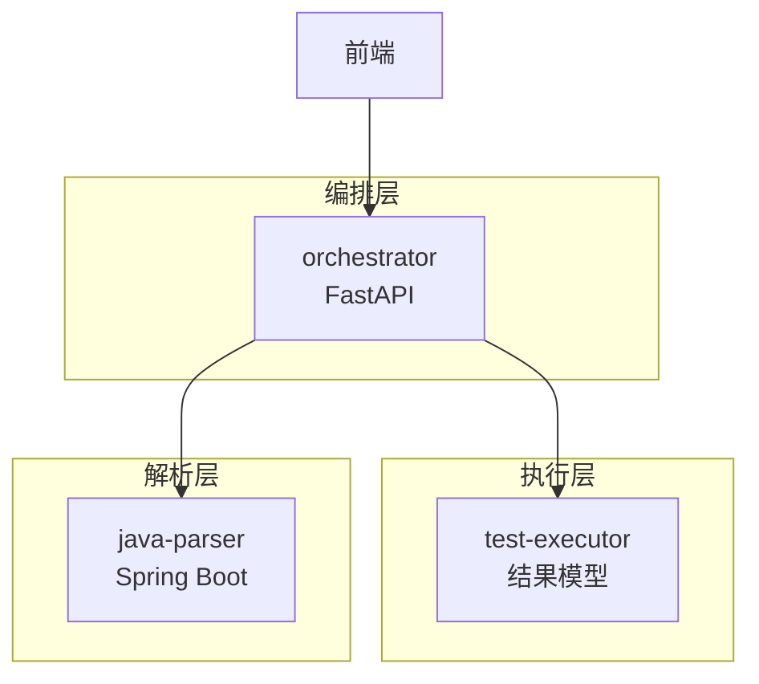
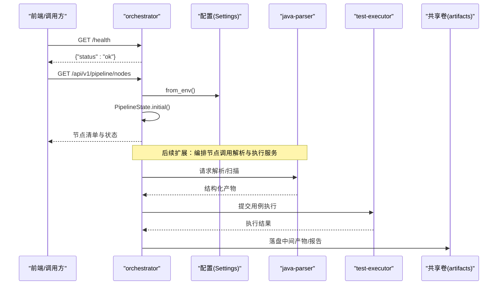
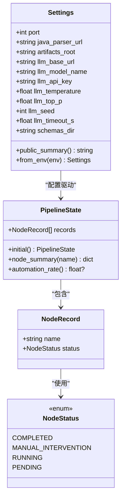
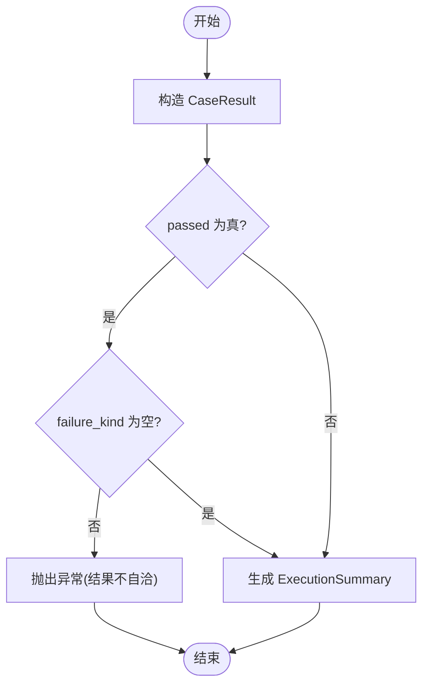
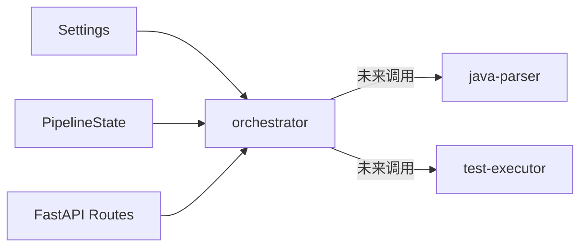
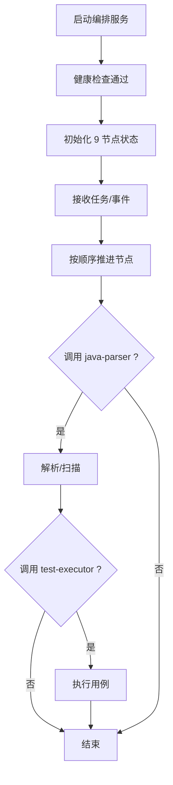

# 执行流程

<cite>
**本文引用的文件**
- [pipeline.py](file://services/orchestrator/src/orchestrator/pipeline.py)
- [api.py](file://services/orchestrator/src/orchestrator/api.py)
- [config.py](file://services/orchestrator/src/orchestrator/config.py)
- [__main__.py](file://services/orchestrator/src/orchestrator/__main__.py)
- [result.py](file://services/test-executor/src/executor/result.py)
- [ParserApplication.java](file://services/java-parser/src/main/java/com/llmautotest/parser/ParserApplication.java)
- [HealthController.java](file://services/java-parser/src/main/java/com/llmautotest/parser/HealthController.java)
- [docker-compose.yml](file://deploy/docker-compose.yml)
</cite>

## 目录
1. [简介](#简介)
2. [项目结构](#项目结构)
3. [核心组件](#核心组件)
4. [架构总览](#架构总览)
5. [详细组件分析](#详细组件分析)
6. [依赖关系分析](#依赖关系分析)
7. [性能考量](#性能考量)
8. [故障排查指南](#故障排查指南)
9. [结论](#结论)
10. [附录](#附录)

## 简介
本文件面向“流水线从启动到完成”的完整执行流程，覆盖以下目标：
- API 如何触发流水线执行
- 节点间的协调机制与数据传递方式
- 并行与串行策略的选择
- 异常处理与重试、失败回滚策略
- 监控指标与进度跟踪的实现方式
- 提供执行流程图与关键路径分析

当前代码库处于骨架阶段：编排服务暴露 REST API 并维护固定 9 节点的顺序与状态；测试执行器定义结果模型；Java 解析服务提供健康检查与后续接口逆向能力。实际调度、调用下游服务、产物落盘、重试与回滚等逻辑在骨架中预留了扩展点。

## 项目结构
- 编排服务（orchestrator）：FastAPI 应用，负责对外暴露 API、读取配置、维护 9 节点顺序与状态。
- 测试执行器（test-executor）：定义用例执行结果的判定模型（断言失败与环境失败分离）。
- Java 解析服务（java-parser）：Spring Boot 服务，提供健康检查端点，后续用于多仓库扫描与接口逆向。
- 部署编排（docker-compose）：统一容器编排、端口映射、卷挂载、健康检查与启动依赖。

图表来源
- [api.py:11-27](file://services/orchestrator/src/orchestrator/api.py#L11-L27)
- [__main__.py:15-21](file://services/orchestrator/src/orchestrator/__main__.py#L15-L21)
- [ParserApplication.java:9-15](file://services/java-parser/src/main/java/com/llmautotest/parser/ParserApplication.java#L9-L15)
- [result.py:17-61](file://services/test-executor/src/executor/result.py#L17-L61)

章节来源
- [docker-compose.yml:1-62](file://deploy/docker-compose.yml#L1-L62)

## 核心组件
- 流水线节点与状态：固定 9 节点顺序与四态（待运行、运行中、已完成、人工介入），并提供自动化率计算入口。
- 配置管理：通过环境变量注入运行时参数（端口、LLM 调用参数、产物根目录、Schema 目录等），并提供安全摘要输出。
- REST API：健康检查与节点清单查询，作为外部系统接入点。
- 执行结果模型：区分断言失败与环境失败，提供汇总统计属性。
- 解析服务：提供健康检查，后续承载代码扫描与接口逆向。

章节来源
- [pipeline.py:11-84](file://services/orchestrator/src/orchestrator/pipeline.py#L11-L84)
- [config.py:9-56](file://services/orchestrator/src/orchestrator/config.py#L9-L56)
- [api.py:11-27](file://services/orchestrator/src/orchestrator/api.py#L11-L27)
- [result.py:10-61](file://services/test-executor/src/executor/result.py#L10-L61)
- [HealthController.java:9-16](file://services/java-parser/src/main/java/com/llmautotest/parser/HealthController.java#L9-L16)

## 架构总览
编排服务作为统一入口，对外暴露 REST API；内部维护 9 节点顺序与状态，并在未来实现中负责：
- 接收上游任务或事件，创建流水线实例
- 按顺序推进节点，将中间产物写入共享卷
- 调用 Java 解析服务与测试执行器
- 记录节点状态、收集指标、处理异常与重试

图表来源
- [api.py:16-25](file://services/orchestrator/src/orchestrator/api.py#L16-L25)
- [config.py:35-56](file://services/orchestrator/src/orchestrator/config.py#L35-L56)
- [PipelineState.initial:51-54](file://services/orchestrator/src/orchestrator/pipeline.py#L51-L54)
- [HealthController.java:12-16](file://services/java-parser/src/main/java/com/llmautotest/parser/HealthController.java#L12-L16)
- [docker-compose.yml:23-31](file://deploy/docker-compose.yml#L23-L31)

## 详细组件分析

### 编排服务（orchestrator）
- 启动流程：CLI 入口加载配置，启动 FastAPI 服务，绑定 0.0.0.0 与指定端口。
- API 层：
  - /health：健康检查，供编排依赖检测。
  - /api/v1/pipeline/nodes：返回 9 节点清单与当前状态（骨架阶段为初始态）。
- 状态模型：
  - 固定 9 节点顺序，四态标注，支持自动化率计算。
  - 节点状态记录以不可变数据结构表达，便于并发安全与可追溯。

图表来源
- [config.py:9-56](file://services/orchestrator/src/orchestrator/config.py#L9-L56)
- [pipeline.py:11-84](file://services/orchestrator/src/orchestrator/pipeline.py#L11-L84)

章节来源
- [__main__.py:15-21](file://services/orchestrator/src/orchestrator/__main__.py#L15-L21)
- [api.py:11-27](file://services/orchestrator/src/orchestrator/api.py#L11-L27)
- [pipeline.py:23-84](file://services/orchestrator/src/orchestrator/pipeline.py#L23-L84)
- [config.py:9-56](file://services/orchestrator/src/orchestrator/config.py#L9-L56)

### 测试执行器（test-executor）
- 结果模型：
  - CaseResult：单条用例结果，包含是否通过及失败类型。
  - ExecutionSummary：汇总统计，区分断言失败与环境失败，提供总数、通过数、两类失败数。
- 约束：通过的用例不得携带失败类型，保证结果自洽。

图表来源
- [result.py:17-61](file://services/test-executor/src/executor/result.py#L17-L61)

章节来源
- [result.py:10-61](file://services/test-executor/src/executor/result.py#L10-L61)

### Java 解析服务（java-parser）
- 服务入口：Spring Boot 应用，提供健康检查端点。
- 角色定位：后续承载多仓库扫描与接口逆向还原，产出结构化接口定义，供编排服务消费。

章节来源
- [ParserApplication.java:9-15](file://services/java-parser/src/main/java/com/llmautotest/parser/ParserApplication.java#L9-L15)
- [HealthController.java:9-16](file://services/java-parser/src/main/java/com/llmautotest/parser/HealthController.java#L9-L16)

### 部署与依赖
- docker-compose 定义了三个核心服务：java-parser、orchestrator、frontend；test-executor 与 mock-services 按 profile 启用。
- 共享卷 artifacts 用于跨服务产物交换。
- 健康检查与 depends_on 确保启动顺序与可用性。

章节来源
- [docker-compose.yml:1-62](file://deploy/docker-compose.yml#L1-L62)

## 依赖关系分析
- orchestrator 依赖：
  - 配置：Settings.from_env 读取环境变量，缺失必填项时抛出异常。
  - 状态：PipelineState 维护节点顺序与状态。
  - API：FastAPI 路由暴露健康检查与节点清单。
- test-executor 被 orchestrator 在未来调度中调用，当前仅提供结果模型。
- java-parser 由 orchestrator 在未来节点中调用，当前提供健康检查。

图表来源
- [config.py:35-56](file://services/orchestrator/src/orchestrator/config.py#L35-L56)
- [pipeline.py:23-84](file://services/orchestrator/src/orchestrator/pipeline.py#L23-L84)
- [api.py:11-27](file://services/orchestrator/src/orchestrator/api.py#L11-L27)

章节来源
- [config.py:35-56](file://services/orchestrator/src/orchestrator/config.py#L35-L56)
- [pipeline.py:23-84](file://services/orchestrator/src/orchestrator/pipeline.py#L23-L84)
- [api.py:11-27](file://services/orchestrator/src/orchestrator/api.py#L11-L27)

## 性能考量
- 节点顺序固定为 9，串行推进可降低复杂度与资源竞争；在后续实现中可按节点特性评估并行化（如独立扫描与生成步骤）。
- LLM 调用参数（温度、top_p、seed、超时）可通过环境变量调整，避免硬编码，便于压测与调优。
- 共享卷 artifacts 作为唯一产物通道，减少网络开销，但需注意并发写入与锁策略。
- 健康检查与 depends_on 保障服务就绪，降低冷启动抖动对整体吞吐的影响。

[本节为通用指导，不直接分析具体文件]

## 故障排查指南
- 配置缺失：Settings.from_env 在缺少必填环境变量时会抛出异常，需检查部署环境变量。
- 健康检查：
  - orchestrator：GET /health 应返回 ok。
  - java-parser：GET /health 应返回 ok 且包含服务标识。
- 启动顺序：docker-compose 通过 depends_on 与 healthcheck 控制启动顺序，若编排失败请检查服务健康端点与端口映射。
- 结果自洽：test-executor 的结果模型在构造时校验一致性，出现不一致会抛异常，需检查用例执行逻辑。

章节来源
- [config.py:35-56](file://services/orchestrator/src/orchestrator/config.py#L35-L56)
- [api.py:16-19](file://services/orchestrator/src/orchestrator/api.py#L16-L19)
- [HealthController.java:12-16](file://services/java-parser/src/main/java/com/llmautotest/parser/HealthController.java#L12-L16)
- [docker-compose.yml:11-16](file://deploy/docker-compose.yml#L11-L16)
- [result.py:25-29](file://services/test-executor/src/executor/result.py#L25-L29)

## 结论
当前骨架实现了：
- 固定 9 节点顺序与状态模型
- 配置集中管理与安全摘要
- 基础 REST API（健康检查与节点清单）
- 测试结果模型（断言失败与环境失败分离）
- 部署编排与健康检查

尚未实现的部分包括：
- 实际的流水线调度与节点执行
- 与 java-parser 和 test-executor 的集成调用
- 产物落盘、重试与回滚策略
- 监控指标与进度跟踪

建议在后续迭代中优先补齐调度与集成，再逐步完善重试、回滚与监控能力。

[本节为总结性内容，不直接分析具体文件]

## 附录

### 执行流程图（概念级）

[此图为概念流程，不对应具体源码文件]

### 关键路径分析
- 关键路径：健康检查 → 初始化状态 → 节点推进 → 解析/执行 → 产物落盘 → 报告汇总。
- 风险点：
  - 配置缺失导致启动失败
  - 下游服务未就绪导致调用失败
  - 产物卷权限或容量问题
  - LLM 调用超时或限流

[本节为通用分析，不直接分析具体文件]