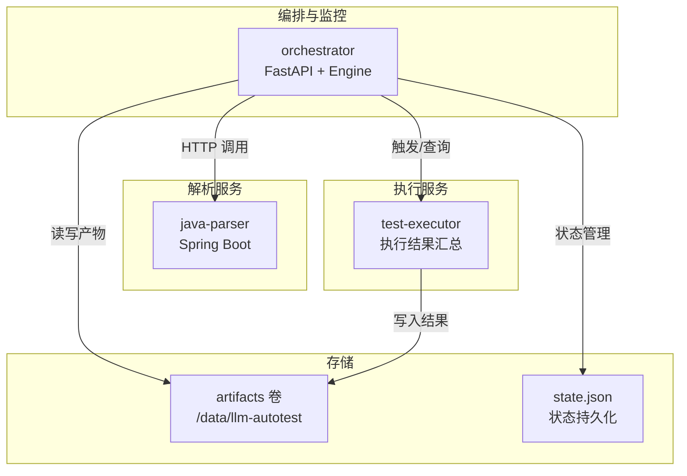
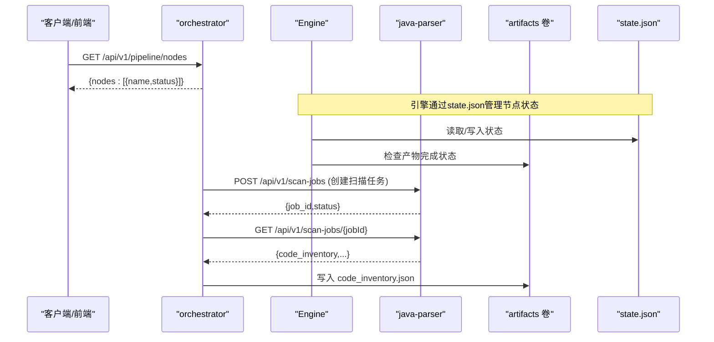
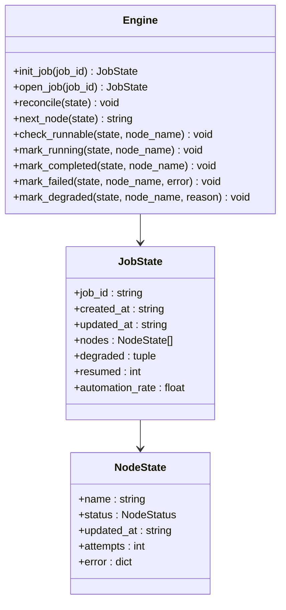
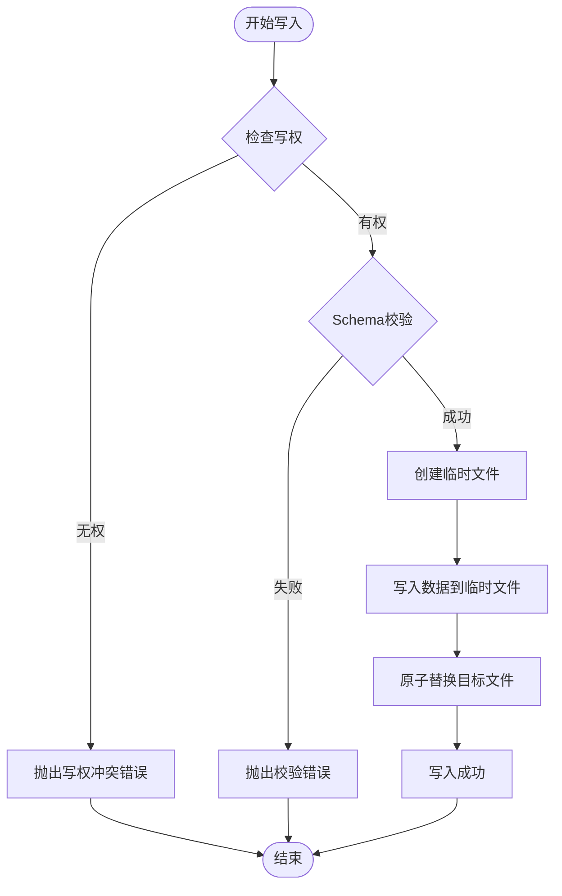
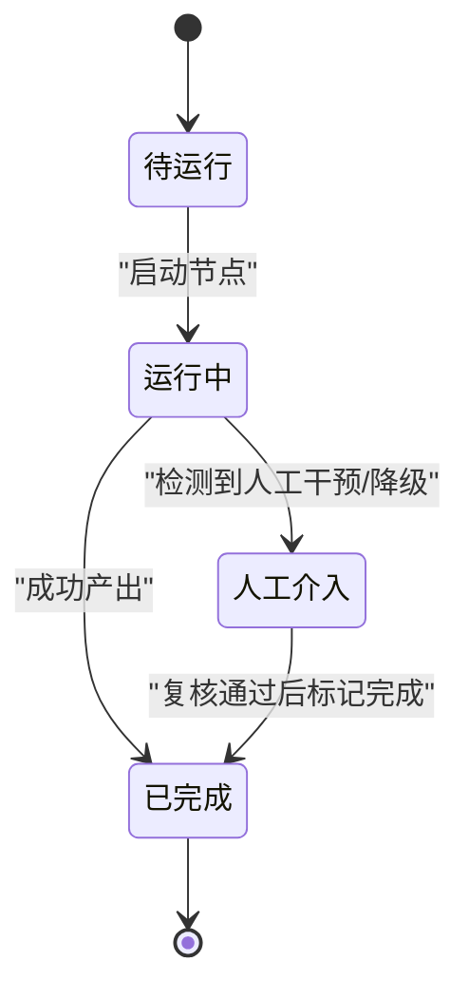
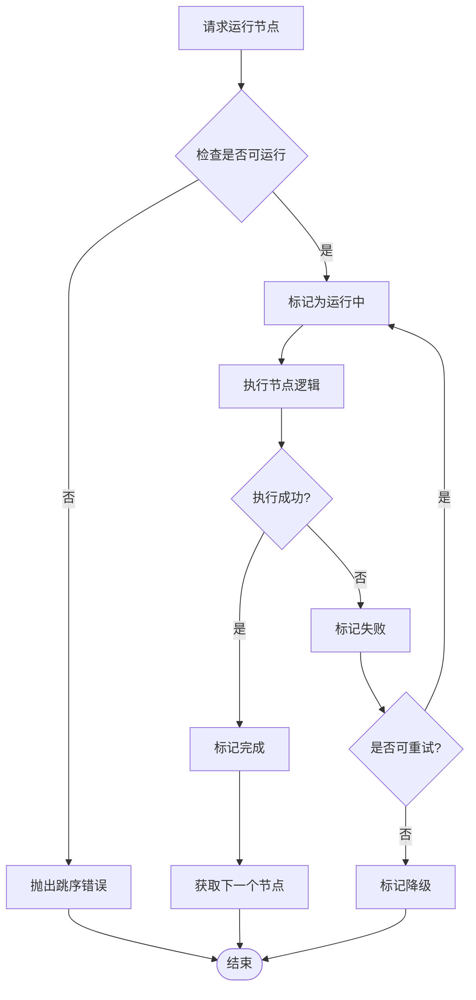
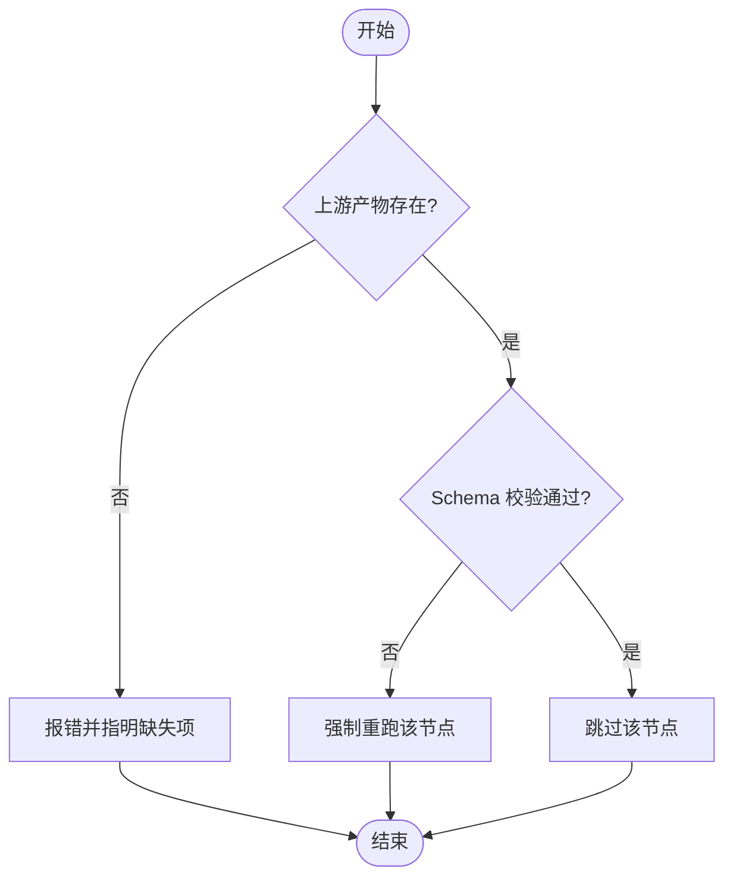
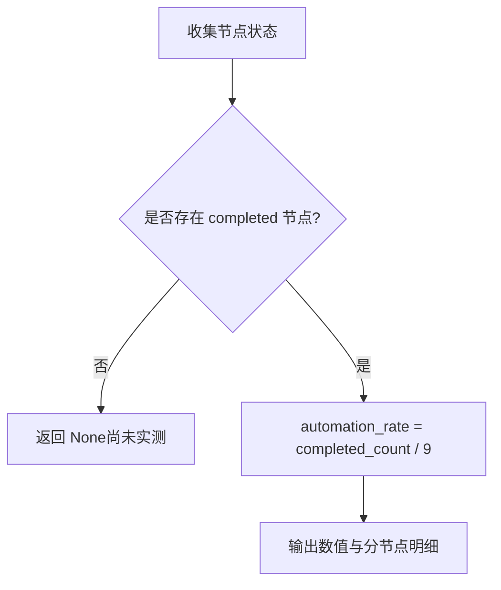
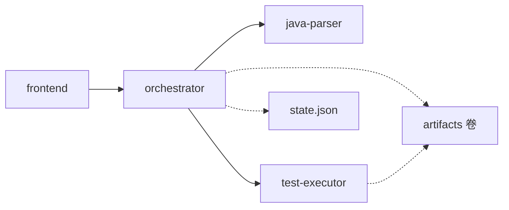

# 流水线架构

<cite>
**本文引用的文件**
- [engine.py](file://services/orchestrator/src/orchestrator/engine.py)
- [pipeline.py](file://services/orchestrator/src/orchestrator/pipeline.py)
- [artifacts.py](file://services/orchestrator/src/orchestrator/artifacts.py)
- [errors.py](file://services/orchestrator/src/orchestrator/errors.py)
- [api.py](file://services/orchestrator/src/orchestrator/api.py)
- [config.py](file://services/orchestrator/src/orchestrator/config.py)
- [__main__.py](file://services/orchestrator/src/orchestrator/__main__.py)
- [result.py](file://services/test-executor/src/executor/result.py)
- [ParserApplication.java](file://services/java-parser/src/main/java/com/llmautotest/parser/ParserApplication.java)
- [docker-compose.yml](file://deploy/docker-compose.yml)
- [java-parser.openapi.yaml](file://schemas/contracts/java-parser.openapi.yaml)
- [04_功能规格说明.md](file://docs/04_功能规格说明.md)
- [07_UI演示设计.md](file://docs/07_UI演示设计.md)
</cite>

## 更新摘要
**变更内容**
- 新增引擎模块状态管理系统，实现state.json持久化和断点续跑能力
- 引入原子文件操作机制，确保状态一致性和数据完整性
- 实现序列保护机制，防止跳序执行和并发冲突
- 增强九节点状态跟踪能力，支持降级处理和自动化率计算
- 完善错误处理策略，提供统一的错误码和异常管理机制

## 目录
1. [引言](#引言)
2. [项目结构](#项目结构)
3. [核心组件](#核心组件)
4. [架构总览](#架构总览)
5. [详细组件分析](#详细组件分析)
6. [依赖关系分析](#依赖关系分析)
7. [性能与可观测性](#性能与可观测性)
8. [故障排查指南](#故障排查指南)
9. [结论](#结论)
10. [附录](#附录)

## 引言
本仓库实现了一个"九节点固定流水线"的编排与度量骨架，围绕需求解析、代码扫描、接口还原、Code Review、用例生成、自动执行、测试报告、缺陷清单、复测回归沉淀九个固定节点展开。系统通过编排器（orchestrator）统一入口，结合外部 Java 解析服务（java-parser）与测试执行器（test-executor），以文件为产物契约进行节点间数据交换，并以四态标注（已完成、人工介入、运行中、待运行）刻画节点状态，最终输出自动化率等度量指标。

**更新** 新增了完整的引擎模块状态管理系统，实现了state.json持久化、断点续跑、序列保护和原子文件操作等关键能力。

## 项目结构
- 编排层：Python FastAPI 服务 orchestrator，提供健康检查与节点清单 API，承载流水线状态模型与自动化率计算骨架。
- 解析层：Java Spring Boot 服务 java-parser，负责多仓库扫描与接口候选提取（静态侧）。
- 执行层：Python 测试执行器 test-executor，负责用例执行结果的结构化汇总与失败二态区分。
- 前端层：Vue 前端用于演示与可视化（当前阶段概念设计为主）。
- 部署：Docker Compose 编排，共享 artifacts 卷作为节点间产物通道。

**图表来源**
- [docker-compose.yml:1-62](file://deploy/docker-compose.yml#L1-L62)
- [api.py:11-27](file://services/orchestrator/src/orchestrator/api.py#L11-L27)
- [ParserApplication.java:1-17](file://services/java-parser/src/main/java/com/llmautotest/parser/ParserApplication.java#L1-L17)
- [engine.py:133-151](file://services/orchestrator/src/orchestrator/engine.py#L133-L151)

章节来源
- [docker-compose.yml:1-62](file://deploy/docker-compose.yml#L1-L62)
- [api.py:11-27](file://services/orchestrator/src/orchestrator/api.py#L11-L27)
- [ParserApplication.java:1-17](file://services/java-parser/src/main/java/com/llmautotest/parser/ParserApplication.java#L1-L17)

## 核心组件
- **引擎模块**：全新的Engine类提供完整的状态管理、断点续跑、序列保护和降级处理能力。
- **流水线状态与节点定义**：固定 9 节点顺序与四态枚举；PipelineState 提供初始态、摘要与自动化率计算。
- **原子文件操作**：ArtifactStore提供原子写入、Schema校验和写权排他机制。
- **REST API**：健康检查与节点清单接口，返回各节点名称与当前状态。
- **配置管理**：从环境变量加载端口、解析服务地址、产物根路径与 LLM 参数，并提供脱敏摘要。
- **执行结果模型**：断言失败与环境失败二态分离，程序化汇总总数、通过数、两类失败数。
- **解析服务契约**：异步 Job 模式，扫描与提取任务创建与状态查询，结构化错误与产物 Schema。

**更新** 新增了Engine模块和增强的ArtifactStore，提供了完整的状态管理和原子操作能力。

章节来源
- [engine.py:133-302](file://services/orchestrator/src/orchestrator/engine.py#L133-L302)
- [pipeline.py:11-83](file://services/orchestrator/src/orchestrator/pipeline.py#L11-L83)
- [artifacts.py:55-157](file://services/orchestrator/src/orchestrator/artifacts.py#L55-L157)
- [api.py:11-27](file://services/orchestrator/src/orchestrator/api.py#L11-L27)
- [config.py:9-56](file://services/orchestrator/src/orchestrator/config.py#L9-L56)
- [result.py:10-61](file://services/test-executor/src/executor/result.py#L10-L61)
- [java-parser.openapi.yaml:1-369](file://schemas/contracts/java-parser.openapi.yaml#L1-L369)

## 架构总览
- **控制面**：orchestrator暴露 /health 与 /api/v1/pipeline/nodes，供前端或编排工具探测与展示。
- **数据面**：节点间通过 artifacts 卷中的结构化 JSON 传递产物，避免内存耦合。
- **状态管理**：Engine模块通过state.json实现持久化状态管理，支持断点续跑和对账机制。
- **扩展点**：java-parser 提供扫描与接口候选提取；test-executor 提供执行结果汇总；未来可扩展更多协议 Runner。
- **部署拓扑**：三个服务共享 artifacts 卷，orchestrator 依赖 java-parser 健康后启动，前端依赖 orchestrator。

**图表来源**
- [api.py:16-25](file://services/orchestrator/src/orchestrator/api.py#L16-L25)
- [engine.py:153-159](file://services/orchestrator/src/orchestrator/engine.py#L153-L159)
- [artifacts.py:75-96](file://services/orchestrator/src/orchestrator/artifacts.py#L75-L96)
- [java-parser.openapi.yaml:24-115](file://schemas/contracts/java-parser.openapi.yaml#L24-L115)
- [docker-compose.yml:18-32](file://deploy/docker-compose.yml#L18-L32)

## 详细组件分析

### 引擎模块与状态管理

**新增** Engine模块是流水线的核心状态管理器，提供完整的生命周期管理能力：

- **JobState管理**：每个流水线作业有独立的JobState，包含节点状态、降级信息和重试计数。
- **NodeState追踪**：每个节点记录状态、更新时间、尝试次数和错误信息。
- **对账机制**：reconcile方法确保状态与产物的一致性，崩溃恢复时自动修正状态。
- **断点续跑**：open_job方法支持从上次中断处继续执行。

**图表来源**
- [engine.py:43-96](file://services/orchestrator/src/orchestrator/engine.py#L43-L96)
- [engine.py:133-265](file://services/orchestrator/src/orchestrator/engine.py#L133-L265)

章节来源
- [engine.py:1-302](file://services/orchestrator/src/orchestrator/engine.py#L1-L302)

### 原子文件操作与序列保护

**新增** ArtifactStore提供原子文件操作和序列保护机制：

- **原子写入**：所有文件写入采用tmp+replace模式，确保操作的原子性。
- **Schema校验**：写入前进行严格的Schema验证，拒绝不合规数据。
- **写权排他**：每个产物文件有明确的写方归属，防止并发冲突。
- **节点完成判据**：基于产物存在性和Schema校验结果判断节点完成状态。

**图表来源**
- [artifacts.py:75-96](file://services/orchestrator/src/orchestrator/artifacts.py#L75-L96)
- [artifacts.py:144-157](file://services/orchestrator/src/orchestrator/artifacts.py#L144-L157)

章节来源
- [artifacts.py:1-157](file://services/orchestrator/src/orchestrator/artifacts.py#L1-L157)

### 九节点与四态标注

- **九节点固定顺序**：req_parse → code_scan → interface_reconstruct → code_review → testcase_generate → auto_execute → test_report → defect_list → retest_regression。该顺序冻结不可增删，分母固定为 9。
- **四态标注**：
  - 已完成：节点成功产出且无降级/人工干预。
  - 人工介入：节点执行期间发生人工修改或命令干预；降级节点按人工介入计入。
  - 运行中：节点正在执行。
  - 待运行：尚未开始。
- **状态持久化**：Engine模块通过state.json实现持久化状态管理，支持崩溃恢复和对账。

**图表来源**
- [pipeline.py:11-21](file://services/orchestrator/src/orchestrator/pipeline.py#L11-L21)
- [engine.py:161-180](file://services/orchestrator/src/orchestrator/engine.py#L161-L180)
- [engine.py:221-261](file://services/orchestrator/src/orchestrator/engine.py#L221-L261)

章节来源
- [pipeline.py:11-83](file://services/orchestrator/src/orchestrator/pipeline.py#L11-L83)
- [engine.py:161-261](file://services/orchestrator/src/orchestrator/engine.py#L161-L261)
- [04_功能规格说明.md:288-313](file://docs/04_功能规格说明.md#L288-L313)

### 序列保护机制

**新增** Engine模块提供完整的序列保护机制：

- **跳序防护**：check_runnable方法确保请求运行的节点其前序节点必须全部完成。
- **降级跳过**：manual_intervention状态的节点会被跳过，流程继续推进后续节点。
- **依赖检查**：NODE_ARTIFACTS定义每个节点的产物依赖，确保执行顺序正确。

**图表来源**
- [engine.py:196-220](file://services/orchestrator/src/orchestrator/engine.py#L196-L220)
- [engine.py:221-250](file://services/orchestrator/src/orchestrator/engine.py#L221-L250)

章节来源
- [engine.py:196-250](file://services/orchestrator/src/orchestrator/engine.py#L196-L250)

### 节点职责与输入输出
- **需求解析（req_parse）**：输入文档（docx/md/xlsx），输出 requirements.json。
- **代码扫描（code_scan）**：输入仓库路径列表，输出 code_inventory.json。
- **接口还原（interface_reconstruct）**：基于 code_inventory 与源文件内容，输出 interfaces.json（含协议、签名、位置溯源）。
- **Code Review（code_review）**：生成 mapping.json、risk_list.json、missing_features.json，并支持人工审核回流。
- **用例生成（testcase_generate）**：依据 interfaces.json 与 requirements.json，生成可执行脚本与 cases.json。
- **自动执行（auto_execute）**：按协议路由到对应 Runner，输出 execution.json，区分断言失败与环境失败。
- **测试报告（test_report）**：基于 execution.json 生成 Markdown + JSON 报告，包含通过率与降级说明。
- **缺陷清单（defect_list）**：仅断言失败进入缺陷清单，环境失败隔离至待环境确认。
- **复测回归（retest_regression）**：对通过复测的用例归档至回归目录，形成回归套件与资产索引。

章节来源
- [04_功能规格说明.md:35-285](file://docs/04_功能规格说明.md#L35-L285)

### 执行顺序与依赖控制
- **顺序控制**：NODE_ORDER 严格规定执行顺序，上游产物缺失时下游拒绝启动。
- **断点续跑**：若某节点产物已存在且 Schema 校验通过，则跳过该节点；否则强制重跑。
- **产物契约**：节点间以文件为接口，落盘到 artifacts_root 下的固定目录，避免内存耦合。

**图表来源**
- [04_功能规格说明.md:21-31](file://docs/04_功能规格说明.md#L21-L31)

章节来源
- [04_功能规格说明.md:21-31](file://docs/04_功能规格说明.md#L21-L31)

### 自动化率计算与监控指标
- **自动化率**：completed 节点数 / 9（分母固定不缩减），降级节点按人工介入计入。
- **指标采集**：消费编排器节点执行日志，并结合运行后的人工标注复核（半自动方案）。
- **报告呈现**：报告中显式标注降级环节与瓶颈分析（介入原因 + 可自动化路径建议）。

**更新** Engine模块的JobState.automation_rate属性提供程序化的自动化率计算。

**图表来源**
- [engine.py:127-130](file://services/orchestrator/src/orchestrator/engine.py#L127-L130)
- [pipeline.py:61-70](file://services/orchestrator/src/orchestrator/pipeline.py#L61-L70)
- [04_功能规格说明.md:288-313](file://docs/04_功能规格说明.md#L288-L313)

章节来源
- [engine.py:127-130](file://services/orchestrator/src/orchestrator/engine.py#L127-L130)
- [pipeline.py:61-70](file://services/orchestrator/src/orchestrator/pipeline.py#L61-L70)
- [04_功能规格说明.md:288-313](file://docs/04_功能规格说明.md#L288-L313)

### 错误处理策略
- **节点失败**：停止后续节点，输出失败节点与原因，保留已产出产物。
- **产物 Schema 不通过**：拒绝复用，强制重跑。
- **执行失败分类**：断言失败计入缺陷清单；环境失败隔离至待环境确认，不计入通过率分母。
- **报告异常**：execution.json 缺失/损坏时禁止产出空报告。
- **统一错误码**：X-ORCH-01表示产物校验失败，X-ORCH-02表示断点续跑跳序请求。

**更新** 引入了统一的PipelineError类和标准化的错误码体系。

章节来源
- [04_功能规格说明.md:27-31](file://docs/04_功能规格说明.md#L27-L31)
- [04_功能规格说明.md:211-232](file://docs/04_功能规格说明.md#L211-L232)
- [result.py:10-61](file://services/test-executor/src/executor/result.py#L10-L61)
- [errors.py:1-38](file://services/orchestrator/src/orchestrator/errors.py#L1-L38)

## 依赖关系分析
- **orchestrator 依赖**：
  - java-parser：通过 HTTP 发起扫描与提取任务，轮询状态与产物。
  - artifacts 卷：所有节点产物落盘位置，确保跨进程/容器共享。
  - test-executor：执行用例并汇总结果（当前以 result.py 数据结构为契约基础）。
- **部署依赖**：
  - docker-compose 中 orchestrator 依赖 java-parser 健康检查通过后再启动。
  - frontend 依赖 orchestrator 可用。

**更新** Engine模块增加了state.json的依赖，用于状态持久化。

**图表来源**
- [docker-compose.yml:18-41](file://deploy/docker-compose.yml#L18-L41)
- [api.py:11-27](file://services/orchestrator/src/orchestrator/api.py#L11-L27)
- [java-parser.openapi.yaml:24-115](file://schemas/contracts/java-parser.openapi.yaml#L24-L115)
- [engine.py:267-302](file://services/orchestrator/src/orchestrator/engine.py#L267-L302)

章节来源
- [docker-compose.yml:1-62](file://deploy/docker-compose.yml#L1-L62)
- [java-parser.openapi.yaml:1-369](file://schemas/contracts/java-parser.openapi.yaml#L1-L369)

## 性能与可观测性
- **长任务异步化**：java-parser 采用 job 模式（POST 创建 → GET 轮询），降低阻塞时间。
- **Token 用量控制**：接口还原采用"静态特征定位 + 分块上下文"，减少单次大上下文调用。
- **可观测性**：
  - 健康检查：/health 用于编排与健康探针。
  - 日志：节点执行日志自动记录（命令清单、产物变更时间戳），支撑人工标注复核。
  - 报告：Markdown + JSON 双产物，便于人类阅读与机器消费。
  - **状态追踪**：state.json提供完整的执行历史和状态变更追踪。

**更新** 新增了state.json状态追踪和原子操作的可观测性支持。

章节来源
- [java-parser.openapi.yaml:24-115](file://schemas/contracts/java-parser.openapi.yaml#L24-L115)
- [04_功能规格说明.md:103-116](file://docs/04_功能规格说明.md#L103-L116)
- [04_功能规格说明.md:211-232](file://docs/04_功能规格说明.md#L211-L232)
- [engine.py:294-302](file://services/orchestrator/src/orchestrator/engine.py#L294-L302)

## 故障排查指南
- **节点无法启动**：检查上游产物是否存在且 Schema 校验通过；查看缺失项报错信息。
- **自动化率为 None**：尚无 completed 节点，等待执行推进或从产物卷读取真实状态。
- **执行失败类型区分**：
  - 断言失败：进入缺陷清单，需复测与关闭建议。
  - 环境失败：隔离至待环境确认，不影响通过率分母。
- **报告为空**：检查 execution.json 是否缺失或损坏，禁止产出空报告。
- **降级场景**：MQ 等协议可能降级为"脚本生成成功 + Mock 执行演示"，报告中需显式说明。
- **状态不一致**：使用Engine.reconcile方法进行状态对账，自动修复状态与产物的不一致。
- **序列冲突**：检查check_runnable方法的跳序保护，确保前序节点已完成。

**更新** 新增了状态对账和序列冲突的故障排查指导。

章节来源
- [04_功能规格说明.md:27-31](file://docs/04_功能规格说明.md#L27-L31)
- [04_功能规格说明.md:211-232](file://docs/04_功能规格说明.md#L211-L232)
- [result.py:10-61](file://services/test-executor/src/executor/result.py#L10-L61)
- [engine.py:161-180](file://services/orchestrator/src/orchestrator/engine.py#L161-L180)
- [engine.py:196-220](file://services/orchestrator/src/orchestrator/engine.py#L196-L220)

## 结论
本架构以"九节点固定口径"为核心，通过编排器统一入口、文件契约解耦、四态标注与程序化度量，实现了端到端测试流水线的骨架能力。当前阶段重点在于：
- **固化节点顺序与状态模型**，确保度量口径一致。
- **通过Engine模块实现完整状态管理**，支持断点续跑和崩溃恢复。
- **引入原子文件操作和序列保护**，确保数据一致性和执行顺序正确。
- **通过 java-parser 与 test-executor 扩展解析与执行能力**。
- **以 artifacts 卷为纽带**，实现跨服务产物共享与断点续跑。

**更新** 新增的Engine模块显著增强了系统的可靠性和可维护性，提供了生产级别的状态管理和错误处理能力。

后续应完善状态持久化、更丰富的协议支持与更强的可观测性，以提升规模化落地能力。

## 附录
- **入口与配置**：
  - 服务入口：orchestrator 通过 __main__.py 启动 FastAPI 应用，监听端口由环境变量决定。
  - 配置项：端口、java-parser URL、产物根路径、LLM 基线参数（仅 GLM-5.3）。
- **UI 演示**：
  - 六页概念图覆盖任务配置、流水线总览、Code Review 三视图、测试报告、缺陷闭环、回归沉淀与度量。
  - 演示数据为示意值，需替换为实测值；降级与兜底结果需单独标注。

**更新** Engine模块提供了完整的状态管理和原子操作能力，为生产环境部署奠定了基础。

章节来源
- [__main__.py:15-26](file://services/orchestrator/src/orchestrator/__main__.py#L15-L26)
- [config.py:9-56](file://services/orchestrator/src/orchestrator/config.py#L9-L56)
- [07_UI演示设计.md:18-85](file://docs/07_UI演示设计.md#L18-L85)
- [engine.py:133-302](file://services/orchestrator/src/orchestrator/engine.py#L133-L302)