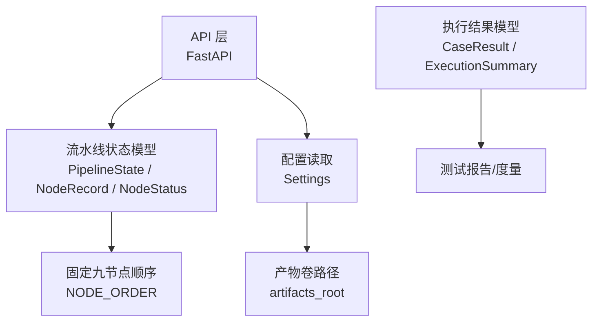
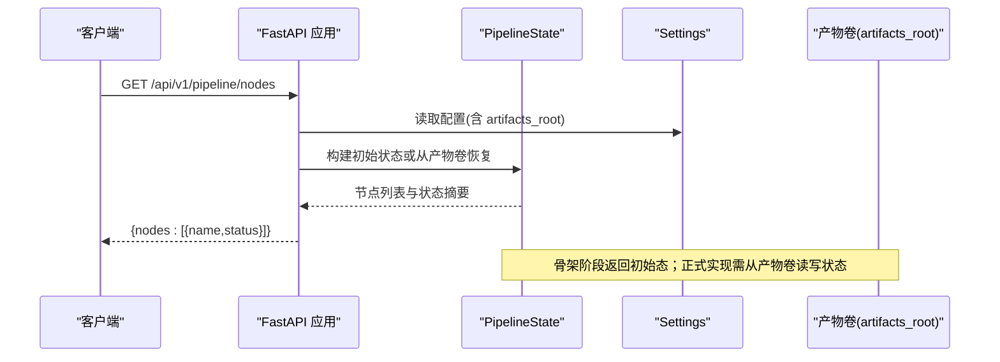
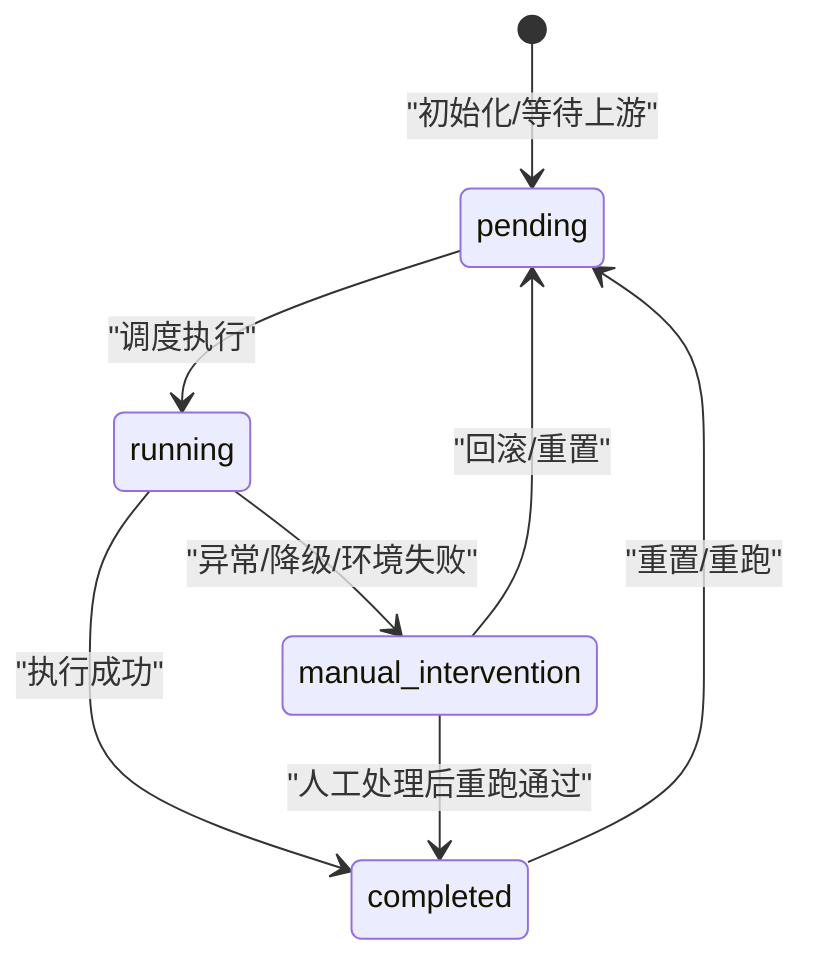
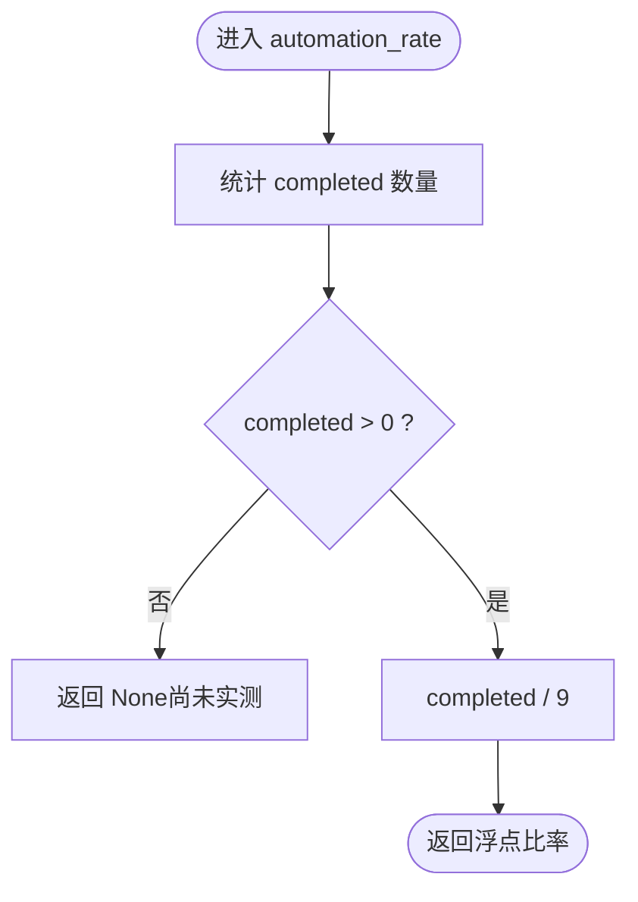
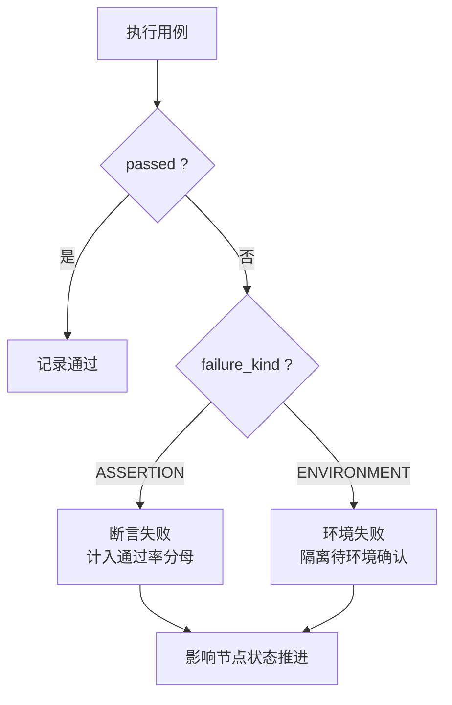
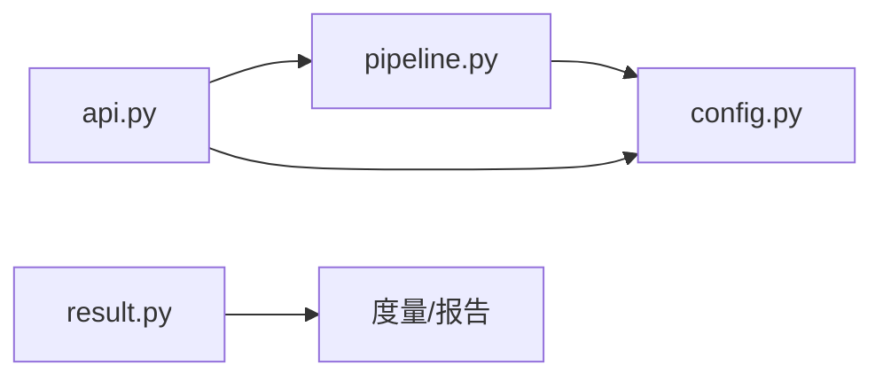

# 状态管理

<cite>
**本文引用的文件**
- [pipeline.py](file://services/orchestrator/src/orchestrator/pipeline.py)
- [api.py](file://services/orchestrator/src/orchestrator/api.py)
- [config.py](file://services/orchestrator/src/orchestrator/config.py)
- [result.py](file://services/test-executor/src/executor/result.py)
- [06_需求定稿冻结.md](file://docs/06_需求定稿冻结.md)
- [04_功能规格说明.md](file://docs/04_功能规格说明.md)
- [07_UI演示设计.md](file://docs/07_UI演示设计.md)
</cite>

## 目录
1. [引言](#引言)
2. [项目结构](#项目结构)
3. [核心组件](#核心组件)
4. [架构总览](#架构总览)
5. [详细组件分析](#详细组件分析)
6. [依赖关系分析](#依赖关系分析)
7. [性能考量](#性能考量)
8. [故障排查指南](#故障排查指南)
9. [结论](#结论)
10. [附录](#附录)

## 引言
本文件聚焦“流水线四态标注系统”的状态管理机制，围绕 NodeStatus 的四种状态（completed、manual_intervention、running、pending）进行系统化解析，阐明 NodeRecord 与 PipelineState 的职责边界，说明状态持久化策略与自动化率计算逻辑，并给出状态转换图与错误降级处理机制。文档严格基于仓库内源码与规范文档，确保口径一致、可追溯。

## 项目结构
与状态管理直接相关的代码位于 orchestrator 服务与 test-executor 服务：
- orchestrator 提供流水线节点定义、状态模型与对外 API；
- test-executor 提供执行结果判定（断言失败与环境失败分离），为后续状态推进提供输入依据；
- 配置通过环境变量注入，产物卷路径由配置指定，用于状态持久化。

图表来源
- [api.py:11-27](file://services/orchestrator/src/orchestrator/api.py#L11-L27)
- [pipeline.py:11-83](file://services/orchestrator/src/orchestrator/pipeline.py#L11-L83)
- [config.py:9-56](file://services/orchestrator/src/orchestrator/config.py#L9-L56)
- [result.py:10-61](file://services/test-executor/src/executor/result.py#L10-L61)

章节来源
- [api.py:11-27](file://services/orchestrator/src/orchestrator/api.py#L11-L27)
- [pipeline.py:11-83](file://services/orchestrator/src/orchestrator/pipeline.py#L11-L83)
- [config.py:9-56](file://services/orchestrator/src/orchestrator/config.py#L9-L56)
- [result.py:10-61](file://services/test-executor/src/executor/result.py#L10-L61)

## 核心组件
- NodeStatus：节点四态枚举，定义 completed、manual_intervention、running、pending 四种状态。
- NodeRecord：不可变数据类，记录单个节点的 name 与 status。
- PipelineState：不可变数据类，维护整条流水线的 records 集合，并提供初始态构造、单节点摘要查询与自动化率计算。
- NODE_ORDER：固定九节点顺序，作为分母与执行顺序的权威来源。
- Settings：从环境变量加载运行配置，包含 artifacts_root 等关键路径。
- CaseResult / ExecutionSummary：执行结果二态（断言失败/环境失败）与汇总能力，为状态推进与度量提供输入。

章节来源
- [pipeline.py:11-83](file://services/orchestrator/src/orchestrator/pipeline.py#L11-L83)
- [config.py:9-56](file://services/orchestrator/src/orchestrator/config.py#L9-L56)
- [result.py:10-61](file://services/test-executor/src/executor/result.py#L10-L61)

## 架构总览
状态管理的职责分层如下：
- API 层：暴露健康检查与节点清单接口，返回当前各节点状态摘要。
- 状态模型层：以不可变数据结构表达节点与流水线状态，保证并发安全与可审计性。
- 执行结果层：将用例执行结果按“断言失败/环境失败”分类，支撑通过率与自动化率的程序化汇总。
- 配置与持久化：通过配置指定产物卷根路径，真实状态在正式实现中落盘于产物卷。

图表来源
- [api.py:11-27](file://services/orchestrator/src/orchestrator/api.py#L11-L27)
- [pipeline.py:45-70](file://services/orchestrator/src/orchestrator/pipeline.py#L45-L70)
- [config.py:9-56](file://services/orchestrator/src/orchestrator/config.py#L9-L56)

## 详细组件分析

### NodeStatus 四态语义与转换规则
- pending（待运行）：节点尚未开始执行，处于等待上游完成或调度触发。
- running（运行中）：节点正在执行，可能涉及 LLM 调用、脚本生成或执行器调用。
- completed（已完成）：节点成功产出预期产物，且满足验收标准（如结构化产物、断言明确）。
- manual_intervention（人工介入）：需要人工确认、修复或决策；包括降级节点按“人工介入”计入（D1）。

转换规则（结合规范与实现意图）：
- pending → running：调度器或上游节点完成后触发。
- running → completed：执行成功并产出有效产物。
- running → manual_intervention：执行异常、LLM 输出不合规、环境失败或降级触发。
- manual_intervention → completed：人工处理后重新执行并通过。
- 任意状态 → pending：流程回滚或重置时（例如断点续跑前清理）。

图表来源
- [pipeline.py:11-21](file://services/orchestrator/src/orchestrator/pipeline.py#L11-L21)
- [06_需求定稿冻结.md:41-49](file://docs/06_需求定稿冻结.md#L41-L49)
- [04_功能规格说明.md:308-312](file://docs/04_功能规格说明.md#L308-L312)

章节来源
- [pipeline.py:11-21](file://services/orchestrator/src/orchestrator/pipeline.py#L11-L21)
- [06_需求定稿冻结.md:41-49](file://docs/06_需求定稿冻结.md#L41-L49)
- [04_功能规格说明.md:308-312](file://docs/04_功能规格说明.md#L308-L312)

### NodeRecord：单节点状态记录
- 字段：name（节点名）、status（四态之一）。
- 不可变性：使用 frozen dataclass，避免运行时被意外修改，便于快照与审计。
- 用途：作为 PipelineState.records 的元素，承载每个节点的状态快照。

章节来源
- [pipeline.py:37-43](file://services/orchestrator/src/orchestrator/pipeline.py#L37-L43)

### PipelineState：流水线状态集合与管理
- 字段：records（NodeRecord 元组），表示整条流水线的节点状态集合。
- initial()：创建全部节点为 pending 的初始态，符合“启动即待运行”的约定。
- node_summary(name)：按节点名查询其摘要（name + status），供 API 返回。
- automation_rate：自动化率 = 已完成节点数 / 9；若无 completed 则返回 None，表示尚未实测。

图表来源
- [pipeline.py:51-70](file://services/orchestrator/src/orchestrator/pipeline.py#L51-L70)

章节来源
- [pipeline.py:45-70](file://services/orchestrator/src/orchestrator/pipeline.py#L45-L70)

### 状态持久化策略
- 骨架阶段：PipelineState.initial() 返回内存中的初始态，API 直接返回该快照。
- 正式实现：注释明确“真实状态持久化于产物卷”，通过 Settings.artifacts_root 指定根路径；状态应序列化到产物卷并在请求时恢复，以实现跨进程/重启后的状态一致性。
- 产物卷作用：保存中间产物与状态快照，支持断点续跑与审计回溯。

章节来源
- [pipeline.py:45-48](file://services/orchestrator/src/orchestrator/pipeline.py#L45-L48)
- [config.py:9-56](file://services/orchestrator/src/orchestrator/config.py#L9-L56)

### 自动化率计算逻辑
- 公式：automation_rate = completed_count / 9（分母固定为 9，禁止缩减）。
- 降级节点：按“人工介入”计入，不减少分母（D1）。
- 未实测场景：若无 completed，返回 None，避免误导。
- 程序化汇总：数值不经 LLM，确保客观性与可复现性（F-MTR-03）。

章节来源
- [pipeline.py:61-70](file://services/orchestrator/src/orchestrator/pipeline.py#L61-L70)
- [06_需求定稿冻结.md:41-49](file://docs/06_需求定稿冻结.md#L41-L49)
- [04_功能规格说明.md:308-312](file://docs/04_功能规格说明.md#L308-L312)

### 执行结果与状态推进（断言失败 vs 环境失败）
- FailureKind：区分 ASSERTION（断言失败）与 ENVIRONMENT（环境失败）。
- CaseResult：单条用例结果，包含 case_id、passed、failure_kind；通过后不得携带失败类型（一致性校验）。
- ExecutionSummary：汇总 total、passed、failed_assertion、failed_environment；环境失败隔离至“待环境确认”，不计入通过率分母。
- 对状态的影响：
  - 断言失败：通常标记为 manual_intervention，进入人工复核或重试分支。
  - 环境失败：隔离至待环境确认，不直接影响自动化率分母，但可能阻塞下游节点直至环境修复。

图表来源
- [result.py:10-61](file://services/test-executor/src/executor/result.py#L10-L61)

章节来源
- [result.py:10-61](file://services/test-executor/src/executor/result.py#L10-L61)

### 错误降级与兜底机制
- 降级节点按“人工介入”计入自动化率（D1），报告中注明降级清单与原因。
- 当某节点无法达成 AC 要求（如接口识别不足），输出告警并提示切换兜底演示仓库；兜底结果单独标注、不计入 G3。
- 兜底仓库结果与真实仓库结果分列呈现，避免虚假正向结论（D5）。

章节来源
- [06_需求定稿冻结.md:41-49](file://docs/06_需求定稿冻结.md#L41-L49)
- [04_功能规格说明.md:110-116](file://docs/04_功能规格说明.md#L110-L116)
- [04_功能规格说明.md:308-312](file://docs/04_功能规格说明.md#L308-L312)

## 依赖关系分析
- API 层依赖 pipeline 模块获取节点清单与状态摘要。
- PipelineState 依赖 NODE_ORDER 确定分母与顺序。
- Settings 提供 artifacts_root 等运行参数，决定状态持久化位置。
- test-executor 的结果模型为状态推进与度量提供输入，但不直接耦合 pipeline 模块。

图表来源
- [api.py:11-27](file://services/orchestrator/src/orchestrator/api.py#L11-L27)
- [pipeline.py:11-83](file://services/orchestrator/src/orchestrator/pipeline.py#L11-L83)
- [config.py:9-56](file://services/orchestrator/src/orchestrator/config.py#L9-L56)
- [result.py:10-61](file://services/test-executor/src/executor/result.py#L10-L61)

章节来源
- [api.py:11-27](file://services/orchestrator/src/orchestrator/api.py#L11-L27)
- [pipeline.py:11-83](file://services/orchestrator/src/orchestrator/pipeline.py#L11-L83)
- [config.py:9-56](file://services/orchestrator/src/orchestrator/config.py#L9-L56)
- [result.py:10-61](file://services/test-executor/src/executor/result.py#L10-L61)

## 性能考量
- 不可变数据结构：NodeRecord 与 PipelineState 使用 frozen dataclass，降低并发写入风险，提升可审计性与缓存友好度。
- 固定分母与程序化汇总：自动化率计算简单高效，避免 LLM 参与带来的不确定性与延迟。
- 产物卷 I/O：正式实现需在请求时从产物卷恢复状态，建议引入缓存与增量更新以减少磁盘访问开销。

[本节为通用指导，不直接分析具体文件]

## 故障排查指南
- 自动化率为 None：表示尚无 completed 节点，属于正常初始态；检查是否已执行至少一个节点并产出有效产物。
- 节点长期处于 manual_intervention：核查是否存在断言失败或环境失败；根据 result.py 的分类定位问题类型。
- 降级节点影响自动化率：确认降级原因与清单，按 D1 口径计入人工介入，不缩减分母。
- 产物卷路径配置：检查 Settings.artifacts_root 是否正确设置，确保状态可持久化与恢复。

章节来源
- [pipeline.py:61-70](file://services/orchestrator/src/orchestrator/pipeline.py#L61-L70)
- [result.py:10-61](file://services/test-executor/src/executor/result.py#L10-L61)
- [config.py:9-56](file://services/orchestrator/src/orchestrator/config.py#L9-L56)

## 结论
本系统以 NodeStatus 的四态为核心，配合 NodeRecord 与 PipelineState 的不可变模型，实现了清晰、可审计的流水线状态管理。自动化率采用固定分母与程序化汇总，确保口径一致与结果可信。状态持久化通过产物卷实现，支持断点续跑与审计回溯。错误降级与环境失败隔离机制提升了系统的鲁棒性与可观测性。后续实施应重点完善状态落盘与恢复逻辑，以及更细粒度的状态转换控制。

[本节为总结性内容，不直接分析具体文件]

## 附录
- 九节点固定顺序：req_parse、code_scan、interface_reconstruct、code_review、testcase_generate、auto_execute、test_report、defect_list、retest_regression。
- 关键规范裁决：D1 降级节点按人工介入计入；X-MTR-01 某节点降级跳过仍按人工介入计入；X-MTR-02 节点标记数据缺失时标“数据不完整”。

章节来源
- [pipeline.py:23-34](file://services/orchestrator/src/orchestrator/pipeline.py#L23-L34)
- [06_需求定稿冻结.md:41-49](file://docs/06_需求定稿冻结.md#L41-L49)
- [04_功能规格说明.md:308-312](file://docs/04_功能规格说明.md#L308-L312)