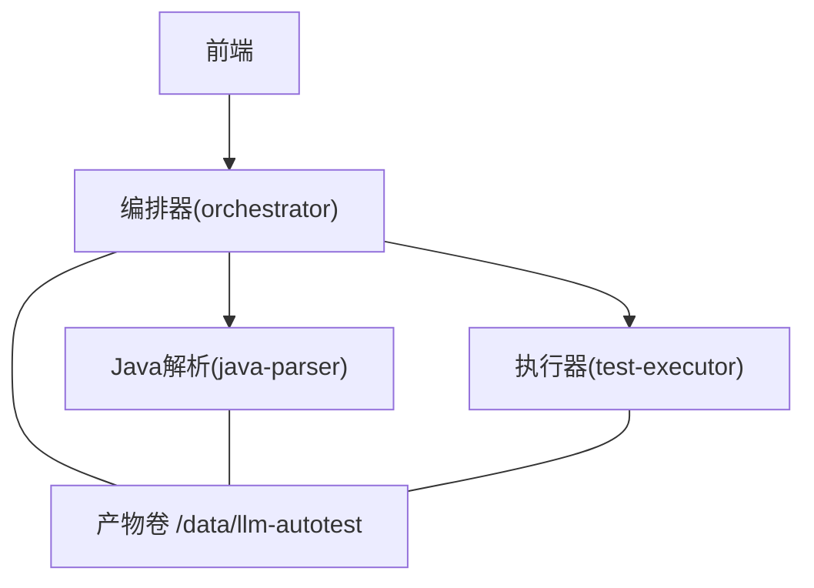
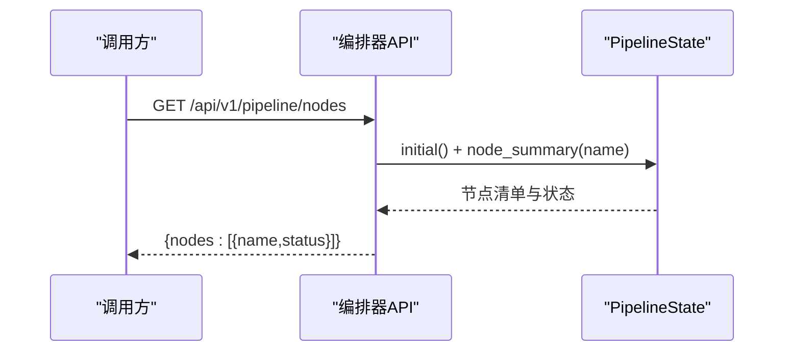
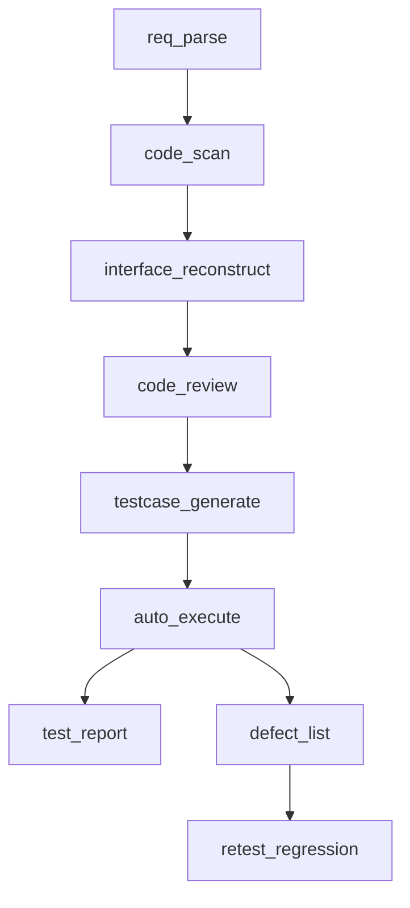

# 节点设计

<cite>
**本文引用的文件**
- [pipeline.py](file://services/orchestrator/src/orchestrator/pipeline.py)
- [api.py](file://services/orchestrator/src/orchestrator/api.py)
- [config.py](file://services/orchestrator/src/orchestrator/config.py)
- [__main__.py](file://services/orchestrator/src/orchestrator/__main__.py)
- [result.py](file://services/test-executor/src/executor/result.py)
- [java-parser.openapi.yaml](file://schemas/contracts/java-parser.openapi.yaml)
- [docker-compose.yml](file://deploy/docker-compose.yml)
- [04_功能规格说明.md](file://docs/04_功能规格说明.md)
- [02_立项提案.md](file://docs/02_立项提案.md)
- [06_需求定稿冻结.md](file://docs/06_需求定稿冻结.md)
- [11_三人分工任务书.md](file://docs/11_三人分工任务书.md)
- [09_开发规范说明.md](file://docs/09_开发规范说明.md)
</cite>

## 目录
1. [引言](#引言)
2. [项目结构](#项目结构)
3. [核心组件](#核心组件)
4. [架构总览](#架构总览)
5. [详细节点分析](#详细节点分析)
6. [依赖关系与执行顺序](#依赖关系与执行顺序)
7. [固定口径的设计决策](#固定口径的设计决策)
8. [扩展点与自定义可能性](#扩展点与自定义可能性)
9. [性能与可靠性考量](#性能与可靠性考量)
10. [故障排查指南](#故障排查指南)
11. [结论](#结论)

## 引言
本文件聚焦“九节点固定流水线”的每个节点设计，围绕职责、输入输出、处理逻辑、上下游依赖、执行顺序约束以及为何采用“固定口径”展开。系统以编排器（orchestrator）为核心，串联需求解析、代码扫描、接口重构、代码审查、用例生成、自动执行、测试报告、缺陷列表、回归重测九个节点；通过契约化的产物与统一的度量口径，确保端到端可观测、可复现、可扩展。

## 项目结构
仓库采用多服务 monorepo：
- orchestrator：Python FastAPI 服务，定义并暴露 9 节点清单、健康检查、配置加载与启动入口。
- java-parser：Java 服务，提供多仓库扫描与接口候选提取的异步 Job API。
- test-executor：Python 服务骨架，负责执行结果判定（断言失败与环境失败分离）。
- frontend：前端页面（待联调）。
- schemas：跨服务契约（OpenAPI/JSON Schema）。
- deploy：容器编排（docker-compose），统一挂载产物卷。

图表来源
- [docker-compose.yml:1-62](file://deploy/docker-compose.yml#L1-L62)
- [api.py:11-27](file://services/orchestrator/src/orchestrator/api.py#L11-L27)
- [pipeline.py:23-34](file://services/orchestrator/src/orchestrator/pipeline.py#L23-L34)

章节来源
- [docker-compose.yml:1-62](file://deploy/docker-compose.yml#L1-L62)
- [api.py:1-27](file://services/orchestrator/src/orchestrator/api.py#L1-L27)
- [pipeline.py:1-84](file://services/orchestrator/src/orchestrator/pipeline.py#L1-L84)

## 核心组件
- 节点顺序与状态模型：固定 9 节点顺序、四态标注（completed/manual_intervention/running/pending）、自动化率计算分母固定为 9。
- 配置加载：从环境变量读取端口、上游服务地址、LLM 参数等，禁止硬编码。
- REST API：健康检查与 9 节点清单查询（骨架阶段返回初始状态）。
- 执行结果二态：断言失败与环境失败分离，影响通过率与缺陷清单。

章节来源
- [pipeline.py:11-70](file://services/orchestrator/src/orchestrator/pipeline.py#L11-L70)
- [config.py:9-50](file://services/orchestrator/src/orchestrator/config.py#L9-L50)
- [api.py:11-27](file://services/orchestrator/src/orchestrator/api.py#L11-L27)
- [result.py:10-61](file://services/test-executor/src/executor/result.py#L10-L61)

## 架构总览
编排器作为控制面，按固定顺序驱动各节点；节点间通过“文件即接口”的产物卷交换数据；java-parser 提供静态分析与候选提取；test-executor 产出结构化执行结果；前端消费编排器 API 展示流水线状态与指标。

图表来源
- [api.py:21-26](file://services/orchestrator/src/orchestrator/api.py#L21-L26)
- [pipeline.py:45-60](file://services/orchestrator/src/orchestrator/pipeline.py#L45-L60)

章节来源
- [api.py:11-27](file://services/orchestrator/src/orchestrator/api.py#L11-L27)
- [pipeline.py:45-70](file://services/orchestrator/src/orchestrator/pipeline.py#L45-L70)

## 详细节点分析

### 节点1：req_parse（需求解析）
- 职责：将 Word/Markdown/Excel 需求文档解析为结构化需求条目 JSON，保证条目 ID 全局唯一且稳定，用于后续映射与溯源。
- 输入：需求文档路径列表（.docx/.md/.xlsx）。
- 输出：requirements.json（含条目ID、标题、描述、优先级标记等）。
- 处理逻辑：文本抽取 + LLM 结构化；Prompt 版本锁定；三格式产物过同一 Schema；异常编码或空文档走明确错误分支；LLM 超时重试一次仍失败则标记该文件失败但不阻塞其他文件。
- 下游依赖：code_scan 不依赖此节点；interface_reconstruct/code_review/case_generate 依赖此节点。
- 扩展点：新增需求格式解析器；接入更多 LLM 模型需遵循“仅 GLM-5.3”基线；Schema 演进需升版本。

章节来源
- [04_功能规格说明.md:35-61](file://docs/04_功能规格说明.md#L35-L61)
- [09_开发规范说明.md:73-87](file://docs/09_开发规范说明.md#L73-L87)

### 节点2：code_scan（代码扫描）
- 职责：对 ≥2 个 Java 仓库进行源码扫描，过滤测试与生成代码，汇总源码清单。
- 输入：仓库本地路径列表（含分支信息）。
- 输出：code_inventory.json（仓库、模块、文件路径、扫描状态、截断范围、跳过编码文件等）。
- 处理逻辑：零人工操作；UTF-8 读取；超大仓库按 include_paths 截断；空仓库标记“无可分析内容”继续；路径不存在报错。
- 下游依赖：interface_reconstruct 依赖此节点。
- 扩展点：新增协议/框架识别规则；调整过滤策略；对接更多仓库类型。

章节来源
- [04_功能规格说明.md:64-87](file://docs/04_功能规格说明.md#L64-L87)
- [java-parser.openapi.yaml:162-240](file://schemas/contracts/java-parser.openapi.yaml#L162-L240)

### 节点3：interface_reconstruct（接口重构）
- 职责：基于 code_inventory 与源文件内容，进行静态特征定位（注解/proto/WSDL 等）并产出接口候选清单，供 LLM 语义解析使用。
- 输入：code_inventory.json + 源文件内容；可选 protocols（rest/grpc/graphql/soap/mq）。
- 输出：interfaces.json（候选清单，含协议、签名、代码位置、源码片段、关联文件、is_fallback、confidence）。
- 处理逻辑：先静态后 LLM；上下文分块（Controller→Service→DTO）；单文件解析失败记录跳过；候选数低于底线时告警提示换兜底仓库；兜底仓库结果单独标注不计入 G3。
- 下游依赖：code_review/case_generate 依赖此节点。
- 扩展点：新增协议解析器（ProtocolResolver）；提升置信度评估；增加关联文件挖掘策略。

章节来源
- [04_功能规格说明.md:90-116](file://docs/04_功能规格说明.md#L90-L116)
- [java-parser.openapi.yaml:274-369](file://schemas/contracts/java-parser.openapi.yaml#L274-L369)
- [09_开发规范说明.md:56-62](file://docs/09_开发规范说明.md#L56-L62)

### 节点4：code_review（代码审查）
- 职责：基于 requirements.json × interfaces.json + 代码实现，生成需求-代码映射表（四态标注），并派生风险清单与遗漏功能清单；支持人工审核与驳回回流。
- 输入：requirements.json、interfaces.json、源码上下文。
- 输出：mapping.json、risk_list.json、missing_features.json、review_log.json。
- 处理逻辑：映射覆盖率 100%；“部分实现”自动进入风险清单；程序化派生遗漏清单；人工审核记录结论与原因，驳回产物回流至对应生成节点；人工审核不在 9 节点自动化率口径内。
- 下游依赖：case_generate 依赖 mapping 与 interfaces；report/defect/regression 间接依赖。
- 扩展点：新增评审维度（安全/性能）；接入外部知识库辅助判断；增强回溯定位能力。

章节来源
- [04_功能规格说明.md:119-148](file://docs/04_功能规格说明.md#L119-L148)
- [11_三人分工任务书.md:67-96](file://docs/11_三人分工任务书.md#L67-L96)

### 节点5：testcase_generate（用例生成）
- 职责：按接口生成可执行测试脚本，覆盖正常/边界/异常场景，参数一致性校验，附带需求与接口溯源。
- 输入：interfaces.json、requirements.json。
- 输出：测试脚本文件、cases.json（用例元数据）。
- 处理逻辑：每接口≥3条用例；参数名与结构必须来自接口定义；生成后语法校验；unknown 类型用例标记低置信度；连续两次校验失败放弃该接口用例并告警。
- 下游依赖：auto_execute 依赖此节点。
- 扩展点：新增测试框架适配；参数模板库；更丰富的边界值生成策略。

章节来源
- [04_功能规格说明.md:151-176](file://docs/04_功能规格说明.md#L151-L176)
- [11_三人分工任务书.md:119-132](file://docs/11_三人分工任务书.md#L119-L132)

### 节点6：auto_execute（自动执行）
- 职责：一键无人值守执行全量用例，按协议路由到对应 Runner，产出结构化执行结果 execution.json。
- 输入：cases.json、测试脚本、环境配置（fixtures）。
- 输出：execution.json（每条用例：passed、failure_kind=assertion/environment）。
- 处理逻辑：环境可用性探测优先（REST > gRPC > GraphQL > SOAP/MQ）；前置数据在流程启动前预置；失败区分断言失败与环境失败；MQ 以“脚本生成成功 + Mock 演示”降级为主方案。
- 下游依赖：test_report/defect_list/retest_regression 依赖此节点。
- 扩展点：新增协议 Runner；Mock 服务集成；执行并行度与重试策略可调。

章节来源
- [04_功能规格说明.md:179-200](file://docs/04_功能规格说明.md#L179-L200)
- [result.py:10-61](file://services/test-executor/src/executor/result.py#L10-L61)
- [11_三人分工任务书.md:127-155](file://docs/11_三人分工任务书.md#L127-L155)

### 节点7：test_report（测试报告）
- 职责：从 execution.json 程序化汇总总数、通过数、失败数、通过率、失败明细，输出 Markdown + JSON 双格式报告；严禁 LLM 参与数字计算。
- 输入：execution.json。
- 输出：test_report.md、test_report.json。
- 处理逻辑：数值只经此处汇总；缺失执行结果直接报错不出空报告；全部环境失败时通过率显示“无可判读”；包含降级说明章节。
- 下游依赖：defect_list/retest_regression 依赖报告与执行结果。
- 扩展点：报告模板定制；指标卡片扩展；多语言报告。

章节来源
- [04_功能规格说明.md:140-153](file://docs/04_功能规格说明.md#L140-L153)
- [09_开发规范说明.md:81-87](file://docs/09_开发规范说明.md#L81-L87)

### 节点8：defect_list（缺陷列表）
- 职责：将“断言失败”转化为缺陷记录（接口、失败原因、复现步骤引用用例脚本），环境失败隔离至“待环境确认”列表。
- 输入：execution.json。
- 输出：defects.json（断言失败）、pending_env.json（环境失败）。
- 处理逻辑：仅断言失败进缺陷；环境失败隔离；字段稳定便于复测与回归。
- 下游依赖：retest_regression 依赖此节点。
- 扩展点：对接缺陷管理系统（生产口径差异需在度量声明中体现）；批量导入导出。

章节来源
- [04_功能规格说明.md:155-163](file://docs/04_功能规格说明.md#L155-L163)
- [06_需求定稿冻结.md:37-50](file://docs/06_需求定稿冻结.md#L37-L50)

### 节点9：retest_regression（回归重测）
- 职责：对已修复缺陷发起复测；复测通过的脚本移动至回归区沉淀为固定套件，支持一键重跑与回归漂移检测。
- 输入：defects.json、cases.json、回归区索引。
- 输出：更新后的缺陷状态、回归套件脚本与索引、回归执行结果。
- 处理逻辑：复测状态流转（发现→复测中→通过/保留）带时间戳；回归脚本按协议/需求维度组织；不一致标“回归漂移”交人工判断不自动删除。
- 下游依赖：闭环于报告与度量。
- 扩展点：回归基线管理；变更影响分析；多环境回归矩阵。

章节来源
- [04_功能规格说明.md:166-176](file://docs/04_功能规格说明.md#L166-L176)
- [11_三人分工任务书.md:134-155](file://docs/11_三人分工任务书.md#L134-L155)

## 依赖关系与执行顺序
- 固定顺序：req_parse → code_scan → interface_reconstruct → code_review → testcase_generate → auto_execute → test_report → defect_list → retest_regression。
- 关键依赖：
  - interface_reconstruct 依赖 code_scan 产物。
  - code_review 依赖 req_parse 与 interface_reconstruct。
  - testcase_generate 依赖 interface_reconstruct 与 req_parse。
  - auto_execute 依赖 testcase_generate。
  - test_report/defect_list 依赖 auto_execute。
  - retest_regression 依赖 defect_list 与执行结果。
- 断点续跑：任一节点产物存在时可跳过；产物 Schema 校验不通过则强制重跑。

图表来源
- [pipeline.py:23-34](file://services/orchestrator/src/orchestrator/pipeline.py#L23-L34)
- [04_功能规格说明.md:9-32](file://docs/04_功能规格说明.md#L9-L32)

章节来源
- [pipeline.py:23-34](file://services/orchestrator/src/orchestrator/pipeline.py#L23-L34)
- [04_功能规格说明.md:9-32](file://docs/04_功能规格说明.md#L9-L32)

## 固定口径的设计决策
- 分母固定为 9：被降级跳过的节点按“人工介入”计入，报告中注明降级清单，不缩减分母。
- 项目口径 ≠ 生产口径：“缺陷提交”在本项目为生成本地缺陷记录文件（自动化节点），生产环境为人工提交缺陷系统；度量方案需显式声明。
- 兜底仓库结果单独标注、不计入 G3 达成，避免虚假正向结论。
- 数字不经 LLM：报告与度量中的数值由结构化产物程序化汇总产生。

章节来源
- [06_需求定稿冻结.md:37-50](file://docs/06_需求定稿冻结.md#L37-L50)
- [04_功能规格说明.md:288-306](file://docs/04_功能规格说明.md#L288-L306)
- [09_开发规范说明.md:81-87](file://docs/09_开发规范说明.md#L81-L87)

## 扩展点与自定义可能性
- 节点级扩展：
  - 新增协议解析器（java-parser 的 ProtocolResolver 插拔）。
  - 新增测试 Runner（auto_execute 按协议路由）。
  - 报告模板与指标扩展（test_report）。
- 配置化：
  - LLM 参数、端口、上游服务地址、产物根目录均通过环境变量注入。
- 产物 Schema：
  - 所有跨节点数据结构以 schemas/ 为准，变更需升版本并保持向后兼容。
- 编排策略：
  - 断点续跑、降级策略、人工介入采集可在编排层扩展，但不得改变 9 节点顺序与分母。

章节来源
- [config.py:9-50](file://services/orchestrator/src/orchestrator/config.py#L9-L50)
- [java-parser.openapi.yaml:1-11](file://schemas/contracts/java-parser.openapi.yaml#L1-L11)
- [09_开发规范说明.md:56-62](file://docs/09_开发规范说明.md#L56-L62)
- [09_开发规范说明.md:89-95](file://docs/09_开发规范说明.md#L89-L95)

## 性能与可靠性考量
- 长任务异步化：java-parser 采用 job 模式（POST 创建 → GET 轮询），降低同步阻塞。
- 上下文压缩：接口还原采用“静态特征定位 + 分块调用”，减少 token 消耗与超时风险。
- 失败隔离：单文件解析失败记录跳过不中断整体；环境失败与断言失败分离，避免污染通过率。
- 健康检查与编排依赖：compose 中服务健康检查与 depends_on 保障启动顺序与稳定性。

章节来源
- [java-parser.openapi.yaml:24-115](file://schemas/contracts/java-parser.openapi.yaml#L24-L115)
- [04_功能规格说明.md:103-116](file://docs/04_功能规格说明.md#L103-L116)
- [docker-compose.yml:1-62](file://deploy/docker-compose.yml#L1-L62)

## 故障排查指南
- 常见错误：
  - 仓库路径不存在：明确报错并指明无效路径。
  - 空文档/无功能点：报错“未识别到需求条目”。
  - LLM 超时：重试一次仍失败则标记该文件失败。
  - 候选数不足：告警提示换用兜底仓库。
  - 执行环境不可用：按协议优先级降级为“脚本生成 + Mock 演示”。
- 定位方法：
  - 查看节点日志与产物文件（artifacts_root 下按任务 ID 归档）。
  - 核对 execution.json 的 failure_kind 区分断言与环境失败。
  - 通过编排器 API 获取节点状态与自动化率。

章节来源
- [04_功能规格说明.md:55-87](file://docs/04_功能规格说明.md#L55-L87)
- [04_功能规格说明.md:110-116](file://docs/04_功能规格说明.md#L110-L116)
- [result.py:10-61](file://services/test-executor/src/executor/result.py#L10-L61)
- [api.py:16-26](file://services/orchestrator/src/orchestrator/api.py#L16-L26)

## 结论
本流水线以“固定 9 节点 + 固定分母”的口径为基础，结合契约化产物、程序化度量与明确的降级策略，实现了从需求到回归的全链路自动化与可观测性。各节点职责清晰、输入输出稳定、扩展点明确，既满足当前最小可用闭环，也为后续规模化落地预留了空间。