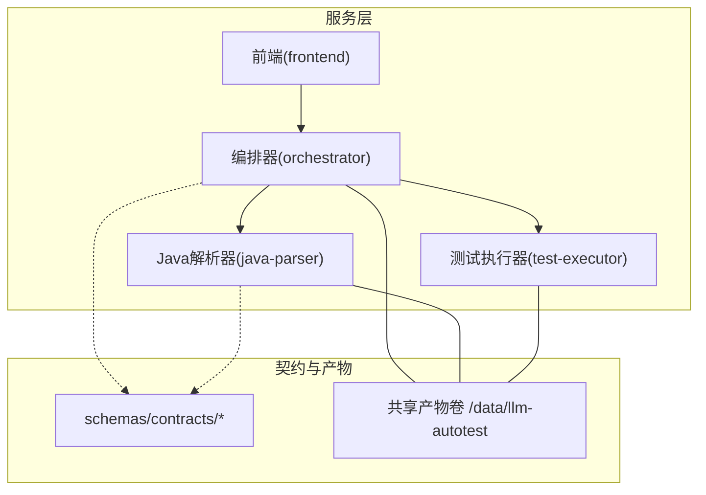
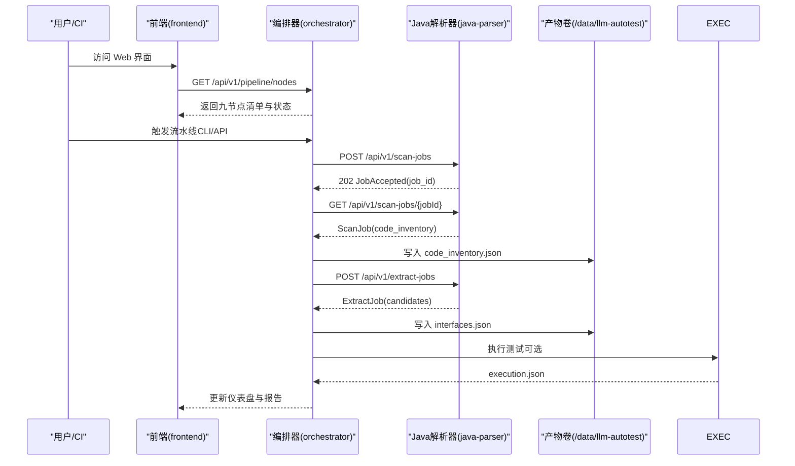
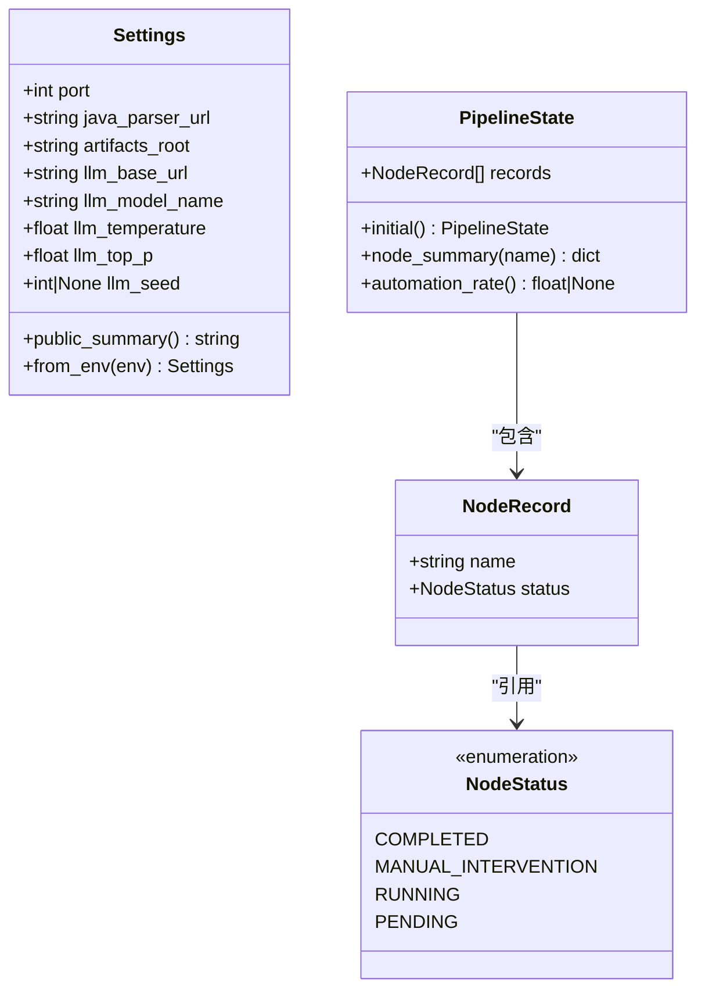
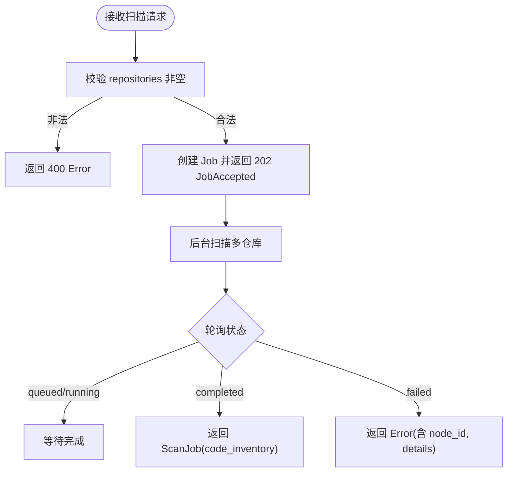
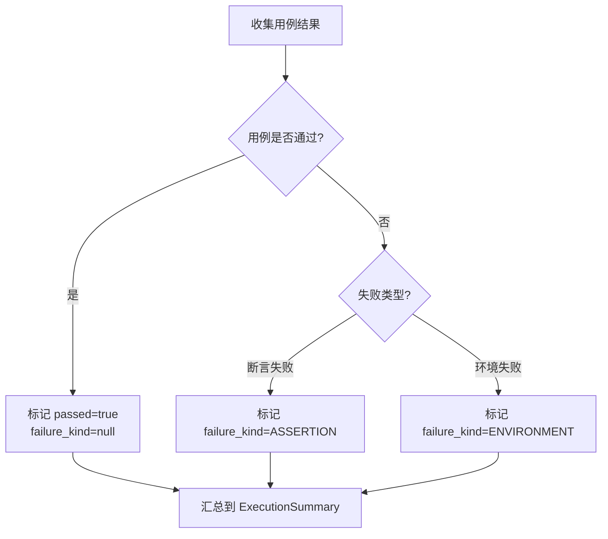
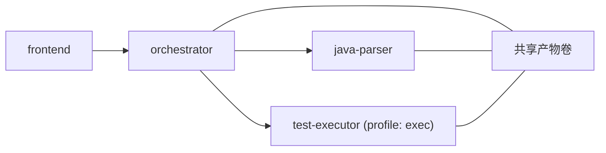
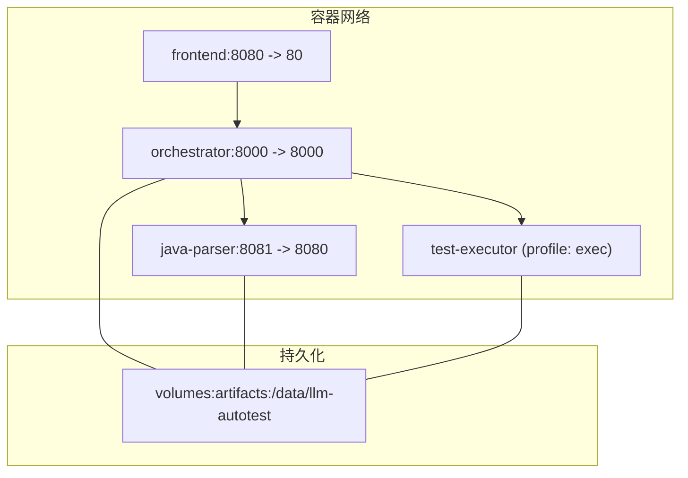

# 系统架构

<cite>
**本文引用的文件**
- [services/orchestrator/src/orchestrator/__main__.py](file://services/orchestrator/src/orchestrator/__main__.py)
- [services/orchestrator/src/orchestrator/api.py](file://services/orchestrator/src/orchestrator/api.py)
- [services/orchestrator/src/orchestrator/pipeline.py](file://services/orchestrator/src/orchestrator/pipeline.py)
- [services/orchestrator/src/orchestrator/config.py](file://services/orchestrator/src/orchestrator/config.py)
- [services/java-parser/src/main/java/com/llmautotest/parser/ParserApplication.java](file://services/java-parser/src/main/java/com/llmautotest/parser/ParserApplication.java)
- [services/java-parser/src/main/java/com/llmautotest/parser/HealthController.java](file://services/java-parser/src/main/java/com/llmautotest/parser/HealthController.java)
- [services/java-parser/src/main/java/com/llmautotest/parser/ProtocolResolver.java](file://services/java-parser/src/main/java/com/llmautotest/parser/ProtocolResolver.java)
- [services/java-parser/src/main/resources/application.yml](file://services/java-parser/src/main/resources/application.yml)
- [services/test-executor/src/executor/result.py](file://services/test-executor/src/executor/result.py)
- [schemas/contracts/java-parser.openapi.yaml](file://schemas/contracts/java-parser.openapi.yaml)
- [deploy/docker-compose.yml](file://deploy/docker-compose.yml)
- [docs/04_功能规格说明.md](file://docs/04_功能规格说明.md)
- [docs/09_开发规范说明.md](file://docs/09_开发规范说明.md)
</cite>

## 目录
1. [引言](#引言)
2. [项目结构](#项目结构)
3. [核心组件](#核心组件)
4. [架构总览](#架构总览)
5. [详细组件分析](#详细组件分析)
6. [依赖关系分析](#依赖关系分析)
7. [性能与可扩展性](#性能与可扩展性)
8. [故障排查指南](#故障排查指南)
9. [结论](#结论)
10. [附录](#附录)

## 引言
本架构文档面向 LLM-AutoTest 系统，围绕微服务化设计，阐述编排器服务、Java 解析器、前端应用与测试执行器的职责边界、数据流向与状态管理。重点解释“九节点固定流水线”的设计理念与四态标注机制，明确服务间通信协议、数据交换格式与错误处理策略，并给出系统上下文图、组件交互图与部署拓扑图。同时总结技术选型决策、可扩展性考虑与性能优化策略，为后续迭代与运维提供依据。

## 项目结构
仓库采用 Monorepo 组织，按服务划分：
- services/orchestrator：Python FastAPI 编排服务，负责 9 节点固定流水线编排、断点续跑、REST API 暴露与配置管理。
- services/java-parser：Spring Boot Java 服务，负责多仓库扫描与接口候选提取（静态特征定位），对外暴露异步 Job REST API。
- services/frontend：Vue 3 + TypeScript 前端，展示任务配置、监控与报告（当前为占位页面）。
- services/test-executor：Python 测试执行器骨架，负责用例结果判定与汇总（失败二态分离）。
- schemas/contracts：OpenAPI 契约定义，约束 orchestrator 与 java-parser 的接口。
- deploy/docker-compose.yml：容器编排唯一事实来源，定义服务启动顺序、端口映射、健康检查与共享产物卷。

图表来源
- [deploy/docker-compose.yml:1-62](file://deploy/docker-compose.yml#L1-L62)
- [schemas/contracts/java-parser.openapi.yaml:1-369](file://schemas/contracts/java-parser.openapi.yaml#L1-L369)

章节来源
- [deploy/docker-compose.yml:1-62](file://deploy/docker-compose.yml#L1-L62)
- [docs/09_开发规范说明.md:21-35](file://docs/09_开发规范说明.md#L21-L35)

## 核心组件
- 编排器服务（orchestrator）
  - 职责：统一入口命令、9 节点固定流水线编排、断点续跑、REST API 暴露、配置加载、与外部服务通信。
  - 关键实现：FastAPI 应用构建、健康检查、节点清单与状态查询；PipelineState 维护九节点四态；Settings 从环境变量加载。
- Java 解析器（java-parser）
  - 职责：多仓库源码扫描与接口候选提取（静态特征定位），以异步 Job 模式对外提供 REST API。
  - 关键实现：Spring Boot 应用、健康检查端点、可插拔协议解析策略接口 ProtocolResolver。
- 前端应用（frontend）
  - 职责：Web 界面展示与交互（当前为占位），所有数值口径来自后端 API，前端不做计算。
- 测试执行器（test-executor）
  - 职责：执行测试脚本、产出结构化结果，区分“断言失败”与“环境失败”，提供程序化汇总。

章节来源
- [services/orchestrator/src/orchestrator/__main__.py:1-26](file://services/orchestrator/src/orchestrator/__main__.py#L1-L26)
- [services/orchestrator/src/orchestrator/api.py:1-28](file://services/orchestrator/src/orchestrator/api.py#L1-L28)
- [services/orchestrator/src/orchestrator/pipeline.py:1-84](file://services/orchestrator/src/orchestrator/pipeline.py#L1-L84)
- [services/orchestrator/src/orchestrator/config.py:1-50](file://services/orchestrator/src/orchestrator/config.py#L1-L50)
- [services/java-parser/src/main/java/com/llmautotest/parser/ParserApplication.java:1-17](file://services/java-parser/src/main/java/com/llmautotest/parser/ParserApplication.java#L1-L17)
- [services/java-parser/src/main/java/com/llmautotest/parser/HealthController.java:1-18](file://services/java-parser/src/main/java/com/llmautotest/parser/HealthController.java#L1-L18)
- [services/java-parser/src/main/java/com/llmautotest/parser/ProtocolResolver.java:1-17](file://services/java-parser/src/main/java/com/llmautotest/parser/ProtocolResolver.java#L1-L17)
- [services/test-executor/src/executor/result.py:1-61](file://services/test-executor/src/executor/result.py#L1-L61)

## 架构总览
系统采用微服务架构，前后端解耦，编排器作为中枢协调各节点与外部服务。Java 解析器通过 OpenAPI 契约暴露异步 Job 接口；测试执行器按 profile 按需启用；前端通过编排器 API 获取流水线状态与指标。

图表来源
- [services/orchestrator/src/orchestrator/api.py:11-27](file://services/orchestrator/src/orchestrator/api.py#L11-L27)
- [schemas/contracts/java-parser.openapi.yaml:24-115](file://schemas/contracts/java-parser.openapi.yaml#L24-L115)
- [deploy/docker-compose.yml:18-32](file://deploy/docker-compose.yml#L18-L32)

## 详细组件分析

### 编排器服务（orchestrator）
- 启动与配置
  - 通过 __main__ 启动 FastAPI 应用，读取 Settings 配置（端口、java_parser_url、artifacts_root、LLM 参数等），使用 uvicorn 监听。
- REST API
  - /health：健康检查，供编排依赖检测。
  - /api/v1/pipeline/nodes：返回九节点清单与当前状态（基于 PipelineState.initial 的待运行状态）。
- 流水线与状态
  - NODE_ORDER 固定为 9 个节点名称，禁止增删。
  - NodeStatus 四态：completed、manual_intervention、running、pending。
  - PipelineState 维护节点记录集合，提供 node_summary 与自动化率计算（已完成节点数/9）。
- 配置管理
  - Settings.from_env 强制必填项校验，公开摘要用于日志安全。

图表来源
- [services/orchestrator/src/orchestrator/config.py:9-50](file://services/orchestrator/src/orchestrator/config.py#L9-L50)
- [services/orchestrator/src/orchestrator/pipeline.py:11-84](file://services/orchestrator/src/orchestrator/pipeline.py#L11-L84)

章节来源
- [services/orchestrator/src/orchestrator/__main__.py:15-25](file://services/orchestrator/src/orchestrator/__main__.py#L15-L25)
- [services/orchestrator/src/orchestrator/api.py:11-27](file://services/orchestrator/src/orchestrator/api.py#L11-L27)
- [services/orchestrator/src/orchestrator/pipeline.py:23-70](file://services/orchestrator/src/orchestrator/pipeline.py#L23-L70)
- [services/orchestrator/src/orchestrator/config.py:9-50](file://services/orchestrator/src/orchestrator/config.py#L9-L50)

### Java 解析器（java-parser）
- 应用入口与健康检查
  - Spring Boot 应用启动，/health 返回服务存活信息。
- 协议解析策略
  - ProtocolResolver 接口支持 rest/dubbo/grpc/graphql/soap/mq，新增协议无需改动主流程，体现可插拔设计。
- 异步 Job 模式
  - 通过 OpenAPI 定义 scan-jobs 与 extract-jobs 的创建与查询接口，返回 JobAccepted 与 JobStatus，完成时附带 code_inventory 或 candidates。
- 配置
  - application.yml 定义 server.port 与 parser.scan-concurrency 并发度。

图表来源
- [schemas/contracts/java-parser.openapi.yaml:24-115](file://schemas/contracts/java-parser.openapi.yaml#L24-L115)
- [services/java-parser/src/main/java/com/llmautotest/parser/HealthController.java:8-17](file://services/java-parser/src/main/java/com/llmautotest/parser/HealthController.java#L8-L17)
- [services/java-parser/src/main/resources/application.yml:1-8](file://services/java-parser/src/main/resources/application.yml#L1-L8)

章节来源
- [services/java-parser/src/main/java/com/llmautotest/parser/ParserApplication.java:1-17](file://services/java-parser/src/main/java/com/llmautotest/parser/ParserApplication.java#L1-L17)
- [services/java-parser/src/main/java/com/llmautotest/parser/HealthController.java:1-18](file://services/java-parser/src/main/java/com/llmautotest/parser/HealthController.java#L1-L18)
- [services/java-parser/src/main/java/com/llmautotest/parser/ProtocolResolver.java:1-17](file://services/java-parser/src/main/java/com/llmautotest/parser/ProtocolResolver.java#L1-L17)
- [schemas/contracts/java-parser.openapi.yaml:1-369](file://schemas/contracts/java-parser.openapi.yaml#L1-L369)
- [services/java-parser/src/main/resources/application.yml:1-8](file://services/java-parser/src/main/resources/application.yml#L1-L8)

### 前端应用（frontend）
- 当前为占位页面，遵循“数值一律来自后端 API，前端不做计算”的红线。
- 后续将接入编排器 API，展示任务配置、流水线监控、三视图与报告。

章节来源
- [services/frontend/src/App.vue:1-12](file://services/frontend/src/App.vue#L1-L12)
- [docs/09_开发规范说明.md:64-71](file://docs/09_开发规范说明.md#L64-L71)

### 测试执行器（test-executor）
- 结果模型
  - FailureKind 区分 ASSERTION 与 ENVIRONMENT，CaseResult 保证一致性（通过的用例不得携带失败类型）。
  - ExecutionSummary 提供 total、passed、failed_assertion、failed_environment 的程序化汇总。
- 规则
  - 断言失败计入通过率分母；环境失败隔离至待环境确认，不计入通过率分母。

图表来源
- [services/test-executor/src/executor/result.py:10-61](file://services/test-executor/src/executor/result.py#L10-L61)

章节来源
- [services/test-executor/src/executor/result.py:1-61](file://services/test-executor/src/executor/result.py#L1-L61)

## 依赖关系分析
- 服务间依赖
  - orchestrator 依赖 java-parser（JAVA_PARSER_URL）、test-executor（可选）、共享产物卷。
  - frontend 依赖 orchestrator（REST API）。
  - java-parser 独立运行，通过 OpenAPI 契约暴露接口。
- 启动顺序与依赖
  - docker-compose 中 orchestrator depends_on java-parser（条件 service_healthy），frontend depends_on orchestrator。
- 契约约束
  - 所有跨服务接口在 schemas/contracts 中定义，错误结构统一为 {code, message, node_id?, details}。

图表来源
- [deploy/docker-compose.yml:18-56](file://deploy/docker-compose.yml#L18-L56)
- [schemas/contracts/java-parser.openapi.yaml:130-148](file://schemas/contracts/java-parser.openapi.yaml#L130-L148)

章节来源
- [deploy/docker-compose.yml:1-62](file://deploy/docker-compose.yml#L1-L62)
- [docs/09_开发规范说明.md:89-94](file://docs/09_开发规范说明.md#L89-L94)

## 性能与可扩展性
- 性能
  - java-parser 支持 scan-concurrency 配置，控制多仓库扫描并发度。
  - orchestrator 使用 FastAPI + uvicorn 提供高吞吐 REST API。
  - 产物落盘共享卷，避免内存传递，提升稳定性与可恢复性。
- 可扩展性
  - 协议解析策略可插拔（ProtocolResolver），新增协议不改主流程。
  - 九节点固定口径冻结，便于度量与回归；节点内逻辑可按需扩展。
  - test-executor 按 profile 启用，降低默认资源占用。
- 优化建议
  - 对大仓库采用 include_paths 截断扫描范围，减少 I/O 与解析开销。
  - 对 LLM 调用进行 token 用量控制与上下文分块，避免长上下文导致的延迟与成本上升。
  - 增加缓存层（如 Redis）存储 Job 状态与中间产物索引，降低轮询压力。

[本节为通用指导，不直接分析具体文件]

## 故障排查指南
- 健康检查
  - orchestrator /health 与 java-parser /health 用于编排依赖检测。
- 常见错误
  - 缺少必填环境变量：orchestrator 启动时报错提示缺失键。
  - 仓库路径不存在：java-parser 返回 400 或 Error，包含 node_id 与 details。
  - 单文件解析失败：记录跳过原因，不中断整体流程。
- 日志与产物
  - 节点失败必须落盘状态与原因，支撑断点续跑。
  - 产物按任务 ID 分目录写入共享卷，便于定位与回溯。

章节来源
- [services/orchestrator/src/orchestrator/config.py:32-50](file://services/orchestrator/src/orchestrator/config.py#L32-L50)
- [schemas/contracts/java-parser.openapi.yaml:130-148](file://schemas/contracts/java-parser.openapi.yaml#L130-L148)
- [docs/09_开发规范说明.md:96-101](file://docs/09_开发规范说明.md#L96-L101)

## 结论
LLM-AutoTest 采用清晰的微服务架构，编排器作为中枢协调 9 节点固定流水线，Java 解析器提供可插拔的协议解析能力，前端与执行器按需集成。通过 OpenAPI 契约与共享产物卷，确保服务间解耦与可观测性。九节点口径冻结与四态标注保障度量一致性与可追溯性。未来可在并发、缓存与 LLM 上下文管理方面进一步优化，持续提升系统性能与可扩展性。

[本节为总结，不直接分析具体文件]

## 附录

### 九节点固定流水线与状态管理
- 节点顺序固定：req_parse、code_scan、interface_reconstruct、code_review、testcase_generate、auto_execute、test_report、defect_list、retest_regression。
- 四态标注：completed、manual_intervention、running、pending；降级节点按人工介入计入。
- 自动化率：已完成节点数/9，程序化汇总，不经 LLM。

章节来源
- [services/orchestrator/src/orchestrator/pipeline.py:23-70](file://services/orchestrator/src/orchestrator/pipeline.py#L23-L70)
- [docs/04_功能规格说明.md:9-32](file://docs/04_功能规格说明.md#L9-L32)

### 服务间通信协议与数据交换格式
- 协议：HTTP REST（FastAPI/Spring Boot）。
- 契约：OpenAPI 3.1.0，定义健康检查、扫描与提取 Job 的创建与查询。
- 错误结构：{code, message, node_id?, details}，统一三栈错误响应。
- 输入结构：仓库输入采用“路径 + 分支”结构，支持 include_paths 截断。

章节来源
- [schemas/contracts/java-parser.openapi.yaml:1-369](file://schemas/contracts/java-parser.openapi.yaml#L1-L369)
- [docs/09_开发规范说明.md:89-94](file://docs/09_开发规范说明.md#L89-L94)

### 部署拓扑图

图表来源
- [deploy/docker-compose.yml:1-62](file://deploy/docker-compose.yml#L1-L62)