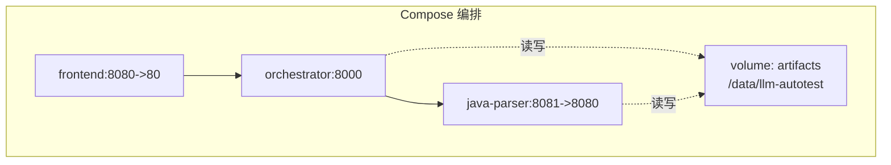
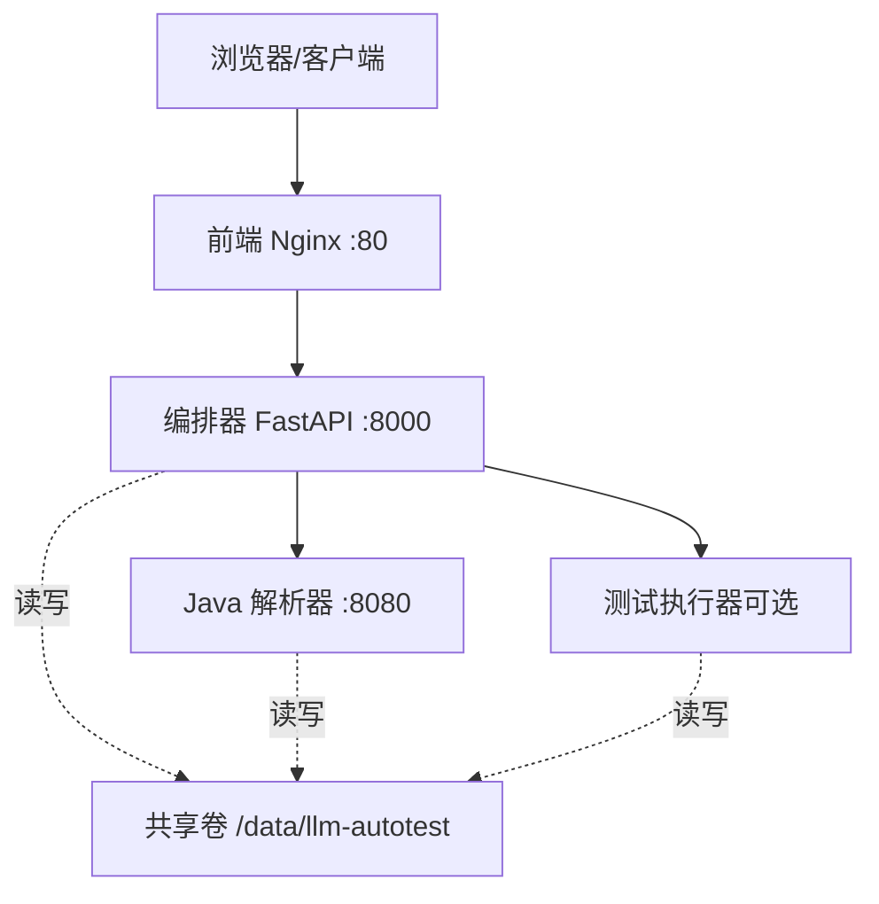
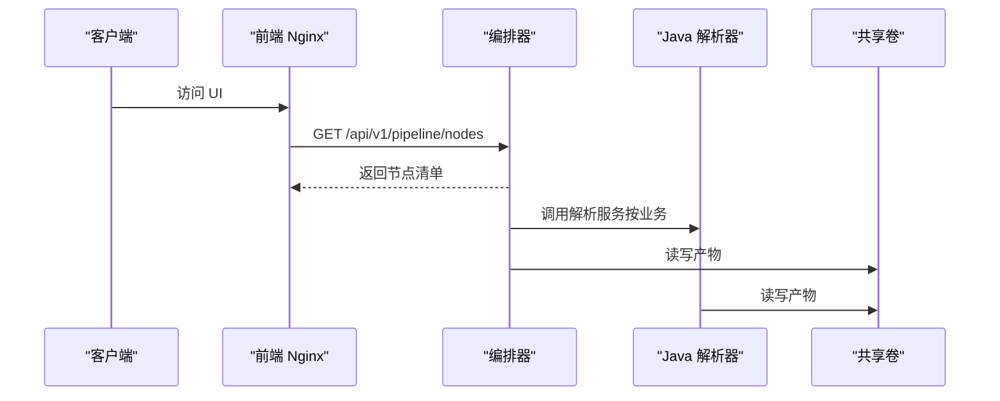
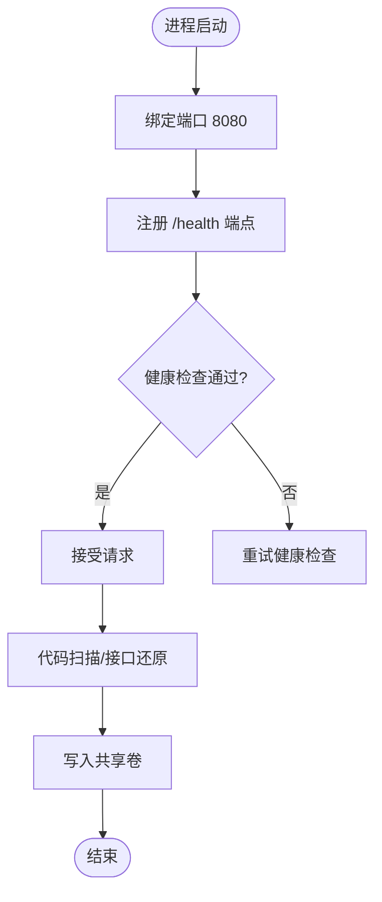
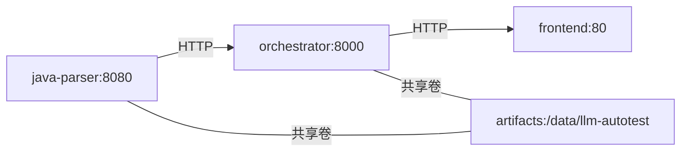

# 部署架构

<cite>
**本文引用的文件**
- [docker-compose.yml](file://deploy/docker-compose.yml)
- [Dockerfile（前端）](file://services/frontend/Dockerfile)
- [Dockerfile（Java 解析器）](file://services/java-parser/Dockerfile)
- [Dockerfile（编排器）](file://services/orchestrator/Dockerfile)
- [application.yml（Java 解析器配置）](file://services/java-parser/src/main/resources/application.yml)
- [config.py（编排器配置）](file://services/orchestrator/src/orchestrator/config.py)
- [api.py（编排器 API）](file://services/orchestrator/src/orchestrator/api.py)
- [pipeline.py（流水线节点定义）](file://services/orchestrator/src/orchestrator/pipeline.py)
- [HealthController.java（健康检查）](file://services/java-parser/src/main/java/com/llmautotest/parser/HealthController.java)
- [package.json（前端依赖）](file://services/frontend/package.json)
- [pyproject.toml（编排器依赖）](file://services/orchestrator/pyproject.toml)
- [pyproject.toml（测试执行器）](file://services/test-executor/pyproject.toml)
</cite>

## 目录
1. [简介](#简介)
2. [项目结构](#项目结构)
3. [核心组件](#核心组件)
4. [架构总览](#架构总览)
5. [详细组件分析](#详细组件分析)
6. [依赖关系分析](#依赖关系分析)
7. [性能与扩展性](#性能与扩展性)
8. [高可用与负载均衡](#高可用与负载均衡)
9. [监控告警与日志收集](#监控告警与日志收集)
10. [故障排查指南](#故障排查指南)
11. [结论](#结论)

## 简介
本系统采用容器化微服务架构，通过 Docker Compose 编排三个核心服务：前端、编排器与 Java 解析器，并预留测试执行器与 Mock 服务的可选启用能力。系统以“产物卷”作为跨服务共享存储，使用环境变量进行配置注入，提供健康检查保障编排稳定性。当前版本聚焦于可运行的最小闭环，后续可按需扩展为生产级高可用与可观测体系。

## 项目结构
- 编排入口：deploy/docker-compose.yml 定义了服务、端口映射、环境变量、卷挂载、健康检查与启动顺序。
- 服务镜像：
  - 前端：基于 Nginx 的占位镜像，待 V2.1 完整构建流程启用。
  - Java 解析器：多阶段构建，运行 JRE 镜像，暴露 /health 健康端点。
  - 编排器：Python FastAPI 应用，读取环境变量配置，对外暴露 REST API。
  - 测试执行器：按 profile 按需启用，用于后续测试脚本执行。
- 共享存储：volumes.artifacts 统一挂载到 /data/llm-autotest，供各服务读写产物。

图表来源
- [docker-compose.yml:4-41](file://deploy/docker-compose.yml#L4-L41)
- [docker-compose.yml:57-62](file://deploy/docker-compose.yml#L57-L62)

章节来源
- [docker-compose.yml:1-62](file://deploy/docker-compose.yml#L1-L62)

## 核心组件
- 前端（Nginx 占位）
  - 作用：用户界面入口，当前为占位页面，V2.1 将接入 Vue 构建产物。
  - 镜像：nginx:1.27-alpine，暴露 80 端口，由 Compose 映射到宿主机 8080。
- 编排器（FastAPI）
  - 作用：REST API 层，负责九节点流水线状态查询与健康检查；通过环境变量连接 Java 解析器与 LLM。
  - 配置：从环境变量读取端口、解析器地址、产物根路径与 LLM 参数。
  - 镜像：python:3.11-slim + uv 管理依赖，暴露 8000 端口。
- Java 解析器（Spring Boot）
  - 作用：代码扫描与接口还原服务，提供 /health 健康端点。
  - 配置：端口与并发度等通过 application.yml 配置，支持环境变量覆盖。
  - 镜像：多阶段构建，JRE 运行时，暴露 8080 端口，由 Compose 映射到宿主机 8081。
- 测试执行器（可选）
  - 作用：加载并执行 pytest 脚本，产出二态断言结果。
  - 启用方式：通过 profiles=["exec"] 按需拉起。

章节来源
- [Dockerfile（前端）:1-13](file://services/frontend/Dockerfile#L1-L13)
- [Dockerfile（编排器）:1-16](file://services/orchestrator/Dockerfile#L1-L16)
- [Dockerfile（Java 解析器）:1-21](file://services/java-parser/Dockerfile#L1-L21)
- [config.py:9-50](file://services/orchestrator/src/orchestrator/config.py#L9-L50)
- [application.yml:1-8](file://services/java-parser/src/main/resources/application.yml#L1-L8)
- [pyproject.toml（编排器）:1-53](file://services/orchestrator/pyproject.toml#L1-L53)
- [pyproject.toml（测试执行器）:1-45](file://services/test-executor/pyproject.toml#L1-L45)

## 架构总览
系统采用分层微服务架构：
- 前端通过浏览器访问编排器的 API，或直接由 Nginx 静态资源提供服务。
- 编排器协调 Java 解析器完成代码扫描与接口还原，并将产物写入共享卷。
- 测试执行器在需要时拉取产物执行测试，结果落盘供报告与度量使用。

图表来源
- [docker-compose.yml:4-55](file://deploy/docker-compose.yml#L4-L55)

## 详细组件分析

### 编排器（Orchestrator）
- 职责
  - 提供 /health 健康检查端点，供 Compose 探测服务可用性。
  - 提供 /api/v1/pipeline/nodes 返回九节点清单与当前状态。
  - 通过环境变量连接 Java 解析器与 LLM，统一管理配置。
- 配置
  - 端口默认 8000，可通过 PORT 覆盖。
  - JAVA_PARSER_URL 指向 Compose 内部网络中的 java-parser 服务。
  - ARTIFACTS_ROOT 默认 /data/llm-autotest，与共享卷一致。
  - LLM_BASE_URL、LLM_MODEL_NAME、LLM_TEMPERATURE、LLM_TOP_P、LLM_SEED 控制模型调用。
- 镜像构建
  - 基础镜像 python:3.11-slim，使用 uv 安装依赖，确保构建可重复。
  - 启动命令通过 uv run 运行 orchestrator 模块。

图表来源
- [api.py:11-27](file://services/orchestrator/src/orchestrator/api.py#L11-L27)
- [docker-compose.yml:18-32](file://deploy/docker-compose.yml#L18-L32)

章节来源
- [api.py:1-28](file://services/orchestrator/src/orchestrator/api.py#L1-L28)
- [config.py:9-50](file://services/orchestrator/src/orchestrator/config.py#L9-L50)
- [Dockerfile（编排器）:1-16](file://services/orchestrator/Dockerfile#L1-L16)

### Java 解析器（Java Parser）
- 职责
  - 提供 /health 健康检查端点，供 Compose 健康检查使用。
  - 代码扫描与接口还原，输出结构化产物至共享卷。
- 配置
  - server.port 默认 8080，可通过环境变量覆盖。
  - parser.scan-concurrency 控制多仓库扫描并发度。
- 镜像构建
  - 多阶段构建：第一阶段 Maven 打包，第二阶段仅包含 JRE 与 jar。
  - 安装 wget 以支持 Compose 健康检查。

图表来源
- [HealthController.java:9-17](file://services/java-parser/src/main/java/com/llmautotest/parser/HealthController.java#L9-L17)
- [application.yml:1-8](file://services/java-parser/src/main/resources/application.yml#L1-L8)
- [docker-compose.yml:11-16](file://deploy/docker-compose.yml#L11-L16)

章节来源
- [HealthController.java:1-18](file://services/java-parser/src/main/java/com/llmautotest/parser/HealthController.java#L1-L18)
- [application.yml:1-8](file://services/java-parser/src/main/resources/application.yml#L1-L8)
- [Dockerfile（Java 解析器）:1-21](file://services/java-parser/Dockerfile#L1-L21)

### 前端（Frontend）
- 职责
  - 提供 Web 界面入口，当前为占位页面。
  - 未来将接入 Vue/Vite 构建产物并通过 Nginx 静态托管。
- 镜像构建
  - 基于 nginx:1.27-alpine，临时 index.html 占位。
  - 暴露 80 端口，由 Compose 映射到宿主机 8080。

章节来源
- [Dockerfile（前端）:1-13](file://services/frontend/Dockerfile#L1-L13)
- [package.json:1-29](file://services/frontend/package.json#L1-L29)

### 测试执行器（Test Executor，可选）
- 职责
  - 加载 pytest 脚本，无人值守执行，输出二态断言结果。
- 启用方式
  - 通过 docker-compose profiles=["exec"] 按需拉起。
  - 共享卷用于读写测试产物。

章节来源
- [docker-compose.yml:45-50](file://deploy/docker-compose.yml#L45-L50)
- [pyproject.toml（测试执行器）:1-45](file://services/test-executor/pyproject.toml#L1-L45)

## 依赖关系分析
- 启动顺序
  - java-parser 先启动并提供健康检查。
  - orchestrator 依赖 java-parser 健康后启动。
  - frontend 依赖 orchestrator 启动后启动。
- 网络拓扑
  - Compose 内部 DNS：orchestrator 通过 JAVA_PARSER_URL 访问 java-parser。
  - 端口映射：前端 8080、编排器 8000、解析器 8081。
- 存储卷
  - artifacts 卷统一挂载到 /data/llm-autotest，供各服务共享产物。

图表来源
- [docker-compose.yml:4-41](file://deploy/docker-compose.yml#L4-L41)
- [docker-compose.yml:57-62](file://deploy/docker-compose.yml#L57-L62)

章节来源
- [docker-compose.yml:1-62](file://deploy/docker-compose.yml#L1-L62)

## 性能与扩展性
- 并发与吞吐
  - Java 解析器支持 parser.scan-concurrency 控制多仓库扫描并发度，可根据资源调整。
  - 编排器基于 FastAPI + Uvicorn，适合高并发 I/O 场景。
- 水平扩展
  - 编排器与解析器无状态，可水平扩展多个副本，配合外部负载均衡器实现流量分发。
  - 前端 Nginx 也可多副本部署，结合反向代理进行负载均衡。
- 存储扩展
  - 共享卷 artifacts 建议使用持久化后端（如 NFS、云盘），便于备份与扩容。
- 依赖解耦
  - 通过环境变量与内部网络解耦服务间耦合，便于独立升级与替换。

[本节为通用指导，不直接分析具体文件]

## 高可用与负载均衡
- 健康检查
  - java-parser 提供 /health，Compose 使用 wget 探测。
  - orchestrator 提供 /health，用于编排器自身健康检查。
- 重启策略
  - 所有服务设置 restart: unless-stopped，保证异常退出后自动恢复。
- 负载均衡建议
  - 在生产环境引入反向代理（如 Nginx/Ingress）对前端与编排器进行负载均衡。
  - 对解析器与执行器可采用有状态池或队列模式，避免重复处理。

章节来源
- [docker-compose.yml:11-16](file://deploy/docker-compose.yml#L11-L16)
- [docker-compose.yml:18-32](file://deploy/docker-compose.yml#L18-L32)
- [docker-compose.yml:34-41](file://deploy/docker-compose.yml#L34-L41)
- [HealthController.java:9-17](file://services/java-parser/src/main/java/com/llmautotest/parser/HealthController.java#L9-L17)
- [api.py:16-19](file://services/orchestrator/src/orchestrator/api.py#L16-L19)

## 监控告警与日志收集
- 健康检查
  - Compose 健康检查已集成，可在编排层感知服务可用性。
- 指标与监控
  - 当前未内置 Prometheus/Grafana 采集，建议在编排器与解析器中增加指标端点（如 /metrics）。
  - 可将指标暴露给外部监控系统采集。
- 日志收集
  - 建议将各服务标准输出重定向到集中式日志系统（如 ELK/Loki）。
  - 对关键操作（节点执行、错误、重试）记录结构化日志，便于追踪。
- 告警
  - 基于健康检查失败、错误率升高、延迟上升等阈值设置告警规则。
  - 对共享卷容量、解析器并发度等关键资源设置容量告警。

[本节为通用指导，不直接分析具体文件]

## 故障排查指南
- 服务无法启动
  - 检查环境变量是否齐全（特别是 JAVA_PARSER_URL、LLM_BASE_URL、LLM_SEED）。
  - 查看 Compose 日志定位依赖启动顺序问题。
- 健康检查失败
  - 确认 java-parser 的 /health 可达，且端口映射正确。
  - 检查 orchestrator 的 /health 是否正常返回。
- 产物丢失或不可写
  - 检查 artifacts 卷挂载路径 /data/llm-autotest 权限。
  - 确认各服务对该路径具有读写权限。
- 解析器并发过高导致资源紧张
  - 调整 parser.scan-concurrency，降低并发度观察效果。
- 前端无法访问
  - 确认端口 8080 未被占用，Nginx 容器正常运行。

章节来源
- [config.py:32-50](file://services/orchestrator/src/orchestrator/config.py#L32-L50)
- [docker-compose.yml:11-16](file://deploy/docker-compose.yml#L11-L16)
- [docker-compose.yml:57-62](file://deploy/docker-compose.yml#L57-L62)
- [application.yml:1-8](file://services/java-parser/src/main/resources/application.yml#L1-L8)

## 结论
本部署架构以 Docker Compose 为核心，实现了前端、编排器与 Java 解析器的容器化编排，并通过共享卷与环境变量完成服务间协作与健康检查。当前版本满足最小可运行闭环，具备清晰的扩展路径：引入外部负载均衡、指标与日志系统、以及测试执行器的按需启用。后续可按生产要求逐步增强高可用与可观测性。