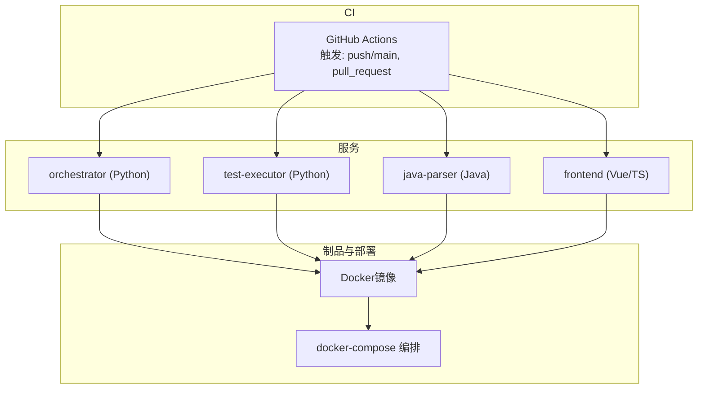
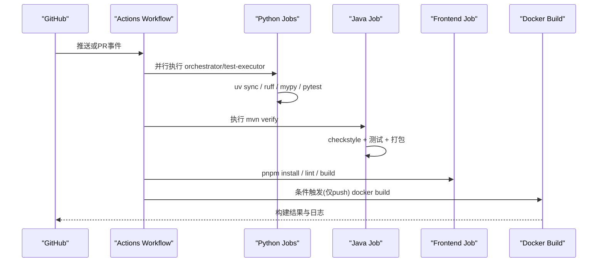
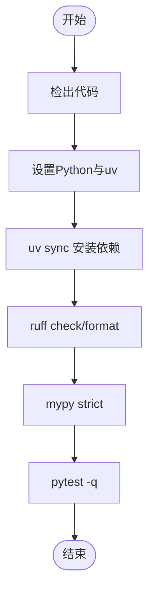
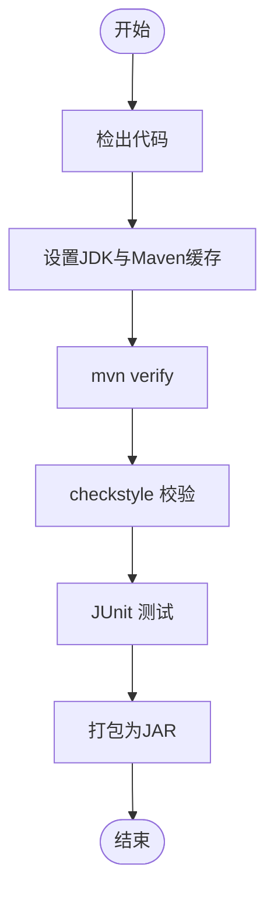
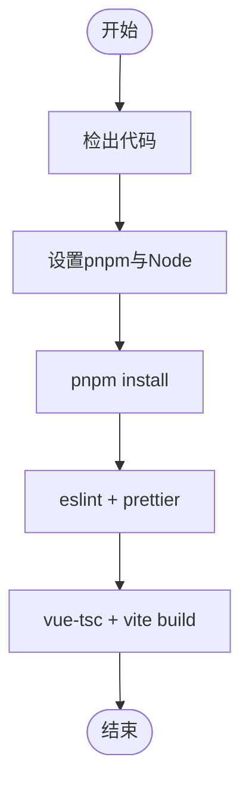
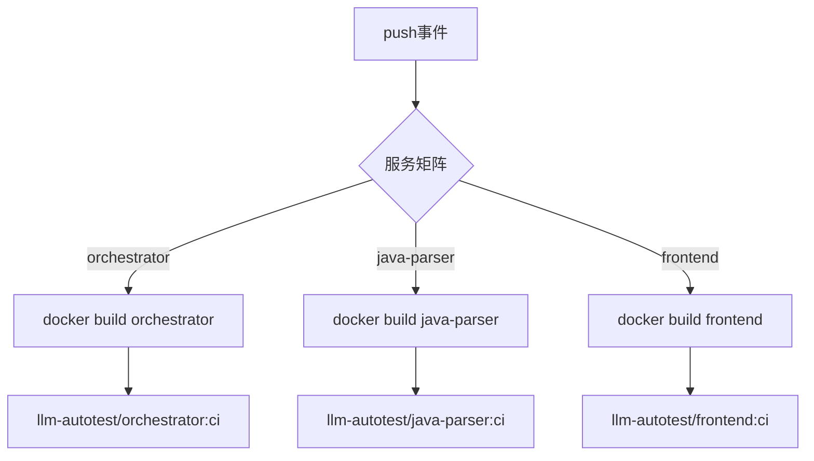
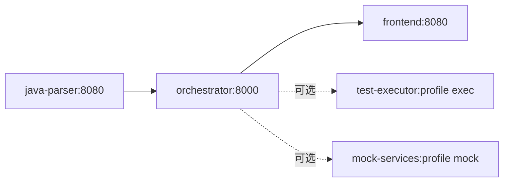
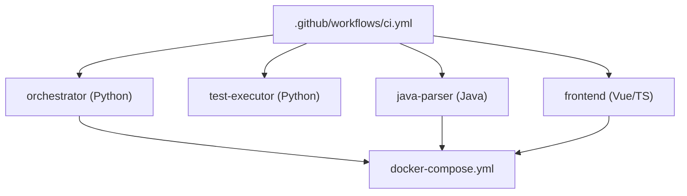

# CI/CD流水线

<cite>
**本文引用的文件**
- [ci.yml](file://.github/workflows/ci.yml)
- [pyproject.toml（orchestrator）](file://services/orchestrator/pyproject.toml)
- [pyproject.toml（test-executor）](file://services/test-executor/pyproject.toml)
- [pom.xml（java-parser）](file://services/java-parser/pom.xml)
- [package.json（frontend）](file://services/frontend/package.json)
- [Dockerfile（orchestrator）](file://services/orchestrator/Dockerfile)
- [Dockerfile（java-parser）](file://services/java-parser/Dockerfile)
- [Dockerfile（frontend）](file://services/frontend/Dockerfile)
- [docker-compose.yml](file://deploy/docker-compose.yml)
- [13-测试策略与质量门禁.md](file://MumuSpec/13-测试策略与质量门禁.md)
- [python-code-style.md](file://.rules/python-code-style.md)
- [frontend-code-style.md](file://.rules/frontend-code-style.md)
</cite>

## 目录
1. [简介](#简介)
2. [项目结构](#项目结构)
3. [核心组件](#核心组件)
4. [架构总览](#架构总览)
5. [详细组件分析](#详细组件分析)
6. [依赖关系分析](#依赖关系分析)
7. [性能考虑](#性能考虑)
8. [故障排查指南](#故障排查指南)
9. [结论](#结论)
10. [附录](#附录)

## 简介
本文件面向LLM-AutoTest项目的CI/CD流水线，聚焦GitHub Actions工作流配置与多语言构建策略。内容覆盖代码检查、单元测试、集成测试、自动化构建、制品管理、版本发布与回滚策略、流水线扩展方式以及本地调试方法。目标是帮助开发者快速理解并安全地扩展流水线，确保Python、Java与前端服务在多分支与PR场景下稳定交付。

## 项目结构
仓库采用Monorepo组织，关键服务位于services目录下：
- Python服务：orchestrator（编排）、test-executor（执行）
- Java服务：java-parser（源码解析）
- 前端服务：frontend（Vue 3 + TypeScript）
- 部署编排：deploy/docker-compose.yml
- CI配置：.github/workflows/ci.yml

图表来源
- [ci.yml:1-75](file://.github/workflows/ci.yml#L1-L75)
- [docker-compose.yml:1-62](file://deploy/docker-compose.yml#L1-L62)

章节来源
- [ci.yml:1-75](file://.github/workflows/ci.yml#L1-L75)
- [docker-compose.yml:1-62](file://deploy/docker-compose.yml#L1-L62)

## 核心组件
- GitHub Actions工作流：定义Python、Java、Frontend与Docker构建任务，按矩阵并行执行。
- Python服务：使用uv进行依赖管理与运行；ruff做格式与lint；mypy严格类型检查；pytest执行测试。
- Java服务：基于Spring Boot与Maven；checkstyle在verify阶段执行；mvn verify统一完成编译、测试与规范检查。
- 前端服务：pnpm包管理；eslint+prettier做代码风格检查；vue-tsc+vite构建产物。
- Docker镜像：各服务提供独立Dockerfile，CI中仅构建镜像用于验证可构建性。
- 质量门禁：遵循分层测试与门禁策略（Lint/Unit/Integration/E2E），覆盖率目标≥70%（核心逻辑）。

章节来源
- [ci.yml:1-75](file://.github/workflows/ci.yml#L1-L75)
- [pyproject.toml（orchestrator）:1-57](file://services/orchestrator/pyproject.toml#L1-L57)
- [pyproject.toml（test-executor）:1-45](file://services/test-executor/pyproject.toml#L1-L45)
- [pom.xml（java-parser）:1-83](file://services/java-parser/pom.xml#L1-L83)
- [package.json（frontend）:1-30](file://services/frontend/package.json#L1-L30)
- [13-测试策略与质量门禁.md:29-89](file://MumuSpec/13-测试策略与质量门禁.md#L29-L89)

## 架构总览
下图展示CI触发到各服务构建与测试的调用链，以及Docker镜像构建流程。

图表来源
- [ci.yml:1-75](file://.github/workflows/ci.yml#L1-L75)

章节来源
- [ci.yml:1-75](file://.github/workflows/ci.yml#L1-L75)

## 详细组件分析

### Python服务流水线（orchestrator与test-executor）
- 环境准备：使用astral-sh/setup-uv安装Python 3.11与uv工具。
- 依赖同步：uv sync锁定依赖（结合uv.lock）。
- 代码质量：ruff check与format --check；mypy strict模式。
- 测试执行：pytest -q运行测试。
- 覆盖率：当前未强制覆盖率门禁，但策略要求核心逻辑覆盖率≥70%，可在后续步骤启用coverage报告与阈值检查。

图表来源
- [ci.yml:9-28](file://.github/workflows/ci.yml#L9-L28)
- [pyproject.toml（orchestrator）:16-57](file://services/orchestrator/pyproject.toml#L16-L57)
- [pyproject.toml（test-executor）:11-45](file://services/test-executor/pyproject.toml#L11-L45)

章节来源
- [ci.yml:9-28](file://.github/workflows/ci.yml#L9-L28)
- [pyproject.toml（orchestrator）:1-57](file://services/orchestrator/pyproject.toml#L1-L57)
- [pyproject.toml（test-executor）:1-45](file://services/test-executor/pyproject.toml#L1-L45)
- [python-code-style.md:9-56](file://.rules/python-code-style.md#L9-L56)

### Java服务流水线（java-parser）
- 环境准备：setup-java使用Temurin JDK 21，启用Maven缓存。
- 构建与校验：mvn -B -ntp verify，包含checkstyle与测试。
- 构建产物：生成可执行JAR（spring-boot-maven-plugin）。

图表来源
- [ci.yml:30-43](file://.github/workflows/ci.yml#L30-L43)
- [pom.xml（java-parser）:49-80](file://services/java-parser/pom.xml#L49-L80)

章节来源
- [ci.yml:30-43](file://.github/workflows/ci.yml#L30-L43)
- [pom.xml（java-parser）:1-83](file://services/java-parser/pom.xml#L1-L83)

### 前端服务流水线（frontend）
- 环境准备：pnpm action v9，Node 20，启用pnpm缓存。
- 依赖安装：pnpm install --no-frozen-lockfile。
- 代码质量：eslint与prettier检查。
- 构建：vue-tsc类型检查后vite构建静态资源。

图表来源
- [ci.yml:45-63](file://.github/workflows/ci.yml#L45-L63)
- [package.json（frontend）:8-13](file://services/frontend/package.json#L8-L13)

章节来源
- [ci.yml:45-63](file://.github/workflows/ci.yml#L45-L63)
- [package.json（frontend）:1-30](file://services/frontend/package.json#L1-L30)
- [frontend-code-style.md:12-55](file://.rules/frontend-code-style.md#L12-L55)

### Docker镜像构建
- 触发条件：仅在push事件时执行，避免PR污染镜像仓库。
- 矩阵构建：对orchestrator、java-parser、frontend分别构建镜像，命名llm-autotest/<service>:ci。
- 镜像说明：
  - orchestrator：基于python:3.11-slim，使用uv安装依赖并启动FastAPI服务。
  - java-parser：多阶段构建，先maven打包再运行JRE镜像。
  - frontend：当前为占位镜像（nginx），待V2.1范围裁决后接入真实构建流程。

图表来源
- [ci.yml:65-75](file://.github/workflows/ci.yml#L65-L75)
- [Dockerfile（orchestrator）:1-16](file://services/orchestrator/Dockerfile#L1-L16)
- [Dockerfile（java-parser）:1-21](file://services/java-parser/Dockerfile#L1-L21)
- [Dockerfile（frontend）:1-13](file://services/frontend/Dockerfile#L1-L13)

章节来源
- [ci.yml:65-75](file://.github/workflows/ci.yml#L65-L75)
- [Dockerfile（orchestrator）:1-16](file://services/orchestrator/Dockerfile#L1-L16)
- [Dockerfile（java-parser）:1-21](file://services/java-parser/Dockerfile#L1-L21)
- [Dockerfile（frontend）:1-13](file://services/frontend/Dockerfile#L1-L13)

### 本地编排与健康检查
- 使用docker-compose编排服务，包含健康检查与依赖顺序。
- 卷挂载artifacts用于共享产物路径/data/llm-autotest。
- test-executor与mock-services通过profiles按需启用。

图表来源
- [docker-compose.yml:1-62](file://deploy/docker-compose.yml#L1-L62)

章节来源
- [docker-compose.yml:1-62](file://deploy/docker-compose.yml#L1-L62)

## 依赖关系分析
- 工作流内任务相互独立，通过矩阵并行提升效率。
- Python服务依赖uv与lock文件保证一致性；Java服务依赖Maven缓存加速；前端依赖pnpm缓存。
- 服务间依赖通过环境变量与HTTP接口（如orchestrator调用java-parser），在docker-compose中通过depends_on与healthcheck保障启动顺序。

图表来源
- [ci.yml:1-75](file://.github/workflows/ci.yml#L1-L75)
- [docker-compose.yml:1-62](file://deploy/docker-compose.yml#L1-L62)

章节来源
- [ci.yml:1-75](file://.github/workflows/ci.yml#L1-L75)
- [docker-compose.yml:1-62](file://deploy/docker-compose.yml#L1-L62)

## 性能考虑
- 缓存策略：Maven与pnpm缓存已启用，显著减少依赖下载时间。
- 并行执行：Python服务矩阵并行，缩短整体流水线时长。
- 构建优化：Java多阶段构建减小最终镜像体积；Python使用uv冻结依赖提升安装速度。
- 建议：
  - 在前端构建中启用增量构建与缓存命中优化。
  - 在Python任务中加入覆盖率统计与报告上传，便于追踪趋势。
  - 对大仓库扫描场景，考虑分片或异步批处理以降低内存峰值。

[本节为通用指导，不直接分析具体文件]

## 故障排查指南
- Python任务失败：
  - 检查ruff/mypy/pytest输出定位问题；确认uv.lock与依赖版本一致。
  - 若类型错误，优先修复类型标注而非忽略警告。
- Java任务失败：
  - 查看checkstyle与测试日志；确认JDK版本与Maven缓存命中。
  - 若依赖冲突，优先升级至兼容版本并更新POM。
- 前端任务失败：
  - 根据eslint/prettier提示修复格式与规则；确认TypeScript类型正确。
  - 构建失败时检查vite配置与依赖版本。
- Docker构建失败：
  - 检查Dockerfile中的COPY路径与命令；确认基础镜像可用。
  - 多阶段构建需确保中间阶段产物存在。
- 编排问题：
  - 使用docker compose logs查看服务日志；检查healthcheck与端口映射。
  - 通过env_file注入必要环境变量，避免硬编码敏感信息。

章节来源
- [ci.yml:9-75](file://.github/workflows/ci.yml#L9-L75)
- [docker-compose.yml:1-62](file://deploy/docker-compose.yml#L1-L62)

## 结论
当前CI/CD流水线已覆盖Python、Java与前端的核心构建与测试流程，具备稳定的代码质量门禁与容器化构建能力。建议在后续迭代中逐步引入覆盖率门禁、安全扫描与端到端测试，完善制品管理与发布回滚策略，进一步提升交付质量与效率。

[本节为总结性内容，不直接分析具体文件]

## 附录

### 多语言构建脚本速查
- Python：uv sync → ruff check/format → mypy → pytest
- Java：mvn verify（含checkstyle与测试）
- 前端：pnpm install → eslint + prettier → vue-tsc + vite build

章节来源
- [ci.yml:9-63](file://.github/workflows/ci.yml#L9-L63)
- [pyproject.toml（orchestrator）:16-57](file://services/orchestrator/pyproject.toml#L16-L57)
- [pyproject.toml（test-executor）:11-45](file://services/test-executor/pyproject.toml#L11-L45)
- [pom.xml（java-parser）:49-80](file://services/java-parser/pom.xml#L49-L80)
- [package.json（frontend）:8-13](file://services/frontend/package.json#L8-L13)

### 质量门禁与覆盖率
- 分层门禁：G-LINT/G-UNIT/G-INT/G-E2E
- 覆盖率目标：核心逻辑≥70%
- 建议：在Python任务中启用coverage并设置阈值，在PR合并前阻断低覆盖率提交。

章节来源
- [13-测试策略与质量门禁.md:29-89](file://MumuSpec/13-测试策略与质量门禁.md#L29-L89)

### 制品管理与发布策略（建议）
- 制品：Docker镜像作为主要制品，命名规范llm-autotest/<service>:<version>
- 发布：在tag事件触发发布流程，推送镜像至仓库并记录版本元数据
- 回滚：保留历史镜像标签，通过docker-compose切换image版本实现快速回滚

[本节为概念性建议，不直接分析具体文件]

### 自定义流水线步骤与扩展
- 新增服务：在ci.yml中添加jobs与matrix条目，并在services下提供Dockerfile
- 新增检查：在对应服务配置中添加lint/type检查步骤
- 安全扫描：可集成SAST/SCA工具（如Trivy、Dependabot）于相应job
- 性能测试：在服务级添加基准测试或负载测试步骤，并上传报告

[本节为概念性建议，不直接分析具体文件]

### 本地调试CI/CD流水线的工具与方法
- 使用act在本地模拟GitHub Actions执行，复现CI行为
- 使用docker compose up -d启动服务，结合logs与healthcheck排查问题
- 针对Python服务：uv run pytest -xvv定位失败用例；mypy与ruff单独运行以缩小问题范围
- 针对Java服务：mvn clean verify -e查看详细错误栈
- 针对前端：pnpm lint与pnpm build逐步定位问题

[本节为通用指导，不直接分析具体文件]