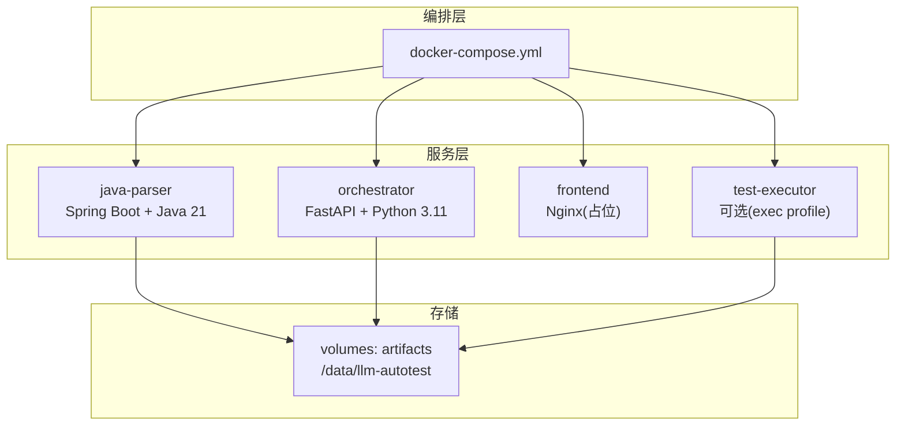
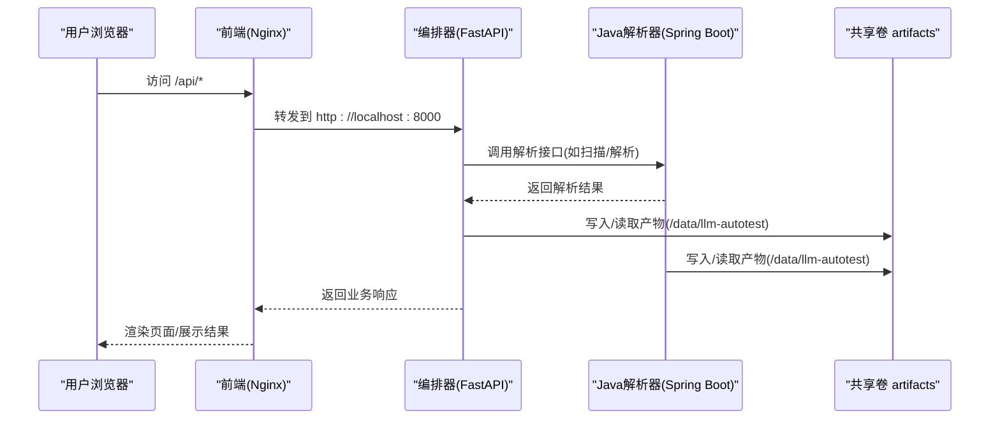
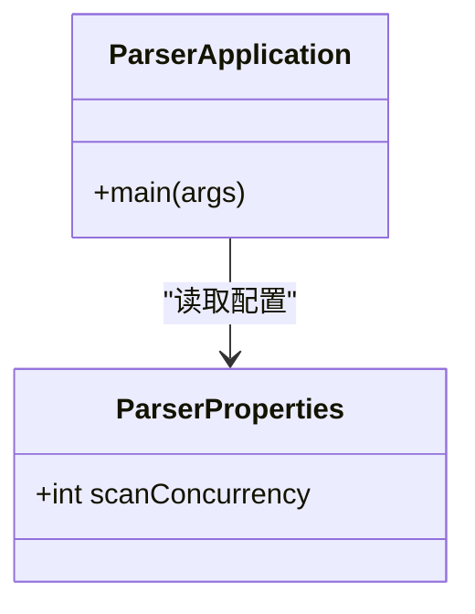
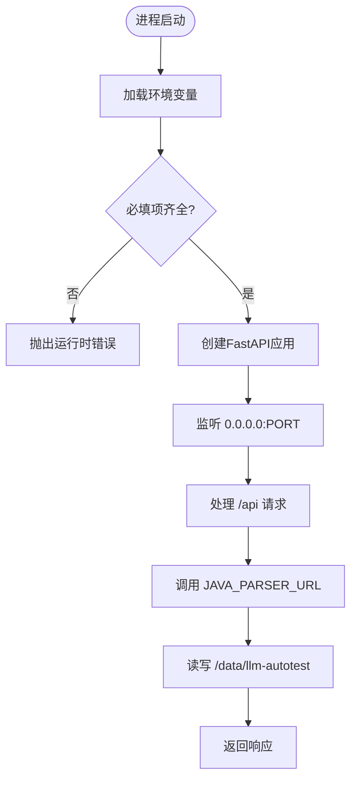
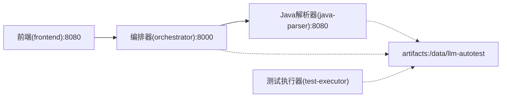

# Docker容器化部署

<cite>
**本文引用的文件**
- [docker-compose.yml](file://deploy/docker-compose.yml)
- [java-parser/Dockerfile](file://services/java-parser/Dockerfile)
- [orchestrator/Dockerfile](file://services/orchestrator/Dockerfile)
- [frontend/Dockerfile](file://services/frontend/Dockerfile)
- [java-parser/pom.xml](file://services/java-parser/pom.xml)
- [java-parser/application.yml](file://services/java-parser/src/main/resources/application.yml)
- [java-parser/ParserApplication.java](file://services/java-parser/src/main/java/com/llmautotest/parser/ParserApplication.java)
- [java-parser/ParserProperties.java](file://services/java-parser/src/main/java/com/llmautotest/parser/ParserProperties.java)
- [orchestrator/config.py](file://services/orchestrator/src/orchestrator/config.py)
- [orchestrator/__main__.py](file://services/orchestrator/src/orchestrator/__main__.py)
- [orchestrator/pyproject.toml](file://services/orchestrator/pyproject.toml)
- [test-executor/pyproject.toml](file://services/test-executor/pyproject.toml)
- [frontend/package.json](file://services/frontend/package.json)
- [frontend/vite.config.ts](file://services/frontend/vite.config.ts)
</cite>

## 目录
1. [简介](#简介)
2. [项目结构](#项目结构)
3. [核心组件](#核心组件)
4. [架构总览](#架构总览)
5. [详细组件分析](#详细组件分析)
6. [依赖关系分析](#依赖关系分析)
7. [性能考虑](#性能考虑)
8. [故障排查指南](#故障排查指南)
9. [结论](#结论)
10. [附录](#附录)

## 简介
本文件面向LLM-AutoTest的Docker容器化部署，基于Docker Compose编排多服务：Java解析器、Python编排器、前端与可选的测试执行器。文档涵盖端口映射、环境变量、数据卷挂载、服务依赖、启动命令、环境配置示例与生产优化建议，帮助读者快速搭建并稳定运行系统。

## 项目结构
仓库采用按服务分层的目录组织方式，每个服务拥有独立的构建脚本与依赖声明；编排入口位于deploy目录下的docker-compose.yml，统一管理服务镜像构建、端口暴露、健康检查、数据卷与依赖关系。

图表来源
- [docker-compose.yml:3-62](file://deploy/docker-compose.yml#L3-L62)

章节来源
- [docker-compose.yml:3-62](file://deploy/docker-compose.yml#L3-L62)

## 核心组件
- Java解析器（java-parser）
  - 提供HTTP接口用于源码扫描与接口逆向还原；默认监听8080端口；通过application.yml暴露可配置的扫描并发度；容器内健康检查端点为/health。
- 编排器（orchestrator）
  - FastAPI服务，负责流水线编排、产物管理与REST API；默认监听8000端口；从环境变量读取JAVA_PARSER_URL、LLM_*等参数；将产物写入共享卷/data/llm-autotest。
- 前端（frontend）
  - 当前以Nginx占位镜像提供静态页面；开发时通过Vite代理将/api请求转发至本地8000端口；生产镜像对外暴露80端口。
- 测试执行器（test-executor，可选）
  - 通过profiles=["exec"]按需启用；依赖httpx与pydantic；挂载同一产物卷以便与编排器共享结果。

章节来源
- [docker-compose.yml:4-51](file://deploy/docker-compose.yml#L4-L51)
- [java-parser/application.yml:1-8](file://services/java-parser/src/main/resources/application.yml#L1-L8)
- [java-parser/ParserApplication.java:1-17](file://services/java-parser/src/main/java/com/llmautotest/parser/ParserApplication.java#L1-L17)
- [java-parser/ParserProperties.java:1-17](file://services/java-parser/src/main/java/com/llmautotest/parser/ParserProperties.java#L1-L17)
- [orchestrator/config.py:1-50](file://services/orchestrator/src/orchestrator/config.py#L1-L50)
- [orchestrator/__main__.py:1-26](file://services/orchestrator/src/orchestrator/__main__.py#L1-L26)
- [frontend/vite.config.ts:1-16](file://services/frontend/vite.config.ts#L1-L16)
- [test-executor/pyproject.toml:1-45](file://services/test-executor/pyproject.toml#L1-L45)

## 架构总览
下图展示容器间调用链路与数据流向：前端访问编排器API，编排器调用Java解析器进行源码解析，三者共享artifacts卷用于产物持久化。

图表来源
- [docker-compose.yml:4-51](file://deploy/docker-compose.yml#L4-L51)
- [orchestrator/__main__.py:15-22](file://services/orchestrator/src/orchestrator/__main__.py#L15-L22)
- [java-parser/application.yml:1-8](file://services/java-parser/src/main/resources/application.yml#L1-L8)

## 详细组件分析

### Java解析器（java-parser）
- 构建与运行
  - 多阶段构建：使用Maven在构建阶段打包，最终镜像仅包含JRE与JAR包，减小体积。
  - 暴露端口：8080；健康检查依赖wget，已预装。
  - 应用入口：Spring Boot主类自动装配并扫描配置属性。
- 配置项
  - application.yml定义server.port=8080与parser.scan-concurrency（受控可配置）。
  - ParserProperties校验scanConcurrency必须为正数。
- 依赖
  - Spring Boot Web、JavaParser Symbol Solver等。

图表来源
- [java-parser/ParserApplication.java:1-17](file://services/java-parser/src/main/java/com/llmautotest/parser/ParserApplication.java#L1-L17)
- [java-parser/ParserProperties.java:1-17](file://services/java-parser/src/main/java/com/llmautotest/parser/ParserProperties.java#L1-L17)

章节来源
- [java-parser/Dockerfile:1-21](file://services/java-parser/Dockerfile#L1-L21)
- [java-parser/pom.xml:1-83](file://services/java-parser/pom.xml#L1-L83)
- [java-parser/application.yml:1-8](file://services/java-parser/src/main/resources/application.yml#L1-L8)
- [java-parser/ParserApplication.java:1-17](file://services/java-parser/src/main/java/com/llmautotest/parser/ParserApplication.java#L1-L17)
- [java-parser/ParserProperties.java:1-17](file://services/java-parser/src/main/java/com/llmautotest/parser/ParserProperties.java#L1-L17)

### 编排器（orchestrator）
- 构建与运行
  - 基于python:3.11-slim，使用uv安装依赖并运行模块入口。
  - 暴露端口：8000；通过__main__.py启动FastAPI应用，绑定0.0.0.0。
- 配置项（全部来自环境变量）
  - PORT、JAVA_PARSER_URL、ARTIFACTS_ROOT（默认/data/llm-autotest）。
  - LLM_BASE_URL、LLM_MODEL_NAME（默认glm-5.3）、LLM_TEMPERATURE（默认0.2）、LLM_TOP_P（默认0.8）、LLM_SEED（可选）。
  - 缺失必填项会抛出运行时错误，便于早期发现配置问题。
- 依赖
  - FastAPI、uvicorn、httpx、jsonschema等。

图表来源
- [orchestrator/__main__.py:15-22](file://services/orchestrator/src/orchestrator/__main__.py#L15-L22)
- [orchestrator/config.py:9-50](file://services/orchestrator/src/orchestrator/config.py#L9-L50)

章节来源
- [orchestrator/Dockerfile:1-16](file://services/orchestrator/Dockerfile#L1-L16)
- [orchestrator/config.py:1-50](file://services/orchestrator/src/orchestrator/config.py#L1-L50)
- [orchestrator/__main__.py:1-26](file://services/orchestrator/src/or__main__.py#L1-L26)
- [orchestrator/pyproject.toml:1-53](file://services/orchestrator/pyproject.toml#L1-L53)

### 前端（frontend）
- 构建与运行
  - 当前使用nginx:1.27-alpine作为占位镜像，提供静态页面；对外暴露80端口。
  - 开发模式通过vite.config.ts将/api代理到http://localhost:8000（编排器）。
- 依赖
  - Vue 3、Vite、TypeScript等开发依赖。

章节来源
- [frontend/Dockerfile:1-13](file://services/frontend/Dockerfile#L1-L13)
- [frontend/package.json:1-29](file://services/frontend/package.json#L1-L29)
- [frontend/vite.config.ts:1-16](file://services/frontend/vite.config.ts#L1-L16)

### 测试执行器（test-executor，可选）
- 通过profiles=["exec"]按需启用；挂载artifacts卷与编排器共享产物；依赖httpx与pydantic。

章节来源
- [docker-compose.yml:43-51](file://deploy/docker-compose.yml#L43-L51)
- [test-executor/pyproject.toml:1-45](file://services/test-executor/pyproject.toml#L1-L45)

## 依赖关系分析
- 服务依赖
  - orchestrator依赖java-parser（通过JAVA_PARSER_URL），并在编排器健康检查通过后启动。
  - frontend依赖orchestrator（UI通过API驱动）。
- 数据依赖
  - java-parser、orchestrator、test-executor共享artifacts卷，路径/data/llm-autotest。
- 端口映射
  - java-parser: 宿主机8081 -> 容器8080
  - orchestrator: 宿主机8000 -> 容器8000
  - frontend: 宿主机8080 -> 容器80

图表来源
- [docker-compose.yml:4-51](file://deploy/docker-compose.yml#L4-L51)

章节来源
- [docker-compose.yml:4-51](file://deploy/docker-compose.yml#L4-L51)

## 性能考虑
- 资源限制
  - 建议在docker-compose中为各服务设置memory与cpus上限，避免单服务占用过多资源。
- 并发与吞吐
  - Java解析器可通过parser.scan-concurrency调整多仓库扫描并发度；根据宿主CPU核数与I/O能力调优。
- 网络与端口
  - 生产环境建议将对外端口收敛至反向代理（如Nginx/Traefik），仅暴露必要端口。
- 日志与监控
  - 集中收集容器日志；对关键指标（请求延迟、错误率、解析耗时）接入监控告警。
- 缓存与产物
  - 合理划分artifacts卷的备份策略与生命周期，避免磁盘膨胀。

[本节为通用指导，不直接引用具体文件]

## 故障排查指南
- 启动失败
  - 检查必需环境变量是否齐全（特别是JAVA_PARSER_URL、LLM_BASE_URL、LLM_SEED），缺失将导致运行时错误。
  - 确认编排顺序：orchestrator依赖java-parser健康检查通过后才启动。
- 端口冲突
  - 若宿主机8080/8081/8000被占用，修改docker-compose中的端口映射或停止冲突进程。
- 健康检查失败
  - 确认java-parser容器内已安装wget且/health可达；必要时进入容器手动curl验证。
- 产物不可见
  - 检查artifacts卷是否正确挂载；确保容器内写入路径为/data/llm-autotest。
- 前端无法调用后端
  - 开发模式下确认vite代理目标为http://localhost:8000；生产环境需通过反向代理正确转发/api。

章节来源
- [orchestrator/config.py:32-50](file://services/orchestrator/src/orchestrator/config.py#L32-L50)
- [docker-compose.yml:11-16](file://deploy/docker-compose.yml#L11-L16)
- [docker-compose.yml:23-32](file://deploy/docker-compose.yml#L23-L32)
- [frontend/vite.config.ts:7-14](file://services/frontend/vite.config.ts#L7-L14)

## 结论
通过Docker Compose将Java解析器、Python编排器、前端与可选测试执行器解耦编排，配合共享卷与环境变量管理，实现了可移植、可扩展的部署方案。生产环境建议结合反向代理、资源限制、日志监控与安全加固策略，进一步提升稳定性与安全性。

[本节为总结性内容，不直接引用具体文件]

## 附录

### 启动命令与环境配置
- 基础启动（默认profile）
  - 使用编排文件并后台启动：docker compose -f deploy/docker-compose.yml up -d
  - 指定环境变量文件：docker compose -f deploy/docker-compose.yml --env-file deploy/.env up -d
- 启用测试执行器
  - docker compose -f deploy/docker-compose.yml --profile exec up -d
- 关键环境变量（由编排器读取）
  - PORT：编排器监听端口（默认8000）
  - JAVA_PARSER_URL：Java解析器地址（例如http://java-parser:8080）
  - ARTIFACTS_ROOT：产物根目录（默认/data/llm-autotest）
  - LLM_BASE_URL：大模型服务基地址
  - LLM_MODEL_NAME：模型名称（默认glm-5.3）
  - LLM_TEMPERATURE：采样温度（默认0.2）
  - LLM_TOP_P：采样Top-P（默认0.8）
  - LLM_SEED：随机种子（可选）
- 端口映射说明
  - 前端：宿主机8080 -> 容器80
  - 编排器：宿主机8000 -> 容器8000
  - Java解析器：宿主机8081 -> 容器8080

章节来源
- [docker-compose.yml:1-62](file://deploy/docker-compose.yml#L1-L62)
- [orchestrator/config.py:9-50](file://services/orchestrator/src/orchestrator/config.py#L9-L50)

### 生产环境优化与安全加固建议
- 最小权限镜像
  - 使用非root用户运行容器；仅暴露必要端口；移除调试工具与多余依赖。
- 网络隔离
  - 将内部服务置于私有网络，仅通过反向代理对外暴露前端与必要API。
- 配置安全
  - 敏感信息（如LLM密钥）通过环境变量或密钥管理服务注入，禁止硬编码。
- 资源与弹性
  - 为各服务设置内存/CPU限制；结合编排器的健康检查与重启策略提升可用性。
- 日志与审计
  - 集中采集日志；对关键操作进行审计；定期轮转与归档。
- 备份与恢复
  - 对artifacts卷制定备份策略；定期演练恢复流程。

[本节为通用指导，不直接引用具体文件]