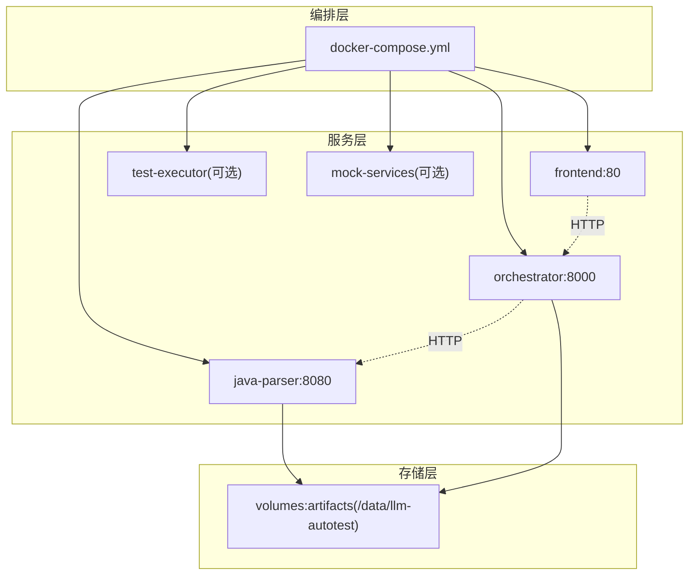
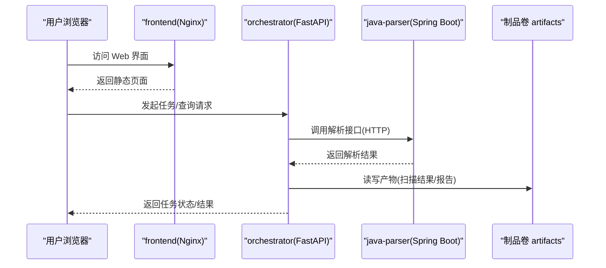
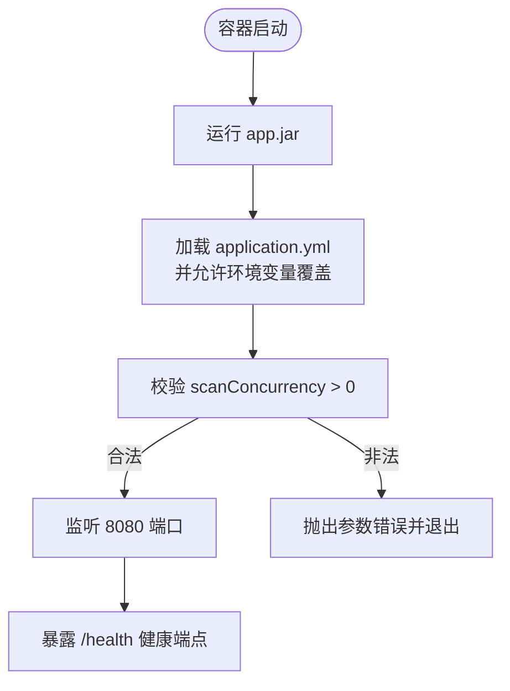
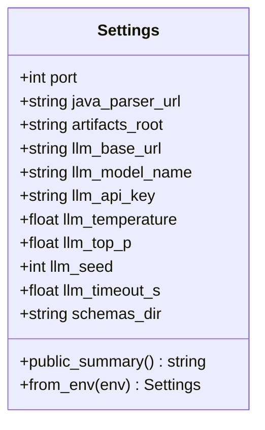
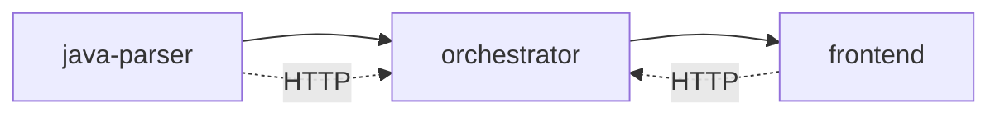

# 容器化部署

<cite>
**本文引用的文件**
- [docker-compose.yml](file://deploy/docker-compose.yml)
- [frontend Dockerfile](file://services/frontend/Dockerfile)
- [java-parser Dockerfile](file://services/java-parser/Dockerfile)
- [orchestrator Dockerfile](file://services/orchestrator/Dockerfile)
- [CI 工作流](file://.github/workflows/ci.yml)
- [Java 应用配置](file://services/java-parser/src/main/resources/application.yml)
- [Orchestrator 配置读取](file://services/orchestrator/src/orchestrator/config.py)
- [Java 解析器属性](file://services/java-parser/src/main/java/com/llmautotest/parser/ParserProperties.java)
- [前端包配置](file://services/frontend/package.json)
</cite>

## 目录
1. [简介](#简介)
2. [项目结构](#项目结构)
3. [核心组件](#核心组件)
4. [架构总览](#架构总览)
5. [详细组件分析](#详细组件分析)
6. [依赖关系与启动顺序](#依赖关系与启动顺序)
7. [环境变量与配置管理](#环境变量与配置管理)
8. [数据卷与持久化](#数据卷与持久化)
9. [健康检查与故障恢复](#健康检查与故障恢复)
10. [构建与镜像优化策略](#构建与镜像优化策略)
11. [开发与生产环境差异](#开发与生产环境差异)
12. [部署命令示例](#部署命令示例)
13. [常见问题排查](#常见问题排查)
14. [结论](#结论)

## 简介
本章节面向运维与研发人员，提供 LLM-AutoTest 的容器化部署指南。内容涵盖：
- 各服务 Dockerfile 配置、依赖管理与镜像优化
- docker-compose 编排与服务间通信、环境变量、数据卷挂载与健康检查
- 开发环境与生产环境的差异（端口映射、网络、存储）
- 容器启动顺序、依赖管理与故障恢复机制
- 完整部署命令与常见问题解决方案

## 项目结构
LLM-AutoTest 采用多服务架构，通过 docker-compose 进行编排：
- java-parser：Java 服务，提供代码解析能力
- orchestrator：Python 服务，负责流水线编排、产物管理与 REST API
- frontend：Nginx 静态页面占位，后续将承载 Vue 前端
- test-executor、mock-services：可选服务，按 profile 启用

图示来源
- [docker-compose.yml:1-62](file://deploy/docker-compose.yml#L1-L62)

章节来源
- [docker-compose.yml:1-62](file://deploy/docker-compose.yml#L1-L62)

## 核心组件
- java-parser：基于 Spring Boot + Maven 的多阶段构建镜像，暴露 8080 端口，提供 /health 健康端点
- orchestrator：基于 Python 3.11 + uv 的 FastAPI 服务，暴露 8000 端口，调用 java-parser 与 LLM
- frontend：基于 Nginx 的静态站点占位，暴露 80 端口，后续替换为构建后的前端资源
- test-executor、mock-services：按需启用的辅助服务

章节来源
- [java-parser Dockerfile:1-21](file://services/java-parser/Dockerfile#L1-L21)
- [orchestrator Dockerfile:1-16](file://services/orchestrator/Dockerfile#L1-L16)
- [frontend Dockerfile:1-13](file://services/frontend/Dockerfile#L1-L13)
- [docker-compose.yml:1-62](file://deploy/docker-compose.yml#L1-L62)

## 架构总览
系统由三个主要服务组成，通过 HTTP 通信，共享一个制品卷用于产物持久化。

图示来源
- [docker-compose.yml:1-62](file://deploy/docker-compose.yml#L1-L62)
- [java-parser Dockerfile:1-21](file://services/java-parser/Dockerfile#L1-L21)
- [orchestrator Dockerfile:1-16](file://services/orchestrator/Dockerfile#L1-L16)
- [frontend Dockerfile:1-13](file://services/frontend/Dockerfile#L1-L13)

## 详细组件分析

### java-parser 服务
- 多阶段构建：使用 maven:3.9-eclipse-temurin-21 作为构建阶段，最终镜像仅包含 JRE 运行时
- 暴露端口：8080
- 健康检查：/health 端点，compose 中使用 wget 探测
- 配置：application.yml 中定义 server.port 与 parser.scan-concurrency；支持环境变量覆盖
- 并发控制：scanConcurrency 必须为正数，防止非法配置导致异常

图示来源
- [java-parser Dockerfile:1-21](file://services/java-parser/Dockerfile#L1-L21)
- [Java 应用配置:1-8](file://services/java-parser/src/main/resources/application.yml#L1-L8)
- [Java 解析器属性:1-17](file://services/java-parser/src/main/java/com/llmautotest/parser/ParserProperties.java#L1-L17)

章节来源
- [java-parser Dockerfile:1-21](file://services/java-parser/Dockerfile#L1-L21)
- [Java 应用配置:1-8](file://services/java-parser/src/main/resources/application.yml#L1-L8)
- [Java 解析器属性:1-17](file://services/java-parser/src/main/java/com/llmautotest/parser/ParserProperties.java#L1-L17)

### orchestrator 服务
- 基础镜像：python:3.11-slim
- 依赖管理：使用 uv 安装依赖，分两步：先安装项目依赖，再同步源码
- 暴露端口：8000
- 配置读取：从环境变量读取关键配置，包括 JAVA_PARSER_URL、LLM_* 等
- 产物路径：默认 /data/llm-autotest，可通过 ARTIFACTS_ROOT 调整
- Schema 目录：默认 schemas，可通过 SCHEMAS_DIR 调整

图示来源
- [Orchestrator 配置读取:1-56](file://services/orchestrator/src/orchestrator/config.py#L1-L56)

章节来源
- [orchestrator Dockerfile:1-16](file://services/orchestrator/Dockerfile#L1-L16)
- [Orchestrator 配置读取:1-56](file://services/orchestrator/src/orchestrator/config.py#L1-L56)

### frontend 服务
- 基础镜像：nginx:1.27-alpine
- 当前状态：占位页面，待 V2.1 范围裁决后接入真实前端构建流程
- 暴露端口：80
- 后续优化：可引入多阶段构建，先构建前端资源，再复制到 nginx 镜像

章节来源
- [frontend Dockerfile:1-13](file://services/frontend/Dockerfile#L1-L13)
- [前端包配置:1-30](file://services/frontend/package.json#L1-L30)

## 依赖关系与启动顺序
- java-parser：无外部依赖，独立启动
- orchestrator：依赖 java-parser，需等待其健康检查通过
- frontend：依赖 orchestrator，确保后端可用后再提供服务
- test-executor、mock-services：按 profile 启用，不影响基础链路

图示来源
- [docker-compose.yml:1-62](file://deploy/docker-compose.yml#L1-L62)

章节来源
- [docker-compose.yml:1-62](file://deploy/docker-compose.yml#L1-L62)

## 环境变量与配置管理
- orchestrator 必需环境变量：
  - JAVA_PARSER_URL：指向 java-parser 服务地址
  - LLM_BASE_URL、LLM_MODEL_NAME、LLM_API_KEY、LLM_TEMPERATURE、LLM_TOP_P、LLM_SEED、LLM_TIMEOUT_S：LLM 调用相关参数
  - PORT：服务监听端口（默认 8000）
  - ARTIFACTS_ROOT：制品根目录（默认 /data/llm-autotest）
  - SCHEMAS_DIR：Schema 目录（默认 schemas）
- java-parser 配置：
  - server.port：服务端口（默认 8080）
  - parser.scan-concurrency：并发度（必须为正数）
- compose 中通过 environment 与 env_file 注入变量，建议将敏感信息放入 .env 文件并通过 --env-file 传入

章节来源
- [Orchestrator 配置读取:1-56](file://services/orchestrator/src/orchestrator/config.py#L1-L56)
- [Java 应用配置:1-8](file://services/java-parser/src/main/resources/application.yml#L1-L8)
- [docker-compose.yml:1-62](file://deploy/docker-compose.yml#L1-L62)

## 数据卷与持久化
- 统一制品卷：artifacts，挂载到 /data/llm-autotest
- 用途：保存扫描结果、测试产物、报告等
- 备份策略：宿主机路径与备份策略待定，建议在 CI/CD 中集成制品归档

章节来源
- [docker-compose.yml:1-62](file://deploy/docker-compose.yml#L1-L62)

## 健康检查与故障恢复
- java-parser：通过 /health 端点进行健康检查，compose 中配置 wget 探测
- 重启策略：unless-stopped，保证服务在异常退出后自动重启
- 依赖等待：orchestrator 通过 depends_on 与 condition: service_healthy 确保 java-parser 就绪后再启动

章节来源
- [docker-compose.yml:1-62](file://deploy/docker-compose.yml#L1-L62)

## 构建与镜像优化策略
- java-parser：
  - 多阶段构建：构建阶段使用 Maven，运行阶段仅包含 JRE，减小镜像体积
  - 依赖缓存：利用 Docker 层缓存加速构建
- orchestrator：
  - 使用 uv 进行依赖管理，分步安装减少镜像层大小
  - 冻结依赖：uv sync --frozen 确保构建可重复
- frontend：
  - 当前为占位镜像，后续可引入多阶段构建，先构建前端资源再复制到 nginx
- CI 集成：
  - GitHub Actions 对 Python、Java、Frontend 分别执行 lint、build、test
  - 推送 main 分支时触发 Docker 构建

章节来源
- [java-parser Dockerfile:1-21](file://services/java-parser/Dockerfile#L1-L21)
- [orchestrator Dockerfile:1-16](file://services/orchestrator/Dockerfile#L1-L16)
- [frontend Dockerfile:1-13](file://services/frontend/Dockerfile#L1-L13)
- [CI 工作流:1-75](file://.github/workflows/ci.yml#L1-L75)

## 开发与生产环境差异
- 端口映射：
  - 开发：java-parser:8081->8080, orchestrator:8000->8000, frontend:8080->80
  - 生产：建议通过反向代理（如 Nginx/Traefik）统一管理入口，避免直接暴露内部端口
- 网络配置：
  - 开发：默认 Docker 网络即可
  - 生产：建议使用自定义网络隔离，限制服务间访问权限
- 存储策略：
  - 开发：本地卷或临时卷
  - 生产：建议使用云盘或对象存储，结合备份与监控
- 环境变量：
  - 开发：可使用默认值或本地 .env
  - 生产：通过密钥管理服务注入敏感变量

章节来源
- [docker-compose.yml:1-62](file://deploy/docker-compose.yml#L1-L62)

## 部署命令示例
- 启动所有服务：
  - docker compose -f deploy/docker-compose.yml up -d
- 指定环境变量文件启动：
  - docker compose -f deploy/docker-compose.yml --env-file deploy/.env up -d
- 仅启动基础服务（不包含可选服务）：
  - docker compose -f deploy/docker-compose.yml up -d
- 启动包含 test-executor 的环境：
  - docker compose -f deploy/docker-compose.yml --profile exec up -d
- 启动包含 mock-services 的环境：
  - docker compose -f deploy/docker-compose.yml --profile mock up -d

章节来源
- [docker-compose.yml:1-62](file://deploy/docker-compose.yml#L1-L62)

## 常见问题排查
- java-parser 启动失败：
  - 检查 /health 端点是否可达
  - 确认 parser.scan-concurrency 是否为正数
- orchestrator 无法连接 java-parser：
  - 确认 JAVA_PARSER_URL 是否正确
  - 检查网络连通性与防火墙设置
- 制品丢失：
  - 检查 volumes:artifacts 是否挂载成功
  - 确认容器内路径 /data/llm-autotest 是否存在
- 前端无法访问：
  - 确认 frontend 服务已启动且端口映射正确
  - 检查浏览器控制台是否有跨域或网络错误

章节来源
- [docker-compose.yml:1-62](file://deploy/docker-compose.yml#L1-L62)
- [Java 应用配置:1-8](file://services/java-parser/src/main/resources/application.yml#L1-L8)
- [Orchestrator 配置读取:1-56](file://services/orchestrator/src/orchestrator/config.py#L1-L56)

## 结论
LLM-AutoTest 通过多服务架构与 docker-compose 编排实现了清晰的职责分离与依赖管理。各服务的 Dockerfile 设计遵循最佳实践，结合 CI/CD 保证了构建的可重复性与质量门禁。在生产环境中，建议通过反向代理、自定义网络与集中式密钥管理进一步提升安全性与可维护性。