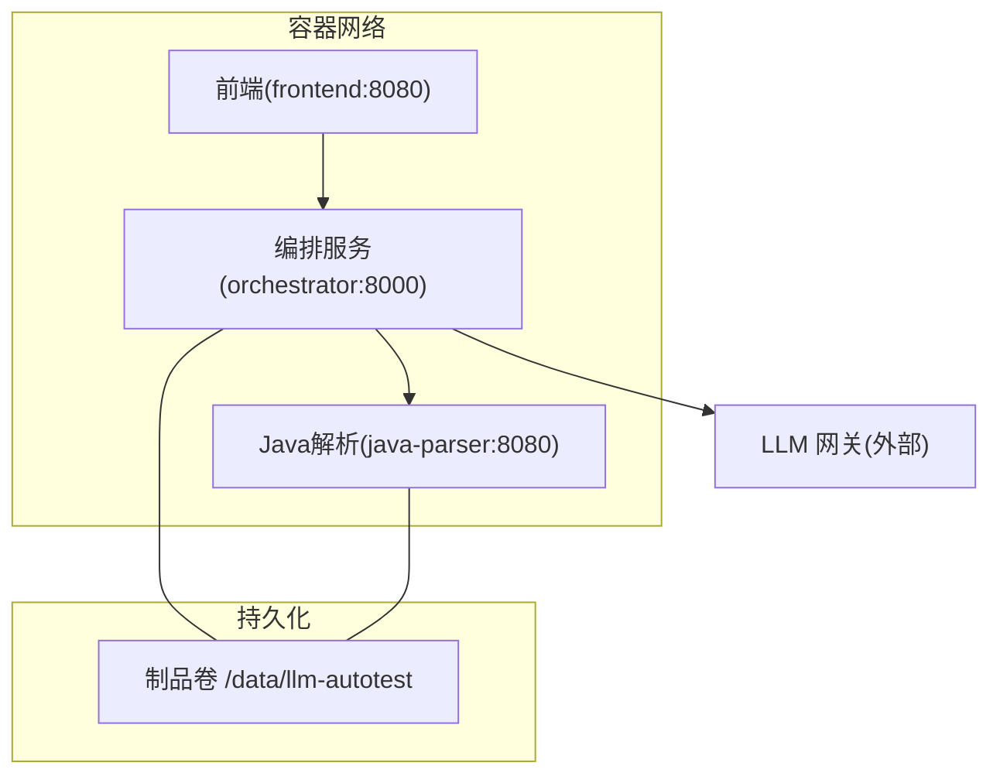
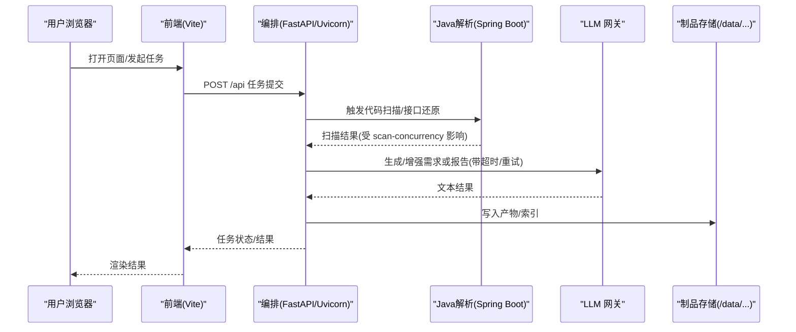
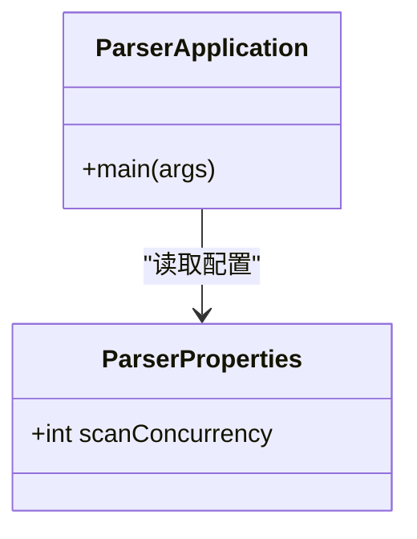
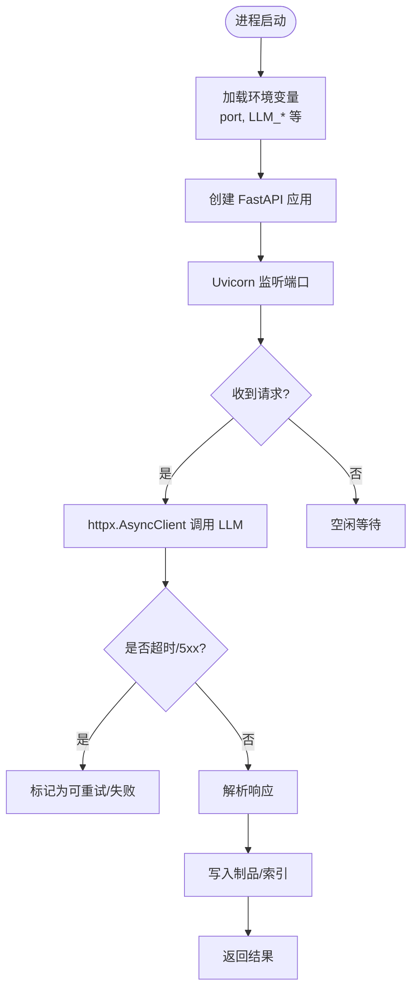
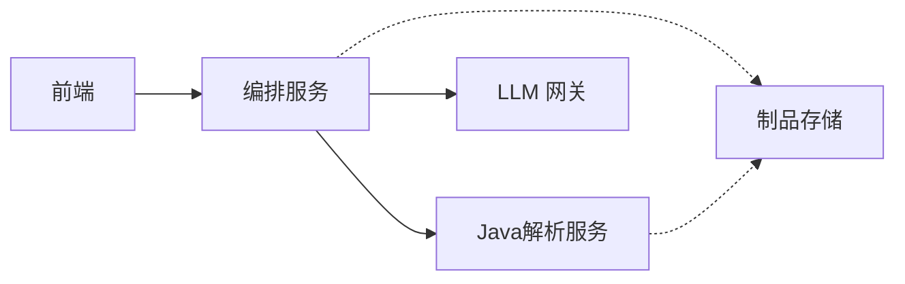

# 性能优化

<cite>
**本文引用的文件**
- [docker-compose.yml](file://deploy/docker-compose.yml)
- [application.yml](file://services/java-parser/src/main/resources/application.yml)
- [ParserProperties.java](file://services/java-parser/src/main/java/com/llmautotest/parser/ParserProperties.java)
- [ParserApplication.java](file://services/java-parser/src/main/java/com/llmautotest/parser/ParserApplication.java)
- [pom.xml](file://services/java-parser/pom.xml)
- [__main__.py](file://services/orchestrator/src/orchestrator/__main__.py)
- [config.py](file://services/orchestrator/src/orchestrator/config.py)
- [client.py](file://services/orchestrator/src/orchestrator/llm/client.py)
- [vite.config.ts](file://services/frontend/vite.config.ts)
- [package.json](file://services/frontend/package.json)
</cite>

## 目录
1. [简介](#简介)
2. [项目结构](#项目结构)
3. [核心组件](#核心组件)
4. [架构总览](#架构总览)
5. [详细组件分析](#详细组件分析)
6. [依赖关系分析](#依赖关系分析)
7. [性能考量](#性能考量)
8. [故障排查指南](#故障排查指南)
9. [结论](#结论)
10. [附录](#附录)

## 简介
本指南面向 LLM-AutoTest 系统的性能调优与容量规划，覆盖 JVM 配置、Python 进程池与异步调用、前端资源优化、数据库连接池与缓存策略、负载均衡与高可用设计、内存/CPU/I/O 优化方法、基准测试与瓶颈定位工具、容量规划与扩容策略，以及性能监控指标与回归检测机制。内容基于仓库中现有服务与配置进行落地建议，确保可操作且与当前实现一致。

## 项目结构
系统由三个主要服务组成：
- Java 解析服务（java-parser）：提供多仓库扫描与接口逆向还原能力，端口 8080，并发度可配置。
- 编排服务（orchestrator）：FastAPI + Uvicorn 提供 REST API，负责流水线编排、产物管理与外部服务调用。
- 前端服务（frontend）：Vue 3 + Vite，开发期通过代理转发到 orchestrator。

部署通过 docker-compose 编排，共享制品卷 artifacts，健康检查保障启动顺序。

图表来源
- [docker-compose.yml:4-41](file://deploy/docker-compose.yml#L4-L41)

章节来源
- [docker-compose.yml:1-62](file://deploy/docker-compose.yml#L1-L62)

## 核心组件
- java-parser：Spring Boot Web 应用，暴露健康检查与解析接口；扫描并发度通过配置项 parser.scan-concurrency 控制，默认 4。
- orchestrator：Uvicorn 单进程运行 FastAPI 应用；通过环境变量注入运行时参数（端口、超时、模型参数等）。
- frontend：Vite 开发服务器代理 /api 到 orchestrator；生产构建静态资源由反向代理或容器内 Nginx 托管（按需扩展）。

章节来源
- [application.yml:1-8](file://services/java-parser/src/main/resources/application.yml#L1-L8)
- [ParserProperties.java:1-17](file://services/java-parser/src/main/java/com/llmautotest/parser/ParserProperties.java#L1-L17)
- [__main__.py:1-26](file://services/orchestrator/src/orchestrator/__main__.py#L1-L26)
- [config.py:1-56](file://services/orchestrator/src/orchestrator/config.py#L1-L56)
- [vite.config.ts:1-16](file://services/frontend/vite.config.ts#L1-L16)

## 架构总览
下图展示请求从前端到编排再到解析与 LLM 的调用链，并标注关键性能点：并发扫描、HTTP 客户端超时、重试策略、制品 I/O。

图表来源
- [__main__.py:15-21](file://services/orchestrator/src/orchestrator/__main__.py#L15-L21)
- [client.py:128-154](file://services/orchestrator/src/orchestrator/llm/client.py#L128-L154)
- [application.yml:1-8](file://services/java-parser/src/main/resources/application.yml#L1-L8)

## 详细组件分析

### Java 解析服务（java-parser）
- 启动入口与配置扫描：Spring Boot 应用启用配置属性扫描，读取 parser.* 前缀的配置。
- 并发控制：parser.scan-concurrency 用于限制多仓库扫描并发度，默认 4，必须为正数。
- 端口与健康检查：默认 8080，compose 中通过 HTTP 健康检查探测。

图表来源
- [ParserApplication.java:1-17](file://services/java-parser/src/main/java/com/llmautotest/parser/ParserApplication.java#L1-L17)
- [ParserProperties.java:1-17](file://services/java-parser/src/main/java/com/llmautotest/parser/ParserProperties.java#L1-L17)

调优要点
- JVM 参数（容器环境）
  - 堆大小：根据容器内存上限设置 -Xms/-Xmx，建议相等以减少动态调整开销。
  - GC：优先使用 G1GC；合理设置 -XX:MaxGCPauseMillis 与 -XX:G1HeapRegionSize。
  - 元空间：-XX:MetaspaceSize 与 -XX:MaxMetaspaceSize 按类加载规模设定。
  - 线程栈：-Xss 根据并发深度评估，避免过大导致 OOM。
- 应用级并发
  - 将 parser.scan-concurrency 与 CPU 核数、磁盘 IOPS 匹配；大仓库场景建议先压测再上调。
  - 若后续引入线程池/连接池，需与扫描并发协同，避免争用。
- 端口与网络
  - 保持 8080 端口稳定；在反向代理层开启连接复用与超时保护。

章节来源
- [application.yml:1-8](file://services/java-parser/src/main/resources/application.yml#L1-L8)
- [ParserProperties.java:1-17](file://services/java-parser/src/main/java/com/llmautotest/parser/ParserProperties.java#L1-L17)
- [pom.xml:1-83](file://services/java-parser/pom.xml#L1-L83)

### 编排服务（orchestrator）
- 启动方式：Uvicorn 单进程运行 FastAPI，绑定 0.0.0.0，端口来自环境变量。
- 配置来源：Settings 从环境变量读取，包含 LLM 调用参数与超时、制品目录等。
- 外部调用：通过 httpx.AsyncClient 调用 LLM 网关，支持超时与可重试错误分类。

图表来源
- [__main__.py:15-21](file://services/orchestrator/src/orchestrator/__main__.py#L15-L21)
- [config.py:1-56](file://services/orchestrator/src/orchestrator/config.py#L1-L56)
- [client.py:128-154](file://services/orchestrator/src/orchestrator/llm/client.py#L128-L154)

调优要点
- Python 进程与线程
  - 单进程 Uvicorn 适合轻量 IO；高并发下建议水平扩展多个 worker（通过容器副本或反向代理分发），而非增加线程。
  - 对 CPU 密集节点（如文档解析）考虑子进程隔离，避免阻塞事件循环。
- 外部调用
  - 合理设置 LLM_TIMEOUT_S，避免长尾拖垮队列；对 5xx 与网络异常采用指数退避重试。
  - 连接复用：httpx 已内置连接池，注意最大连接数与超时匹配。
- 配置安全
  - 日志仅输出 public_summary，不包含密钥；避免敏感信息泄露。

章节来源
- [__main__.py:1-26](file://services/orchestrator/src/orchestrator/__main__.py#L1-L26)
- [config.py:1-56](file://services/orchestrator/src/orchestrator/config.py#L1-L56)
- [client.py:128-154](file://services/orchestrator/src/orchestrator/llm/client.py#L128-L154)

### 前端服务（frontend）
- 开发期代理：Vite server 将 /api 请求代理到 orchestrator，便于本地联调。
- 构建与依赖：Vue 3 + Vite，脚本命令清晰，便于 CI 集成。

调优要点
- 开发体验
  - 保持代理目标指向正确的 orchestrator 端口；必要时添加 gzip/brotli 压缩。
- 生产构建
  - 使用 vite build 产出静态资源，配合 CDN 与浏览器缓存策略（Cache-Control/ETag）。
  - 拆分路由与组件，减少首屏体积；启用 Tree-shaking 与 Code Splitting。

章节来源
- [vite.config.ts:1-16](file://services/frontend/vite.config.ts#L1-L16)
- [package.json:1-30](file://services/frontend/package.json#L1-L30)

## 依赖关系分析
- 编排服务依赖 Java 解析服务与 LLM 网关；前端依赖编排服务 API。
- 制品数据通过共享卷在容器间传递，降低跨服务传输成本。

图表来源
- [docker-compose.yml:4-41](file://deploy/docker-compose.yml#L4-L41)

章节来源
- [docker-compose.yml:1-62](file://deploy/docker-compose.yml#L1-L62)

## 性能考量

### JVM 配置（java-parser）
- 堆与 GC
  - 设置 -Xms=-Xmx 固定堆大小，减少抖动；使用 G1GC 并调优 MaxGCPauseMillis。
- 元空间与线程
  - Metaspace 按类数量预估；-Xss 避免过深递归导致的栈溢出。
- 监控
  - 启用 GC 日志与 JFR/JMX，结合 Prometheus/Grafana 观察吞吐与延迟。

### Python 进程池与异步处理（orchestrator）
- 进程模型
  - 以容器副本水平扩展 Uvicorn 实例，通过负载均衡器分发请求。
- 异步 I/O
  - 使用 httpx.AsyncClient 并发调用外部服务；合理设置连接池大小与超时。
- 重试与熔断
  - 对 5xx 与网络异常实施指数退避重试；对持续失败的服务快速降级。

### 前端资源优化（frontend）
- 构建优化
  - 启用代码分割、Tree-shaking、压缩；按需懒加载路由与组件。
- 缓存策略
  - 静态资源加哈希文件名，配合 CDN 强缓存；HTML 短缓存或协商缓存。
- 开发代理
  - 保持代理路径与后端契约一致，减少联调往返。

### 数据库连接池与缓存策略
- 连接池
  - 若后续引入数据库，应配置连接池大小与超时，避免连接泄漏；监控活跃连接与等待时间。
- 缓存
  - 热点数据（如模型配置、产物索引）放入内存缓存或 Redis；设置 TTL 与失效策略。
- 读写分离
  - 读多写少场景可引入只读副本，提升吞吐。

### 异步处理最佳实践
- 任务分层
  - 将耗时任务（LLM 调用、文件处理）放入后台任务队列，API 立即返回任务 ID。
- 背压与限流
  - 对上游流量进行令牌桶/漏桶限流，防止雪崩。
- 幂等与去重
  - 对外部调用与写入操作实现幂等键，避免重复执行。

### 负载均衡与高可用
- 负载均衡
  - 在编排服务前放置 LB，按权重/会话亲和分发；健康检查剔除异常实例。
- 多副本与滚动升级
  - 编排服务多副本部署，灰度发布与回滚策略完善。
- 容灾
  - 制品存储多副本或异地备份；关键配置集中管理。

### 内存、CPU、I/O 优化
- 内存
  - 监控堆与非堆使用；识别大对象与内存泄漏；合理设置分代大小。
- CPU
  - 热点函数采样分析；避免阻塞式 I/O；并行化 CPU 密集任务。
- I/O
  - 合并小文件写入；使用缓冲与零拷贝；SSD/NVMe 提升随机读写。

### 基准测试与瓶颈定位
- 基准
  - 使用 wrk/k6 对 API 进行压测；记录 P50/P95/P99 延迟与吞吐。
- 定位
  - JVM：JFR、Async-Profiler、VisualVM；Python：py-spy、cProfile；前端：Lighthouse、Chrome DevTools。
- 链路追踪
  - 引入分布式追踪（如 OpenTelemetry），关联各阶段耗时。

### 容量规划与扩容策略
- 容量模型
  - 以 QPS × 平均时延估算所需实例数；考虑突发流量与安全系数。
- 自动扩缩容
  - 基于 CPU/内存/请求队列长度触发 HPA；冷启动预热。
- 分级降级
  - 非关键功能降级，保证核心链路可用。

### 性能监控指标与回归检测
- 指标
  - 请求量、错误率、P95/P99 延迟、GC 停顿、连接池使用率、I/O 吞吐。
- 告警
  - 阈值告警与趋势预测；异常突增自动通知。
- 回归检测
  - 每次发布执行性能基线对比；超过阈值的变更阻断合并。

## 故障排查指南
- 启动与健康检查
  - 确认 compose 健康检查通过；查看服务日志定位启动失败原因。
- 外部调用失败
  - 检查 LLM 超时与重试策略；区分网络错误与服务端 5xx。
- 资源耗尽
  - 监控 JVM 堆与 GC；检查 Python 进程内存与文件句柄；前端资源未命中缓存导致带宽占用过高。
- 慢查询与阻塞
  - 对耗时节点打点；分析线程/协程占用；必要时引入队列与批处理。

章节来源
- [docker-compose.yml:11-16](file://deploy/docker-compose.yml#L11-L16)
- [client.py:128-154](file://services/orchestrator/src/orchestrator/llm/client.py#L128-L154)

## 结论
通过对 java-parser 的 JVM 与并发参数、orchestrator 的进程与异步调用、frontend 的资源构建与缓存策略进行系统化调优，并结合连接池、缓存、负载均衡与高可用设计，可显著提升 LLM-AutoTest 的整体性能与稳定性。建议在生产环境中建立完善的监控与回归检测体系，持续优化容量与弹性。

## 附录
- 关键环境变量（示例）
  - PORT：编排服务端口
  - JAVA_PARSER_URL：Java 解析服务地址
  - LLM_BASE_URL、LLM_MODEL_NAME、LLM_API_KEY、LLM_TEMPERATURE、LLM_TOP_P、LLM_SEED、LLM_TIMEOUT_S：LLM 调用参数
  - ARTIFACTS_ROOT：制品根目录
  - SCHEMAS_DIR：Schema 目录
- 参考配置位置
  - 编排服务配置读取：[config.py:1-56](file://services/orchestrator/src/orchestrator/config.py#L1-L56)
  - Java 解析并发配置：[application.yml:1-8](file://services/java-parser/src/main/resources/application.yml#L1-L8)、[ParserProperties.java:1-17](file://services/java-parser/src/main/java/com/llmautotest/parser/ParserProperties.java#L1-L17)
  - 前端代理配置：[vite.config.ts:1-16](file://services/frontend/vite.config.ts#L1-L16)