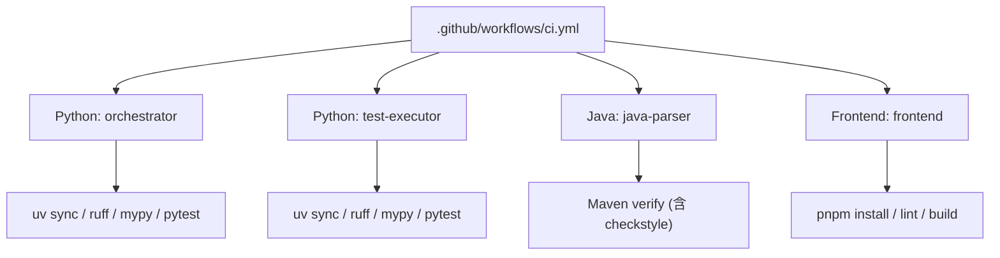
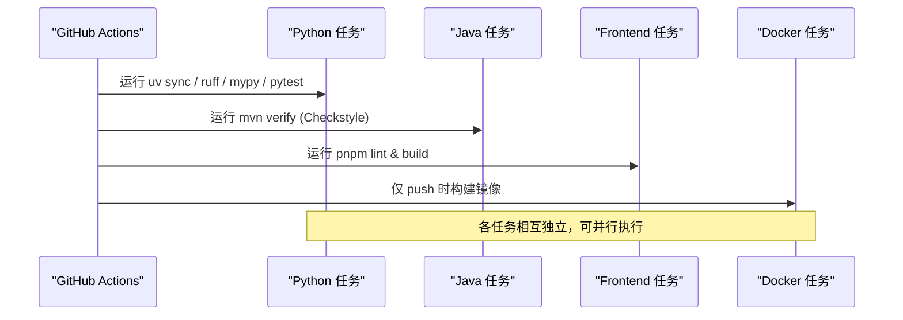
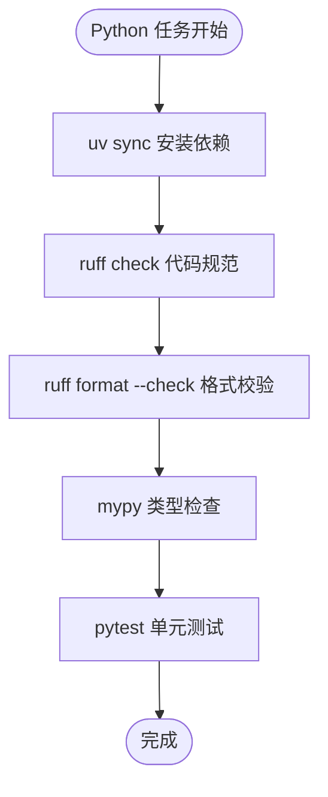
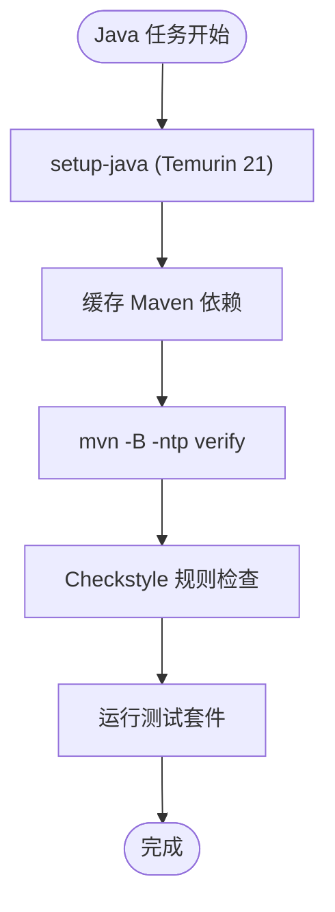
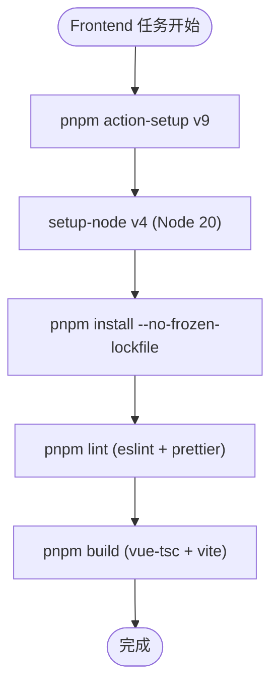
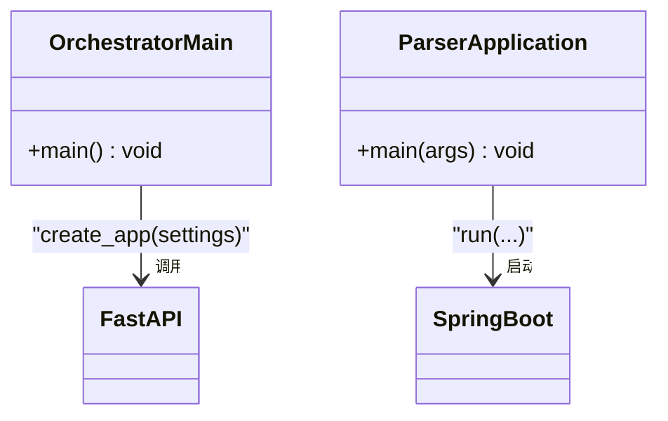
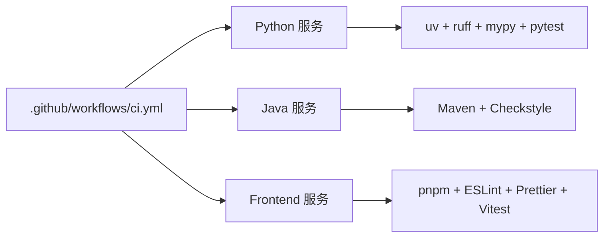

# 持续集成与交付

<cite>
**本文引用的文件**
- [.github/workflows/ci.yml](file://.github/workflows/ci.yml)
- [services/frontend/package.json](file://services/frontend/package.json)
- [services/frontend/eslint.config.js](file://services/frontend/eslint.config.js)
- [services/java-parser/pom.xml](file://services/java-parser/pom.xml)
- [services/java-parser/checkstyle.xml](file://services/java-parser/checkstyle.xml)
- [services/orchestrator/pyproject.toml](file://services/orchestrator/pyproject.toml)
- [services/test-executor/pyproject.toml](file://services/test-executor/pyproject.toml)
- [services/orchestrator/src/orchestrator/__main__.py](file://services/orchestrator/src/orchestrator/__main__.py)
- [services/java-parser/src/main/java/com/llmautotest/parser/ParserApplication.java](file://services/java-parser/src/main/java/com/llmautotest/parser/ParserApplication.java)
- [.rules/python-code-style.md](file://.rules/python-code-style.md)
- [.rules/frontend-code-style.md](file://.rules/frontend-code-style.md)
</cite>

## 目录
1. [简介](#简介)
2. [项目结构](#项目结构)
3. [核心组件](#核心组件)
4. [架构总览](#架构总览)
5. [详细组件分析](#详细组件分析)
6. [依赖关系分析](#依赖关系分析)
7. [性能考虑](#性能考虑)
8. [故障排查指南](#故障排查指南)
9. [结论](#结论)
10. [附录](#附录)

## 简介
本文件面向 LLM-AutoTest 项目的持续集成与持续交付（CI/CD）流水线，基于仓库中的 GitHub Actions 工作流与各服务构建配置，系统化说明代码质量检查、单元测试执行、多语言构建流程与自动化测试策略。文档覆盖 Python（orchestrator、test-executor）、Java（java-parser）与前端（frontend）三大子服务的构建、规范检查与测试；并提供自定义 CI 流程的配置示例与最佳实践，以及发布流程、版本管理与回滚策略建议。

## 项目结构
仓库采用多服务 monorepo 组织：
- .github/workflows/ci.yml：统一的 CI 入口，定义 Python、Java、Frontend 与 Docker 构建任务矩阵。
- services/orchestrator：Python 编排服务，使用 uv + ruff + mypy + pytest。
- services/test-executor：Python 测试执行服务，同样使用 uv 工具链。
- services/java-parser：Java Spring Boot 服务，使用 Maven + Checkstyle。
- services/frontend：Vue 3 + TypeScript + Vite 前端，使用 pnpm + ESLint + Prettier + Vitest。

**图表来源**
- [.github/workflows/ci.yml:1-75](file://.github/workflows/ci.yml#L1-L75)

**章节来源**
- [.github/workflows/ci.yml:1-75](file://.github/workflows/ci.yml#L1-L75)

## 核心组件
- CI 触发条件：push 到 main 分支或任意 pull_request。
- 并行任务：
  - Python 任务：对 orchestrator 与 test-executor 分别执行 uv sync、ruff 检查与格式化校验、mypy 类型检查、pytest 单元测试。
  - Java 任务：设置 JDK 21（Temurin），缓存 Maven 依赖，执行 mvn verify（包含 Checkstyle 规则）。
  - Frontend 任务：安装 pnpm 与 Node 20，缓存 pnpm 依赖，执行 lint（ESLint + Prettier）与构建（vue-tsc + vite build）。
  - Docker 构建：仅在 push 事件下对 orchestrator、java-parser、frontend 构建镜像。

**章节来源**
- [.github/workflows/ci.yml:1-75](file://.github/workflows/ci.yml#L1-L75)

## 架构总览
下图展示了 CI 流水线中各语言服务的构建与验证步骤，以及与各自工具链的交互关系。

**图表来源**
- [.github/workflows/ci.yml:1-75](file://.github/workflows/ci.yml#L1-L75)

## 详细组件分析

### Python 服务（orchestrator 与 test-executor）
- 包管理与依赖锁定：使用 uv 管理依赖并生成 uv.lock，确保可重复构建。
- 代码质量：
  - ruff：统一 lint 与格式检查，行宽限制为 100，启用若干规则集，针对中文注释与 docstring 关闭特定规则。
  - mypy：严格模式类型检查，限定 src 目录。
- 测试：pytest 自动发现 tests 目录下的用例，支持异步模式（orchestrator 开启 asyncio_mode=auto）。
- 覆盖率门禁：当前 CI 未强制覆盖率阈值，但规范文档建议核心逻辑覆盖率 ≥70%。

**图表来源**
- [.github/workflows/ci.yml:9-28](file://.github/workflows/ci.yml#L9-L28)
- [services/orchestrator/pyproject.toml:1-53](file://services/orchestrator/pyproject.toml#L1-L53)
- [services/test-executor/pyproject.toml:1-45](file://services/test-executor/pyproject.toml#L1-L45)

**章节来源**
- [.github/workflows/ci.yml:9-28](file://.github/workflows/ci.yml#L9-L28)
- [services/orchestrator/pyproject.toml:1-53](file://services/orchestrator/pyproject.toml#L1-L53)
- [services/test-executor/pyproject.toml:1-45](file://services/test-executor/pyproject.toml#L1-L45)
- [.rules/python-code-style.md:1-56](file://.rules/python-code-style.md#L1-L56)

### Java 服务（java-parser）
- 构建与依赖：Spring Boot 3.4 基线，JDK 21，Maven 构建，依赖缓存加速。
- 代码规范：Checkstyle 在 verify 阶段执行，禁止 System.out 打印，要求 SLF4J 日志；行宽放宽至 120。
- 测试：通过 spring-boot-starter-test 提供测试能力，CI 通过 mvn verify 统一执行。

**图表来源**
- [.github/workflows/ci.yml:30-43](file://.github/workflows/ci.yml#L30-L43)
- [services/java-parser/pom.xml:1-83](file://services/java-parser/pom.xml#L1-L83)
- [services/java-parser/checkstyle.xml:1-34](file://services/java-parser/checkstyle.xml#L1-L34)

**章节来源**
- [.github/workflows/ci.yml:30-43](file://.github/workflows/ci.yml#L30-L43)
- [services/java-parser/pom.xml:1-83](file://services/java-parser/pom.xml#L1-L83)
- [services/java-parser/checkstyle.xml:1-34](file://services/java-parser/checkstyle.xml#L1-L34)

### 前端服务（frontend）
- 包管理与环境：pnpm@9 与 Node 20，依赖缓存路径指向 pnpm-lock.yaml。
- 代码规范：ESLint 推荐规则 + Vue 插件，Prettier 格式校验。
- 构建与测试：vue-tsc 类型检查 + vite build 构建产物；vitest 用于单元测试。

**图表来源**
- [.github/workflows/ci.yml:45-63](file://.github/workflows/ci.yml#L45-L63)
- [services/frontend/package.json:1-29](file://services/frontend/package.json#L1-L29)
- [services/frontend/eslint.config.js:1-17](file://services/frontend/eslint.config.js#L1-L17)

**章节来源**
- [.github/workflows/ci.yml:45-63](file://.github/workflows/ci.yml#L45-L63)
- [services/frontend/package.json:1-29](file://services/frontend/package.json#L1-L29)
- [services/frontend/eslint.config.js:1-17](file://services/frontend/eslint.config.js#L1-L17)
- [.rules/frontend-code-style.md:1-55](file://.rules/frontend-code-style.md#L1-L55)

### 服务入口与运行时
- orchestrator：通过 CLI 启动 FastAPI 应用，绑定 0.0.0.0 端口，读取环境变量配置。
- java-parser：Spring Boot 主类启动应用，扫描配置属性。

**图表来源**
- [services/orchestrator/src/orchestrator/__main__.py:1-26](file://services/orchestrator/src/orchestrator/__main__.py#L1-L26)
- [services/java-parser/src/main/java/com/llmautotest/parser/ParserApplication.java:1-17](file://services/java-parser/src/main/java/com/llmautotest/parser/ParserApplication.java#L1-L17)

**章节来源**
- [services/orchestrator/src/orchestrator/__main__.py:1-26](file://services/orchestrator/src/orchestrator/__main__.py#L1-L26)
- [services/java-parser/src/main/java/com/llmautotest/parser/ParserApplication.java:1-17](file://services/java-parser/src/main/java/com/llmautotest/parser/ParserApplication.java#L1-L17)

## 依赖关系分析
- CI 工作流对各服务构建任务的依赖是松耦合的，通过 matrix 与 working-directory 隔离。
- Python 服务依赖 uv 工具链与 pyproject.toml 中的依赖声明；Java 服务依赖 Maven 与 pom.xml；前端依赖 pnpm 与 package.json。
- 代码规范与测试工具在各服务内集中配置，便于统一治理。

**图表来源**
- [.github/workflows/ci.yml:1-75](file://.github/workflows/ci.yml#L1-L75)
- [services/orchestrator/pyproject.toml:1-53](file://services/orchestrator/pyproject.toml#L1-L53)
- [services/java-parser/pom.xml:1-83](file://services/java-parser/pom.xml#L1-L83)
- [services/frontend/package.json:1-29](file://services/frontend/package.json#L1-L29)

**章节来源**
- [.github/workflows/ci.yml:1-75](file://.github/workflows/ci.yml#L1-L75)

## 性能考虑
- 缓存优化：
  - Java：启用 Maven 依赖缓存，减少下载时间。
  - Frontend：启用 pnpm 依赖缓存，指定 lockfile 路径提升命中概率。
- 并行执行：Python、Java、Frontend 任务并行运行，缩短整体流水线时长。
- 构建最小化：
  - Python：使用 uv 快速同步依赖；ruff 与 mypy 增量检查。
  - Java：mvn verify 聚合检查与测试，避免多阶段重复。
  - Frontend：先 lint 后构建，尽早发现问题。

[本节为通用指导，不直接分析具体文件]

## 故障排查指南
- Python 任务失败：
  - ruff 检查失败：检查代码风格与导入顺序，遵循 .rules/python-code-style.md 规范。
  - mypy 类型错误：补齐类型标注，避免 Any 扩散，参考 pyproject.toml 中 strict 配置。
  - pytest 失败：定位测试断言与 Mock 配置，确保测试隔离与确定性。
- Java 任务失败：
  - Checkstyle 违规：修复命名、空捕获块、System.out 使用等，遵循 checkstyle.xml 规则。
  - 编译或测试失败：检查依赖版本与 Spring Boot 兼容性。
- Frontend 任务失败：
  - ESLint/Prettier 报错：按 eslint.config.js 与 .rules/frontend-code-style.md 调整代码。
  - 构建失败：确认 vue-tsc 类型检查与 Vite 构建配置。
- Docker 构建失败：
  - 检查对应服务的 Dockerfile 与上下文路径，确保依赖与构建命令正确。

**章节来源**
- [.rules/python-code-style.md:1-56](file://.rules/python-code-style.md#L1-L56)
- [.rules/frontend-code-style.md:1-55](file://.rules/frontend-code-style.md#L1-L55)
- [services/java-parser/checkstyle.xml:1-34](file://services/java-parser/checkstyle.xml#L1-L34)
- [.github/workflows/ci.yml:1-75](file://.github/workflows/ci.yml#L1-L75)

## 结论
当前 CI 流水线已覆盖 Python、Java 与前端三大服务的代码质量检查与基础构建验证。通过矩阵化任务与缓存策略，提升了构建效率与稳定性。建议在后续迭代中逐步引入覆盖率门禁、制品归档与发布流程，完善版本管理与回滚策略，以支撑更可靠的持续交付。

[本节为总结性内容，不直接分析具体文件]

## 附录

### 自定义 CI 流程配置示例与最佳实践
- 触发时机：
  - push 到 main：执行完整构建与 Docker 镜像构建。
  - pull_request：执行代码检查与测试，阻止不合格合并。
- 任务设计：
  - 将不同语言服务拆分为独立 job，利用 matrix 并行执行。
  - 使用 actions/setup-* 与缓存机制加速依赖安装。
  - 在每个服务目录设置 defaults.run.working-directory，简化命令路径。
- 质量门禁：
  - Python：ruff + mypy + pytest；建议增加覆盖率阈值。
  - Java：Checkstyle + 单元测试；禁止 SNAPSHOT 依赖进入主干。
  - Frontend：ESLint + Prettier + Vitest；构建产物需通过类型检查。
- 制品与发布：
  - 构建成功后上传制品（如 jar、wheel、dist）以便后续部署。
  - 使用语义化版本号与标签，结合 Git tag 触发发布流程。
- 回滚策略：
  - 基于镜像标签或制品版本进行回滚；保留最近 N 个稳定版本。
  - 发布前执行冒烟测试与灰度发布，降低风险。

[本节为通用指导，不直接分析具体文件]