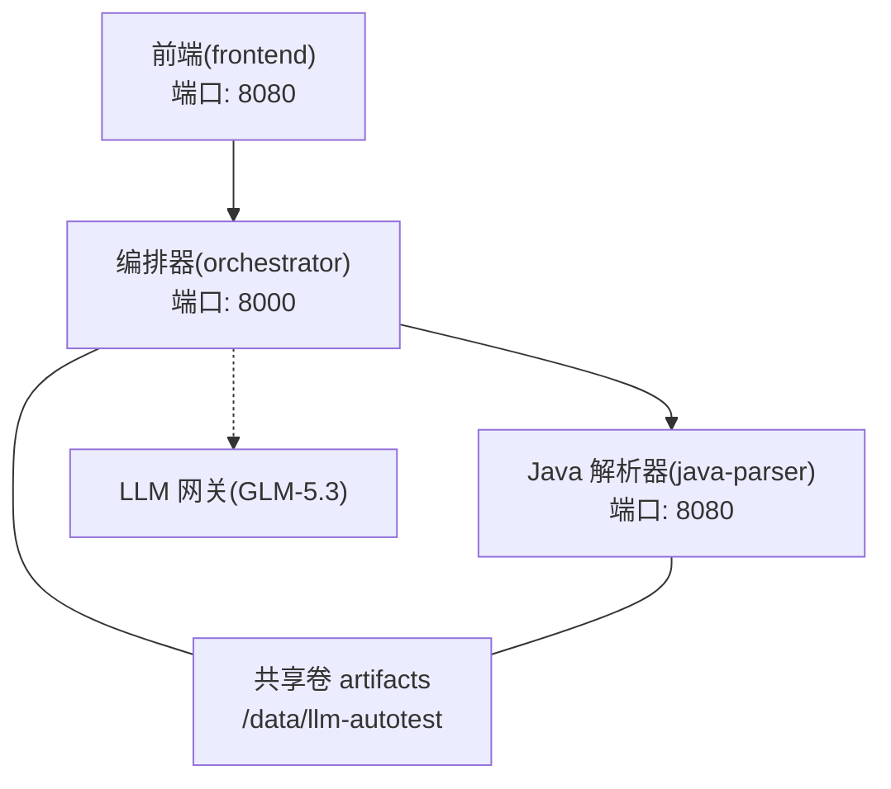
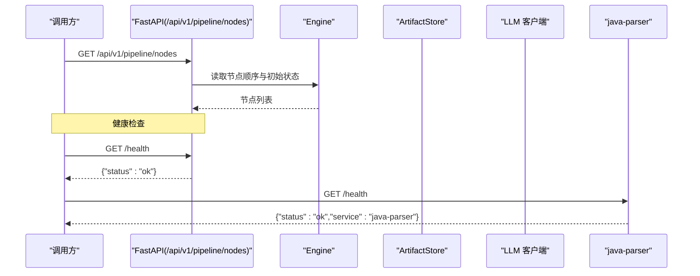
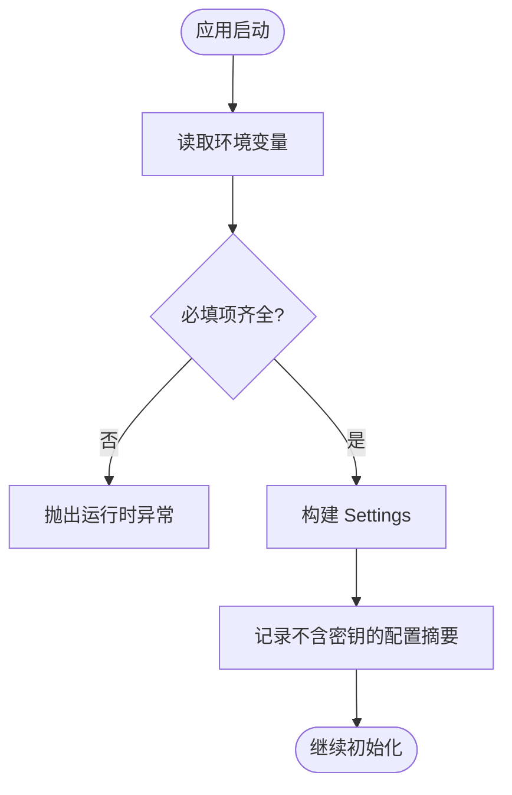
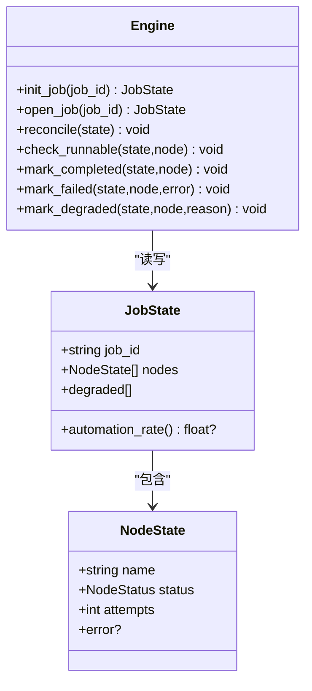
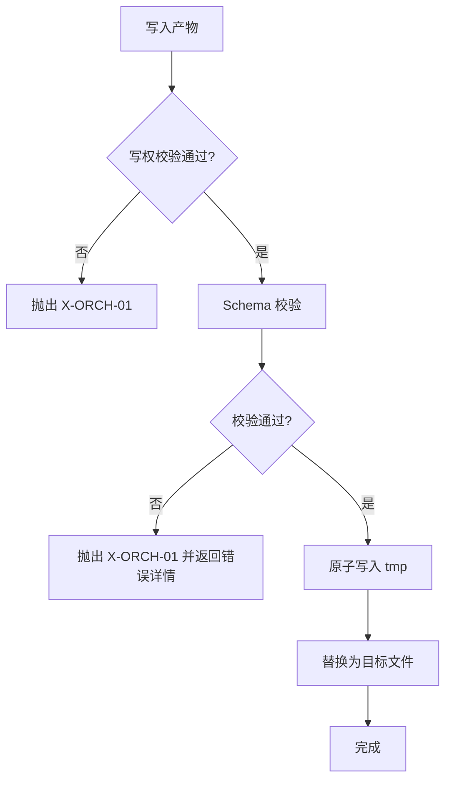
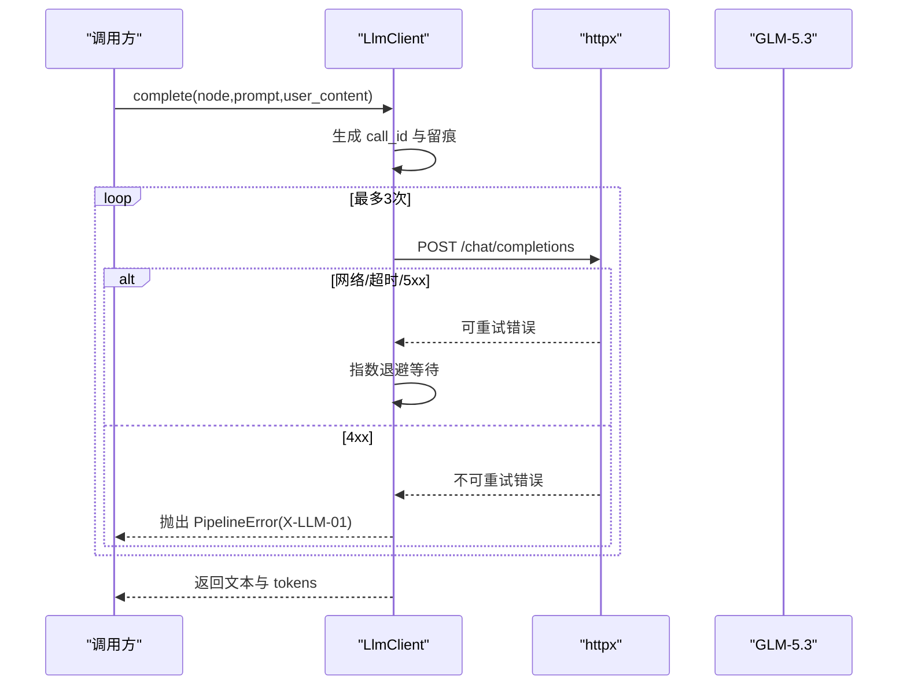
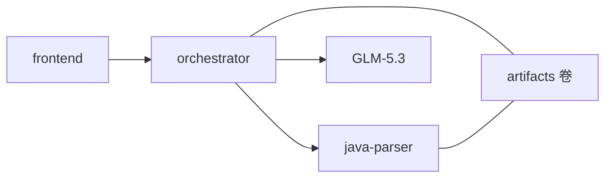

# 故障排查

<cite>
**本文引用的文件**
- [services/orchestrator/src/orchestrator/config.py](file://services/orchestrator/src/orchestrator/config.py)
- [services/orchestrator/src/orchestrator/api.py](file://services/orchestrator/src/orchestrator/api.py)
- [services/orchestrator/src/orchestrator/engine.py](file://services/orchestrator/src/orchestrator/engine.py)
- [services/orchestrator/src/orchestrator/pipeline.py](file://services/orchestrator/src/orchestrator/pipeline.py)
- [services/orchestrator/src/orchestrator/errors.py](file://services/orchestrator/src/orchestrator/errors.py)
- [services/orchestrator/src/orchestrator/artifacts.py](file://services/orchestrator/src/orchestrator/artifacts.py)
- [services/orchestrator/src/orchestrator/llm/client.py](file://services/orchestrator/src/orchestrator/llm/client.py)
- [services/java-parser/src/main/java/com/llmautotest/parser/HealthController.java](file://services/java-parser/src/main/java/com/llmautotest/parser/HealthController.java)
- [services/java-parser/src/main/resources/application.yml](file://services/java-parser/src/main/resources/application.yml)
- [deploy/docker-compose.yml](file://deploy/docker-compose.yml)
</cite>

## 目录
1. [简介](#简介)
2. [项目结构](#项目结构)
3. [核心组件](#核心组件)
4. [架构总览](#架构总览)
5. [详细组件分析](#详细组件分析)
6. [依赖关系分析](#依赖关系分析)
7. [性能与容量](#性能与容量)
8. [故障排查指南](#故障排查指南)
9. [健康检查与自愈](#健康检查与自愈)
10. [调试与远程诊断](#调试与远程诊断)
11. [灾难恢复与备份验证](#灾难恢复与备份验证)
12. [问题跟踪与知识沉淀](#问题跟踪与知识沉淀)
13. [故障演练与应急预案](#故障演练与应急预案)
14. [结论](#结论)

## 简介
本手册面向 LLM-AutoTest 的运维与排障人员，聚焦服务启动失败、API 调用异常、数据同步三类常见问题；提供日志分析技巧（关键标识、错误堆栈解读、性能瓶颈定位）、健康检查与自愈方法、调试工具与远程诊断配置、灾难恢复流程与备份验证方法，以及问题跟踪与知识沉淀机制、故障演练与应急预案制定指导。

## 项目结构
系统由三个主要容器组成：前端、编排器（orchestrator）、Java 解析器（java-parser），并通过共享卷 artifacts 持久化产物与状态。编排器对外暴露 FastAPI 接口，负责流水线调度、状态持久化与降级处理；Java 解析器提供代码扫描与接口逆向能力；前端用于演示与交互。

图表来源
- [deploy/docker-compose.yml:1-62](file://deploy/docker-compose.yml#L1-L62)
- [services/orchestrator/src/orchestrator/api.py:11-27](file://services/orchestrator/src/orchestrator/api.py#L11-L27)
- [services/java-parser/src/main/resources/application.yml:1-8](file://services/java-parser/src/main/resources/application.yml#L1-L8)

章节来源
- [deploy/docker-compose.yml:1-62](file://deploy/docker-compose.yml#L1-L62)
- [services/orchestrator/src/orchestrator/api.py:11-27](file://services/orchestrator/src/orchestrator/api.py#L11-L27)
- [services/java-parser/src/main/resources/application.yml:1-8](file://services/java-parser/src/main/resources/application.yml#L1-L8)

## 核心组件
- 配置中心：从环境变量加载运行参数，包含 LLM 调用参数、超时、Schema 目录等，并提供不含密钥的配置摘要用于日志安全输出。
- 编排引擎：维护 job 状态、节点顺序、断点续跑、跳序防护、降级清单与自动化率计算。
- 产物管理：统一产物目录布局、写权排他、Schema 校验、完成判据与归档。
- LLM 客户端：OpenAI 兼容调用、留痕、重试治理、超时控制与错误分类。
- Java 解析器：提供 /health 健康端点与多仓库扫描能力。

章节来源
- [services/orchestrator/src/orchestrator/config.py:9-56](file://services/orchestrator/src/orchestrator/config.py#L9-L56)
- [services/orchestrator/src/orchestrator/engine.py:1-302](file://services/orchestrator/src/orchestrator/engine.py#L1-L302)
- [services/orchestrator/src/orchestrator/artifacts.py:1-157](file://services/orchestrator/src/orchestrator/artifacts.py#L1-L157)
- [services/orchestrator/src/orchestrator/llm/client.py:1-202](file://services/orchestrator/src/orchestrator/llm/client.py#L1-L202)
- [services/java-parser/src/main/java/com/llmautotest/parser/HealthController.java:1-18](file://services/java-parser/src/main/java/com/llmautotest/parser/HealthController.java#L1-L18)

## 架构总览
编排器作为中枢，协调 LLM 调用、Java 解析器与产物存储，保证流水线按固定九节点顺序推进，并以 state.json 为唯一事实源进行断点续跑与对账。

图表来源
- [services/orchestrator/src/orchestrator/api.py:11-27](file://services/orchestrator/src/orchestrator/api.py#L11-L27)
- [services/java-parser/src/main/java/com/llmautotest/parser/HealthController.java:12-16](file://services/java-parser/src/main/java/com/llmautotest/parser/HealthController.java#L12-L16)

## 详细组件分析

### 配置与环境变量
- 必填项缺失会抛出运行时异常，便于快速发现部署遗漏。
- 日志安全口径通过 public_summary 屏蔽敏感字段。

图表来源
- [services/orchestrator/src/orchestrator/config.py:35-56](file://services/orchestrator/src/orchestrator/config.py#L35-L56)
- [services/orchestrator/src/orchestrator/config.py:26-33](file://services/orchestrator/src/orchestrator/config.py#L26-L33)

章节来源
- [services/orchestrator/src/orchestrator/config.py:9-56](file://services/orchestrator/src/orchestrator/config.py#L9-L56)

### 编排引擎与状态机
- 以 state.json 为唯一事实源，打开 job 时执行 reconcile 对账，确保“产物为准”。
- 跳序防护：前序节点未完成则拒绝后续节点请求。
- 降级：置 manual_intervention 并记录原因，不阻塞下游。

图表来源
- [services/orchestrator/src/orchestrator/engine.py:43-131](file://services/orchestrator/src/orchestrator/engine.py#L43-L131)
- [services/orchestrator/src/orchestrator/engine.py:133-302](file://services/orchestrator/src/orchestrator/engine.py#L133-L302)
- [services/orchestrator/src/orchestrator/pipeline.py:11-34](file://services/orchestrator/src/orchestrator/pipeline.py#L11-L34)

章节来源
- [services/orchestrator/src/orchestrator/engine.py:1-302](file://services/orchestrator/src/orchestrator/engine.py#L1-L302)
- [services/orchestrator/src/orchestrator/pipeline.py:1-84](file://services/orchestrator/src/orchestrator/pipeline.py#L1-L84)

### 产物管理与 Schema 校验
- 写权排他：不同服务只能写入指定产物，避免并发冲突。
- 完成判据：JSON 产物需通过对应 Schema 校验；Markdown 报告仅检查存在且非空。
- 归档：重跑前将旧产物移入 archive，保留留痕。

图表来源
- [services/orchestrator/src/orchestrator/artifacts.py:75-96](file://services/orchestrator/src/orchestrator/artifacts.py#L75-L96)
- [services/orchestrator/src/orchestrator/artifacts.py:98-131](file://services/orchestrator/src/orchestrator/artifacts.py#L98-L131)
- [services/orchestrator/src/orchestrator/artifacts.py:133-157](file://services/orchestrator/src/orchestrator/artifacts.py#L133-L157)

章节来源
- [services/orchestrator/src/orchestrator/artifacts.py:1-157](file://services/orchestrator/src/orchestrator/artifacts.py#L1-L157)

### LLM 客户端与重试治理
- 每次调用追加 JSONL 留痕，包含 call_id、采样参数、输入/输出摘要、耗时与 token。
- 仅网络/超时/5xx 可重试，最多 3 次尝试，指数退避。
- 4xx 直接失败，提示鉴权或参数问题。

图表来源
- [services/orchestrator/src/orchestrator/llm/client.py:60-106](file://services/orchestrator/src/orchestrator/llm/client.py#L60-L106)
- [services/orchestrator/src/orchestrator/llm/client.py:108-170](file://services/orchestrator/src/orchestrator/llm/client.py#L108-L170)

章节来源
- [services/orchestrator/src/orchestrator/llm/client.py:1-202](file://services/orchestrator/src/orchestrator/llm/client.py#L1-L202)

### Java 解析器健康检查
- 提供 /health 端点，供 docker-compose 健康检查使用。
- 端口默认 8080，可通过 application.yml 覆盖。

章节来源
- [services/java-parser/src/main/java/com/llmautotest/parser/HealthController.java:1-18](file://services/java-parser/src/main/java/com/llmautotest/parser/HealthController.java#L1-L18)
- [services/java-parser/src/main/resources/application.yml:1-8](file://services/java-parser/src/main/resources/application.yml#L1-L8)

## 依赖关系分析
- orchestrator 依赖 java-parser 的健康状态（depends_on service_healthy）。
- orchestrator 依赖外部 LLM 网关（GLM-5.3）与本地 schemas 目录。
- 所有服务共享 artifacts 卷，确保状态与产物一致性。

图表来源
- [deploy/docker-compose.yml:18-32](file://deploy/docker-compose.yml#L18-L32)
- [deploy/docker-compose.yml:57-62](file://deploy/docker-compose.yml#L57-L62)

章节来源
- [deploy/docker-compose.yml:1-62](file://deploy/docker-compose.yml#L1-L62)

## 性能与容量
- LLM 调用超时与重试：通过 LLM_TIMEOUT_S 控制单次超时；重试策略为指数退避，避免雪崩。
- 解析并发：java-parser 支持 scan-concurrency 配置，可按资源调整。
- 产物落盘：采用原子写入（tmp+replace），降低损坏风险。
- 建议监控指标：LLM 调用耗时分布、重试次数、schema 校验失败率、state.json 更新频率。

章节来源
- [services/orchestrator/src/orchestrator/llm/client.py:27-30](file://services/orchestrator/src/orchestrator/llm/client.py#L27-L30)
- [services/java-parser/src/main/resources/application.yml:5-8](file://services/java-parser/src/main/resources/application.yml#L5-L8)
- [services/orchestrator/src/orchestrator/artifacts.py:91-96](file://services/orchestrator/src/orchestrator/artifacts.py#L91-L96)

## 故障排查指南

### 服务启动失败
- 现象：容器无法就绪或健康检查失败。
- 排查步骤：
  - 检查 docker-compose 编排依赖与健康检查配置，确认 java-parser 先于 orchestrator 就绪。
  - 检查 orchestrator 环境变量是否齐全，缺失必填项会立即抛出异常。
  - 检查 java-parser 端口与 /health 响应。
- 常见原因：
  - JAVA_PARSER_URL、LLM_BASE_URL 等必填环境变量未设置。
  - 端口冲突或网络不通。
  - 共享卷 artifacts 权限不足。

章节来源
- [deploy/docker-compose.yml:11-16](file://deploy/docker-compose.yml#L11-L16)
- [deploy/docker-compose.yml:18-32](file://deploy/docker-compose.yml#L18-L32)
- [services/orchestrator/src/orchestrator/config.py:35-56](file://services/orchestrator/src/orchestrator/config.py#L35-L56)
- [services/java-parser/src/main/java/com/llmautotest/parser/HealthController.java:12-16](file://services/java-parser/src/main/java/com/llmautotest/parser/HealthController.java#L12-L16)

### API 调用异常
- 现象：/api/v1/pipeline/nodes 返回异常或节点状态不符合预期。
- 排查步骤：
  - 确认 orchestrator 健康检查通过。
  - 检查 state.json 是否存在且可读，若损坏会抛出 X-ORCH-01。
  - 检查 schema 校验是否通过，校验失败会返回错误详情。
- 常见原因：
  - state.json 结构不合规或被外力破坏。
  - 产物文件缺失或未通过 schema 校验。
  - 跳序请求被拒绝（X-ORCH-02）。

章节来源
- [services/orchestrator/src/orchestrator/api.py:16-27](file://services/orchestrator/src/orchestrator/api.py#L16-L27)
- [services/orchestrator/src/orchestrator/engine.py:153-159](file://services/orchestrator/src/orchestrator/engine.py#L153-L159)
- [services/orchestrator/src/orchestrator/engine.py:271-292](file://services/orchestrator/src/orchestrator/engine.py#L271-L292)
- [services/orchestrator/src/orchestrator/artifacts.py:98-131](file://services/orchestrator/src/orchestrator/artifacts.py#L98-L131)

### 数据同步问题
- 现象：节点状态与实际产物不一致。
- 排查步骤：
  - 使用 open_job 触发 reconcile，以产物为准修正状态。
  - 检查 write 写权是否属于当前服务，写权冲突会抛出 X-ORCH-01。
  - 检查归档目录，确认重跑前旧产物已归档。
- 常见原因：
  - 进程崩溃导致状态未落盘。
  - 多服务并发写入同一产物。
  - 产物被删除或损坏。

章节来源
- [services/orchestrator/src/orchestrator/engine.py:161-180](file://services/orchestrator/src/orchestrator/engine.py#L161-L180)
- [services/orchestrator/src/orchestrator/artifacts.py:144-157](file://services/orchestrator/src/orchestrator/artifacts.py#L144-L157)
- [services/orchestrator/src/orchestrator/artifacts.py:133-142](file://services/orchestrator/src/orchestrator/artifacts.py#L133-L142)

### 日志分析技巧
- 关键日志标识符：
  - 错误码：X-LLM-01/02/03、X-ORCH-01/02/03。
  - 调用标识：call_id 格式为 LLM-<job短码>-<序号>。
  - 节点名：如 req_parse、code_scan 等。
- 错误堆栈解读：
  - LLM 调用失败：关注网络/超时/5xx 与 4xx 的区别，前者可重试，后者通常无需重试。
  - 产物校验失败：查看 details 中的 schema 错误路径与消息。
  - 状态不合规：检查 state.json 结构与 job_id 匹配性。
- 性能瓶颈定位：
  - 查看留痕中的 duration_ms 与 tokens，识别慢调用与高消耗节点。
  - 结合重试次数与退避间隔，评估 LLM 稳定性。

章节来源
- [services/orchestrator/src/orchestrator/errors.py:8-15](file://services/orchestrator/src/orchestrator/errors.py#L8-L15)
- [services/orchestrator/src/orchestrator/llm/client.py:60-106](file://services/orchestrator/src/orchestrator/llm/client.py#L60-L106)
- [services/orchestrator/src/orchestrator/artifacts.py:75-96](file://services/orchestrator/src/orchestrator/artifacts.py#L75-L96)

## 健康检查与自愈
- 健康检查：
  - orchestrator 提供 /health 返回 ok。
  - java-parser 提供 /health 返回服务名与状态。
- 自愈机制：
  - docker-compose 健康检查失败自动重启（restart: unless-stopped）。
  - orchestrator 在 open_job 时执行 reconcile，自动修复状态与产物不一致。
  - LLM 客户端对网络/超时/5xx 进行指数退避重试。

章节来源
- [services/orchestrator/src/orchestrator/api.py:16-19](file://services/orchestrator/src/orchestrator/api.py#L16-L19)
- [services/java-parser/src/main/java/com/llmautotest/parser/HealthController.java:12-16](file://services/java-parser/src/main/java/com/llmautotest/parser/HealthController.java#L12-L16)
- [deploy/docker-compose.yml:11-16](file://deploy/docker-compose.yml#L11-L16)
- [deploy/docker-compose.yml:18-32](file://deploy/docker-compose.yml#L18-L32)
- [services/orchestrator/src/orchestrator/engine.py:153-159](file://services/orchestrator/src/orchestrator/engine.py#L153-L159)
- [services/orchestrator/src/orchestrator/llm/client.py:108-121](file://services/orchestrator/src/orchestrator/llm/client.py#L108-L121)

## 调试与远程诊断
- 调试入口：
  - 使用 /api/v1/pipeline/nodes 获取节点状态。
  - 通过 open_job 触发对账与续跑。
- 远程诊断：
  - 查看 artifacts 卷下的 state.json 与各产物文件。
  - 查看 LLM 留痕文件（每 job 目录下的 llm_calls.jsonl），按 call_id 追踪调用链。
  - 检查 java-parser 日志与 /health 响应。
- 配置注入：
  - 通过环境变量调整 LLM 超时、模型名称、采样参数等。
  - 通过 application.yml 调整 java-parser 并发度。

章节来源
- [services/orchestrator/src/orchestrator/api.py:21-27](file://services/orchestrator/src/orchestrator/api.py#L21-L27)
- [services/orchestrator/src/orchestrator/llm/client.py:172-183](file://services/orchestrator/src/orchestrator/llm/client.py#L172-L183)
- [services/java-parser/src/main/resources/application.yml:5-8](file://services/java-parser/src/main/resources/application.yml#L5-L8)

## 灾难恢复与备份验证
- 恢复流程：
  - 停止相关服务，避免写入冲突。
  - 从备份恢复 artifacts 卷与 state.json。
  - 启动 java-parser，确认 /health 正常。
  - 启动 orchestrator，调用 open_job 触发 reconcile。
- 备份验证：
  - 随机抽取 job 目录，验证 state.json 可读且 job_id 匹配。
  - 验证产物文件通过 schema 校验。
  - 验证 LLM 留痕文件完整且可解析。

章节来源
- [services/orchestrator/src/orchestrator/engine.py:153-159](file://services/orchestrator/src/orchestrator/engine.py#L153-L159)
- [services/orchestrator/src/orchestrator/engine.py:271-292](file://services/orchestrator/src/orchestrator/engine.py#L271-L292)
- [services/orchestrator/src/orchestrator/artifacts.py:98-131](file://services/orchestrator/src/orchestrator/artifacts.py#L98-L131)

## 问题跟踪与知识沉淀
- 问题跟踪：
  - 使用错误码与 call_id 关联问题与留痕。
  - 在 state.json 的 degraded 清单中记录降级原因与时间。
- 知识沉淀：
  - 将常见问题与解决方案归档至文档库。
  - 定期复盘 LLM 留痕，优化 Prompt 与采样参数。
  - 更新 schema 与产物规范，确保一致性。

章节来源
- [services/orchestrator/src/orchestrator/errors.py:8-15](file://services/orchestrator/src/orchestrator/errors.py#L8-L15)
- [services/orchestrator/src/orchestrator/engine.py:252-261](file://services/orchestrator/src/orchestrator/engine.py#L252-L261)
- [services/orchestrator/src/orchestrator/llm/client.py:60-106](file://services/orchestrator/src/orchestrator/llm/client.py#L60-L106)

## 故障演练与应急预案
- 故障演练：
  - 模拟 LLM 超时与 5xx 错误，验证重试与留痕。
  - 模拟 state.json 损坏，验证 reconcile 恢复。
  - 模拟 java-parser 不可用，验证编排器降级与告警。
- 应急预案：
  - 明确各角色职责与升级路径。
  - 准备回滚方案与临时替代流程。
  - 定期演练并更新预案。

[本节为通用指导，不直接分析具体文件]

## 结论
通过统一错误码、严格的状态对账、原子落盘与留痕机制，LLM-AutoTest 提供了可靠的流水线编排与排障基础。结合健康检查、重试治理与备份恢复，可在复杂环境下保持系统稳定与可观测性。建议持续完善监控与演练，提升故障自愈与恢复效率。