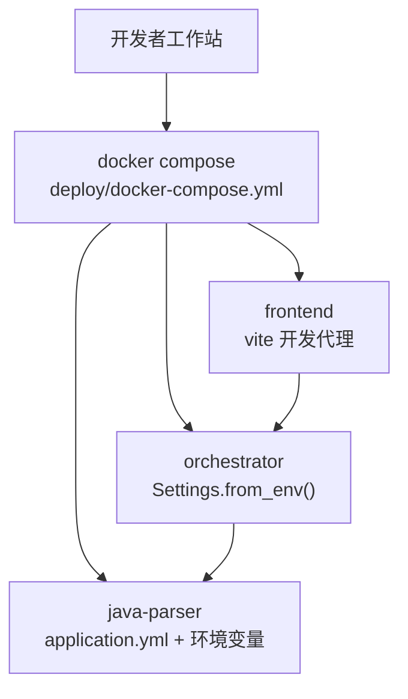
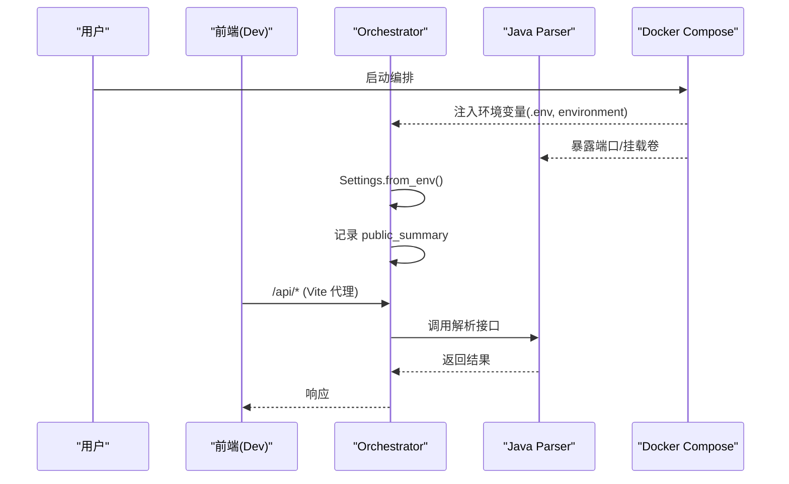
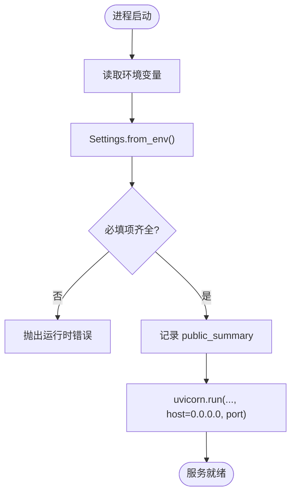
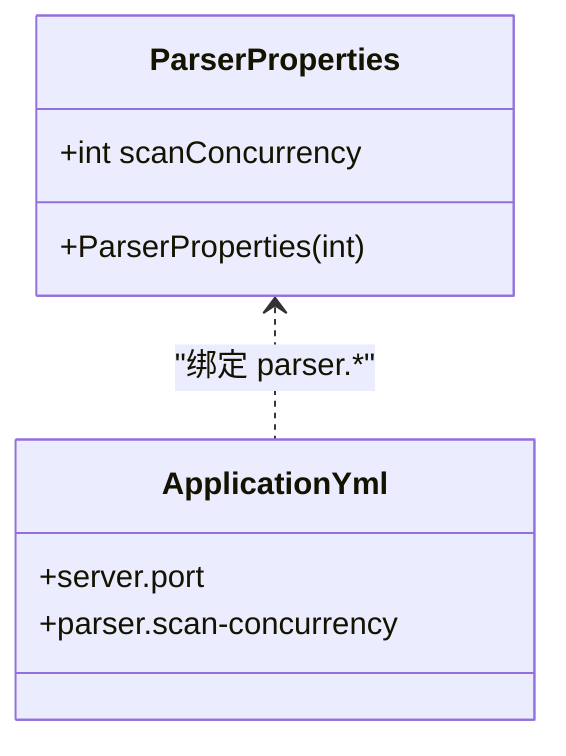
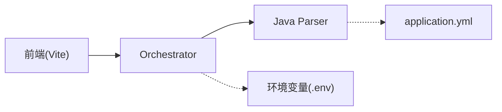

# 环境配置管理

<cite>
**本文引用的文件**
- [services/orchestrator/src/orchestrator/config.py](file://services/orchestrator/src/orchestrator/config.py)
- [services/orchestrator/src/orchestrator/__main__.py](file://services/orchestrator/src/orchestrator/__main__.py)
- [services/java-parser/src/main/resources/application.yml](file://services/java-parser/src/main/resources/application.yml)
- [services/java-parser/src/main/java/com/llmautotest/parser/ParserProperties.java](file://services/java-parser/src/main/java/com/llmautotest/parser/ParserProperties.java)
- [deploy/docker-compose.yml](file://deploy/docker-compose.yml)
- [services/frontend/vite.config.ts](file://services/frontend/vite.config.ts)
- [.gitignore](file://.gitignore)
- [services/orchestrator/tests/test_config.py](file://services/orchestrator/tests/test_config.py)
</cite>

## 目录
1. [简介](#简介)
2. [项目结构](#项目结构)
3. [核心组件](#核心组件)
4. [架构总览](#架构总览)
5. [详细组件分析](#详细组件分析)
6. [依赖关系分析](#依赖关系分析)
7. [性能考虑](#性能考虑)
8. [故障排查指南](#故障排查指南)
9. [结论](#结论)
10. [附录](#附录)

## 简介
本文件面向 LLM-AutoTest 项目的“环境配置管理”，覆盖开发、测试、生产三类环境的配置策略与落地方式，重点说明：
- 环境变量配置与配置文件管理
- 敏感信息处理与日志安全口径
- 各服务配置项、默认值与校验机制
- 配置模板、示例与迁移指南
- 最佳实践与安全注意事项

## 项目结构
本项目采用多服务编排部署，配置来源以“环境变量优先”为主，辅以少量应用级配置文件。编排入口位于 deploy 目录，通过 docker-compose 统一拉起服务并注入环境变量；前端开发时通过代理将 API 请求转发至编排后的后端服务。

**图表来源**
- [deploy/docker-compose.yml:1-62](file://deploy/docker-compose.yml#L1-L62)
- [services/java-parser/src/main/resources/application.yml:1-8](file://services/java-parser/src/main/resources/application.yml#L1-L8)
- [services/orchestrator/src/orchestrator/config.py:9-50](file://services/orchestrator/src/orchestrator/config.py#L9-L50)
- [services/frontend/vite.config.ts:1-16](file://services/frontend/vite.config.ts#L1-L16)

**章节来源**
- [deploy/docker-compose.yml:1-62](file://deploy/docker-compose.yml#L1-L62)
- [services/java-parser/src/main/resources/application.yml:1-8](file://services/java-parser/src/main/resources/application.yml#L1-L8)
- [services/orchestrator/src/orchestrator/config.py:9-50](file://services/orchestrator/src/orchestrator/config.py#L9-L50)
- [services/frontend/vite.config.ts:1-16](file://services/frontend/vite.config.ts#L1-L16)

## 核心组件
- orchestrator（Python/FastAPI）：通过 Settings 数据类从环境变量加载运行参数，提供 REST API 与流水线编排能力。
- java-parser（Java/Spring Boot）：通过 application.yml 与 @ConfigurationProperties 读取 parser.* 配置项，并进行合法性校验。
- frontend（Vue/Vite）：开发期通过代理将 /api 请求转发到 orchestrator。
- 编排层（docker-compose）：集中声明服务、端口、卷、健康检查与环境变量注入点。

**章节来源**
- [services/orchestrator/src/orchestrator/config.py:9-50](file://services/orchestrator/src/orchestrator/config.py#L9-L50)
- [services/java-parser/src/main/resources/application.yml:1-8](file://services/java-parser/src/main/resources/application.yml#L1-L8)
- [services/java-parser/src/main/java/com/llmautotest/parser/ParserProperties.java:1-17](file://services/java-parser/src/main/java/com/llmautotest/parser/ParserProperties.java#L1-L17)
- [services/frontend/vite.config.ts:1-16](file://services/frontend/vite.config.ts#L1-L16)
- [deploy/docker-compose.yml:1-62](file://deploy/docker-compose.yml#L1-L62)

## 架构总览
下图展示了启动时配置加载与服务间调用关系：

**图表来源**
- [deploy/docker-compose.yml:18-32](file://deploy/docker-compose.yml#L18-L32)
- [services/orchestrator/src/orchestrator/config.py:32-50](file://services/orchestrator/src/orchestrator/config.py#L32-L50)
- [services/orchestrator/src/orchestrator/__main__.py:15-21](file://services/orchestrator/src/orchestrator/__main__.py#L15-L21)
- [services/frontend/vite.config.ts:7-14](file://services/frontend/vite.config.ts#L7-L14)

## 详细组件分析

### Orchestrator 配置模型与加载流程
- 配置模型：使用不可变 dataclass 定义 Settings，字段包括端口、Java 解析器地址、产物根路径、LLM 调用基址、模型名、温度、top_p、seed 等。
- 加载方式：from_env 从环境变量读取，缺失必填项抛出运行时错误，避免静默默认导致的不一致行为。
- 日志安全：public_summary 仅输出非敏感字段，防止密钥泄露。
- 启动集成：__main__ 中加载 Settings 后启动 uvicorn，绑定 0.0.0.0 与配置端口。

**图表来源**
- [services/orchestrator/src/orchestrator/config.py:32-50](file://services/orchestrator/src/orchestrator/config.py#L32-L50)
- [services/orchestrator/src/orchestrator/__main__.py:15-21](file://services/orchestrator/src/orchestrator/__main__.py#L15-L21)

**章节来源**
- [services/orchestrator/src/orchestrator/config.py:9-50](file://services/orchestrator/src/orchestrator/config.py#L9-L50)
- [services/orchestrator/src/orchestrator/__main__.py:15-21](file://services/orchestrator/src/orchestrator/__main__.py#L15-L21)
- [services/orchestrator/tests/test_config.py:10-42](file://services/orchestrator/tests/test_config.py#L10-L42)

### Java Parser 配置与校验
- 配置文件：application.yml 定义 server.port 与 parser.scan-concurrency。
- 属性绑定：ParserProperties 使用 @ConfigurationProperties(prefix="parser") 绑定 parser.* 配置，并在构造中校验 scanConcurrency 必须为正数。
- 环境变量覆盖：Spring Boot 支持通过环境变量覆盖 application.yml 中的配置项。

**图表来源**
- [services/java-parser/src/main/resources/application.yml:1-8](file://services/java-parser/src/main/resources/application.yml#L1-L8)
- [services/java-parser/src/main/java/com/llmautotest/parser/ParserProperties.java:1-17](file://services/java-parser/src/main/java/com/llmautotest/parser/ParserProperties.java#L1-L17)

**章节来源**
- [services/java-parser/src/main/resources/application.yml:1-8](file://services/java-parser/src/main/resources/application.yml#L1-L8)
- [services/java-parser/src/main/java/com/llmautotest/parser/ParserProperties.java:1-17](file://services/java-parser/src/main/java/com/llmautotest/parser/ParserProperties.java#L1-L17)

### 前端开发代理配置
- Vite 在开发模式下将 /api 请求代理到 http://localhost:8000（即编排后的 orchestrator）。
- 该配置用于本地联调，不影响容器化部署。

**章节来源**
- [services/frontend/vite.config.ts:1-16](file://services/frontend/vite.config.ts#L1-L16)

### 编排与环境变量注入
- docker-compose 声明了 java-parser、orchestrator、frontend 等服务，并通过 environment 与 env_file 注入环境变量。
- orchestrator 显式注入 JAVA_PARSER_URL，并通过 .env 文件加载其他变量。
- 共享卷 artifacts 映射到 /data/llm-autotest，供多个服务读写产物。

**章节来源**
- [deploy/docker-compose.yml:1-62](file://deploy/docker-compose.yml#L1-L62)

## 依赖关系分析
- orchestrator 依赖 java-parser 的 HTTP 接口，通过 JAVA_PARSER_URL 访问。
- orchestrator 启动时强依赖必需的环境变量，缺失将直接失败，便于早期发现问题。
- 前端仅在开发阶段依赖 orchestrator 的 API 代理，构建产物不耦合后端地址。

**图表来源**
- [services/frontend/vite.config.ts:7-14](file://services/frontend/vite.config.ts#L7-L14)
- [services/orchestrator/src/orchestrator/config.py:32-50](file://services/orchestrator/src/orchestrator/config.py#L32-L50)
- [services/java-parser/src/main/resources/application.yml:1-8](file://services/java-parser/src/main/resources/application.yml#L1-L8)
- [deploy/docker-compose.yml:18-32](file://deploy/docker-compose.yml#L18-L32)

**章节来源**
- [services/orchestrator/src/orchestrator/config.py:32-50](file://services/orchestrator/src/orchestrator/config.py#L32-L50)
- [services/java-parser/src/main/resources/application.yml:1-8](file://services/java-parser/src/main/resources/application.yml#L1-L8)
- [services/frontend/vite.config.ts:7-14](file://services/frontend/vite.config.ts#L7-L14)
- [deploy/docker-compose.yml:18-32](file://deploy/docker-compose.yml#L18-L32)

## 性能考虑
- 并发度控制：java-parser 的扫描并发度可通过 parser.scan-concurrency 调整，建议根据资源与仓库规模评估设置。
- I/O 路径：artifacts_root 统一为 /data/llm-autotest，确保多服务共享高效存储卷。
- 网络开销：减少不必要的重试与超时，合理设置 orchestrator 与 java-parser 之间的连接与超时参数（由各自框架默认值决定，可按需扩展）。

[本节为通用指导，不直接分析具体代码文件]

## 故障排查指南
- 启动时报缺少必填环境变量：检查 orchestrator 所需的环境变量是否已正确注入（如 JAVA_PARSER_URL、LLM_BASE_URL、LLM_SEED 等），参考 from_env 的报错定位。
- 日志包含敏感信息：确认未将密钥写入 public_summary 或日志输出；当前实现仅输出非敏感字段。
- 解析服务不可用：验证 java-parser 健康检查与端口映射是否正确，确认 JAVA_PARSER_URL 指向可达地址。
- 前端无法调用 API：检查 Vite 代理 target 是否与编排端口一致（开发期为 8000）。

**章节来源**
- [services/orchestrator/tests/test_config.py:26-42](file://services/orchestrator/tests/test_config.py#L26-L42)
- [services/orchestrator/src/orchestrator/config.py:32-50](file://services/orchestrator/src/orchestrator/config.py#L32-L50)
- [deploy/docker-compose.yml:11-16](file://deploy/docker-compose.yml#L11-L16)
- [services/frontend/vite.config.ts:7-14](file://services/frontend/vite.config.ts#L7-L14)

## 结论
本项目采用“环境变量优先、配置文件为辅”的配置策略，结合 docker-compose 集中注入与 Spring Boot 的属性绑定，实现了清晰、可验证、安全的配置管理。通过严格的必填校验与日志脱敏，降低了误配与泄露风险。建议在多环境中通过 .env 与 profile 差异化管理配置，保持单一事实来源与最小权限原则。

[本节为总结性内容，不直接分析具体代码文件]

## 附录

### 环境差异与策略
- 开发环境
  - 使用 Vite 代理将 /api 转发到本地编排后的 orchestrator（端口 8000）。
  - 通过 docker-compose 启动 java-parser 与 orchestrator，使用本地 .env 注入变量。
- 测试环境
  - 复用同一编排文件，替换 .env 中的 LLM_BASE_URL、LLM_MODEL_NAME、LLM_TEMPERATURE、LLM_TOP_P、LLM_SEED 等。
  - 可启用 profiles 按需拉起 test-executor 或 mock-services。
- 生产环境
  - 建议使用外部密钥管理服务注入敏感变量（如 LLM_API_KEY），不在仓库中保存明文。
  - 通过 CI/CD 注入不同 .env 片段，保证镜像与配置解耦。

[本节为概念性说明，不直接分析具体代码文件]

### 环境变量清单与默认值
- orchestrator（来自 Settings）
  - PORT：默认 8000
  - JAVA_PARSER_URL：必填
  - ARTIFACTS_ROOT：默认 /data/llm-autotest
  - LLM_BASE_URL：必填
  - LLM_MODEL_NAME：默认 glm-5.3
  - LLM_TEMPERATURE：默认 0.2
  - LLM_TOP_P：默认 0.8
  - LLM_SEED：可选整数
- java-parser（来自 application.yml 与环境变量覆盖）
  - server.port：默认 8080
  - parser.scan-concurrency：默认 4，且必须为正数

**章节来源**
- [services/orchestrator/src/orchestrator/config.py:32-50](file://services/orchestrator/src/orchestrator/config.py#L32-L50)
- [services/java-parser/src/main/resources/application.yml:1-8](file://services/java-parser/src/main/resources/application.yml#L1-L8)
- [services/java-parser/src/main/java/com/llmautotest/parser/ParserProperties.java:10-15](file://services/java-parser/src/main/java/com/llmautotest/parser/ParserProperties.java#L10-L15)

### 配置模板与示例
- 环境变量模板
  - 建议创建 deploy/.env.example，列出所有必要变量名与占位值，便于团队快速复制。
  - 实际 .env 不应提交到版本库（已在 .gitignore 中忽略）。
- 编排注入
  - 通过 docker-compose 的 environment 与 env_file 注入变量，确保不同环境仅需替换 .env 内容。

**章节来源**
- [.gitignore:21-23](file://.gitignore#L21-L23)
- [deploy/docker-compose.yml:23-26](file://deploy/docker-compose.yml#L23-L26)

### 配置迁移指南
- 新增配置项
  - Python 侧：在 Settings 中添加字段，并在 from_env 中读取与校验；更新测试用例覆盖新字段。
  - Java 侧：在 application.yml 添加键，并在 ParserProperties 中绑定与校验。
  - 编排侧：在 docker-compose 中补充环境变量注入。
- 变更默认值
  - 优先通过环境变量覆盖，避免修改源码默认值；必要时同步更新文档与测试断言。
- 废弃配置项
  - 保留兼容读取逻辑一段时间，逐步迁移至新变量；在日志中提示弃用警告。

**章节来源**
- [services/orchestrator/src/orchestrator/config.py:9-50](file://services/orchestrator/src/orchestrator/config.py#L9-L50)
- [services/java-parser/src/main/resources/application.yml:1-8](file://services/java-parser/src/main/resources/application.yml#L1-L8)
- [services/java-parser/src/main/java/com/llmautotest/parser/ParserProperties.java:1-17](file://services/java-parser/src/main/java/com/llmautotest/parser/ParserProperties.java#L1-L17)
- [deploy/docker-compose.yml:18-32](file://deploy/docker-compose.yml#L18-L32)

### 最佳实践与安全注意事项
- 一律通过环境变量注入敏感信息，禁止硬编码到源码或配置文件。
- 日志只输出 public_summary 等非敏感字段，避免泄露密钥。
- 使用 .gitignore 排除 .env 与 .env.*，仅保留 .env.example 作为模板。
- 对关键配置进行单元测试覆盖（如必填校验、默认值、非法值拒绝）。
- 通过 docker-compose 的 healthcheck 保障服务就绪后再依赖其启动后续服务。

**章节来源**
- [services/orchestrator/src/orchestrator/config.py:23-30](file://services/orchestrator/src/orchestrator/config.py#L23-L30)
- [.gitignore:21-23](file://.gitignore#L21-L23)
- [services/orchestrator/tests/test_config.py:26-42](file://services/orchestrator/tests/test_config.py#L26-L42)
- [deploy/docker-compose.yml:11-16](file://deploy/docker-compose.yml#L11-L16)