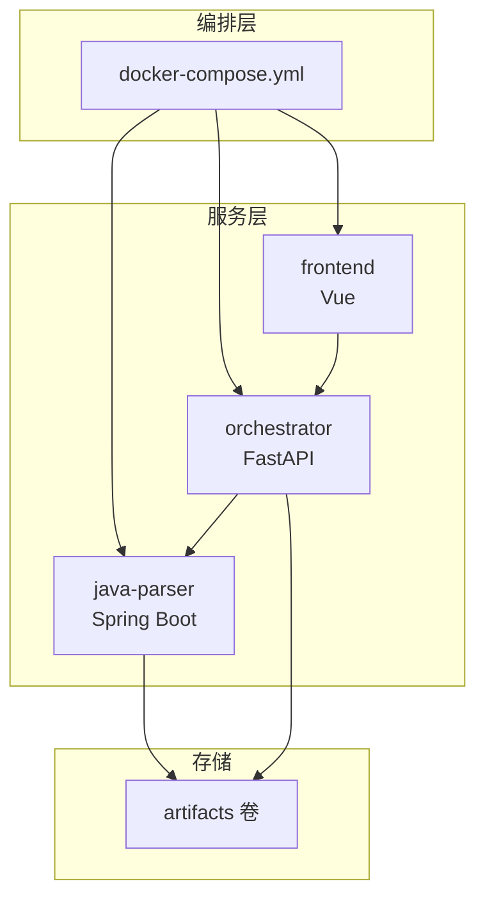
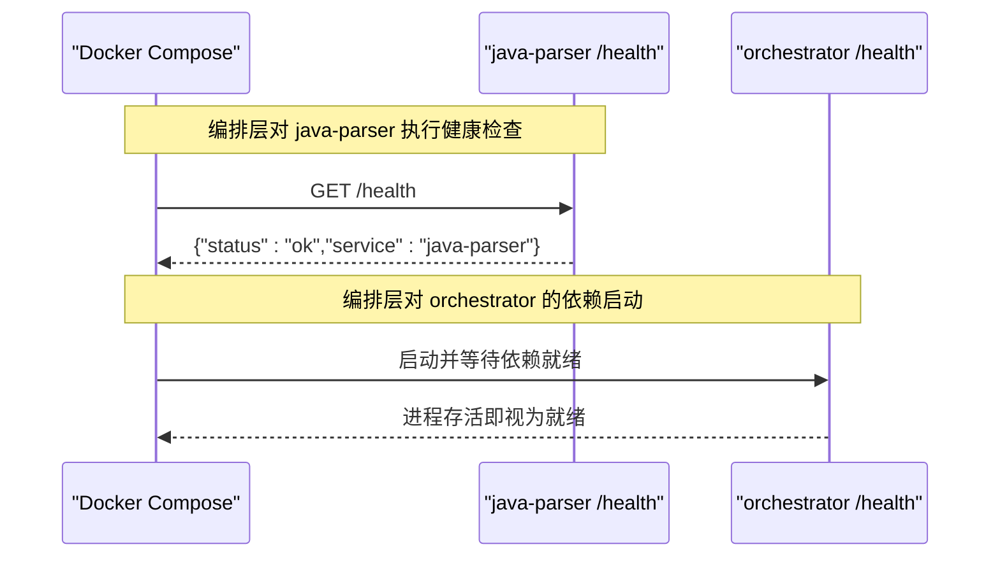
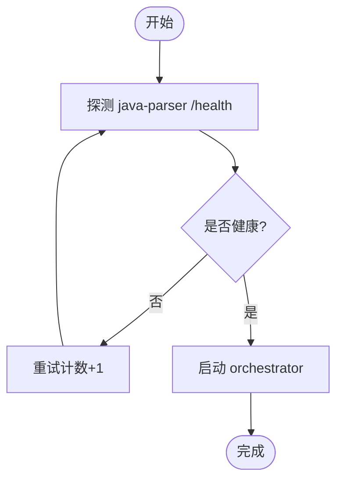
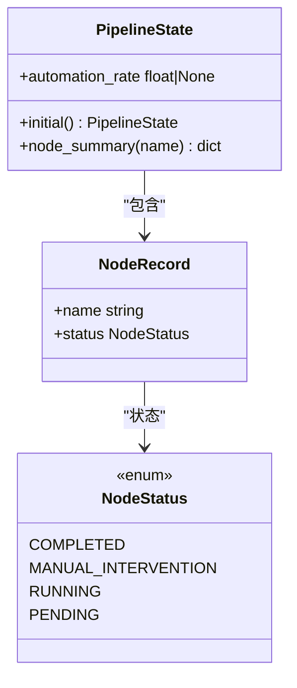
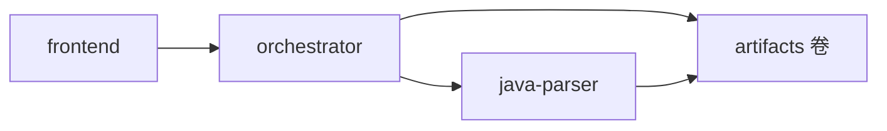

# 监控与告警

<cite>
**本文引用的文件**
- [services/java-parser/src/main/java/com/llmautotest/parser/HealthController.java](file://services/java-parser/src/main/java/com/llmautotest/parser/HealthController.java)
- [services/java-parser/src/test/java/com/llmautotest/parser/HealthControllerTest.java](file://services/java-parser/src/test/java/com/llmautotest/parser/HealthControllerTest.java)
- [services/java-parser/src/main/resources/application.yml](file://services/java-parser/src/main/resources/application.yml)
- [services/java-parser/Dockerfile](file://services/java-parser/Dockerfile)
- [services/orchestrator/src/orchestrator/api.py](file://services/orchestrator/src/orchestrator/api.py)
- [services/orchestrator/src/orchestrator/config.py](file://services/orchestrator/src/orchestrator/config.py)
- [services/orchestrator/src/orchestrator/pipeline.py](file://services/orchestrator/src/orchestrator/pipeline.py)
- [services/orchestrator/src/orchestrator/errors.py](file://services/orchestrator/src/orchestrator/errors.py)
- [services/orchestrator/Dockerfile](file://services/orchestrator/Dockerfile)
- [deploy/docker-compose.yml](file://deploy/docker-compose.yml)
- [schemas/metrics.json](file://schemas/metrics.json)
</cite>

## 目录
1. [简介](#简介)
2. [项目结构](#项目结构)
3. [核心组件](#核心组件)
4. [架构总览](#架构总览)
5. [详细组件分析](#详细组件分析)
6. [依赖关系分析](#依赖关系分析)
7. [性能考虑](#性能考虑)
8. [故障排查指南](#故障排查指南)
9. [结论](#结论)
10. [附录](#附录)

## 简介
本文件面向 LLM-AutoTest 项目的监控与告警配置，聚焦以下目标：
- 健康检查端点的实现与使用：服务状态监控与依赖服务检测。
- 日志收集与分析策略：应用日志、访问日志、错误日志的统一管理思路。
- 性能指标收集方案：API 响应时间、资源使用率与业务指标（自动化率等）。
- 告警规则与通知机制：邮件、Webhook、即时通讯工具的集成建议。
- 可视化展示与趋势分析：基于现有度量产物的可视化与趋势分析方法。
- 扩展性与高可用设计：在容器编排下的可扩展与高可用实践。

## 项目结构
当前仓库包含三个主要服务：
- java-parser：提供 Java 代码解析能力，暴露 /health 健康检查端点。
- orchestrator：编排器，对外暴露 FastAPI 接口，包含 /health 及流水线节点清单接口。
- frontend：前端界面（Vue），通过编排器进行交互。

编排由 docker-compose 统一管理，定义服务间依赖与健康检查策略。

图表来源
- [deploy/docker-compose.yml:1-62](file://deploy/docker-compose.yml#L1-L62)

章节来源
- [deploy/docker-compose.yml:1-62](file://deploy/docker-compose.yml#L1-L62)

## 核心组件
- 健康检查端点
  - java-parser：/health 返回服务名与健康状态，用于编排健康检查。
  - orchestrator：/health 返回统一健康状态，供编排与外部探针使用。
- 配置与环境变量
  - orchestrator：所有运行参数来自环境变量，避免硬编码；提供公开摘要输出（不含密钥）。
- 流水线与业务指标
  - orchestrator：定义固定 9 节点顺序与四态标注，支持自动化率计算（骨架阶段为 None）。
  - schemas/metrics.json：度量产物 Schema，约束自动化率与节点状态的输出格式。
- 错误模型
  - orchestrator：统一错误结构，便于日志记录与告警分类。

章节来源
- [services/java-parser/src/main/java/com/llmautotest/parser/HealthController.java:1-18](file://services/java-parser/src/main/java/com/llmautotest/parser/HealthController.java#L1-L18)
- [services/orchestrator/src/orchestrator/api.py:1-28](file://services/orchestrator/src/orchestrator/api.py#L1-L28)
- [services/orchestrator/src/orchestrator/config.py:1-56](file://services/orchestrator/src/orchestrator/config.py#L1-L56)
- [services/orchestrator/src/orchestrator/pipeline.py:1-84](file://services/orchestrator/src/orchestrator/pipeline.py#L1-L84)
- [schemas/metrics.json:1-31](file://schemas/metrics.json#L1-L31)
- [services/orchestrator/src/orchestrator/errors.py:1-39](file://services/orchestrator/src/orchestrator/errors.py#L1-L39)

## 架构总览
下图展示了编排器与解析器的健康检查流程，以及编排层的健康检查策略。

图表来源
- [deploy/docker-compose.yml:11-16](file://deploy/docker-compose.yml#L11-L16)
- [services/java-parser/src/main/java/com/llmautotest/parser/HealthController.java:12-16](file://services/java-parser/src/main/java/com/llmautotest/parser/HealthController.java#L12-L16)
- [services/orchestrator/src/orchestrator/api.py:16-19](file://services/orchestrator/src/orchestrator/api.py#L16-L19)

## 详细组件分析

### 健康检查端点与依赖检测
- java-parser
  - 暴露 /health，返回服务标识与健康状态，供 Docker 健康检查调用。
  - 测试用例确保 /health 返回 200 且 status=ok。
- orchestrator
  - 暴露 /health，返回统一健康状态，供编排与外部探针使用。
- 编排层
  - 使用 wget 定期探测 java-parser 的 /health，失败则重试，达到阈值后标记不健康。
  - orchestrator 依赖 java-parser 健康后再启动，保障依赖就绪。

图表来源
- [deploy/docker-compose.yml:11-16](file://deploy/docker-compose.yml#L11-L16)
- [services/java-parser/src/main/java/com/llmautest/parser/HealthController.java:12-16](file://services/java-parser/src/main/java/com/llmautotest/parser/HealthController.java#L12-L16)
- [services/java-parser/src/test/java/com/llmautotest/parser/HealthControllerTest.java:20-25](file://services/java-parser/src/test/java/com/llmautotest/parser/HealthControllerTest.java#L20-L25)
- [services/orchestrator/src/orchestrator/api.py:16-19](file://services/orchestrator/src/orchestrator/api.py#L16-L19)

章节来源
- [services/java-parser/src/main/java/com/llmautotest/parser/HealthController.java:1-18](file://services/java-parser/src/main/java/com/llmautotest/parser/HealthController.java#L1-L18)
- [services/java-parser/src/test/java/com/llmautotest/parser/HealthControllerTest.java:1-26](file://services/java-parser/src/test/java/com/llmautotest/parser/HealthControllerTest.java#L1-L26)
- [services/orchestrator/src/orchestrator/api.py:1-28](file://services/orchestrator/src/orchestrator/api.py#L1-L28)
- [deploy/docker-compose.yml:11-32](file://deploy/docker-compose.yml#L11-L32)

### 配置与环境变量
- orchestrator 通过 Settings.from_env 读取端口、下游服务地址、LLM 调用参数、超时、Schema 目录等。
- 提供 public_summary 属性用于安全地输出非敏感配置摘要。
- 缺失必填环境变量会抛出运行时异常，便于快速定位配置问题。

章节来源
- [services/orchestrator/src/orchestrator/config.py:9-56](file://services/orchestrator/src/orchestrator/config.py#L9-L56)

### 流水线与业务指标
- 固定 9 节点顺序与四态标注（completed、manual_intervention、running、pending）。
- 自动化率 = 已完成节点数 / 9；骨架阶段返回 None 表示尚未实测。
- metrics.json 定义了度量产物结构，包括 schema_version、job_id、automation_rate、nodes 等字段，约束数值口径与完整性。

图表来源
- [services/orchestrator/src/orchestrator/pipeline.py:11-84](file://services/orchestrator/src/orchestrator/pipeline.py#L11-L84)

章节来源
- [services/orchestrator/src/orchestrator/pipeline.py:1-84](file://services/orchestrator/src/orchestrator/pipeline.py#L1-L84)
- [schemas/metrics.json:1-31](file://schemas/metrics.json#L1-L31)

### 错误模型与告警分类
- 统一错误结构包含 code、message、可选 node_id 与 details。
- 错误码涵盖 LLM 调用失败、Schema 校验失败、产物校验失败、下游服务不可达等场景，便于告警规则按类别触发。

章节来源
- [services/orchestrator/src/orchestrator/errors.py:1-39](file://services/orchestrator/src/orchestrator/errors.py#L1-L39)

## 依赖关系分析
- 编排依赖
  - orchestrator 依赖 java-parser 健康后再启动。
  - frontend 依赖 orchestrator 启动完成后启动。
- 运行时依赖
  - orchestrator 通过 JAVA_PARSER_URL 访问 java-parser。
  - 共享 artifacts 卷用于产物持久化。

图表来源
- [deploy/docker-compose.yml:18-41](file://deploy/docker-compose.yml#L18-L41)
- [services/orchestrator/src/orchestrator/config.py:13-24](file://services/orchestrator/src/orchestrator/config.py#L13-L24)

章节来源
- [deploy/docker-compose.yml:1-62](file://deploy/docker-compose.yml#L1-L62)
- [services/orchestrator/src/orchestrator/config.py:1-56](file://services/orchestrator/src/orchestrator/config.py#L1-L56)

## 性能考虑
- 健康检查间隔与超时
  - java-parser 健康检查间隔 10s，超时 5s，重试 5 次，避免频繁探测影响服务性能。
- 并发与超时
  - java-parser 扫描并发度可配置（scan-concurrency），orchestrator 的 LLM 调用超时可配置（LLM_TIMEOUT_S），需根据环境容量调优。
- 指标采集
  - 骨架阶段自动化率为 None，正式实现应从产物卷读取节点状态并计算；metrics.json 约束了输出结构，便于后续接入指标系统。

章节来源
- [deploy/docker-compose.yml:11-16](file://deploy/docker-compose.yml#L11-L16)
- [services/java-parser/src/main/resources/application.yml:5-8](file://services/java-parser/src/main/resources/application.yml#L5-L8)
- [services/orchestrator/src/orchestrator/config.py:16-24](file://services/orchestrator/src/orchestrator/config.py#L16-L24)
- [services/orchestrator/src/orchestrator/pipeline.py:61-70](file://services/orchestrator/src/orchestrator/pipeline.py#L61-L70)
- [schemas/metrics.json:1-31](file://schemas/metrics.json#L1-L31)

## 故障排查指南
- 健康检查失败
  - 检查 java-parser /health 是否可达，确认端口映射与网络连通性。
  - 查看编排健康检查重试次数与超时设置，必要时调整。
- 配置缺失
  - orchestrator 启动时若缺少必填环境变量将抛出异常，依据错误信息补齐配置。
- 下游服务不可达
  - 当 java-parser 不可用时，orchestrator 可能抛出 X-ORCH-03 类错误，结合错误码与 message 定位问题。
- 度量数据不完整
  - 若节点标记数据缺失，自动化率应标记为数据不完整，避免误导数值。

章节来源
- [deploy/docker-compose.yml:11-16](file://deploy/docker-compose.yml#L11-L16)
- [services/orchestrator/src/orchestrator/config.py:35-56](file://services/orchestrator/src/orchestrator/config.py#L35-L56)
- [services/orchestrator/src/orchestrator/errors.py:8-15](file://services/orchestrator/src/orchestrator/errors.py#L8-L15)
- [schemas/metrics.json:10-19](file://schemas/metrics.json#L10-L19)

## 结论
- 健康检查：java-parser 与 orchestrator 均提供 /health，编排层通过健康检查保证依赖就绪。
- 配置管理：orchestrator 通过环境变量集中管理配置，并提供安全摘要输出。
- 业务指标：固定 9 节点口径与自动化率计算，度量产物遵循严格 Schema。
- 错误治理：统一错误结构与错误码，便于日志分析与告警分类。
- 下一步建议：在编排层或外部监控系统接入指标采集与告警通知，完善可视化与趋势分析。

## 附录

### 健康检查端点使用方法
- 直接调用
  - java-parser：GET http://localhost:8081/health（端口映射见编排）
  - orchestrator：GET http://localhost:8000/health
- 编排健康检查
  - 使用 wget 探测 java-parser /health，间隔、超时、重试次数已在编排中配置。

章节来源
- [deploy/docker-compose.yml:7-16](file://deploy/docker-compose.yml#L7-L16)
- [services/java-parser/src/main/java/com/llmautotest/parser/HealthController.java:12-16](file://services/java-parser/src/main/java/com/llmautotest/parser/HealthController.java#L12-L16)
- [services/orchestrator/src/orchestrator/api.py:16-19](file://services/orchestrator/src/orchestrator/api.py#L16-L19)

### 日志收集与分析策略（建议）
- 应用日志
  - 将各服务的标准输出与错误输出汇聚到统一日志平台（如 ELK/Loki），按服务名与级别过滤。
- 访问日志
  - 对 FastAPI 与 Spring Boot 启用访问日志，记录请求路径、方法、状态码、耗时。
- 错误日志
  - 基于统一错误结构（code/message/node_id/details）进行分类与聚合，便于告警规则匹配。
- 指标日志
  - 将自动化率与节点状态以结构化形式写入 artifacts 卷，供指标系统抓取。

[本节为通用建议，不直接分析具体文件]

### 性能指标收集方案（建议）
- API 响应时间
  - 在编排层或网关层采集请求耗时，按接口维度统计 P50/P95/P99。
- 资源使用率
  - 采集 CPU、内存、磁盘 I/O、网络带宽，设置阈值告警。
- 业务指标
  - 从 artifacts 卷读取 metrics.json，计算自动化率与节点通过率，形成趋势图。

[本节为通用建议，不直接分析具体文件]

### 告警规则与通知机制（建议）
- 邮件
  - 针对健康检查失败、关键错误码（如 X-LLM-01/X-ORCH-03）、自动化率低于阈值触发邮件通知。
- Webhook
  - 对接企业微信/钉钉/飞书等 Webhook，推送告警消息与链接。
- 即时通讯工具
  - 建立告警频道，按严重等级分流，支持自动恢复通知。

[本节为通用建议，不直接分析具体文件]

### 可视化展示与趋势分析（建议）
- 仪表盘
  - 展示服务健康状态、API 响应时间、资源使用率、自动化率趋势。
- 趋势分析
  - 基于 metrics.json 的历史数据，观察自动化率变化与瓶颈节点分布。
- 告警面板
  - 关联告警事件与指标曲线，便于快速定位根因。

[本节为通用建议，不直接分析具体文件]

### 扩展性与高可用性设计（建议）
- 水平扩展
  - 将 orchestrator 与 java-parser 无状态化，配合负载均衡横向扩展。
- 多副本与健康检查
  - 增加副本数，结合健康检查与滚动更新降低停机风险。
- 存储与备份
  - artifacts 卷采用分布式存储或定期备份，确保产物可恢复。
- 降级与隔离
  - 对下游依赖（如 LLM）设置超时与熔断，避免雪崩。

[本节为通用建议，不直接分析具体文件]