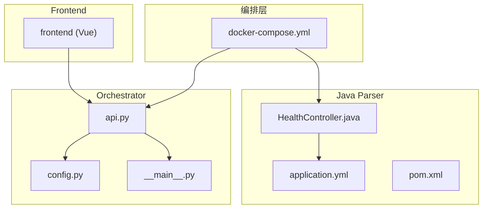
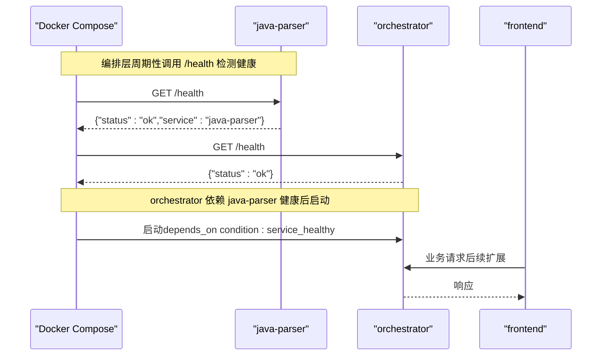
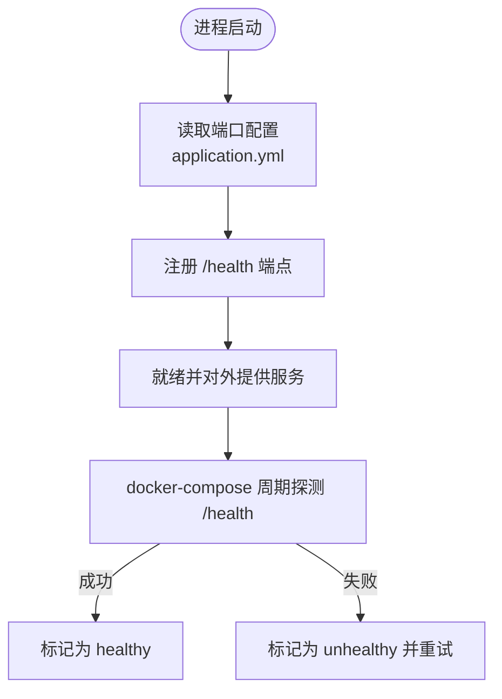
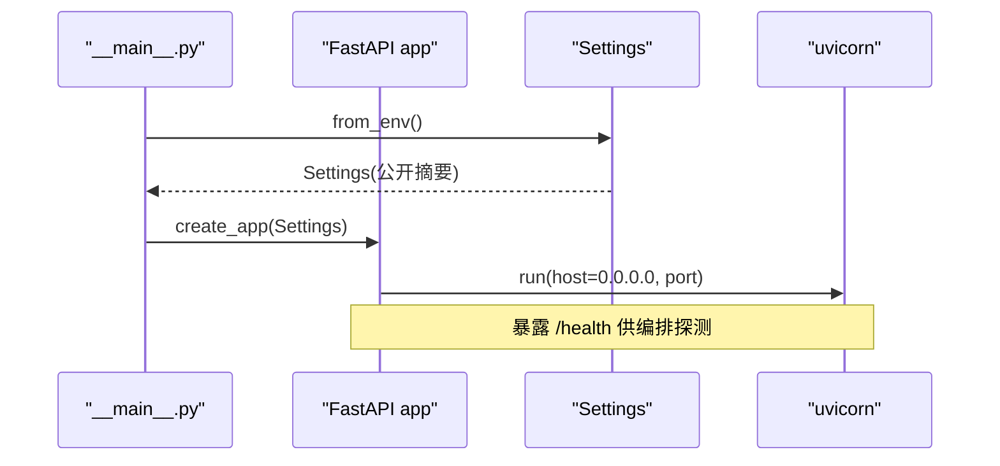
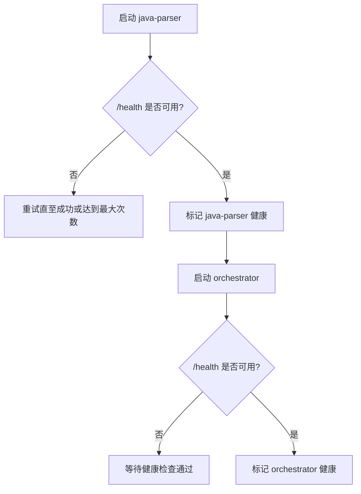
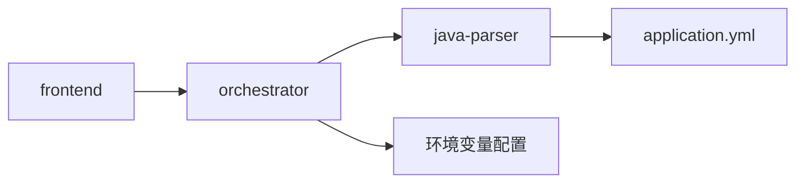

# 监控与日志管理

<cite>
**本文引用的文件**
- [HealthController.java](file://services/java-parser/src/main/java/com/llmautotest/parser/HealthController.java)
- [application.yml](file://services/java-parser/src/main/resources/application.yml)
- [pom.xml](file://services/java-parser/pom.xml)
- [api.py](file://services/orchestrator/src/orchestrator/api.py)
- [config.py](file://services/orchestrator/src/orchestrator/config.py)
- [__main__.py](file://services/orchestrator/src/orchestrator/__main__.py)
- [docker-compose.yml](file://deploy/docker-compose.yml)
- [开发规范说明.md](file://docs/09_开发规范说明.md)
</cite>

## 目录
1. [简介](#简介)
2. [项目结构](#项目结构)
3. [核心组件](#核心组件)
4. [架构总览](#架构总览)
5. [详细组件分析](#详细组件分析)
6. [依赖关系分析](#依赖关系分析)
7. [性能考量](#性能考量)
8. [故障诊断指南](#故障诊断指南)
9. [结论](#结论)
10. [附录](#附录)

## 简介
本文件面向 LLM-AutoTest 的运维与研发人员，系统化说明健康检查端点、服务状态监控、日志收集策略、告警与指标建议、以及故障诊断方法。当前仓库已实现：
- Java Parser 服务的 /health 健康检查端点
- Orchestrator 服务的 /health 健康检查端点
- Docker Compose 编排中的健康检查与启动顺序约束
- Python 侧基础日志配置（INFO 级别）
- 开发规范中对节点失败落盘、统一日志格式的要求

生产环境建议在此基础上补充结构化日志、指标采集与集中式日志/监控平台接入。

## 项目结构
LLM-AutoTest 采用多服务容器化部署，关键监控与日志相关位置如下：
- Java Parser：Spring Boot 应用，暴露 /health；端口由 application.yml 配置；通过 docker-compose 进行健康检查
- Orchestrator：FastAPI 应用，暴露 /health；Python logging 在入口初始化；端口与外部依赖通过环境变量注入
- Frontend：静态前端，不直接参与后端健康检查
- Test Executor：按 profile 启用，当前未暴露 HTTP 接口
- 编排：docker-compose 定义服务间依赖与健康检查

图表来源
- [docker-compose.yml:1-62](file://deploy/docker-compose.yml#L1-L62)
- [HealthController.java:1-18](file://services/java-parser/src/main/java/com/llmautotest/parser/HealthController.java#L1-L18)
- [application.yml:1-8](file://services/java-parser/src/main/resources/application.yml#L1-L8)
- [api.py:1-28](file://services/orchestrator/src/orchestrator/api.py#L1-L28)
- [config.py:1-50](file://services/orchestrator/src/orchestrator/config.py#L1-L50)
- [__main__.py:1-26](file://services/orchestrator/src/orchestrator/__main__.py#L1-L26)

章节来源
- [docker-compose.yml:1-62](file://deploy/docker-compose.yml#L1-L62)
- [application.yml:1-8](file://services/java-parser/src/main/resources/application.yml#L1-L8)
- [api.py:1-28](file://services/orchestrator/src/orchestrator/api.py#L1-L28)
- [__main__.py:1-26](file://services/orchestrator/src/orchestrator/__main__.py#L1-L26)

## 核心组件
- 健康检查端点
  - Java Parser：/health 返回固定状态与服务标识，供编排器探测
  - Orchestrator：/health 返回统一状态，供编排器探测
- 服务状态监控
  - 基于 docker-compose healthcheck 周期性探测 /health
  - 服务启动顺序：orchestrator 依赖 java-parser 健康后再启动
- 日志收集策略
  - Python 侧使用标准 logging，INFO 级别，格式化输出
  - 规范要求：节点失败必须落盘；统一 JSON 行格式（建议落地）；Java 侧使用 SLF4J（需结合框架配置）

章节来源
- [HealthController.java:1-18](file://services/java-parser/src/main/java/com/llmautotest/parser/HealthController.java#L1-L18)
- [api.py:1-28](file://services/orchestrator/src/orchestrator/api.py#L1-L28)
- [docker-compose.yml:1-62](file://deploy/docker-compose.yml#L1-L62)
- [__main__.py:1-26](file://services/orchestrator/src/orchestrator/__main__.py#L1-L26)
- [开发规范说明.md:96-119](file://docs/09_开发规范说明.md#L96-L119)

## 架构总览
下图展示健康检查与编排依赖关系，以及日志流向。

图表来源
- [docker-compose.yml:1-62](file://deploy/docker-compose.yml#L1-L62)
- [HealthController.java:1-18](file://services/java-parser/src/main/java/com/llmautotest/parser/HealthController.java#L1-L18)
- [api.py:1-28](file://services/orchestrator/src/orchestrator/api.py#L1-L28)

## 详细组件分析

### Java Parser 健康检查与配置
- 健康检查端点
  - 路径：/health
  - 行为：返回包含 status 与 service 的 JSON，用于编排健康检查
- 配置
  - 端口：默认 8080（可通过环境变量覆盖）
  - 扫描并发度：可配置项（不影响健康检查）
- 构建与运行
  - Spring Boot 应用，依赖 spring-boot-starter-web
  - 通过 Maven 插件打包为可执行镜像

图表来源
- [application.yml:1-8](file://services/java-parser/src/main/resources/application.yml#L1-L8)
- [HealthController.java:1-18](file://services/java-parser/src/main/java/com/llmautotest/parser/HealthController.java#L1-L18)
- [docker-compose.yml:1-62](file://deploy/docker-compose.yml#L1-L62)

章节来源
- [HealthController.java:1-18](file://services/java-parser/src/main/java/com/llmautotest/parser/HealthController.java#L1-L18)
- [application.yml:1-8](file://services/java-parser/src/main/resources/application.yml#L1-L8)
- [pom.xml:1-83](file://services/java-parser/pom.xml#L1-L83)
- [docker-compose.yml:1-62](file://deploy/docker-compose.yml#L1-L62)

### Orchestrator 健康检查、日志与配置
- 健康检查端点
  - 路径：/health
  - 行为：返回 {"status": "ok"}，用于编排健康检查
- 日志
  - 入口初始化 logging，级别 INFO，格式包含时间、模块名、级别、消息
  - 启动时记录配置摘要（不含敏感信息）
- 配置
  - 全部来自环境变量（端口、下游服务地址、产物根目录、LLM 参数等）
  - 缺失必填环境变量会抛出异常，便于快速定位部署问题

图表来源
- [__main__.py:1-26](file://services/orchestrator/src/orchestrator/__main__.py#L1-L26)
- [api.py:1-28](file://services/orchestrator/src/orchestrator/api.py#L1-L28)
- [config.py:1-50](file://services/orchestrator/src/orchestrator/config.py#L1-L50)

章节来源
- [api.py:1-28](file://services/orchestrator/src/orchestrator/api.py#L1-L28)
- [config.py:1-50](file://services/orchestrator/src/orchestrator/config.py#L1-L50)
- [__main__.py:1-26](file://services/orchestrator/src/orchestrator/__main__.py#L1-L26)

### 编排与健康检查流程
- 健康检查
  - java-parser：wget 访问 http://localhost:8080/health
  - orchestrator：由编排层探测其 /health（端口 8000）
- 启动顺序
  - orchestrator depends_on java-parser，条件为 service_healthy
- 重启策略
  - 所有服务均设置 restart: unless-stopped

图表来源
- [docker-compose.yml:1-62](file://deploy/docker-compose.yml#L1-L62)
- [HealthController.java:1-18](file://services/java-parser/src/main/java/com/llmautotest/parser/HealthController.java#L1-L18)
- [api.py:1-28](file://services/orchestrator/src/orchestrator/api.py#L1-L28)

章节来源
- [docker-compose.yml:1-62](file://deploy/docker-compose.yml#L1-L62)

## 依赖关系分析
- 服务耦合
  - orchestrator 依赖 java-parser 的健康状态（通过 depends_on + healthcheck）
  - frontend 依赖 orchestrator 提供业务接口（当前为占位实现）
- 外部依赖
  - Java Parser 依赖 Spring Boot Web 栈
  - Orchestrator 依赖 FastAPI/Uvicorn、HTTPX、Pydantic 等
- 配置与环境
  - 所有关键配置通过环境变量注入，避免硬编码
  - 端口、URL、模型参数等均可外部化

图表来源
- [docker-compose.yml:1-62](file://deploy/docker-compose.yml#L1-L62)
- [config.py:1-50](file://services/orchestrator/src/orchestrator/config.py#L1-L50)
- [application.yml:1-8](file://services/java-parser/src/main/resources/application.yml#L1-L8)

章节来源
- [docker-compose.yml:1-62](file://deploy/docker-compose.yml#L1-L62)
- [config.py:1-50](file://services/orchestrator/src/orchestrator/config.py#L1-L50)
- [application.yml:1-8](file://services/java-parser/src/main/resources/application.yml#L1-L8)

## 性能考量
- 健康检查频率与超时
  - 当前 java-parser 健康检查间隔 10s、超时 5s、重试 5 次；可根据实际负载调整
- 并发与资源
  - Java Parser 支持扫描并发度配置，避免对上游仓库造成过大压力
- 日志开销
  - 当前 Python 日志为控制台输出；生产建议改为结构化 JSON 并写入文件或远端日志系统，减少 I/O 抖动
- 启动顺序
  - 通过 depends_on + healthcheck 确保依赖就绪，减少冷启动期间的错误风暴

[本节为通用指导，无需特定文件引用]

## 故障诊断指南

### 常见问题与排查步骤
- 服务无法启动
  - 检查环境变量是否齐全（orchestrator 缺少必填变量会抛错）
  - 检查端口冲突（java-parser 8080、orchestrator 8000、frontend 8080）
- 健康检查失败
  - 确认 /health 可达（curl/wget）
  - 查看容器日志（stdout/stderr），定位启动异常
- 启动顺序异常
  - 确认 docker-compose 中 depends_on 与 healthcheck 配置正确
  - 观察编排日志中“service_healthy”状态变化
- 日志不可用或难以检索
  - 确认日志输出到 stdout/stderr（容器默认）
  - 若挂载了卷，检查卷路径与权限
- 节点失败与断点续跑
  - 依据开发规范，节点失败必须落盘（状态+原因+时间戳），作为断点续跑依据
  - 检查产物目录是否存在失败记录

章节来源
- [config.py:1-50](file://services/orchestrator/src/orchestrator/config.py#L1-L50)
- [docker-compose.yml:1-62](file://deploy/docker-compose.yml#L1-L62)
- [开发规范说明.md:96-119](file://docs/09_开发规范说明.md#L96-L119)

### 日志分析方法
- Python 日志
  - 入口已配置 logging，级别 INFO；建议在生产切换为 JSON 行格式，便于聚合与分析
  - 关注启动日志中的配置摘要，核对端口、下游 URL、模型参数等
- Java 日志
  - 使用 SLF4J；建议结合 Spring Boot 日志配置输出结构化日志（JSON），并统一时间与时区
- 集中式日志
  - 建议将 stdout/stderr 接入集中式日志系统（如 ELK/Loki），并按服务名与任务 ID 打标签

章节来源
- [__main__.py:1-26](file://services/orchestrator/src/orchestrator/__main__.py#L1-L26)
- [开发规范说明.md:96-119](file://docs/09_开发规范说明.md#L96-L119)

### 监控指标与告警建议（扩展方案）
- 指标定义（建议）
  - 健康检查成功率：/health 成功次数 / 总探测次数
  - 服务可用性：连续 N 次健康检查失败即判定为不可用
  - 请求延迟：各接口 P50/P95/P99 耗时
  - 错误率：4xx/5xx 比例
  - 资源使用：CPU、内存、磁盘 I/O
- 告警规则（建议）
  - 健康检查连续失败超过阈值（如 3 次）触发告警
  - 错误率超过阈值（如 5%）触发告警
  - 延迟超过阈值（如 P95 > 2s）触发告警
  - 资源使用接近上限（如 CPU > 80%、内存 > 85%）触发告警
- 性能监控方案（建议）
  - 接入 Prometheus + Grafana 采集指标
  - 接入集中式日志系统（ELK/Loki）进行日志聚合与检索
  - 对关键链路埋点（请求开始/结束、外部调用耗时、错误堆栈）

[本节为通用指导，无需特定文件引用]

## 结论
当前仓库已具备基础的健康检查与日志能力：
- 健康检查：Java Parser 与 Orchestrator 均提供 /health，编排层通过 docker-compose 进行健康探测与启动顺序控制
- 日志：Python 侧使用标准 logging，INFO 级别；规范要求节点失败落盘与统一日志格式
生产环境建议：
- 将日志升级为结构化 JSON 并接入集中式日志系统
- 引入指标采集与告警机制（Prometheus/Grafana/ELK/Loki）
- 完善健康检查语义（增加依赖健康状态、版本信息等）

[本节为总结性内容，无需特定文件引用]

## 附录

### 健康检查端点清单
- Java Parser
  - 路径：/health
  - 响应：包含 status 与 service 字段
- Orchestrator
  - 路径：/health
  - 响应：包含 status 字段

章节来源
- [HealthController.java:1-18](file://services/java-parser/src/main/java/com/llmautotest/parser/HealthController.java#L1-L18)
- [api.py:1-28](file://services/orchestrator/src/orchestrator/api.py#L1-L28)

### 日志级别与格式
- Python
  - 级别：INFO
  - 格式：时间、模块名、级别、消息
  - 建议：生产切换为 JSON 行格式
- Java
  - 建议使用 SLF4J，配合 Spring Boot 输出结构化日志

章节来源
- [__main__.py:1-26](file://services/orchestrator/src/orchestrator/__main__.py#L1-L26)
- [开发规范说明.md:96-119](file://docs/09_开发规范说明.md#L96-L119)

### 编排与健康检查配置要点
- 健康检查命令：wget 访问 /health
- 健康检查参数：interval、timeout、retries
- 启动顺序：depends_on 条件为 service_healthy
- 重启策略：unless-stopped

章节来源
- [docker-compose.yml:1-62](file://deploy/docker-compose.yml#L1-L62)