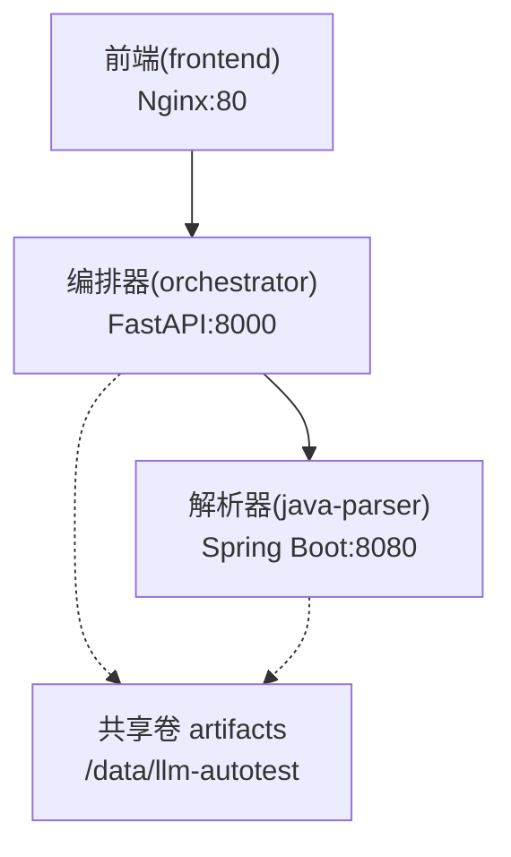
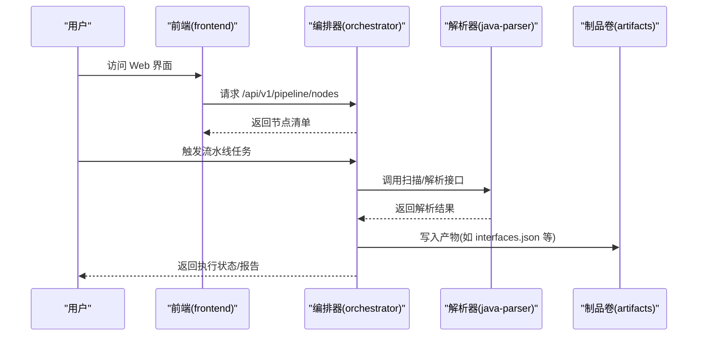
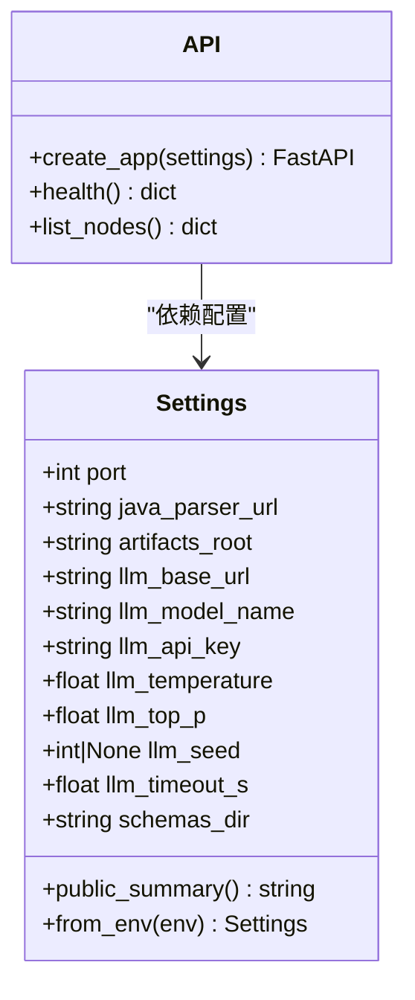
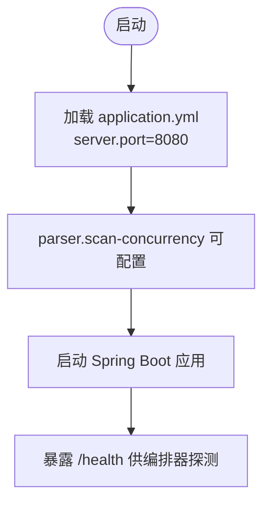
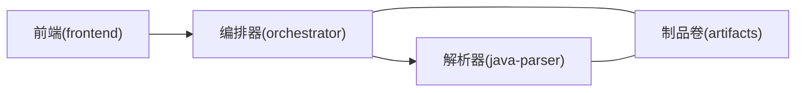

# 部署运维

<cite>
**本文引用的文件**
- [docker-compose.yml](file://deploy/docker-compose.yml)
- [ci.yml](file://.github/workflows/ci.yml)
- [orchestrator Dockerfile](file://services/orchestrator/Dockerfile)
- [java-parser Dockerfile](file://services/java-parser/Dockerfile)
- [frontend Dockerfile](file://services/frontend/Dockerfile)
- [orchestrator 配置](file://services/orchestrator/src/orchestrator/config.py)
- [orchestrator API](file://services/orchestrator/src/orchestrator/api.py)
- [java-parser 应用入口](file://services/java-parser/src/main/java/com/llmautotest/parser/ParserApplication.java)
- [java-parser 应用配置](file://services/java-parser/src/main/resources/application.yml)
- [前端 package.json](file://services/frontend/package.json)
- [orchestrator 依赖与构建](file://services/orchestrator/pyproject.toml)
- [java-parser 构建配置](file://services/java-parser/pom.xml)
</cite>

## 目录
1. [简介](#简介)
2. [项目结构](#项目结构)
3. [核心组件](#核心组件)
4. [架构总览](#架构总览)
5. [详细组件分析](#详细组件分析)
6. [依赖关系分析](#依赖关系分析)
7. [性能考虑](#性能考虑)
8. [故障排查指南](#故障排查指南)
9. [结论](#结论)
10. [附录](#附录)

## 简介
本运维文档面向生产环境，提供 LLM-AutoTest 的容器化部署、Kubernetes 集群部署与传统服务器部署方案；说明 CI/CD 流水线与自动化构建发布流程；给出监控告警、日志聚合、备份恢复、灾难恢复、容量规划、性能调优、安全加固与日常维护建议；并提供常见问题的定位与处理方法。

## 项目结构
LLM-AutoTest 由三个服务组成：
- orchestrator：Python FastAPI 编排服务，负责九节点流水线编排、产物管理与 REST API。
- java-parser：Java Spring Boot 服务，负责多仓库扫描与接口逆向还原。
- frontend：静态前端（当前为占位镜像），后续将接入 Vue 3 + Vite 构建产物并由 Nginx 托管。

图示来源
- [docker-compose.yml:3-41](file://deploy/docker-compose.yml#L3-L41)
- [orchestrator Dockerfile:13](file://services/orchestrator/Dockerfile#L13)
- [java-parser Dockerfile:15](file://services/java-parser/Dockerfile#L15)
- [frontend Dockerfile:12](file://services/frontend/Dockerfile#L12)

章节来源
- [docker-compose.yml:3-41](file://deploy/docker-compose.yml#L3-L41)
- [orchestrator Dockerfile:1-16](file://services/orchestrator/Dockerfile#L1-L16)
- [java-parser Dockerfile:1-21](file://services/java-parser/Dockerfile#L1-L21)
- [frontend Dockerfile:1-13](file://services/frontend/Dockerfile#L1-L13)

## 核心组件
- 编排器（orchestrator）
  - 基于 FastAPI 暴露健康检查与流水线节点清单等接口。
  - 通过环境变量加载运行配置，包含端口、下游解析器地址、产物根路径、LLM 调用参数与 Schema 目录等。
- 解析器（java-parser）
  - 基于 Spring Boot 启动，默认监听 8080，支持并发扫描参数配置。
- 前端（frontend）
  - 当前使用 Nginx 占位镜像，后续替换为构建产物。

章节来源
- [orchestrator API:11-27](file://services/orchestrator/src/orchestrator/api.py#L11-L27)
- [orchestrator 配置:9-56](file://services/orchestrator/src/orchestrator/config.py#L9-L56)
- [java-parser 应用入口:8-16](file://services/java-parser/src/main/java/com/llmautotest/parser/ParserApplication.java#L8-L16)
- [java-parser 应用配置:1-8](file://services/java-parser/src/main/resources/application.yml#L1-L8)
- [frontend package.json:1-29](file://services/frontend/package.json#L1-L29)

## 架构总览
系统采用“前端 + 编排器 + 解析器”的分层架构，编排器作为中枢协调各节点执行并持久化产物；解析器提供代码扫描能力；前端提供交互界面（当前为占位）。

图示来源
- [orchestrator API:21-26](file://services/orchestrator/src/orchestrator/api.py#L21-L26)
- [docker-compose.yml:18-32](file://deploy/docker-compose.yml#L18-L32)
- [java-parser 应用配置:1-8](file://services/java-parser/src/main/resources/application.yml#L1-L8)

## 详细组件分析

### 编排器（orchestrator）
- 职责
  - 暴露健康检查与流水线节点清单接口。
  - 从环境变量读取运行配置，包括 LLM 调用参数、产物根路径、Schema 目录等。
- 关键实现点
  - 健康检查用于编排依赖判定。
  - 配置类强制必填项校验，缺失时抛出运行时异常。
  - 公开摘要不包含敏感信息，避免密钥泄露到日志。

图示来源
- [orchestrator 配置:9-56](file://services/orchestrator/src/orchestrator/config.py#L9-L56)
- [orchestrator API:11-27](file://services/orchestrator/src/orchestrator/api.py#L11-L27)

章节来源
- [orchestrator 配置:9-56](file://services/orchestrator/src/orchestrator/config.py#L9-L56)
- [orchestrator API:11-27](file://services/orchestrator/src/orchestrator/api.py#L11-L27)

### 解析器（java-parser）
- 职责
  - 提供 Java 多仓库扫描与接口逆向还原能力。
  - 默认端口 8080，支持并发度配置。
- 关键实现点
  - 多阶段构建，仅 JRE 运行镜像，体积更小更安全。
  - 安装 wget 以支持健康检查。

图示来源
- [java-parser 应用配置:1-8](file://services/java-parser/src/main/resources/application.yml#L1-L8)
- [java-parser 应用入口:8-16](file://services/java-parser/src/main/java/com/llmautotest/parser/ParserApplication.java#L8-L16)

章节来源
- [java-parser 应用配置:1-8](file://services/java-parser/src/main/resources/application.yml#L1-L8)
- [java-parser 应用入口:8-16](file://services/java-parser/src/main/java/com/llmautotest/parser/ParserApplication.java#L8-L16)

### 前端（frontend）
- 当前为占位镜像，后续将替换为 Vue 3 + Vite 构建产物并由 Nginx 托管。
- 开发脚本与测试脚本已定义，便于本地开发与质量门禁。

章节来源
- [frontend Dockerfile:1-13](file://services/frontend/Dockerfile#L1-L13)
- [frontend package.json:1-29](file://services/frontend/package.json#L1-L29)

## 依赖关系分析
- 编排器依赖解析器的 HTTP 接口，并通过共享卷 artifacts 交换产物。
- 前端依赖编排器提供的 API 进行交互。
- 所有服务均容器化，通过 docker-compose 编排启动，具备健康检查与重启策略。

图示来源
- [docker-compose.yml:3-41](file://deploy/docker-compose.yml#L3-L41)

章节来源
- [docker-compose.yml:3-41](file://deploy/docker-compose.yml#L3-L41)

## 性能考虑
- 并发与超时
  - 解析器支持 scan-concurrency 调整扫描并发度，可根据 CPU/内存资源评估设置。
  - 编排器可通过 LLM_TIMEOUT_S 控制单次 LLM 调用超时，避免长尾阻塞。
- I/O 与存储
  - 产物统一挂载至 /data/llm-autotest，建议使用高性能磁盘或网络存储，确保高吞吐写入。
- 资源隔离
  - 在 Kubernetes 中为各服务设置 requests/limits，防止资源争用导致抖动。
- 缓存与复用
  - 解析器可复用 Maven/依赖缓存；CI 中启用缓存加速构建。

[本节为通用指导，不直接分析具体文件]

## 故障排查指南
- 健康检查失败
  - 确认编排器与解析器端口映射正确，健康检查端点可达。
  - 若解析器未安装 wget 或端口被占用，需修正镜像或端口配置。
- 环境变量缺失
  - 编排器启动时会校验必填环境变量，缺失将抛出运行时异常；请检查 JAVA_PARSER_URL、LLM_BASE_URL 等是否注入。
- 产物写入失败
  - 检查共享卷权限与空间，确保 /data/llm-autotest 可写且磁盘充足。
- 网络不可达
  - 编排器调用解析器或 LLM 时出现连接错误，需检查网络连通性与防火墙策略。
- 前端无法访问
  - 确认 Nginx 容器端口映射与反向代理配置正确，必要时替换为真实构建产物。

章节来源
- [docker-compose.yml:11-16](file://deploy/docker-compose.yml#L11-L16)
- [orchestrator 配置:35-56](file://services/orchestrator/src/orchestrator/config.py#L35-L56)
- [java-parser Dockerfile:17-18](file://services/java-parser/Dockerfile#L17-L18)

## 结论
本项目采用清晰的三层架构与容器化编排，具备完善的健康检查与环境变量配置机制。通过 CI/CD 流水线保障代码质量与构建一致性。生产部署建议结合 Kubernetes 进行弹性伸缩与资源治理，并完善监控、日志、备份与安全策略，以满足稳定可靠的运行要求。

## 附录

### A. 容器化部署（Docker Compose）
- 前置条件
  - 安装 Docker 与 Docker Compose。
  - 准备 .env 文件，注入必要环境变量（如 LLM_BASE_URL、LLM_API_KEY、JAVA_PARSER_URL 等）。
- 启动步骤
  - 使用编排文件启动全部服务：docker compose -f deploy/docker-compose.yml --env-file deploy/.env up -d
  - 验证健康检查：访问编排器健康端点与解析器健康端点。
- 停止与清理
  - 停止服务：docker compose -f deploy/docker-compose.yml down
  - 清理数据卷（谨慎操作）：docker compose -f deploy/docker-compose.yml down -v

章节来源
- [docker-compose.yml:1-62](file://deploy/docker-compose.yml#L1-L62)

### B. Kubernetes 集群部署
- 镜像准备
  - 使用 CI 构建的镜像或自行构建：参考各服务的 Dockerfile。
- 部署建议
  - 使用 Deployment 管理每个服务副本数，Service 暴露端口。
  - 使用 ConfigMap/Secret 管理环境变量与敏感信息。
  - 使用 PersistentVolume 挂载 artifacts 卷，确保产物持久化。
  - 配置 Readiness/Liveness 探针对接 /health 端点。
- 扩缩容
  - 根据 QPS 与资源使用率调整 replicas 与 HPA。

章节来源
- [orchestrator Dockerfile:1-16](file://services/orchestrator/Dockerfile#L1-L16)
- [java-parser Dockerfile:1-21](file://services/java-parser/Dockerfile#L1-L21)
- [frontend Dockerfile:1-13](file://services/frontend/Dockerfile#L1-L13)
- [orchestrator API:16-19](file://services/orchestrator/src/orchestrator/api.py#L16-L19)

### C. 传统服务器部署
- 方式一：直接运行容器
  - 在各节点拉取镜像并运行容器，使用 -e 注入环境变量，-v 挂载 artifacts。
- 方式二：源码运行（开发/临时）
  - Python 服务：uv sync 后 uv run python -m orchestrator。
  - Java 服务：mvn spring-boot:run 或使用打包后的 jar。
  - 前端：pnpm build 后用 Nginx 托管静态资源。

章节来源
- [orchestrator Dockerfile:15](file://services/orchestrator/Dockerfile#L15)
- [java-parser Dockerfile:20](file://services/java-parser/Dockerfile#L20)
- [frontend package.json:8-12](file://services/frontend/package.json#L8-L12)

### D. CI/CD 流水线与自动化构建发布
- 触发条件
  - push 到 main 分支与 pull_request 事件触发。
- 构建矩阵
  - Python 服务：ruff 检查、格式化、类型检查、单元测试。
  - Java 服务：Maven verify（含 checkstyle）。
  - 前端：pnpm install、lint、build。
  - Docker 构建：仅在 push 事件下构建各服务镜像。
- 发布建议
  - 将镜像推送到私有镜像仓库，并在 K8s 中使用镜像标签管理版本。
  - 结合 Git Tag 与 Release 管理发布基线。

章节来源
- [ci.yml:1-75](file://.github/workflows/ci.yml#L1-L75)

### E. 监控告警与日志聚合
- 指标收集
  - 采集服务健康状态、QPS、延迟、错误率；对 LLM 调用记录耗时与失败原因。
- 日志聚合
  - Python 使用 logging 输出 JSON 行格式；Java 使用 SLF4J；统一采集到日志平台。
- 告警规则
  - 健康检查失败、错误率突增、LLM 调用超时、磁盘空间不足等阈值告警。
- 可视化
  - 使用仪表盘展示流水线执行状态、节点成功率与自动化率。

[本节为通用指导，不直接分析具体文件]

### F. 备份恢复与灾难恢复
- 备份策略
  - 定期备份 artifacts 卷（/data/llm-autotest），保留最近若干版本。
  - 备份配置文件与密钥（使用 Secret 管理）。
- 恢复流程
  - 重建服务与数据库（如有），挂载备份卷，验证健康检查与端到端流程。
- 灾难恢复
  - 多可用区部署，跨地域备份；制定 RTO/RPO 目标并演练。

[本节为通用指导，不直接分析具体文件]

### G. 容量规划建议
- 计算资源
  - 根据并发扫描任务数与 LLM 调用频率估算 CPU/内存需求。
- 存储容量
  - 预估产物大小增长曲线，预留扩容空间。
- 网络带宽
  - 保证解析器与 LLM 服务的上行带宽满足峰值需求。

[本节为通用指导，不直接分析具体文件]

### H. 性能调优指南
- 解析器并发
  - 调整 parser.scan-concurrency 匹配硬件资源。
- 超时与重试
  - 合理设置 LLM_TIMEOUT_S，结合重试与熔断策略。
- 缓存优化
  - 启用依赖缓存与构建缓存，减少冷启动时间。

章节来源
- [java-parser 应用配置:5-8](file://services/java-parser/src/main/resources/application.yml#L5-L8)
- [orchestrator 配置:16-24](file://services/orchestrator/src/orchestrator/config.py#L16-L24)

### I. 安全加固措施
- 最小权限
  - 容器以非 root 用户运行，限制文件系统访问范围。
- 密钥管理
  - 使用 Secret 管理 LLM_API_KEY 等敏感信息，禁止硬编码。
- 传输加密
  - 对外暴露的服务启用 HTTPS，内部通信使用 TLS。
- 审计与合规
  - 记录访问日志与操作审计，满足合规要求。

[本节为通用指导，不直接分析具体文件]

### J. 日常维护操作手册
- 巡检清单
  - 健康检查、磁盘空间、CPU/内存使用率、错误日志。
- 变更管理
  - 通过 CI/CD 发布新版本，灰度发布与回滚预案。
- 问题升级
  - 建立分级响应机制，明确升级路径与责任人。

[本节为通用指导，不直接分析具体文件]