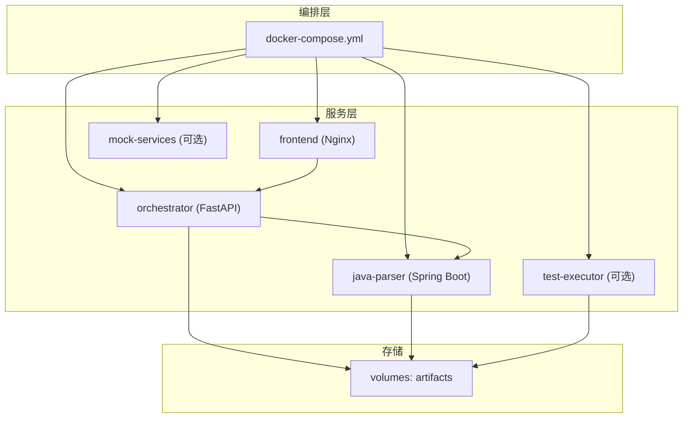
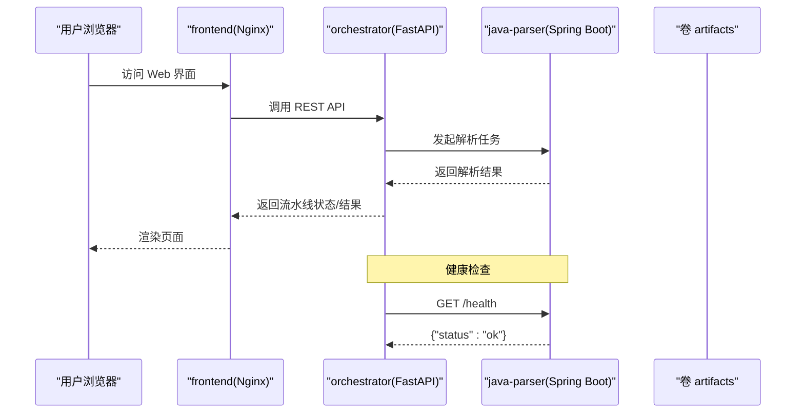
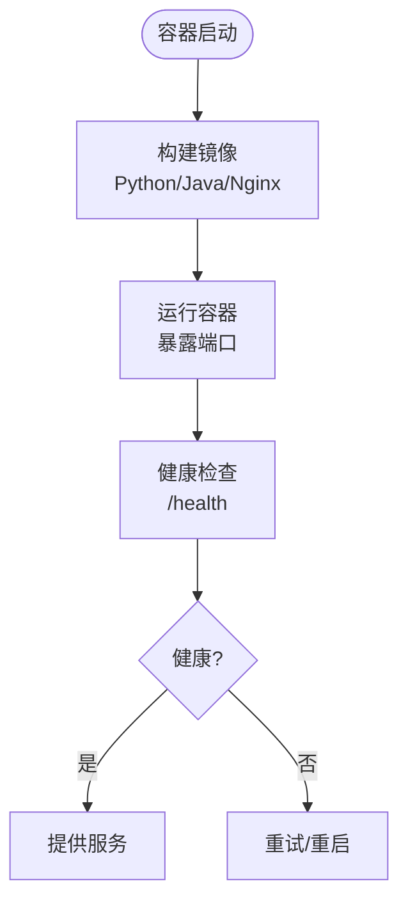
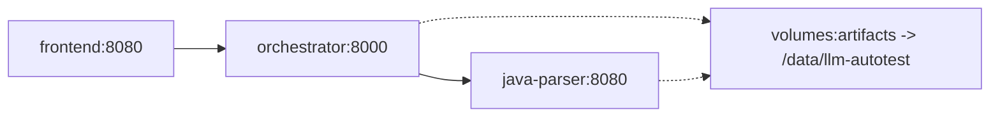
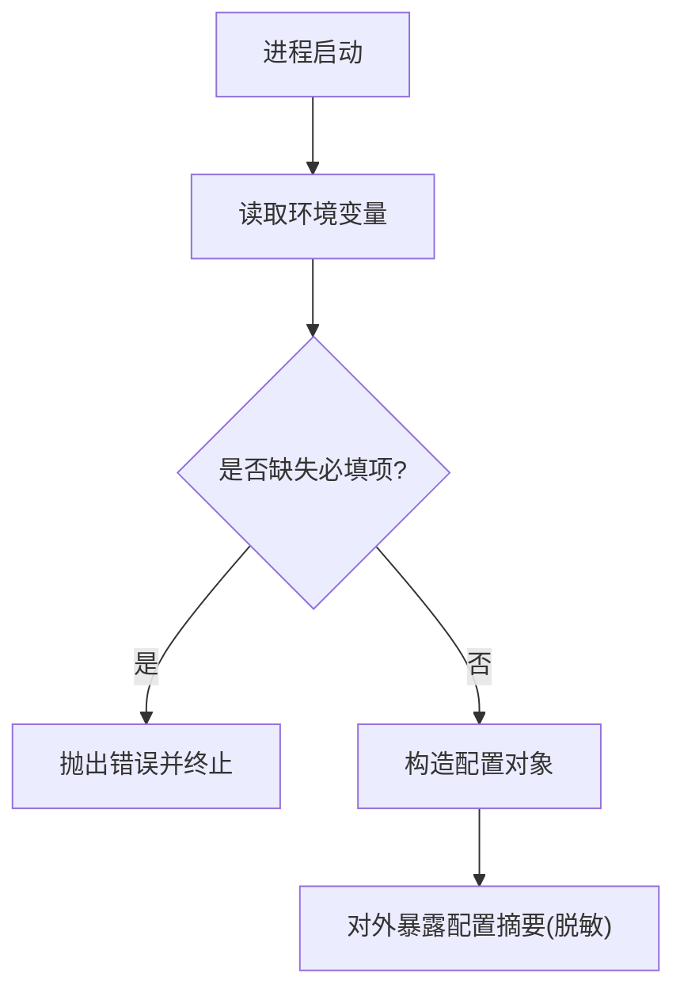
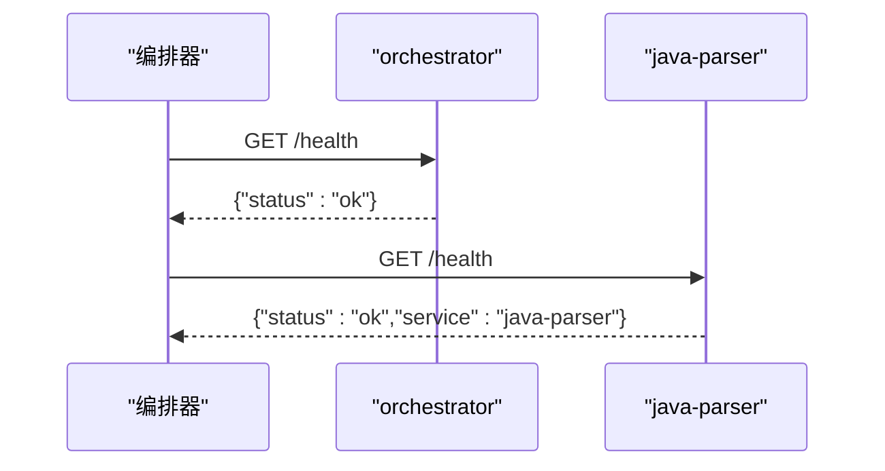
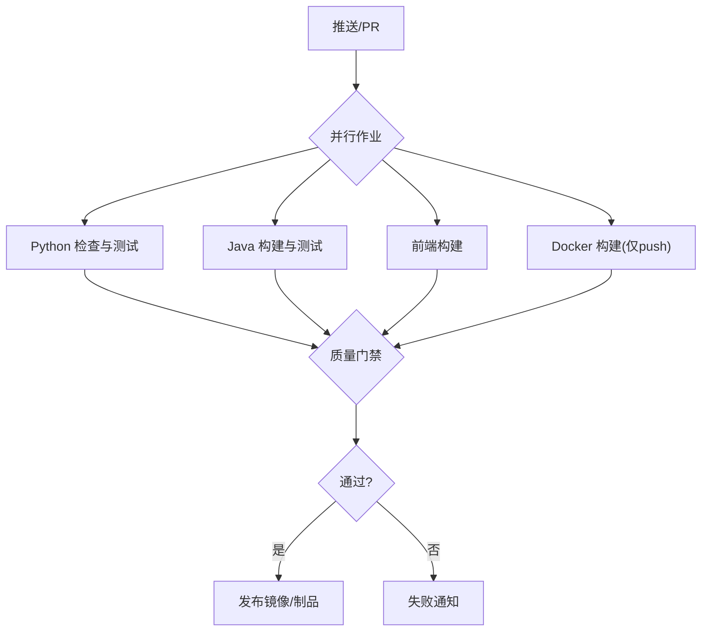
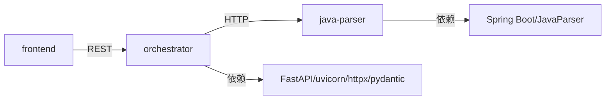

# 部署运维

<cite>
**本文引用的文件**
- [docker-compose.yml](file://deploy/docker-compose.yml)
- [ci.yml](file://.github/workflows/ci.yml)
- [orchestrator Dockerfile](file://services/orchestrator/Dockerfile)
- [java-parser Dockerfile](file://services/java-parser/Dockerfile)
- [frontend Dockerfile](file://services/frontend/Dockerfile)
- [orchestrator 配置](file://services/orchestrator/src/orchestrator/config.py)
- [orchestrator API](file://services/orchestrator/src/orchestrator/api.py)
- [java-parser 应用配置](file://services/java-parser/src/main/resources/application.yml)
- [java-parser 属性类](file://services/java-parser/src/main/java/com/llmautotest/parser/ParserProperties.java)
- [java-parser 健康检查控制器](file://services/java-parser/src/main/java/com/llmautotest/parser/HealthController.java)
- [前端 package.json](file://services/frontend/package.json)
- [orchestrator 依赖与工具链](file://services/orchestrator/pyproject.toml)
- [java-parser 构建配置](file://services/java-parser/pom.xml)
</cite>

## 目录
1. [简介](#简介)
2. [项目结构](#项目结构)
3. [核心组件](#核心组件)
4. [架构总览](#架构总览)
5. [详细组件分析](#详细组件分析)
6. [依赖关系分析](#依赖关系分析)
7. [性能考虑](#性能考虑)
8. [故障排查指南](#故障排查指南)
9. [结论](#结论)
10. [附录](#附录)

## 简介
本运维文档面向 LLM-AutoTest 的生产部署与日常运维，覆盖容器化编排、环境配置管理、CI/CD 流水线、生产发布策略、监控告警、日志分析、性能优化、备份恢复与安全加固等主题。文档基于仓库中现有的 docker-compose 编排、各服务 Dockerfile、环境变量配置与 GitHub Actions CI 流程进行说明，并提供不同环境的模板与示例指引。

## 项目结构
LLM-AutoTest 采用多服务微服务架构：
- orchestrator：Python FastAPI 编排服务，提供 REST API 与流水线状态查询。
- java-parser：Java Spring Boot 服务，负责 Java 源码解析与接口逆向。
- frontend：Nginx 静态站点（当前为占位页面）。
- test-executor、mock-services：按 profile 可选启用的扩展服务。

**图示来源**
- [docker-compose.yml:1-62](file://deploy/docker-compose.yml#L1-L62)

**章节来源**
- [docker-compose.yml:1-62](file://deploy/docker-compose.yml#L1-L62)

## 核心组件
- 编排与运行
  - 使用 docker-compose 统一编排服务、端口映射、卷挂载与健康检查。
  - 通过 profiles 控制可选服务（test-executor、mock-services）的启用。
- 配置管理
  - orchestrator 通过环境变量注入运行参数（端口、下游地址、产物根路径、LLM 调用参数），并生成不含密钥的配置摘要用于日志安全。
  - java-parser 通过 application.yml 暴露可配置项（如扫描并发度），并通过 Java 配置类校验约束。
- 健康检查
  - orchestrator 与 java-parser 均暴露 /health 端点，供编排器判定服务就绪。
- 制品与数据
  - 共享卷 artifacts 挂载到 /data/llm-autotest，用于持久化产物与中间结果。

**章节来源**
- [docker-compose.yml:1-62](file://deploy/docker-compose.yml#L1-L62)
- [orchestrator 配置:1-50](file://services/orchestrator/src/orchestrator/config.py#L1-L50)
- [java-parser 应用配置:1-8](file://services/java-parser/src/main/resources/application.yml#L1-L8)
- [java-parser 属性类:1-17](file://services/java-parser/src/main/java/com/llmautotest/parser/ParserProperties.java#L1-L17)
- [java-parser 健康检查控制器:1-17](file://services/java-parser/src/main/java/com/llmautotest/parser/HealthController.java#L1-L17)
- [orchestrator API:1-28](file://services/orchestrator/src/orchestrator/api.py#L1-L28)

## 架构总览
下图展示请求从前端到编排再到解析服务的调用链路，以及健康检查在编排中的作用。

**图示来源**
- [docker-compose.yml:1-62](file://deploy/docker-compose.yml#L1-L62)
- [orchestrator API:1-28](file://services/orchestrator/src/orchestrator/api.py#L1-L28)
- [java-parser 健康检查控制器:1-17](file://services/java-parser/src/main/java/com/llmautotest/parser/HealthController.java#L1-L17)

## 详细组件分析

### 容器镜像与启动
- orchestrator
  - 基于 Python 3.11 slim，使用 uv 安装依赖，暴露 8000 端口，以模块方式启动。
  - 通过环境变量读取配置，包含 LLM 调用参数与下游服务地址。
- java-parser
  - 多阶段构建：构建期使用 Maven + JDK 21，运行期仅 JRE；暴露 8080 端口；内置 wget 支持健康检查。
  - 通过 application.yml 暴露扫描并发度等配置，并在运行时校验约束。
- frontend
  - 基于 Nginx Alpine，当前为占位页面；后续可按构建流程替换为实际静态资源。

**图示来源**
- [orchestrator Dockerfile:1-16](file://services/orchestrator/Dockerfile#L1-L16)
- [java-parser Dockerfile:1-21](file://services/java-parser/Dockerfile#L1-L21)
- [frontend Dockerfile:1-13](file://services/frontend/Dockerfile#L1-L13)
- [java-parser 健康检查控制器:1-17](file://services/java-parser/src/main/java/com/llmautotest/parser/HealthController.java#L1-L17)

**章节来源**
- [orchestrator Dockerfile:1-16](file://services/orchestrator/Dockerfile#L1-L16)
- [java-parser Dockerfile:1-21](file://services/java-parser/Dockerfile#L1-L21)
- [frontend Dockerfile:1-13](file://services/frontend/Dockerfile#L1-L13)

### 编排与服务依赖
- 服务间依赖
  - orchestrator 依赖 java-parser 健康检查通过后启动。
  - frontend 依赖 orchestrator 可用后启动。
- 端口映射
  - java-parser: 8081:8080
  - orchestrator: 8000:8000
  - frontend: 8080:80
- 数据持久化
  - 共享卷 artifacts 挂载至 /data/llm-autotest，供多个服务读写产物。

**图示来源**
- [docker-compose.yml:1-62](file://deploy/docker-compose.yml#L1-L62)

**章节来源**
- [docker-compose.yml:1-62](file://deploy/docker-compose.yml#L1-L62)

### 配置与环境变量
- orchestrator
  - 必填：JAVA_PARSER_URL、LLM_BASE_URL、LLM_SEED（可选时为空）。
  - 可选：PORT、ARTIFACTS_ROOT、LLM_MODEL_NAME、LLM_TEMPERATURE、LLM_TOP_P。
  - 日志安全：public_summary 不包含敏感字段。
- java-parser
  - parser.scan-concurrency：必须为正整数，由 ParserProperties 校验。
  - server.port：默认 8080，可通过环境变量覆盖。

**图示来源**
- [orchestrator 配置:1-50](file://services/orchestrator/src/orchestrator/config.py#L1-L50)
- [java-parser 属性类:1-17](file://services/java-parser/src/main/java/com/llmautotest/parser/ParserProperties.java#L1-L17)

**章节来源**
- [orchestrator 配置:1-50](file://services/orchestrator/src/orchestrator/config.py#L1-L50)
- [java-parser 应用配置:1-8](file://services/java-parser/src/main/resources/application.yml#L1-L8)
- [java-parser 属性类:1-17](file://services/java-parser/src/main/java/com/llmautotest/parser/ParserProperties.java#L1-L17)

### API 与健康检查
- orchestrator
  - GET /health：返回 {"status":"ok"}，用于编排健康检查。
  - GET /api/v1/pipeline/nodes：返回固定 9 节点清单与初始状态。
- java-parser
  - GET /health：返回 {"status":"ok","service":"java-parser"}。

**图示来源**
- [orchestrator API:1-28](file://services/orchestrator/src/orchestrator/api.py#L1-L28)
- [java-parser 健康检查控制器:1-17](file://services/java-parser/src/main/java/com/llmautotest/parser/HealthController.java#L1-L17)

**章节来源**
- [orchestrator API:1-28](file://services/orchestrator/src/orchestrator/api.py#L1-L28)
- [java-parser 健康检查控制器:1-17](file://services/java-parser/src/main/java/com/llmautotest/parser/HealthController.java#L1-L17)

### CI/CD 流水线
- 触发条件
  - push 到 main 分支或任意 pull_request。
- 作业
  - Python：对 orchestrator、test-executor 执行依赖同步、代码风格检查、类型检查与单元测试。
  - Java：对 java-parser 执行编译、检查与测试。
  - Frontend：安装依赖、lint 与构建。
  - Docker：仅在 push 事件下构建镜像（命名 llm-autotest/<service>:ci）。

**图示来源**
- [ci.yml:1-75](file://.github/workflows/ci.yml#L1-L75)

**章节来源**
- [ci.yml:1-75](file://.github/workflows/ci.yml#L1-L75)

## 依赖关系分析
- 服务耦合
  - orchestrator 强依赖 java-parser 的 HTTP 接口与健康检查。
  - frontend 弱依赖 orchestrator（仅作为后端 API 提供方）。
- 外部依赖
  - orchestrator 依赖 FastAPI、uvicorn、httpx、pydantic 等。
  - java-parser 依赖 Spring Boot、JavaParser 等。
- 构建依赖
  - Python 使用 uv 管理依赖与运行。
  - Java 使用 Maven 构建与 Checkstyle 校验。
  - Frontend 使用 pnpm 与 Vite 构建。

**图示来源**
- [orchestrator 依赖与工具链:1-53](file://services/orchestrator/pyproject.toml#L1-L53)
- [java-parser 构建配置:1-83](file://services/java-parser/pom.xml#L1-L83)
- [docker-compose.yml:1-62](file://deploy/docker-compose.yml#L1-L62)

**章节来源**
- [orchestrator 依赖与工具链:1-53](file://services/orchestrator/pyproject.toml#L1-L53)
- [java-parser 构建配置:1-83](file://services/java-parser/pom.xml#L1-L83)
- [docker-compose.yml:1-62](file://deploy/docker-compose.yml#L1-L62)

## 性能考虑
- 并发与吞吐
  - java-parser 的扫描并发度可通过配置调整，避免过度并发导致资源争用。
  - orchestrator 基于异步框架，适合高并发 API 场景。
- I/O 与存储
  - 产物写入共享卷 artifacts，建议将宿主机磁盘置于高性能介质，并合理规划容量。
- 资源限制
  - 建议在编排层为各服务设置 CPU/内存上限，防止单服务占用过多资源。
- 缓存与复用
  - CI 中已启用 Maven/pnpm 缓存，缩短构建时间；生产侧可根据需要引入缓存层（如 Redis）以降低重复计算。

[本节为通用指导，不直接分析具体文件]

## 故障排查指南
- 服务不可用
  - 检查 /health 端点响应；确认编排器健康检查是否通过。
  - 查看容器日志定位启动失败原因（端口冲突、依赖未就绪、环境变量缺失）。
- 配置问题
  - orchestrator 缺少必填环境变量时会显式报错；请核对 JAVA_PARSER_URL、LLM_BASE_URL、LLM_SEED 等。
  - java-parser 的 scan-concurrency 必须为正数，否则启动失败。
- 网络连通性
  - 确认服务间 DNS 解析与端口可达（如 orchestrator 到 java-parser）。
- 数据与权限
  - 检查共享卷 artifacts 的挂载与权限，确保服务可读写产物目录。
- 回滚与恢复
  - 通过切换镜像标签实现快速回滚；保留历史镜像以便紧急回退。

**章节来源**
- [docker-compose.yml:1-62](file://deploy/docker-compose.yml#L1-L62)
- [orchestrator 配置:1-50](file://services/orchestrator/src/orchestrator/config.py#L1-L50)
- [java-parser 属性类:1-17](file://services/java-parser/src/main/java/com/llmautotest/parser/ParserProperties.java#L1-L17)
- [java-parser 健康检查控制器:1-17](file://services/java-parser/src/main/java/com/llmautotest/parser/HealthController.java#L1-L17)
- [orchestrator API:1-28](file://services/orchestrator/src/orchestrator/api.py#L1-L28)

## 结论
本项目采用清晰的微服务架构与容器化编排，具备完善的健康检查、环境变量驱动的配置管理与自动化 CI/CD 流水线。生产部署建议结合资源限制、监控告警、日志集中采集与备份恢复策略，形成稳定可靠的交付体系。

[本节为总结性内容，不直接分析具体文件]

## 附录

### 生产环境部署策略
- 版本管理
  - 使用语义化版本号标记镜像；发布前通过 CI 完成全量检查与构建。
- 灰度发布
  - 先以小流量灰度验证，再逐步放量；保留快速回滚能力。
- 高可用
  - 关键服务多副本部署；数据库与存储层具备冗余与备份机制。
- 安全基线
  - 最小权限原则；敏感信息通过环境变量或密钥管理服务注入；镜像扫描与漏洞修复纳入流水线。

[本节为通用指导，不直接分析具体文件]

### 监控与告警
- 指标采集
  - 收集服务健康、QPS、延迟、错误率与资源使用率。
- 告警规则
  - 针对健康检查失败、错误率突增、资源耗尽等设定阈值告警。
- 可视化
  - 使用仪表盘展示关键指标趋势，便于快速定位问题。

[本节为通用指导，不直接分析具体文件]

### 日志分析与最佳实践
- 日志规范
  - 结构化输出；包含请求 ID、服务名、关键上下文。
- 集中采集
  - 将容器日志统一采集至日志平台，便于检索与分析。
- 脱敏
  - 禁止在日志中输出敏感信息；使用 public_summary 等脱敏摘要。

[本节为通用指导，不直接分析具体文件]

### 备份与恢复
- 备份范围
  - 重点备份共享卷 artifacts 中的产物与中间结果。
- 备份策略
  - 定期增量备份；保留多版本快照；异地容灾。
- 恢复演练
  - 定期进行恢复演练，验证备份有效性。

[本节为通用指导，不直接分析具体文件]

### 安全加固
- 镜像安全
  - 基础镜像选择精简版；定期更新依赖；镜像扫描。
- 网络安全
  - 仅暴露必要端口；使用反向代理与 WAF。
- 访问控制
  - 最小权限；鉴权与审计；密钥轮换。

[本节为通用指导，不直接分析具体文件]

### 不同环境部署模板与配置示例
- 开发环境
  - 本地使用 docker compose 启动全部服务；通过 .env 注入环境变量。
- 测试环境
  - 使用 CI 构建镜像；部署到测试集群；开启更严格的检查与覆盖率门禁。
- 预生产环境
  - 镜像与生产一致；进行集成测试与压测。
- 生产环境
  - 严格变更流程；灰度发布；完善监控与告警；定期演练恢复。

[本节为通用指导，不直接分析具体文件]