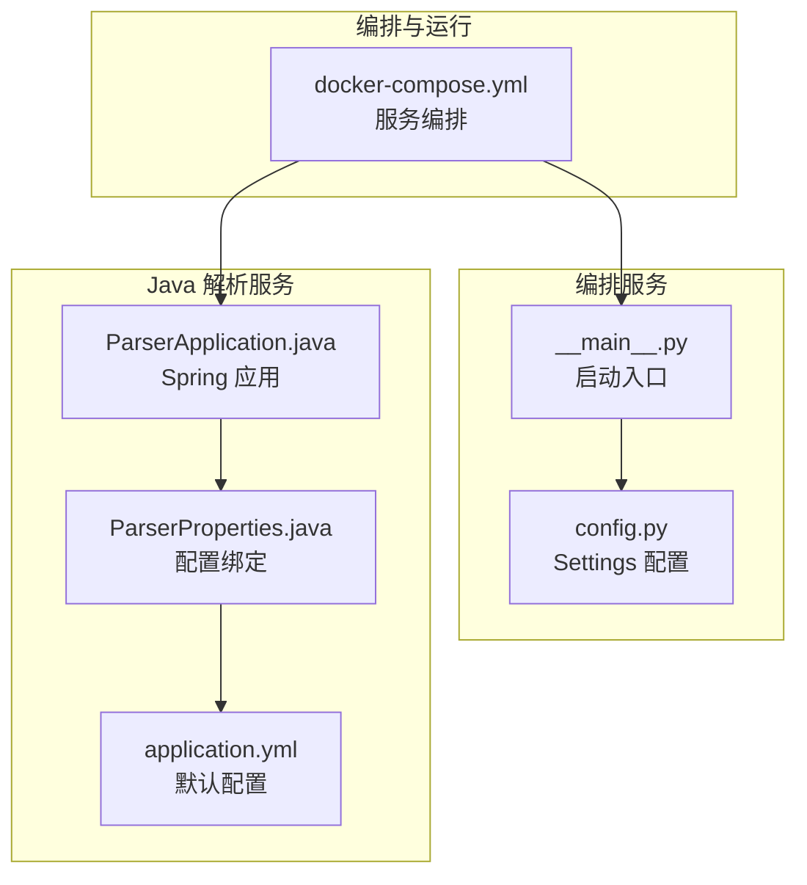
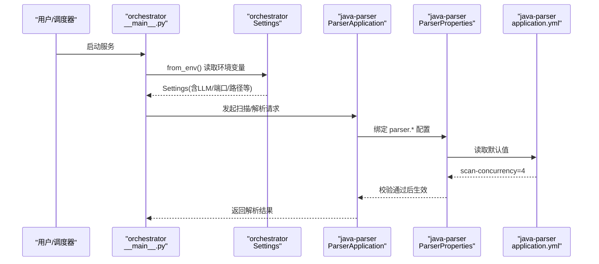
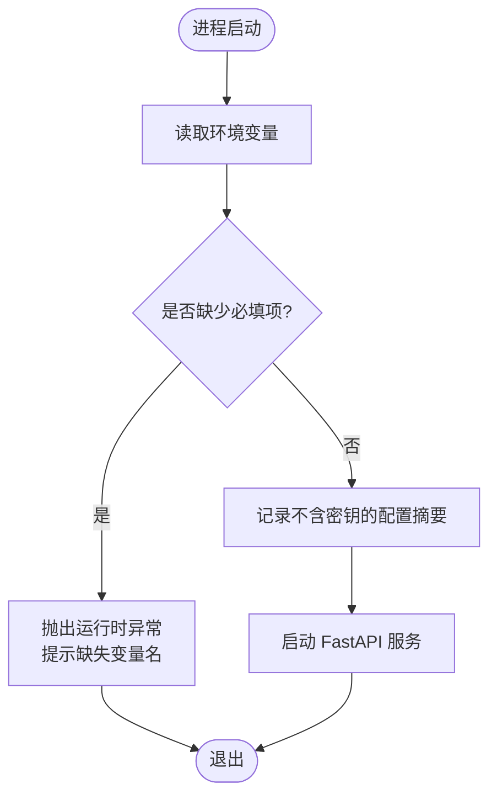
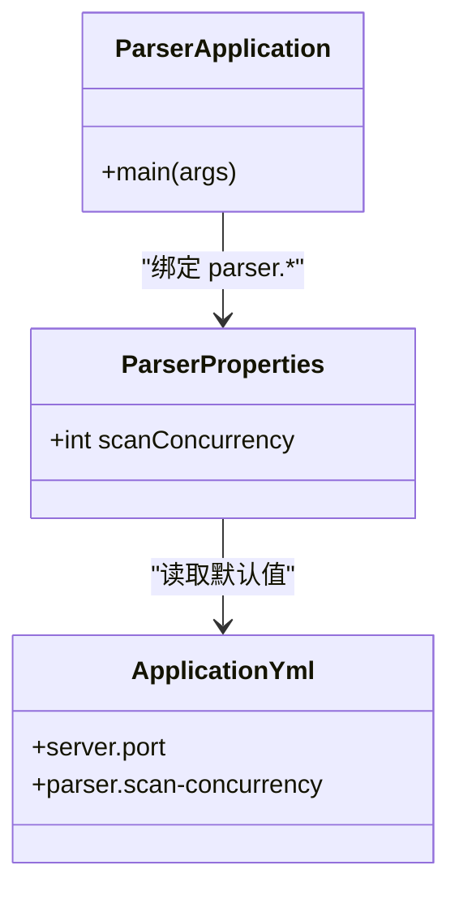
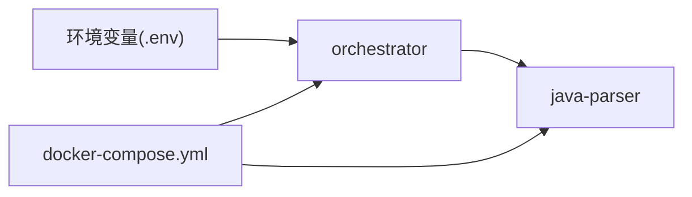

# 配置管理

<cite>
**本文引用的文件**
- [services/orchestrator/src/orchestrator/config.py](file://services/orchestrator/src/orchestrator/config.py)
- [services/orchestrator/src/orchestrator/__main__.py](file://services/orchestrator/src/orchestrator/__main__.py)
- [services/java-parser/src/main/resources/application.yml](file://services/java-parser/src/main/resources/application.yml)
- [services/java-parser/src/main/java/com/llmautotest/parser/ParserProperties.java](file://services/java-parser/src/main/java/com/llmautotest/parser/ParserProperties.java)
- [services/java-parser/src/main/java/com/llmautotest/parser/ParserApplication.java](file://services/java-parser/src/main/java/com/llmautotest/parser/ParserApplication.java)
- [deploy/docker-compose.yml](file://deploy/docker-compose.yml)
</cite>

## 目录
1. [简介](#简介)
2. [项目结构](#项目结构)
3. [核心组件](#核心组件)
4. [架构总览](#架构总览)
5. [详细组件分析](#详细组件分析)
6. [依赖关系分析](#依赖关系分析)
7. [性能考虑](#性能考虑)
8. [故障排查指南](#故障排查指南)
9. [结论](#结论)
10. [附录](#附录)

## 简介
本文件为 LLM-AutoTest 项目的配置管理文档，聚焦于编排服务（orchestrator）与 Java 解析服务（java-parser）的配置项、环境变量、默认值、校验规则、优先级与动态更新机制，并提供开发/测试/生产环境的部署差异建议、安全存储与访问控制、验证与错误提示、以及最佳实践与性能调优建议。

## 项目结构
- 编排服务（Python/FastAPI）：通过数据类集中读取环境变量并启动服务。
- Java 解析服务（Spring Boot）：通过 application.yml 与 @ConfigurationProperties 绑定配置，支持环境变量覆盖。
- 容器编排：docker-compose 统一声明端口、卷、环境变量与依赖关系。

图表来源
- [services/orchestrator/src/orchestrator/__main__.py:15-21](file://services/orchestrator/src/orchestrator/__main__.py#L15-L21)
- [services/orchestrator/src/orchestrator/config.py:9-55](file://services/orchestrator/src/orchestrator/config.py#L9-L55)
- [services/java-parser/src/main/java/com/llmautotest/parser/ParserApplication.java:9-15](file://services/java-parser/src/main/java/com/llmautotest/parser/ParserApplication.java#L9-L15)
- [services/java-parser/src/main/java/com/llmautotest/parser/ParserProperties.java:7-15](file://services/java-parser/src/main/java/com/llmautotest/parser/ParserProperties.java#L7-L15)
- [services/java-parser/src/main/resources/application.yml:1-8](file://services/java-parser/src/main/resources/application.yml#L1-L8)
- [deploy/docker-compose.yml:1-62](file://deploy/docker-compose.yml#L1-L62)

章节来源
- [services/orchestrator/src/orchestrator/__main__.py:15-21](file://services/orchestrator/src/orchestrator/__main__.py#L15-L21)
- [services/orchestrator/src/orchestrator/config.py:9-55](file://services/orchestrator/src/orchestrator/config.py#L9-L55)
- [services/java-parser/src/main/resources/application.yml:1-8](file://services/java-parser/src/main/resources/application.yml#L1-L8)
- [services/java-parser/src/main/java/com/llmautotest/parser/ParserProperties.java:7-15](file://services/java-parser/src/main/java/com/llmautotest/parser/ParserProperties.java#L7-L15)
- [services/java-parser/src/main/java/com/llmautotest/parser/ParserApplication.java:9-15](file://services/java-parser/src/main/java/com/llmautotest/parser/ParserApplication.java#L9-L15)
- [deploy/docker-compose.yml:1-62](file://deploy/docker-compose.yml#L1-L62)

## 核心组件
- 编排服务配置（Settings）
  - 全部来自环境变量；提供公开摘要用于日志安全输出。
  - 必填项缺失时抛出运行时异常，便于快速定位配置问题。
- Java 解析服务配置（ParserProperties + application.yml）
  - 通过 Spring Boot 的 @ConfigurationProperties 绑定 parser.* 前缀配置。
  - application.yml 提供默认值；环境变量可覆盖。
  - 对关键参数进行入参校验（如并发度必须为正）。

章节来源
- [services/orchestrator/src/orchestrator/config.py:9-55](file://services/orchestrator/src/orchestrator/config.py#L9-L55)
- [services/java-parser/src/main/resources/application.yml:1-8](file://services/java-parser/src/main/resources/application.yml#L1-L8)
- [services/java-parser/src/main/java/com/llmautotest/parser/ParserProperties.java:7-15](file://services/java-parser/src/main/java/com/llmautotest/parser/ParserProperties.java#L7-L15)

## 架构总览
下图展示 orchestrator 与 java-parser 在容器编排下的启动与调用关系，以及配置加载路径。

图表来源
- [services/orchestrator/src/orchestrator/__main__.py:15-21](file://services/orchestrator/src/orchestrator/__main__.py#L15-L21)
- [services/orchestrator/src/orchestrator/config.py:35-55](file://services/orchestrator/src/orchestrator/config.py#L35-L55)
- [services/java-parser/src/main/java/com/llmautotest/parser/ParserApplication.java:9-15](file://services/java-parser/src/main/java/com/llmautotest/parser/ParserApplication.java#L9-L15)
- [services/java-parser/src/main/java/com/llmautotest/parser/ParserProperties.java:7-15](file://services/java-parser/src/main/java/com/llmautotest/parser/ParserProperties.java#L7-L15)
- [services/java-parser/src/main/resources/application.yml:1-8](file://services/java-parser/src/main/resources/application.yml#L1-L8)

## 详细组件分析

### 编排服务（orchestrator）配置
- 配置来源与加载
  - 通过 dataclass 集中定义配置字段，从环境变量构建实例。
  - 启动时读取配置并打印不含密钥的摘要信息。
- 关键配置项
  - 服务端口：PORT（默认 8000）
  - Java 解析服务地址：JAVA_PARSER_URL（必填）
  - 产物根目录：ARTIFACTS_ROOT（默认 /data/llm-autotest）
  - LLM 基础 URL：LLM_BASE_URL（必填）
  - LLM 模型名：LLM_MODEL_NAME（默认 glm-5.3）
  - LLM API Key：LLM_API_KEY（可为空，不进入日志）
  - LLM 采样温度：LLM_TEMPERATURE（默认 0.2）
  - LLM Top-P：LLM_TOP_P（默认 0.8）
  - LLM Seed：LLM_SEED（可选）
  - LLM 超时秒数：LLM_TIMEOUT_S（默认 120）
  - Schema 目录：SCHEMAS_DIR（默认 schemas）
- 校验与错误处理
  - 必填项缺失时抛出运行时异常，包含缺失键名，便于快速修复。
- 日志安全
  - 提供公开摘要方法，仅输出非敏感配置，避免密钥泄露。

图表来源
- [services/orchestrator/src/orchestrator/config.py:35-55](file://services/orchestrator/src/orchestrator/config.py#L35-L55)
- [services/orchestrator/src/orchestrator/__main__.py:15-21](file://services/orchestrator/src/orchestrator/__main__.py#L15-L21)

章节来源
- [services/orchestrator/src/orchestrator/config.py:9-55](file://services/orchestrator/src/orchestrator/config.py#L9-L55)
- [services/orchestrator/src/orchestrator/__main__.py:15-21](file://services/orchestrator/src/orchestrator/__main__.py#L15-L21)

### Java 解析服务（java-parser）配置
- 配置来源与加载
  - application.yml 提供默认配置（如 server.port、parser.scan-concurrency）。
  - 通过 @ConfigurationProperties(prefix = "parser") 将 parser.* 绑定到 ParserProperties。
  - Spring Boot 支持以环境变量覆盖 application.yml 中的值。
- 关键配置项
  - 服务端口：server.port（默认 8080，可通过环境变量覆盖）
  - 多仓库扫描并发度：parser.scan-concurrency（默认 4，必须为正整数）
- 校验与错误处理
  - 构造时对 scan-concurrency 进行合法性校验，非法值抛出参数异常。

图表来源
- [services/java-parser/src/main/java/com/llmautotest/parser/ParserApplication.java:9-15](file://services/java-parser/src/main/java/com/llmautotest/parser/ParserApplication.java#L9-L15)
- [services/java-parser/src/main/java/com/llmautotest/parser/ParserProperties.java:7-15](file://services/java-parser/src/main/java/com/llmautotest/parser/ParserProperties.java#L7-L15)
- [services/java-parser/src/main/resources/application.yml:1-8](file://services/java-parser/src/main/resources/application.yml#L1-L8)

章节来源
- [services/java-parser/src/main/resources/application.yml:1-8](file://services/java-parser/src/main/resources/application.yml#L1-L8)
- [services/java-parser/src/main/java/com/llmautotest/parser/ParserProperties.java:7-15](file://services/java-parser/src/main/java/com/llmautotest/parser/ParserProperties.java#L7-L15)
- [services/java-parser/src/main/java/com/llmautotest/parser/ParserApplication.java:9-15](file://services/java-parser/src/main/java/com/llmautotest/parser/ParserApplication.java#L9-L15)

### 容器编排与环境变量注入
- docker-compose 中
  - 暴露端口：java-parser 8081:8080，orchestrator 8000:8000，frontend 8080:80。
  - 共享卷 artifacts 挂载到 /data/llm-autotest，供 orchestrator 与 java-parser 使用。
  - orchestrator 通过 environment 注入 JAVA_PARSER_URL，并通过 env_file 引入 .env 文件。
  - 健康检查：java-parser 提供 /health 端点。
  - 依赖顺序：orchestrator 依赖 java-parser 健康后启动。

章节来源
- [deploy/docker-compose.yml:1-62](file://deploy/docker-compose.yml#L1-L62)

## 依赖关系分析
- 编排服务依赖
  - 环境变量：PORT、JAVA_PARSER_URL、ARTIFACTS_ROOT、LLM_*、SCHEMAS_DIR。
  - 外部服务：java-parser 提供的 HTTP 接口。
- Java 解析服务依赖
  - application.yml 默认配置。
  - 环境变量覆盖 parser.* 与 server.*。
- 编排层依赖
  - docker-compose 负责网络、端口映射、卷挂载、环境变量注入与服务启动顺序。

图表来源
- [deploy/docker-compose.yml:18-32](file://deploy/docker-compose.yml#L18-L32)
- [services/orchestrator/src/orchestrator/config.py:35-55](file://services/orchestrator/src/orchestrator/config.py#L35-L55)

章节来源
- [deploy/docker-compose.yml:18-32](file://deploy/docker-compose.yml#L18-L32)
- [services/orchestrator/src/orchestrator/config.py:35-55](file://services/orchestrator/src/orchestrator/config.py#L35-L55)

## 性能考虑
- 并发与吞吐
  - 调整 parser.scan-concurrency 以匹配机器资源与仓库规模，避免过高导致内存/CPU 抖动。
  - 合理设置 LLM 超时时间（LLM_TIMEOUT_S），防止长耗时任务阻塞流水线。
- I/O 与存储
  - ARTIFACTS_ROOT 指向持久化卷，确保产物可备份与复用；避免频繁跨主机移动大文件。
- 网络与重试
  - 为 java-parser 健康检查与 orchestrator 到 java-parser 的调用预留足够超时与重试策略（可在上层编排或客户端实现）。

[本节为通用指导，不直接分析具体文件]

## 故障排查指南
- 常见错误与定位
  - 缺少必填环境变量：启动时报错并提示缺失变量名，按提示补齐即可。
  - 非法配置值：如 parser.scan-concurrency 非正数，会抛出参数异常，需修正为合法值。
  - 服务不可达：检查 JAVA_PARSER_URL 是否正确，java-parser 端口与健康检查是否正常。
- 日志与调试
  - orchestrator 启动时会记录不含密钥的配置摘要，便于核对运行环境。
  - 若出现 LLM 调用失败，结合 LLM_* 相关配置与网络连通性排查。
- 容器与编排
  - 确认 docker-compose 端口映射、卷挂载与依赖顺序正确。
  - 查看各服务日志，确认健康检查通过后再启动后续服务。

章节来源
- [services/orchestrator/src/orchestrator/config.py:35-55](file://services/orchestrator/src/orchestrator/config.py#L35-L55)
- [services/java-parser/src/main/java/com/llmautotest/parser/ParserProperties.java:10-15](file://services/java-parser/src/main/java/com/llmautotest/parser/ParserProperties.java#L10-L15)
- [deploy/docker-compose.yml:11-16](file://deploy/docker-compose.yml#L11-L16)

## 结论
本项目采用“环境变量优先、配置文件兜底”的配置策略，配合严格的必填校验与入参校验，确保服务在多种环境下稳定运行。通过 docker-compose 统一管理端口、卷与依赖，简化了部署复杂度。建议在敏感信息管理与不同环境差异化配置上进一步完善，以提升安全性与可维护性。

[本节为总结性内容，不直接分析具体文件]

## 附录

### 配置项清单与默认值
- 编排服务（orchestrator）
  - PORT：默认 8000
  - JAVA_PARSER_URL：必填
  - ARTIFACTS_ROOT：默认 /data/llm-autotest
  - LLM_BASE_URL：必填
  - LLM_MODEL_NAME：默认 glm-5.3
  - LLM_API_KEY：可为空
  - LLM_TEMPERATURE：默认 0.2
  - LLM_TOP_P：默认 0.8
  - LLM_SEED：可选
  - LLM_TIMEOUT_S：默认 120
  - SCHEMAS_DIR：默认 schemas
- Java 解析服务（java-parser）
  - server.port：默认 8080
  - parser.scan-concurrency：默认 4（必须为正）

章节来源
- [services/orchestrator/src/orchestrator/config.py:35-55](file://services/orchestrator/src/orchestrator/config.py#L35-L55)
- [services/java-parser/src/main/resources/application.yml:1-8](file://services/java-parser/src/main/resources/application.yml#L1-L8)
- [services/java-parser/src/main/java/com/llmautotest/parser/ParserProperties.java:7-15](file://services/java-parser/src/main/java/com/llmautotest/parser/ParserProperties.java#L7-L15)

### 配置优先级与动态更新
- 优先级
  - 环境变量 > application.yml 默认值（Spring Boot 特性）。
  - orchestrator 仅从环境变量加载，无本地配置文件。
- 动态更新
  - 当前实现为进程启动时一次性加载配置；如需热更新，需在服务内实现监听与重载逻辑（例如基于文件系统或配置中心）。

章节来源
- [services/java-parser/src/main/resources/application.yml:1-8](file://services/java-parser/src/main/resources/application.yml#L1-L8)
- [services/orchestrator/src/orchestrator/config.py:35-55](file://services/orchestrator/src/orchestrator/config.py#L35-L55)

### 不同环境的配置模板建议
- 开发环境
  - 降低并发度与超时，便于调试；可使用本地 Mock 或免鉴权网关。
- 测试环境
  - 固定 LLM 模型与种子，保证结果可复现；开启更详细的日志。
- 生产环境
  - 严格校验所有必填项；限制并发度与超时；启用健康检查与重启策略；使用受控的制品库与网络策略。

[本节为通用指导，不直接分析具体文件]

### 安全管理建议
- 敏感信息
  - 使用环境变量或外部密钥管理服务注入 LLM_API_KEY 等敏感值，避免写入代码与镜像。
  - 日志中仅输出公开摘要，不包含密钥。
- 访问控制
  - 通过容器网络隔离服务间通信；对外暴露最小必要端口。
  - 在生产环境启用防火墙与访问白名单。

[本节为通用指导，不直接分析具体文件]

### 配置验证规则与错误提示
- 必填校验
  - orchestrator 启动时若缺少必填环境变量，将抛出运行时异常并提示缺失键名。
- 入参校验
  - java-parser 对 parser.scan-concurrency 进行正数校验，非法值抛出参数异常。
- 建议增强
  - 可增加更多范围校验（如端口范围、URL 格式、数值区间），并在错误消息中给出明确指引。

章节来源
- [services/orchestrator/src/orchestrator/config.py:35-55](file://services/orchestrator/src/orchestrator/config.py#L35-L55)
- [services/java-parser/src/main/java/com/llmautotest/parser/ParserProperties.java:10-15](file://services/java-parser/src/main/java/com/llmautotest/parser/ParserProperties.java#L10-L15)

### 最佳实践与性能调优
- 配置管理
  - 统一通过环境变量注入配置；保持 application.yml 仅保留默认值。
  - 使用 .env 文件管理不同环境差异，并通过 docker-compose 的 env_file 引入。
- 性能调优
  - 根据机器资源调整 parser.scan-concurrency 与 LLM 超时。
  - 合理设置 LLM 采样参数，平衡质量与延迟。
- 运维监控
  - 启用健康检查与日志收集；对关键指标（并发、超时、错误率）建立告警。

[本节为通用指导，不直接分析具体文件]