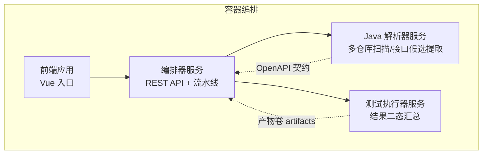
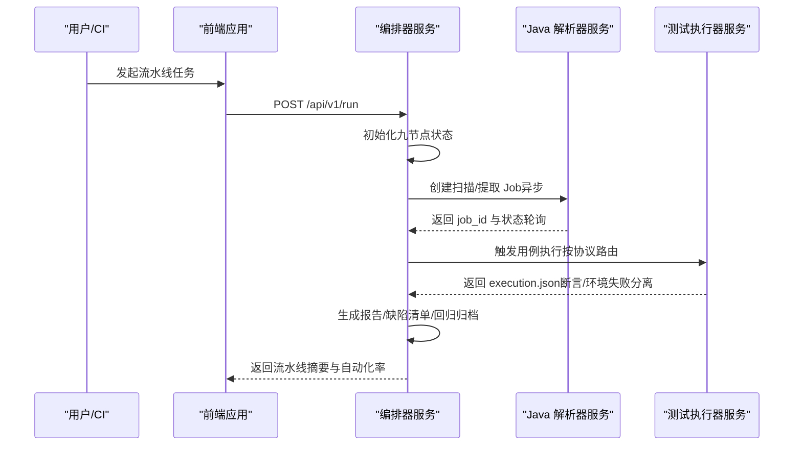
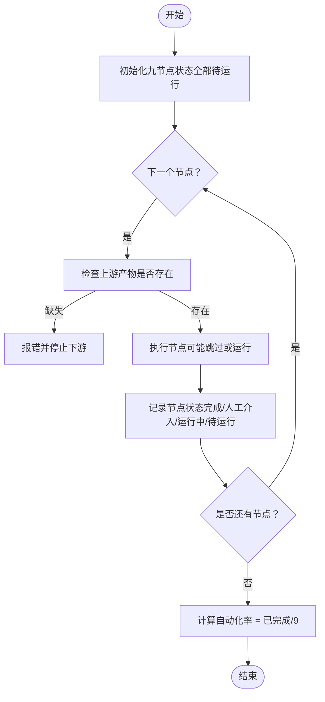
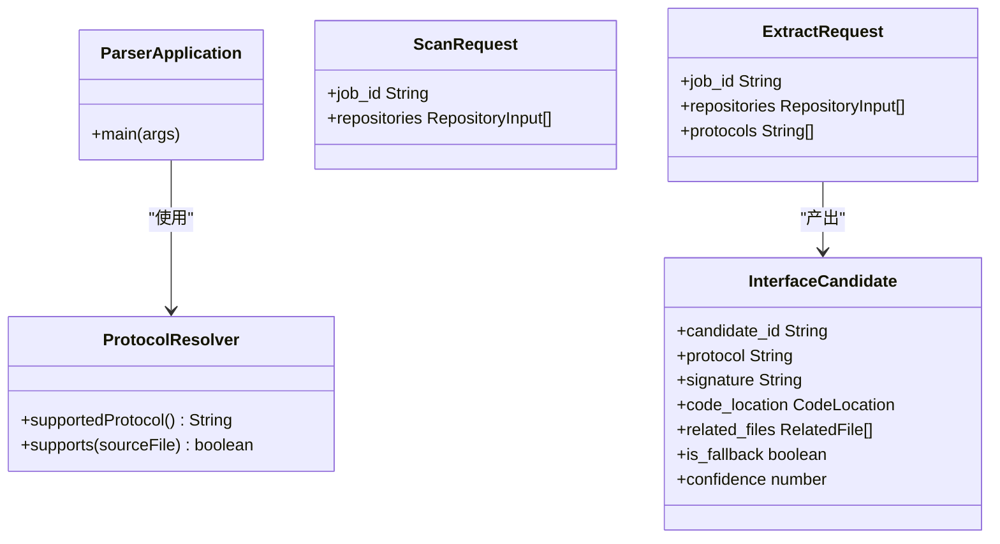
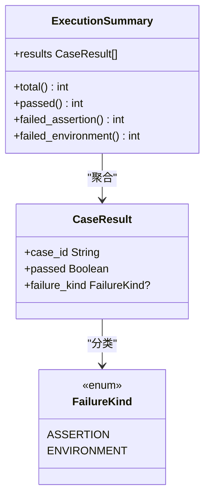
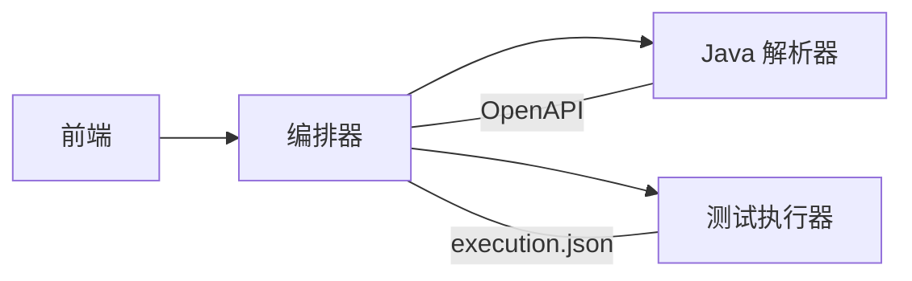

# 项目概述

<cite>
**本文引用的文件**
- [services/orchestrator/src/orchestrator/__main__.py](file://services/orchestrator/src/orchestrator/__main__.py)
- [services/orchestrator/src/orchestrator/pipeline.py](file://services/orchestrator/src/orchestrator/pipeline.py)
- [services/orchestrator/src/orchestrator/config.py](file://services/orchestrator/src/orchestrator/config.py)
- [services/java-parser/src/main/java/com/llmautotest/parser/ParserApplication.java](file://services/java-parser/src/main/java/com/llmautotest/parser/ParserApplication.java)
- [services/java-parser/src/main/java/com/llmautotest/parser/ProtocolResolver.java](file://services/java-parser/src/main/java/com/llmautotest/parser/ProtocolResolver.java)
- [services/java-parser/src/main/resources/application.yml](file://services/java-parser/src/main/resources/application.yml)
- [services/frontend/src/main.ts](file://services/frontend/src/main.ts)
- [services/test-executor/src/executor/result.py](file://services/test-executor/src/executor/result.py)
- [schemas/contracts/java-parser.openapi.yaml](file://schemas/contracts/java-parser.openapi.yaml)
- [deploy/docker-compose.yml](file://deploy/docker-compose.yml)
- [docs/02_立项提案.md](file://docs/02_立项提案.md)
- [docs/04_功能规格说明.md](file://docs/04_功能规格说明.md)
- [docs/10_测试框架选型说明.md](file://docs/10_测试框架选型说明.md)
- [prompts/README.md](file://prompts/README.md)
</cite>

## 目录
1. [引言](#引言)
2. [项目结构](#项目结构)
3. [核心组件](#核心组件)
4. [架构总览](#架构总览)
5. [详细组件分析](#详细组件分析)
6. [依赖关系分析](#依赖关系分析)
7. [性能考量](#性能考量)
8. [故障排查指南](#故障排查指南)
9. [结论](#结论)
10. [附录](#附录)

## 引言
LLM-AutoTest 是一个面向接口测试的自动化平台，目标是在“无统一接口文档”的多仓库 Java 工程背景下，通过“代码扫描 + 接口逆向还原 + AI 增强用例生成 + 自动执行 + 报告与缺陷闭环 + 回归沉淀”的端到端流水线，将人工主导的接口测试工作尽可能自动化。项目以“跑通”为验收标准，覆盖 REST/gRPC/GraphQL/SOAP/MQ 五种协议与九个固定节点口径，形成可度量、可复现、可演进的测试资产沉淀路径。

核心价值：
- 在不依赖既有接口文档的前提下，从源码逆向还原接口并生成可执行用例，降低需求到测试的转换成本。
- 以编排器为中心串联九节点流程，支持断点续跑与人工介入标记，便于在真实环境中快速验证与迭代。
- 通过容器化部署与契约化服务边界（OpenAPI），实现服务解耦与可替换性，便于后续扩展更多协议与工具链。
- 提供统一的度量口径（自动化率）和降级策略，确保首版交付可控且具备规模化评估基础。

**章节来源**
- [docs/02_立项提案.md:20-59](file://docs/02_立项提案.md#L20-L59)
- [docs/04_功能规格说明.md:9-32](file://docs/04_功能规格说明.md#L9-L32)

## 项目结构
项目采用微服务分层组织，按职责拆分为前端应用、编排器服务、Java 解析器服务、测试执行器服务，并通过 Docker Compose 进行编排与依赖管理。

**图表来源**
- [deploy/docker-compose.yml:4-41](file://deploy/docker-compose.yml#L4-L41)
- [schemas/contracts/java-parser.openapi.yaml:1-11](file://schemas/contracts/java-parser.openapi.yaml#L1-L11)

**章节来源**
- [deploy/docker-compose.yml:1-62](file://deploy/docker-compose.yml#L1-L62)
- [services/frontend/src/main.ts:1-6](file://services/frontend/src/main.ts#L1-L6)

## 核心组件
- 编排器服务（orchestrator）：提供统一入口与 REST API，维护九节点流水线状态，驱动各节点顺序执行与断点续跑，采集人工介入信息并计算自动化率。
- Java 解析器服务（java-parser）：负责多仓库源码扫描与接口候选提取，支持可插拔协议解析策略，产出结构化 code_inventory 与接口候选清单。
- 前端应用（frontend）：Vue 应用占位入口，承载未来 UI 能力（如流水线可视化、产物查看等）。
- 测试执行器服务（test-executor）：负责用例执行与结果汇总，区分“断言失败”与“环境失败”，输出程序化汇总数据。

**章节来源**
- [services/orchestrator/src/orchestrator/__main__.py:1-26](file://services/orchestrator/src/orchestrator/__main__.py#L1-L26)
- [services/orchestrator/src/orchestrator/pipeline.py:1-84](file://services/orchestrator/src/orchestrator/pipeline.py#L1-L84)
- [services/java-parser/src/main/java/com/llmautotest/parser/ParserApplication.java:1-17](file://services/java-parser/src/main/java/com/llmautotest/parser/ParserApplication.java#L1-L17)
- [services/java-parser/src/main/java/com/llmautotest/parser/ProtocolResolver.java:1-17](file://services/java-parser/src/main/java/com/llmautotest/parser/ProtocolResolver.java#L1-L17)
- [services/test-executor/src/executor/result.py:1-61](file://services/test-executor/src/executor/result.py#L1-L61)

## 架构总览
系统边界清晰：前端作为交互面；编排器作为控制面；Java 解析器作为静态分析与候选提取的数据面；测试执行器作为执行与结果聚合面。服务间通过 HTTP 与共享卷通信，契约由 OpenAPI 定义，配置通过环境变量注入，保证可移植性与可观测性。

**图表来源**
- [schemas/contracts/java-parser.openapi.yaml:24-115](file://schemas/contracts/java-parser.openapi.yaml#L24-L115)
- [services/orchestrator/src/orchestrator/pipeline.py:23-70](file://services/orchestrator/src/orchestrator/pipeline.py#L23-L70)
- [services/test-executor/src/executor/result.py:17-61](file://services/test-executor/src/executor/result.py#L17-L61)

## 详细组件分析

### 编排器服务（orchestrator）
- 启动与配置：通过 CLI 入口加载 Settings，读取端口、Java 解析器地址、制品根目录以及 LLM 调用参数（模型名、温度、top_p、seed），并以 uvicorn 暴露 REST API。
- 流水线定义：固定九节点顺序（需求解析、代码扫描、接口还原、Code Review、用例生成、自动执行、测试报告、缺陷清单、回归沉淀），每个节点四态（已完成、人工介入、运行中、待运行），并提供自动化率计算（已完成节点数/9）。
- 断点续跑与产物契约：节点间以文件为接口，产物落盘于共享卷；Schema 校验不通过则拒绝复用，强制重跑该节点。

**图表来源**
- [services/orchestrator/src/orchestrator/pipeline.py:23-70](file://services/orchestrator/src/orchestrator/pipeline.py#L23-L70)
- [docs/04_功能规格说明.md:9-32](file://docs/04_功能规格说明.md#L9-L32)

**章节来源**
- [services/orchestrator/src/orchestrator/__main__.py:1-26](file://services/orchestrator/src/orchestrator/__main__.py#L1-L26)
- [services/orchestrator/src/orchestrator/config.py:1-50](file://services/orchestrator/src/orchestrator/config.py#L1-L50)
- [services/orchestrator/src/orchestrator/pipeline.py:1-84](file://services/orchestrator/src/orchestrator/pipeline.py#L1-L84)
- [docs/04_功能规格说明.md:9-32](file://docs/04_功能规格说明.md#L9-L32)

### Java 解析器服务（java-parser）
- 服务入口：Spring Boot 应用，启用配置属性扫描，对外暴露健康检查与异步 Job 接口。
- 协议解析策略：通过 ProtocolResolver 接口实现可插拔协议识别（REST/Dubbo/gRPC/GraphQL/SOAP/MQ），新增协议无需改动主流程。
- 契约与产物：基于 OpenAPI 定义的扫描与提取 Job，产出 code_inventory.json 与接口候选清单（含协议类型、签名、代码位置、关联文件、置信度等），供编排器侧 LLM 语义解析使用。

**图表来源**
- [services/java-parser/src/main/java/com/llmautotest/parser/ParserApplication.java:1-17](file://services/java-parser/src/main/java/com/llmautotest/parser/ParserApplication.java#L1-L17)
- [services/java-parser/src/main/java/com/llmautotest/parser/ProtocolResolver.java:1-17](file://services/java-parser/src/main/java/com/llmautotest/parser/ProtocolResolver.java#L1-L17)
- [schemas/contracts/java-parser.openapi.yaml:162-369](file://schemas/contracts/java-parser.openapi.yaml#L162-L369)

**章节来源**
- [services/java-parser/src/main/java/com/llmautotest/parser/ParserApplication.java:1-17](file://services/java-parser/src/main/java/com/llmautotest/parser/ParserApplication.java#L1-L17)
- [services/java-parser/src/main/java/com/llmautotest/parser/ProtocolResolver.java:1-17](file://services/java-parser/src/main/java/com/llmautotest/parser/ProtocolResolver.java#L1-L17)
- [services/java-parser/src/main/resources/application.yml:1-8](file://services/java-parser/src/main/resources/application.yml#L1-L8)
- [schemas/contracts/java-parser.openapi.yaml:1-369](file://schemas/contracts/java-parser.openapi.yaml#L1-L369)

### 前端应用（frontend）
- 当前为 Vue 占位入口，业务页面将在 V2.1 范围裁决后接入，用于展示流水线状态、产物与报告。

**章节来源**
- [services/frontend/src/main.ts:1-6](file://services/frontend/src/main.ts#L1-L6)

### 测试执行器服务（test-executor）
- 结果判定：区分“断言失败”与“环境失败”，通过 FailureKind 枚举与 CaseResult/ExecutionSummary 数据结构进行程序化汇总，避免经由 LLM 处理，确保数值一致性。
- 执行策略：按协议路由到对应 Runner，统一收敛到 execution.json；前置数据准备发生在流程启动前，不计为节点内人工介入。

**图表来源**
- [services/test-executor/src/executor/result.py:10-61](file://services/test-executor/src/executor/result.py#L10-L61)

**章节来源**
- [services/test-executor/src/executor/result.py:1-61](file://services/test-executor/src/executor/result.py#L1-L61)
- [docs/04_功能规格说明.md:179-208](file://docs/04_功能规格说明.md#L179-L208)

## 依赖关系分析
- 编排器依赖 Java 解析器的异步 Job 接口（扫描/提取），并通过共享卷传递产物；测试执行器依赖用例脚本与协议客户端，结果回传至编排器。
- 前端依赖编排器 API 获取流水线状态与产物。
- 所有服务通过环境变量注入配置，避免硬编码；OpenAPI 契约约束 java-parser 的服务边界。

**图表来源**
- [deploy/docker-compose.yml:18-41](file://deploy/docker-compose.yml#L18-L41)
- [schemas/contracts/java-parser.openapi.yaml:1-11](file://schemas/contracts/java-parser.openapi.yaml#L1-L11)

**章节来源**
- [deploy/docker-compose.yml:1-62](file://deploy/docker-compose.yml#L1-L62)
- [schemas/contracts/java-parser.openapi.yaml:1-369](file://schemas/contracts/java-parser.openapi.yaml#L1-L369)

## 性能考量
- 并发与吞吐：Java 解析器支持可配置的扫描并发度（默认 4），可根据仓库规模与环境资源调整。
- Token 用量控制：接口逆向采用“静态特征定位 + 分块上下文”的策略，减少单次大上下文调用，结合 Prompt 版本化与 Schema 校验，降低无效调用与重试开销。
- 降级策略：对难以部署的协议（SOAP/MQ）优先采用“脚本生成 + Mock 演示”，保障整体流程跑通与度量基线。
- 产物持久化：共享卷 artifacts 集中存放中间产物与最终报告，便于断点续跑与审计。

[本节为通用指导，不直接分析具体文件]

## 故障排查指南
- 服务健康检查：java-parser 提供 /health 端点，docker-compose 通过 healthcheck 探测服务存活。
- 配置缺失：orchestrator 启动时若缺少必填环境变量（如 JAVA_PARSER_URL、LLM_BASE_URL、LLM_SEED），会抛出运行时错误并提示缺失项。
- 契约校验失败：当编排器检测到上游节点产物 Schema 校验不通过，将拒绝复用并强制重跑该节点，避免脏数据传播。
- 执行失败分类：测试执行器将失败区分为“断言失败”与“环境失败”，前者进入缺陷清单，后者隔离至待环境确认列表，便于定位问题来源。

**章节来源**
- [deploy/docker-compose.yml:11-16](file://deploy/docker-compose.yml#L11-L16)
- [services/orchestrator/src/orchestrator/config.py:32-50](file://services/orchestrator/src/orchestrator/config.py#L32-L50)
- [docs/04_功能规格说明.md:27-31](file://docs/04_功能规格说明.md#L27-L31)
- [services/test-executor/src/executor/result.py:10-61](file://services/test-executor/src/executor/result.py#L10-L61)

## 结论
LLM-AutoTest 通过“编排器 + 解析器 + 执行器 + 前端”的微服务架构，实现了从需求到回归的九节点自动化流水线。其创新点在于：
- 以契约化服务边界与可插拔协议解析支撑多协议场景；
- 以“静态特征定位 + LLM 语义解析”的组合策略提升接口还原质量与效率；
- 以断点续跑与人工介入标记保障真实环境的可运维性；
- 以程序化汇总与降级策略确保度量口径一致与交付可控。

对于初学者，建议从 docker-compose 启动与编排器 API 入手，理解九节点流转与产物结构；对于经验丰富的开发者，可聚焦 ProtocolResolver 扩展、Prompt 版本化与 Schema 校验、以及 test-executor 的二态结果聚合机制，持续优化自动化率与稳定性。

[本节总结性内容，不直接分析具体文件]

## 附录
- 测试框架选型：基于 Python 主栈与五协议覆盖需求，选定 pytest，强调 LLM 生成脚本的可加载性、结果导出能力与无人值守执行优势。
- Prompt 管理：所有 LLM Prompt 版本化存放，禁止内联字符串，变更需升版本号并在文件内追加变更记录；Prompt 要求与 schemas/ 中的 JSON Schema 对齐，确保 LLM 输出经校验后方可进入下游。

**章节来源**
- [docs/10_测试框架选型说明.md:1-64](file://docs/10_测试框架选型说明.md#L1-L64)
- [prompts/README.md:1-15](file://prompts/README.md#L1-L15)