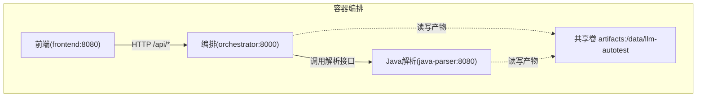
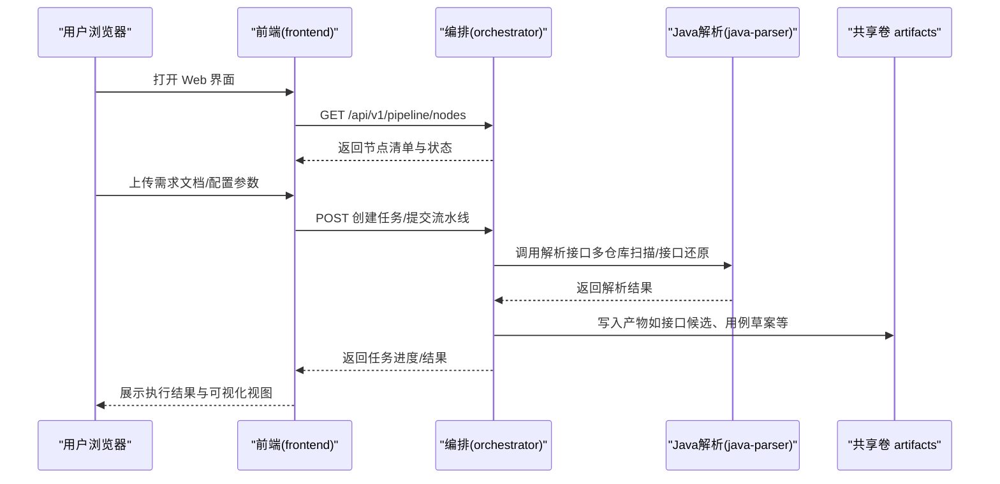
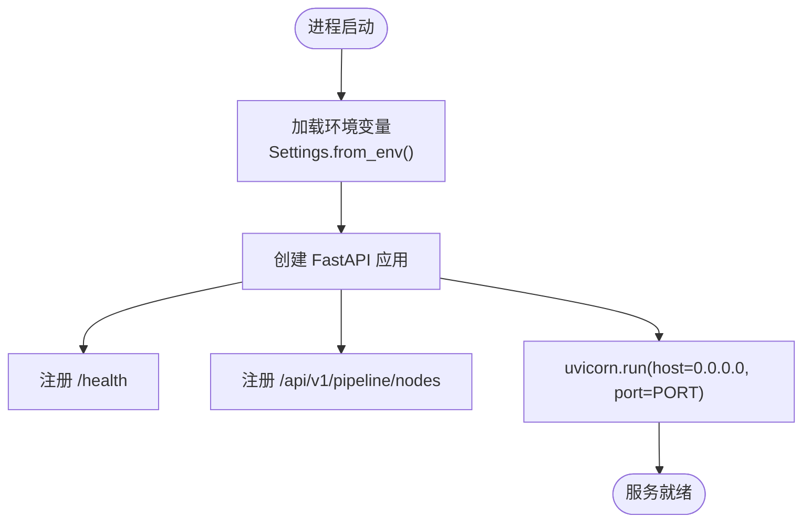
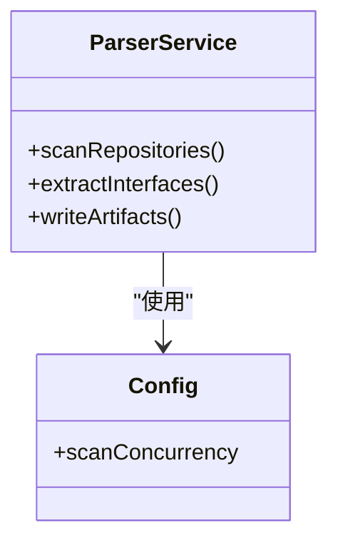
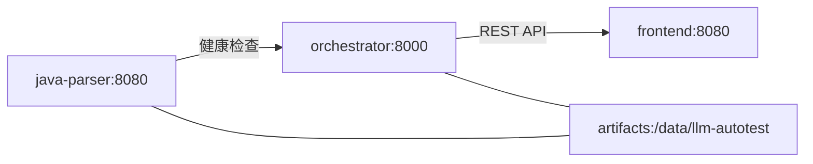

# 快速开始指南

<cite>
**本文引用的文件**
- [docker-compose.yml](file://deploy/docker-compose.yml)
- [config.py](file://services/orchestrator/src/orchestrator/config.py)
- [__main__.py](file://services/orchestrator/src/orchestrator/__main__.py)
- [api.py](file://services/orchestrator/src/orchestrator/api.py)
- [application.yml](file://services/java-parser/src/main/resources/application.yml)
- [pom.xml](file://services/java-parser/pom.xml)
- [package.json](file://services/frontend/package.json)
- [vite.config.ts](file://services/frontend/vite.config.ts)
- [schemas/README.md](file://schemas/README.md)
- [execution.sample.json](file://schemas/samples/execution.sample.json)
- [interface_candidates.sample.json](file://schemas/samples/interface_candidates.sample.json)
</cite>

## 目录
1. [简介](#简介)
2. [项目结构](#项目结构)
3. [核心组件](#核心组件)
4. [架构总览](#架构总览)
5. [详细组件分析](#详细组件分析)
6. [依赖关系分析](#依赖关系分析)
7. [性能与监控](#性能与监控)
8. [故障排查指南](#故障排查指南)
9. [结论](#结论)
10. [附录：30分钟上手清单](#附录30分钟上手清单)

## 简介
本指南面向首次接触 LLM-AutoTest 的新用户，目标是在30分钟内完成环境搭建、一键启动所有服务，并跑通第一个测试流水线。你将学会：
- 准备 Docker 环境与必要工具
- 通过 docker-compose 编排启动编排服务、Java 解析器、前端界面等组件
- 上传需求文档、配置测试参数、启动流水线、查看执行结果
- 处理不同格式的需求文档、多仓库代码扫描、自定义测试配置
- 常见问题的定位与解决
- 性能调优建议与关键监控指标

## 项目结构
LLM-AutoTest 采用“编排 + 解析 + 前端”的分层架构：
- 编排服务（orchestrator）：提供 REST API、节点编排、产物管理、断点续跑能力
- Java 解析器（java-parser）：对多仓库源码进行扫描与接口逆向还原
- 前端界面（frontend）：基于 Vue 3 + Vite 的 Web 界面，用于可视化操作与结果展示
- 产物与契约（schemas）：定义结构化产物的 JSON Schema，作为全链路数据模型的唯一事实来源

**图示来源**
- [docker-compose.yml:1-62](file://deploy/docker-compose.yml#L1-L62)
- [api.py:11-27](file://services/orchestrator/src/orchestrator/api.py#L11-L27)
- [application.yml:1-8](file://services/java-parser/src/main/resources/application.yml#L1-L8)

**章节来源**
- [docker-compose.yml:1-62](file://deploy/docker-compose.yml#L1-L62)

## 核心组件
- 编排服务（Python/FastAPI）
  - 入口：CLI 统一入口 + REST API
  - 配置：全部来自环境变量，包含端口、Java 解析器地址、产物根目录、LLM 调用参数、Schema 目录等
  - 健康检查：/health
  - 节点清单：/api/v1/pipeline/nodes
- Java 解析器（Spring Boot）
  - 端口：8080（容器内），对外映射到宿主机 8081
  - 可配置项：扫描并发度等
- 前端（Vue 3 + Vite）
  - 开发代理：/api 转发至 orchestrator 8000
  - 构建脚本：build/lint/test 等

**章节来源**
- [__main__.py:15-25](file://services/orchestrator/src/orchestrator/__main__.py#L15-L25)
- [config.py:9-55](file://services/orchestrator/src/orchestrator/config.py#L9-L55)
- [api.py:11-27](file://services/orchestrator/src/orchestrator/api.py#L11-L27)
- [application.yml:1-8](file://services/java-parser/src/main/resources/application.yml#L1-L8)
- [package.json:8-28](file://services/frontend/package.json#L8-L28)
- [vite.config.ts:4-15](file://services/frontend/vite.config.ts#L4-L15)

## 架构总览
系统由三个主要服务组成，通过 Docker Compose 编排，共享一个持久化卷存放产物。

**图示来源**
- [docker-compose.yml:18-41](file://deploy/docker-compose.yml#L18-L41)
- [api.py:21-25](file://services/orchestrator/src/orchestrator/api.py#L21-L25)

## 详细组件分析

### 编排服务（orchestrator）
- 启动方式：通过 uvicorn 运行 FastAPI 应用，绑定 0.0.0.0，端口来自环境变量
- 配置加载：从环境变量读取 Settings，缺失必填项会抛出运行时错误
- 暴露接口：
  - /health：健康检查
  - /api/v1/pipeline/nodes：获取九节点清单与当前状态
- 产物目录：默认 /data/llm-autotest，可通过 ARTIFACTS_ROOT 覆盖
- LLM 调用：支持 base_url、model_name、api_key、temperature、top_p、seed、timeout 等参数

**图示来源**
- [__main__.py:15-25](file://services/orchestrator/src/orchestrator/__main__.py#L15-L25)
- [config.py:36-55](file://services/orchestrator/src/orchestrator/config.py#L36-L55)
- [api.py:11-27](file://services/orchestrator/src/orchestrator/api.py#L11-L27)

**章节来源**
- [__main__.py:15-25](file://services/orchestrator/src/orchestrator/__main__.py#L15-L25)
- [config.py:9-55](file://services/orchestrator/src/orchestrator/config.py#L9-L55)
- [api.py:11-27](file://services/orchestrator/src/orchestrator/api.py#L11-L27)

### Java 解析器（java-parser）
- 技术栈：Spring Boot + JavaParser，用于多仓库源码扫描与接口逆向还原
- 端口：容器内 8080，宿主机映射 8081
- 可配置：扫描并发度等
- 健康检查：/health（被编排服务依赖）

**图示来源**
- [application.yml:1-8](file://services/java-parser/src/main/resources/application.yml#L1-L8)
- [pom.xml:31-47](file://services/java-parser/pom.xml#L31-L47)

**章节来源**
- [application.yml:1-8](file://services/java-parser/src/main/resources/application.yml#L1-L8)
- [pom.xml:1-83](file://services/java-parser/pom.xml#L1-L83)

### 前端（frontend）
- 技术栈：Vue 3 + Vite + TypeScript
- 开发模式：将 /api 请求代理到 http://localhost:8000（编排服务）
- 构建与测试：提供 build、lint、test 脚本

**图示来源**
- [vite.config.ts:4-15](file://services/frontend/vite.config.ts#L4-L15)
- [package.json:8-28](file://services/frontend/package.json#L8-L28)

**章节来源**
- [vite.config.ts:4-15](file://services/frontend/vite.config.ts#L4-L15)
- [package.json:8-28](file://services/frontend/package.json#L8-L28)

## 依赖关系分析
- 启动顺序与依赖
  - java-parser：独立服务，提供 /health 健康检查
  - orchestrator：依赖 java-parser 健康后启动；读取 JAVA_PARSER_URL、LLM_* 等环境变量
  - frontend：依赖 orchestrator 可用；开发时通过代理访问编排服务
- 共享存储
  - artifacts 卷：/data/llm-autotest，用于持久化产物（接口候选、用例、执行结果等）

**图示来源**
- [docker-compose.yml:4-41](file://deploy/docker-compose.yml#L4-L41)

**章节来源**
- [docker-compose.yml:4-41](file://deploy/docker-compose.yml#L4-L41)

## 性能与监控
- 关键指标
  - 编排服务可用性：/health 响应时间
  - 解析服务并发度：scan-concurrency（影响多仓库扫描吞吐）
  - LLM 调用超时：LLM_TIMEOUT_S（避免长耗时阻塞流水线）
  - 产物大小与数量：artifacts_root 下的文件增长情况
- 调优建议
  - 合理设置 scan-concurrency，避免 I/O 或 CPU 瓶颈
  - 调整 LLM_TEMPERATURE、LLM_TOP_P 以平衡生成质量与稳定性
  - 为 artifacts 卷分配足够磁盘空间，并制定备份策略
  - 在 CI/CD 中增加健康检查与失败重试

[本节为通用指导，不直接分析具体文件]

## 故障排查指南
- 启动失败
  - 缺少必填环境变量：编排服务启动时会校验，若缺失将抛出运行时错误。请确保已提供 LLM_BASE_URL、JAVA_PARSER_URL、LLM_SEED 等必填项
  - 端口冲突：确认宿主机的 8000、8080、8081 未被占用
  - 网络连通性：前端代理指向 8000，确保编排服务可达
- 解析服务不可用
  - 健康检查失败：检查 java-parser 是否成功启动并暴露 /health
  - 解析超时：适当增大 LLM_TIMEOUT_S 或降低并发
- 产物异常
  - 路径不存在：确认 ARTIFACTS_ROOT 指向的目录存在且可写
  - Schema 校验失败：遵循 schemas/ 中的约定，确保产物结构符合 Schema

**章节来源**
- [config.py:36-55](file://services/orchestrator/src/orchestrator/config.py#L36-L55)
- [docker-compose.yml:11-16](file://deploy/docker-compose.yml#L11-L16)
- [vite.config.ts:4-15](file://services/frontend/vite.config.ts#L4-L15)

## 结论
通过 Docker Compose 一键编排，LLM-AutoTest 提供了开箱即用的流水线平台。新用户可在30分钟内完成环境搭建、启动服务并运行首个测试流水线。后续可根据业务需求扩展 test-executor、mock-services 等可选组件，实现端到端的自动化测试闭环。

[本节为总结性内容，不直接分析具体文件]

## 附录：30分钟上手清单
- 前置条件
  - 安装 Docker（含 Compose）
  - 准备环境变量文件 deploy/.env（至少包含 LLM_BASE_URL、JAVA_PARSER_URL、LLM_SEED 等必填项）
- 启动服务
  - 进入 deploy 目录，执行编排命令启动所有服务
  - 等待 java-parser 健康检查通过后，orchestrator 自动启动
  - 前端通过 8080 端口访问，开发模式下 /api 代理到编排服务
- 基本使用流程
  - 上传需求文档：在前端或通过编排 API 提交需求文档（支持多种格式，按后端解析逻辑处理）
  - 配置测试参数：设置 LLM 相关参数、扫描并发度等
  - 启动流水线：触发编排服务创建任务，编排服务调用 Java 解析器进行多仓库扫描与接口还原
  - 查看结果：在 front-end 查看节点状态、产物与执行结果；产物落盘于 artifacts 卷
- 常见示例与最佳实践
  - 不同格式需求文档：根据后端解析能力选择合适格式；必要时先转换为标准 Markdown
  - 多仓库代码扫描：在 Java 解析器中配置 scan-concurrency，提升吞吐
  - 自定义测试配置：通过环境变量调整 LLM 行为与超时策略
- 参考样例
  - 执行结果样例：execution.sample.json
  - 接口候选样例：interface_candidates.sample.json
  - Schema 约定：schemas/README.md

**章节来源**
- [docker-compose.yml:1-62](file://deploy/docker-compose.yml#L1-L62)
- [execution.sample.json:1-63](file://schemas/samples/execution.sample.json#L1-L63)
- [interface_candidates.sample.json:1-62](file://schemas/samples/interface_candidates.sample.json#L1-L62)
- [schemas/README.md:1-30](file://schemas/README.md#L1-L30)