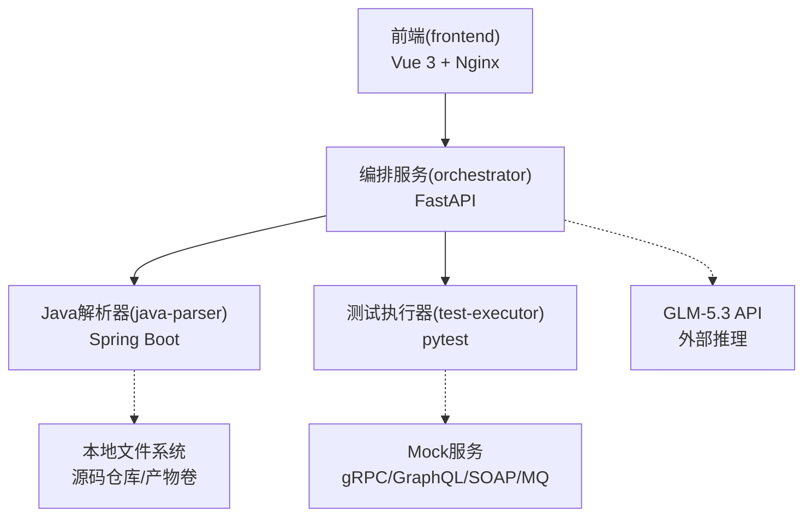
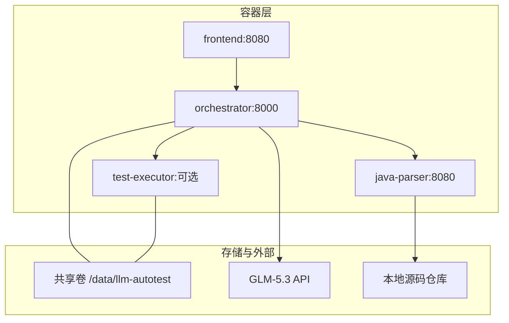
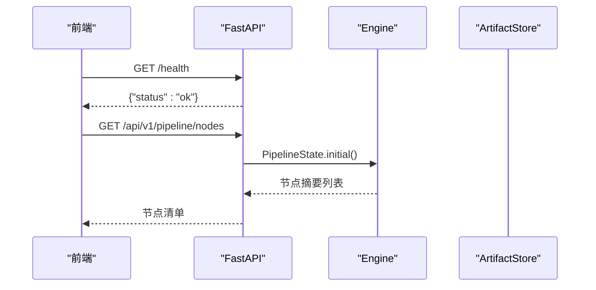
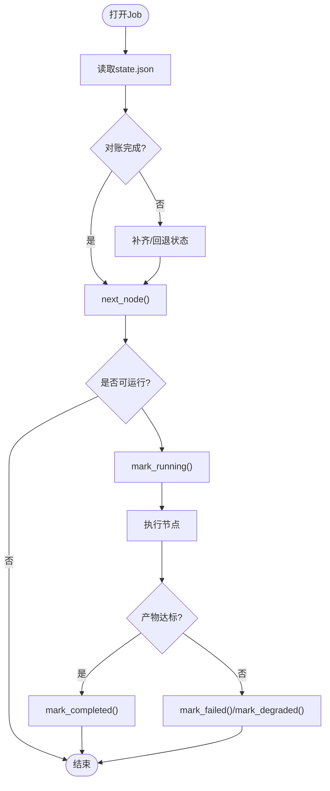
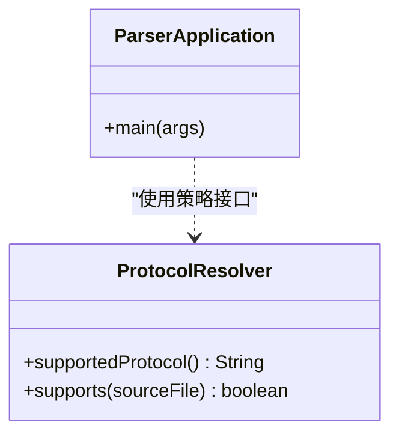
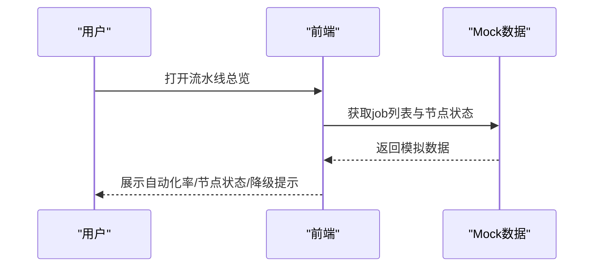
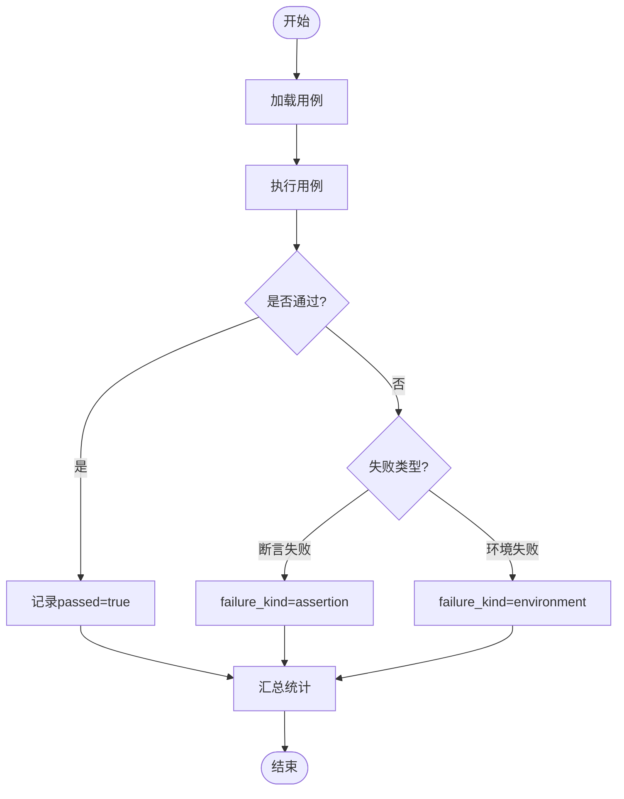
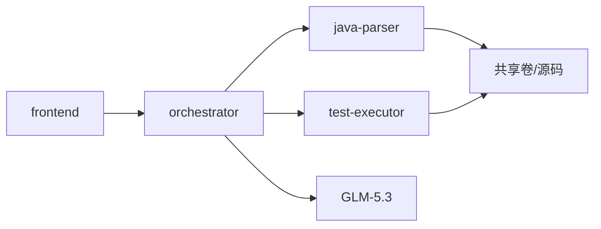
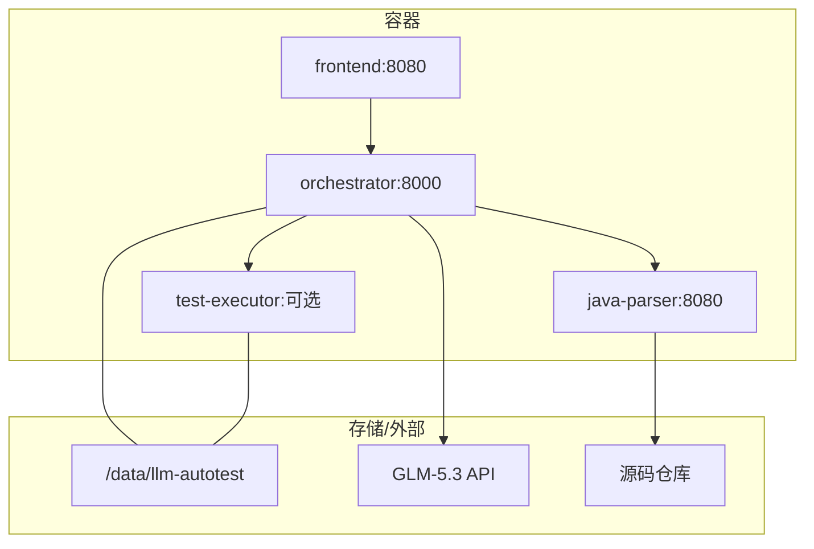
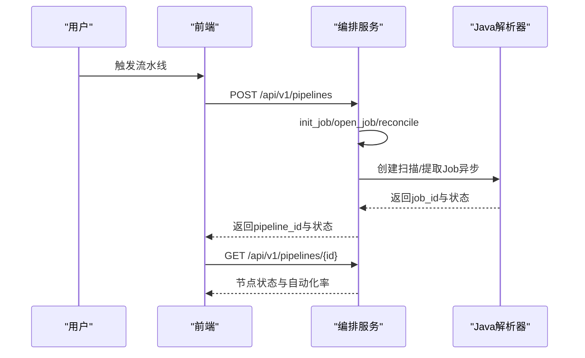

# 技术架构概览

<cite>
**本文引用的文件**
- [08-系统架构与技术选型.md](file://MumuSpec/08-系统架构与技术选型.md)
- [docker-compose.yml](file://deploy/docker-compose.yml)
- [api.py](file://services/orchestrator/src/orchestrator/api.py)
- [pipeline.py](file://services/orchestrator/src/orchestrator/pipeline.py)
- [engine.py](file://services/orchestrator/src/orchestrator/engine.py)
- [config.py](file://services/orchestrator/src/orchestrator/config.py)
- [ParserApplication.java](file://services/java-parser/src/main/java/com/llmautotest/parser/ParserApplication.java)
- [ProtocolResolver.java](file://services/java-parser/src/main/java/com/llmautotest/parser/ProtocolResolver.java)
- [application.yml](file://services/java-parser/src/main/resources/application.yml)
- [java-parser.openapi.yaml](file://schemas/contracts/java-parser.openapi.yaml)
- [App.vue](file://services/frontend/src/App.vue)
- [PipelineOverviewView.vue](file://services/frontend/src/views/PipelineOverviewView.vue)
- [result.py](file://services/test-executor/src/executor/result.py)
- [09-API接口规格.md](file://MumuSpec/09-API接口规格.md)
</cite>

## 目录
1. [简介](#简介)
2. [项目结构](#项目结构)
3. [核心组件](#核心组件)
4. [架构总览](#架构总览)
5. [详细组件分析](#详细组件分析)
6. [依赖关系分析](#依赖关系分析)
7. [性能与可扩展性](#性能与可扩展性)
8. [故障排查指南](#故障排查指南)
9. [结论](#结论)
10. [附录：部署拓扑与交互序列](#附录部署拓扑与交互序列)

## 简介
本技术架构概览面向LLM-AutoTest项目的微服务化设计，围绕编排服务（Orchestrator）、Java解析器服务、前端应用、测试执行器等核心组件的职责边界、通信机制、分层架构与设计模式进行系统性说明。同时给出容器化部署拓扑、关键流程图与扩展点指引，帮助读者快速理解并扩展系统能力。

## 项目结构
仓库采用多服务、多容器的组织方式：
- services/orchestrator：Python FastAPI 编排服务，负责流水线节点编排、状态持久化、产物校验与对外REST API。
- services/java-parser：Spring Boot 服务，提供Java多仓库扫描与接口候选提取的静态分析能力。
- services/frontend：Vue 3 + Vite 前端，提供任务配置、流水线监控、报告与度量等界面。
- services/test-executor：Python 测试执行器骨架，负责用例加载与结果判定（断言失败与环境失败分离）。
- deploy/docker-compose.yml：统一编排入口，定义服务间依赖、端口映射与共享卷。
- schemas/contracts：契约先行，定义java-parser服务的OpenAPI规范。
- MumuSpec：需求与架构规格文档，包含系统架构与技术选型、API接口规格等。

图表来源
- [docker-compose.yml:1-62](file://deploy/docker-compose.yml#L1-L62)
- [08-系统架构与技术选型.md:29-65](file://MumuSpec/08-系统架构与技术选型.md#L29-L65)

章节来源
- [docker-compose.yml:1-62](file://deploy/docker-compose.yml#L1-L62)
- [08-系统架构与技术选型.md:29-65](file://MumuSpec/08-系统架构与技术选型.md#L29-L65)

## 核心组件
- 编排服务（Orchestrator）
  - 职责：暴露REST API、维护9节点固定口径流水线、状态持久化（state.json）、产物对账、跳序防护、降级处理、自动化率汇总。
  - 关键点：NODE_ORDER冻结；以产物为准的对账策略；人工介入节点计入分母但不阻塞后续。
- Java解析器服务（java-parser）
  - 职责：多仓库扫描、接口候选提取；支持协议策略可插拔（REST/Dubbo/gRPC/GraphQL/SOAP/MQ）。
  - 关键点：异步Job模式；OpenAPI契约；scan-concurrency可配置。
- 前端（frontend）
  - 职责：任务配置、流水线总览、Code Review三视图占位、测试报告、缺陷闭环、回归度量展示。
  - 关键点：数值来自后端；降级与兜底仓库如实分列；无路由依赖的轻量壳。
- 测试执行器（test-executor）
  - 职责：加载测试脚本、执行、产出二态结果（断言失败 vs 环境失败），程序化汇总。
  - 关键点：通过/失败类型一致性校验；失败统计口径明确。

章节来源
- [pipeline.py:1-84](file://services/orchestrator/src/orchestrator/pipeline.py#L1-L84)
- [engine.py:1-302](file://services/orchestrator/src/orchestrator/engine.py#L1-L302)
- [api.py:1-28](file://services/orchestrator/src/orchestrator/api.py#L1-L28)
- [ProtocolResolver.java:1-17](file://services/java-parser/src/main/java/com/llmautotest/parser/ProtocolResolver.java#L1-L17)
- [application.yml:1-8](file://services/java-parser/src/main/resources/application.yml#L1-L8)
- [App.vue:1-232](file://services/frontend/src/App.vue#L1-L232)
- [PipelineOverviewView.vue:1-313](file://services/frontend/src/views/PipelineOverviewView.vue#L1-L313)
- [result.py:1-61](file://services/test-executor/src/executor/result.py#L1-L61)

## 架构总览
系统采用“Python主体 + Java解析服务”的混合架构，服务间通过REST API解耦，数据以结构化产物落盘，状态由state.json管理，前端消费编排服务API。

图表来源
- [docker-compose.yml:1-62](file://deploy/docker-compose.yml#L1-L62)
- [08-系统架构与技术选型.md:29-65](file://MumuSpec/08-系统架构与技术选型.md#L29-L65)

章节来源
- [08-系统架构与技术选型.md:29-65](file://MumuSpec/08-系统架构与技术选型.md#L29-L65)
- [docker-compose.yml:1-62](file://deploy/docker-compose.yml#L1-L62)

## 详细组件分析

### 编排服务（Orchestrator）
- 分层与职责
  - API层：FastAPI仅做协议转换与校验，业务逻辑下沉至engine/pipeline。
  - 业务逻辑层：Engine负责state.json读写、对账、跳序防护、降级标记；Pipeline定义9节点顺序与四态。
  - 数据访问层：ArtifactStore抽象产物卷操作（由engine调用）。
- 关键流程
  - 健康检查与节点清单查询。
  - Job生命周期：init_job → open_job（reconcile）→ next_node → mark_running → mark_completed/marked_failed/mark_degraded。
  - 自动化率计算：completed/9，无实测返回None。
- 错误与健壮性
  - state.json损坏或结构不符直接拒绝（宁停不猜）。
  - 产物缺失或不合规时回退为pending并记录错误。
  - 跳序请求被拦截并返回前序未完成信息。

图表来源
- [api.py:11-27](file://services/orchestrator/src/orchestrator/api.py#L11-L27)
- [pipeline.py:23-59](file://services/orchestrator/src/orchestrator/pipeline.py#L23-L59)

图表来源
- [engine.py:153-265](file://services/orchestrator/src/orchestrator/engine.py#L153-L265)
- [engine.py:267-302](file://services/orchestrator/src/orchestrator/engine.py#L267-L302)

章节来源
- [api.py:1-28](file://services/orchestrator/src/orchestrator/api.py#L1-L28)
- [pipeline.py:1-84](file://services/orchestrator/src/orchestrator/pipeline.py#L1-L84)
- [engine.py:1-302](file://services/orchestrator/src/orchestrator/engine.py#L1-L302)
- [config.py:1-56](file://services/orchestrator/src/orchestrator/config.py#L1-L56)

### Java解析器服务（java-parser）
- 职责边界
  - 静态分析：多仓库扫描、接口候选提取；语义解析在orchestrator侧调用GLM-5.3。
  - 异步Job：POST创建任务，GET轮询状态与产物。
- 扩展点
  - ProtocolResolver接口：新增协议只需实现supportedProtocol/supported方法，不改动主流程。
  - scan-concurrency可配置，控制并发度。
- 契约
  - OpenAPI定义健康检查、扫描任务、提取任务及错误结构。

图表来源
- [ParserApplication.java:1-17](file://services/java-parser/src/main/java/com/llmautotest/parser/ParserApplication.java#L1-L17)
- [ProtocolResolver.java:1-17](file://services/java-parser/src/main/java/com/llmautotest/parser/ProtocolResolver.java#L1-L17)

章节来源
- [ParserApplication.java:1-17](file://services/java-parser/src/main/java/com/llmautotest/parser/ParserApplication.java#L1-L17)
- [ProtocolResolver.java:1-17](file://services/java-parser/src/main/java/com/llmautotest/parser/ProtocolResolver.java#L1-L17)
- [application.yml:1-8](file://services/java-parser/src/main/resources/application.yml#L1-L8)
- [java-parser.openapi.yaml:1-369](file://schemas/contracts/java-parser.openapi.yaml#L1-L369)

### 前端应用（frontend）
- 职责
  - 任务配置、流水线总览、占位视图（Code Review/报告/缺陷/回归度量）。
  - 展示自动化率、降级清单、兜底仓库提示，严格遵循后端口径。
- 交互
  - 当前使用mock数据演示，后续对接orchestrator API。
  - 视图切换基于动态组件渲染，无路由依赖。

图表来源
- [App.vue:1-232](file://services/frontend/src/App.vue#L1-L232)
- [PipelineOverviewView.vue:1-313](file://services/frontend/src/views/PipelineOverviewView.vue#L1-L313)

章节来源
- [App.vue:1-232](file://services/frontend/src/App.vue#L1-L232)
- [PipelineOverviewView.vue:1-313](file://services/frontend/src/views/PipelineOverviewView.vue#L1-L313)

### 测试执行器（test-executor）
- 职责
  - 执行测试脚本，输出CaseResult与ExecutionSummary。
  - 区分断言失败与环境失败，确保统计口径正确。
- 约束
  - 通过的用例不得携带失败类型（一致性校验）。

图表来源
- [result.py:1-61](file://services/test-executor/src/executor/result.py#L1-L61)

章节来源
- [result.py:1-61](file://services/test-executor/src/executor/result.py#L1-L61)

## 依赖关系分析
- 服务耦合
  - frontend → orchestrator（HTTP REST）
  - orchestrator → java-parser（HTTP REST，异步Job）
  - orchestrator → test-executor（预留，按profile启用）
  - orchestrator → GLM-5.3（HTTPS REST，外部）
- 数据流
  - 产物落盘于共享卷/data/llm-autotest，engine以产物为准对账。
  - state.json作为运行时状态缓存，损坏则拒绝。
- 配置与契约
  - orchestrator通过环境变量注入配置（禁止硬编码）。
  - java-parser通过OpenAPI契约定义接口。

图表来源
- [docker-compose.yml:1-62](file://deploy/docker-compose.yml#L1-L62)
- [config.py:1-56](file://services/orchestrator/src/orchestrator/config.py#L1-L56)
- [java-parser.openapi.yaml:1-369](file://schemas/contracts/java-parser.openapi.yaml#L1-L369)

章节来源
- [docker-compose.yml:1-62](file://deploy/docker-compose.yml#L1-L62)
- [config.py:1-56](file://services/orchestrator/src/orchestrator/config.py#L1-L56)
- [java-parser.openapi.yaml:1-369](file://schemas/contracts/java-parser.openapi.yaml#L1-L369)

## 性能与可扩展性
- 性能特性
  - 编排引擎原子写state.json（tmp+replace），避免部分写入导致的状态不一致。
  - 对账策略以产物为准，降低崩溃恢复成本。
  - Java解析器scan-concurrency可调，平衡吞吐与资源占用。
- 可扩展点
  - 新增协议：实现ProtocolResolver接口，无需修改主流程。
  - 新节点：在NODE_ORDER中扩展需评估冻结口径影响（当前9节点固定）。
  - 外部集成：通过orchestrator配置注入新的LLM或Mock服务地址。
- 部署弹性
  - docker-compose profiles按需启用test-executor与mock-services。
  - 共享卷隔离产物，便于横向扩展与备份。

章节来源
- [engine.py:294-302](file://services/orchestrator/src/orchestrator/engine.py#L294-L302)
- [application.yml:1-8](file://services/java-parser/src/main/resources/application.yml#L1-L8)
- [docker-compose.yml:43-56](file://deploy/docker-compose.yml#L43-L56)

## 故障排查指南
- 常见错误与定位
  - state.json损坏或结构不符：engine抛出X-ORCH-01，检查文件可读性与schema版本。
  - 跳序请求：X-ORCH-02，确认前序节点是否全部completed或manual_intervention。
  - 产物未达标：mark_completed前校验失败，检查对应节点产物是否存在且符合约定。
  - java-parser健康检查失败：检查端口8080与/health响应。
- 建议步骤
  - 查看docker-compose日志与服务健康状态。
  - 核对共享卷中state.json与产物目录结构。
  - 根据错误码与message定位具体节点与原因。

章节来源
- [engine.py:196-265](file://services/orchestrator/src/orchestrator/engine.py#L196-L265)
- [engine.py:271-302](file://services/orchestrator/src/orchestrator/engine.py#L271-L302)
- [docker-compose.yml:11-16](file://deploy/docker-compose.yml#L11-L16)

## 结论
LLM-AutoTest采用清晰的微服务分层与契约驱动设计：编排服务聚焦流水线状态与产物对账，Java解析器专注静态分析与协议策略扩展，前端提供直观的任务与度量可视化，测试执行器保证结果判定的严谨性。通过容器化部署与共享卷持久化，系统在可维护性、可扩展性与可靠性方面具备良好基础。未来可在协议扩展、节点演进与外部系统集成上持续增强。

## 附录：部署拓扑与交互序列

### 部署拓扑图

图表来源
- [docker-compose.yml:1-62](file://deploy/docker-compose.yml#L1-L62)
- [08-系统架构与技术选型.md:29-65](file://MumuSpec/08-系统架构与技术选型.md#L29-L65)

### 典型交互序列（创建并查询流水线）

图表来源
- [api.py:11-27](file://services/orchestrator/src/orchestrator/api.py#L11-L27)
- [engine.py:140-159](file://services/orchestrator/src/orchestrator/engine.py#L140-L159)
- [java-parser.openapi.yaml:24-115](file://schemas/contracts/java-parser.openapi.yaml#L24-L115)