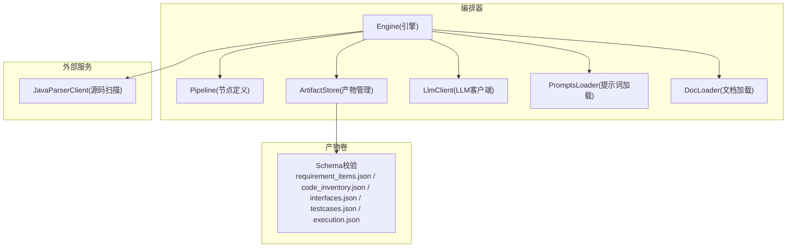
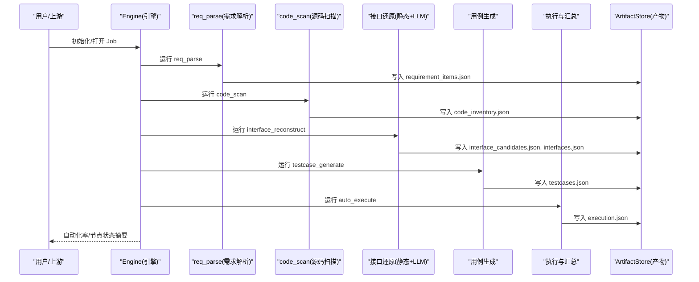
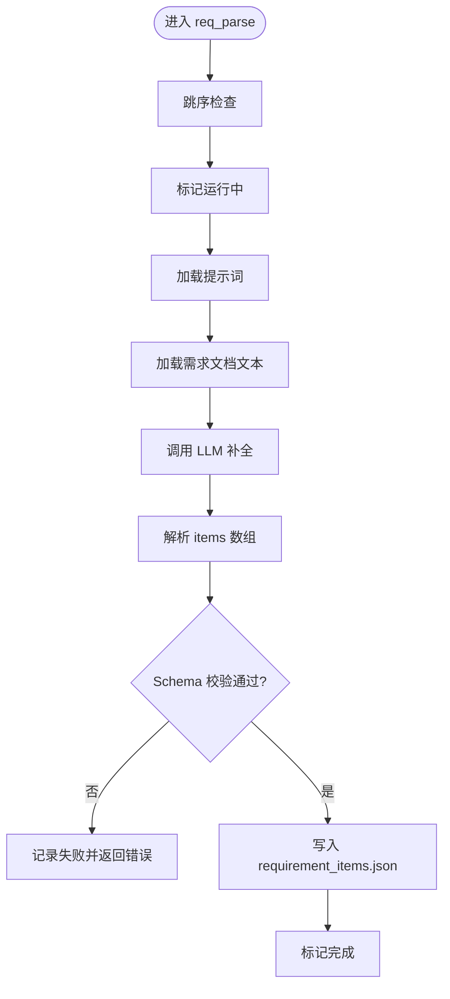
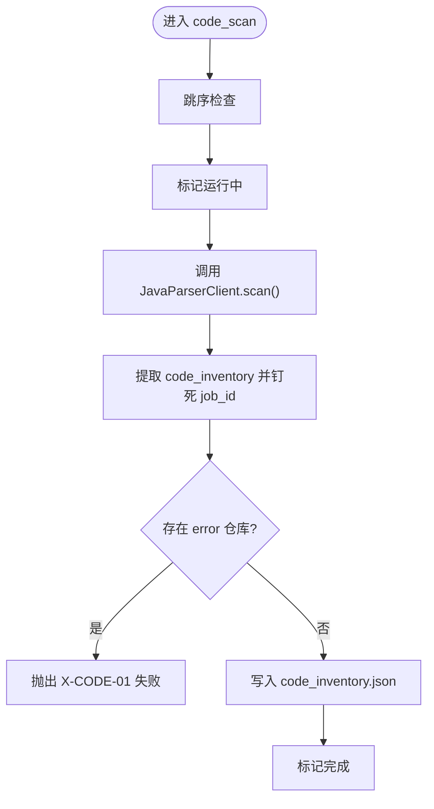
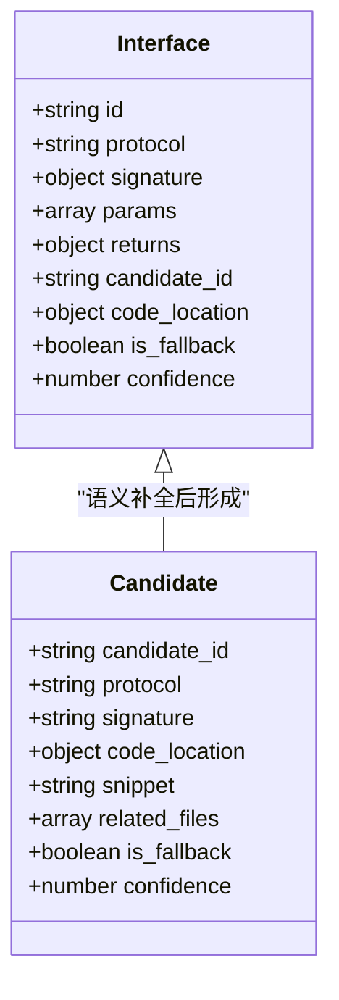
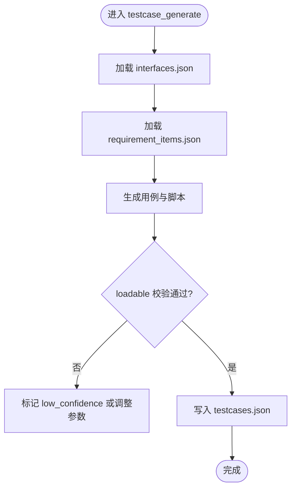
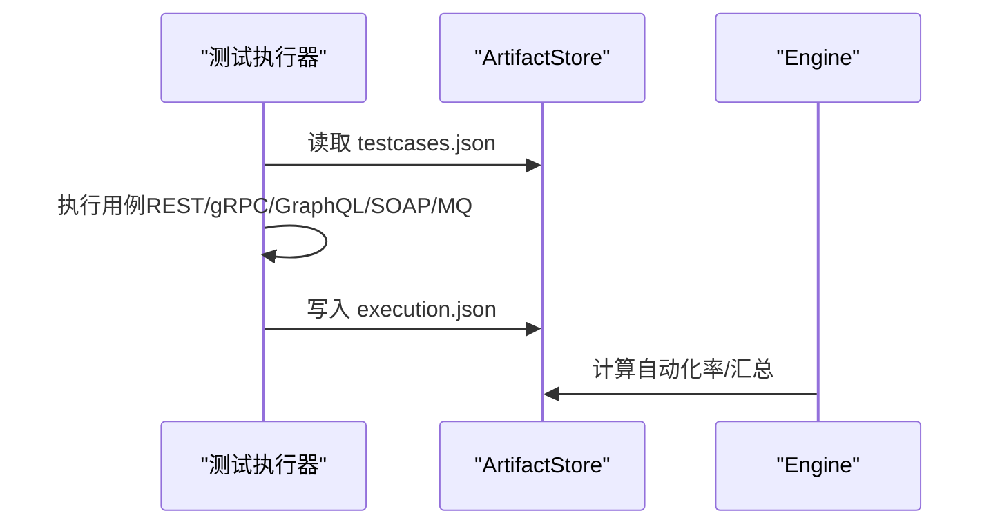
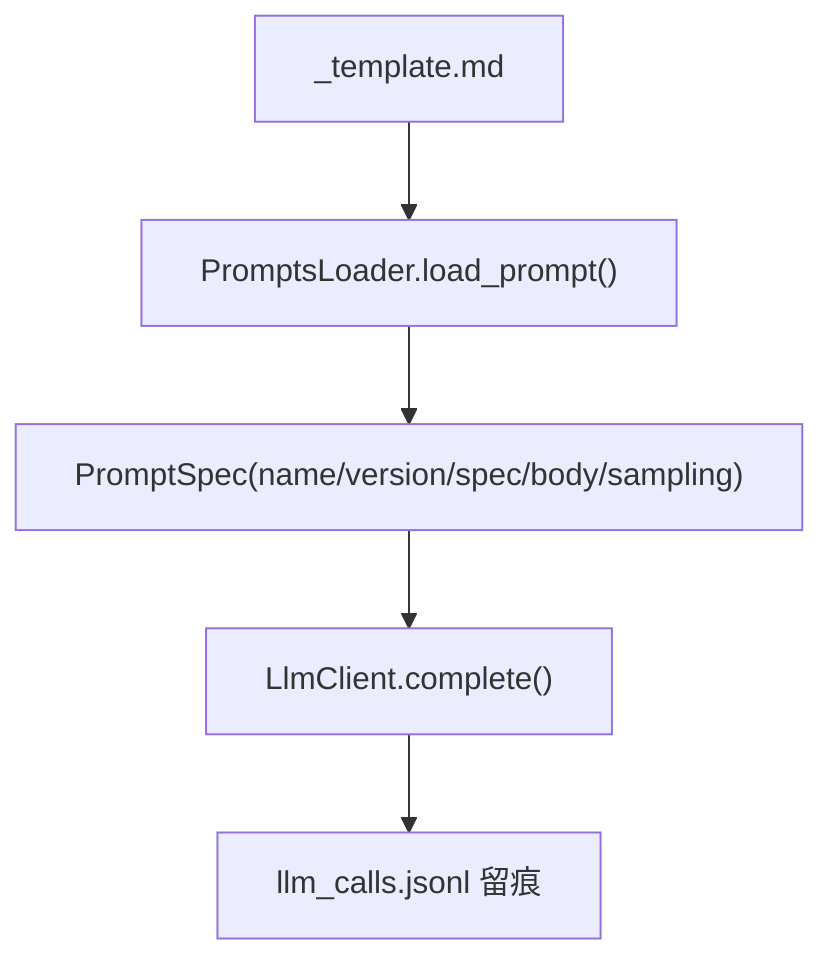
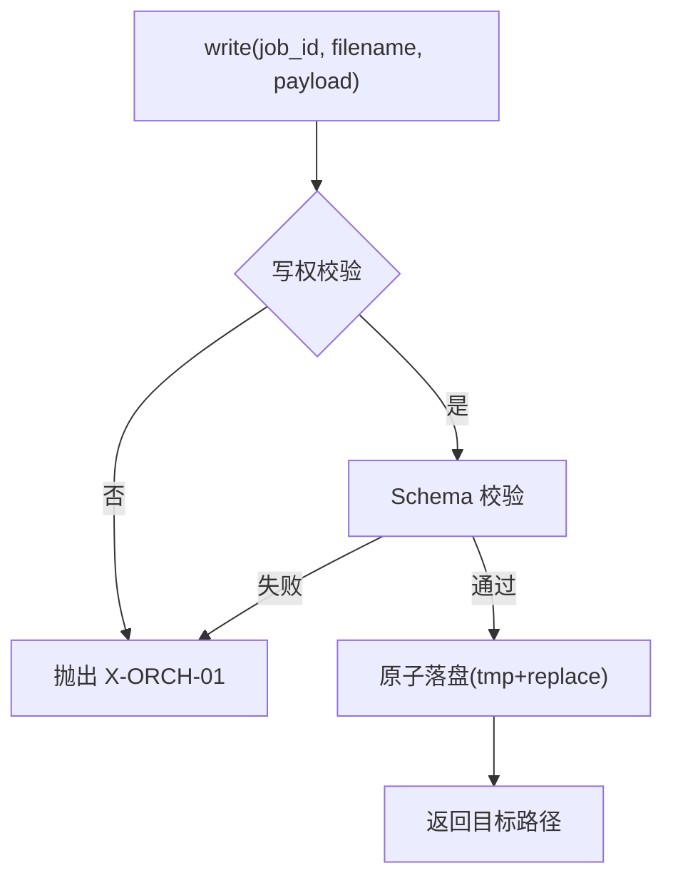
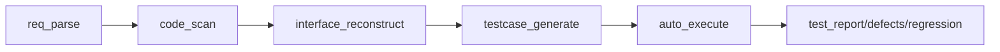

# 智能测试生成

<cite>
**本文引用的文件**
- [engine.py](file://services/orchestrator/src/orchestrator/engine.py)
- [pipeline.py](file://services/orchestrator/src/orchestrator/pipeline.py)
- [req_parse.py](file://services/orchestrator/src/orchestrator/nodes/req_parse.py)
- [code_scan.py](file://services/orchestrator/src/orchestrator/nodes/code_scan.py)
- [client.py](file://services/orchestrator/src/orchestrator/llm/client.py)
- [artifacts.py](file://services/orchestrator/src/orchestrator/artifacts.py)
- [prompts_loader.py](file://services/orchestrator/src/orchestrator/prompts_loader.py)
- [_template.md](file://prompts/_template.md)
- [config.py](file://services/orchestrator/src/orchestrator/config.py)
- [errors.py](file://services/orchestrator/src/orchestrator/errors.py)
- [doc_loader.py](file://services/orchestrator/src/orchestrator/doc_loader.py)
- [requirement_items.json](file://schemas/requirement_items.json)
- [code_inventory.json](file://schemas/code_inventory.json)
- [interface_candidates.json](file://schemas/interface_candidates.json)
- [interfaces.json](file://schemas/interfaces.json)
- [testcases.json](file://schemas/testcases.json)
- [execution.json](file://schemas/execution.json)
</cite>

## 目录
1. [简介](#简介)
2. [项目结构](#项目结构)
3. [核心组件](#核心组件)
4. [架构总览](#架构总览)
5. [详细组件分析](#详细组件分析)
6. [依赖关系分析](#依赖关系分析)
7. [性能考虑](#性能考虑)
8. [故障排查指南](#故障排查指南)
9. [结论](#结论)
10. [附录](#附录)

## 简介
本文件面向 LLM-AutoTest 的“智能测试生成”能力，系统性说明从需求到用例与脚本生成的全链路机制：需求条目解析、业务场景识别、测试点提取；接口还原与多协议（REST、gRPC、GraphQL、SOAP、MQ）脚本生成；提示词工程的设计与优化策略；结构化数据模型与校验；以及效果评估与扩展开发指南。文档以代码级事实为依据，配合可视化图示帮助不同技术背景的读者理解系统。

## 项目结构
服务采用“编排器 + 产物卷 + 外部解析器”的分层设计：
- 编排器（orchestrator）：负责流水线节点调度、状态持久化、产物校验与错误治理。
- 产物卷（artifacts）：按 job 隔离存储 JSON 产物与报告，统一 Schema 校验与写权控制。
- 外部解析器（java-parser）：提供源码扫描与静态特征定位，产出接口候选与清单。
- 提示词与配置：通过 prompts 模板与 Settings 环境变量驱动 LLM 调用与采样参数。

图表来源
- [engine.py:133-302](file://services/orchestrator/src/orchestrator/engine.py#L133-L302)
- [pipeline.py:23-84](file://services/orchestrator/src/orchestrator/pipeline.py#L23-L84)
- [artifacts.py:55-157](file://services/orchestrator/src/orchestrator/artifacts.py#L55-L157)
- [client.py:41-202](file://services/orchestrator/src/orchestrator/llm/client.py#L41-L202)
- [prompts_loader.py:13-135](file://services/orchestrator/src/orchestrator/prompts_loader.py#L13-L135)
- [doc_loader.py:12-65](file://services/orchestrator/src/orchestrator/doc_loader.py#L12-L65)

章节来源
- [engine.py:1-302](file://services/orchestrator/src/orchestrator/engine.py#L1-L302)
- [pipeline.py:1-84](file://services/orchestrator/src/orchestrator/pipeline.py#L1-L84)
- [artifacts.py:1-157](file://services/orchestrator/src/orchestrator/artifacts.py#L1-L157)

## 核心组件
- 流水线与节点状态：固定九节点顺序与四态标注，确保自动化率口径一致。
- 编排引擎：负责 job 生命周期、断点续跑、跳序防护、降级与完成判据。
- 产物管理：按 Schema 强校验、原子落盘、写权排他与归档。
- LLM 客户端：OpenAI 兼容调用、重试退避、留痕与超时治理。
- 提示词加载：从 Markdown 元信息块解析版本、规格编号、采样建议与正文。
- 文档加载：统一 docx/md/xlsx 文本化，便于 LLM 解析与溯源。
- 错误体系：统一 PipelineError 与错误码，贯穿各节点失败路径。

章节来源
- [pipeline.py:11-84](file://services/orchestrator/src/orchestrator/pipeline.py#L11-L84)
- [engine.py:133-302](file://services/orchestrator/src/orchestrator/engine.py#L133-L302)
- [artifacts.py:55-157](file://services/orchestrator/src/orchestrator/artifacts.py#L55-L157)
- [client.py:41-202](file://services/orchestrator/src/orchestrator/llm/client.py#L41-L202)
- [prompts_loader.py:13-135](file://services/orchestrator/src/orchestrator/prompts_loader.py#L13-L135)
- [doc_loader.py:12-65](file://services/orchestrator/src/orchestrator/doc_loader.py#L12-L65)
- [errors.py:1-39](file://services/orchestrator/src/orchestrator/errors.py#L1-L39)

## 架构总览
下图展示从需求到执行的全流程关键交互：需求解析、源码扫描、接口还原、用例生成与执行汇总。

图表来源
- [engine.py:140-265](file://services/orchestrator/src/orchestrator/engine.py#L140-L265)
- [pipeline.py:23-84](file://services/orchestrator/src/orchestrator/pipeline.py#L23-L84)
- [artifacts.py:75-131](file://services/orchestrator/src/orchestrator/artifacts.py#L75-L131)

## 详细组件分析

### 需求解析节点（req_parse）
- 功能：读取需求文档（md/docx/xlsx），调用 LLM 输出结构化需求条目，落盘为 requirement_items.json。
- 关键点：
  - 跳序检查与运行标记。
  - 提示词加载与 LLM 调用，输出经 JSON 与 Schema 校验。
  - 失败路径统一记入 state.json 并抛出 PipelineError。
- 数据结构：items 数组包含 id/title/description/priority/source_location/golden_match 等字段，受 schemas 约束。

图表来源
- [req_parse.py:33-78](file://services/orchestrator/src/orchestrator/nodes/req_parse.py#L33-L78)
- [doc_loader.py:12-65](file://services/orchestrator/src/orchestrator/doc_loader.py#L12-L65)
- [client.py:60-106](file://services/orchestrator/src/orchestrator/llm/client.py#L60-L106)
- [artifacts.py:75-131](file://services/orchestrator/src/orchestrator/artifacts.py#L75-L131)

章节来源
- [req_parse.py:1-125](file://services/orchestrator/src/orchestrator/nodes/req_parse.py#L1-L125)
- [requirement_items.json:1-44](file://schemas/requirement_items.json#L1-L44)
- [doc_loader.py:12-65](file://services/orchestrator/src/orchestrator/doc_loader.py#L12-L65)
- [client.py:60-106](file://services/orchestrator/src/orchestrator/llm/client.py#L60-L106)
- [artifacts.py:75-131](file://services/orchestrator/src/orchestrator/artifacts.py#L75-L131)

### 源码扫描节点（code_scan）
- 功能：调用 java-parser 对多仓库进行源码扫描，产出 code_inventory.json。
- 关键点：
  - 仓库四态处理：ok/empty/truncated/error，error 导致节点失败。
  - 响应契约校验与 job_id 归属校验，防止串档。
  - 异常编码跳过与截断范围记录。

图表来源
- [code_scan.py:26-49](file://services/orchestrator/src/orchestrator/nodes/code_scan.py#L26-L49)
- [code_scan.py:52-94](file://services/orchestrator/src/orchestrator/nodes/code_scan.py#L52-L94)
- [code_inventory.json:1-57](file://schemas/code_inventory.json#L1-L57)

章节来源
- [code_scan.py:1-94](file://services/orchestrator/src/orchestrator/nodes/code_scan.py#L1-L94)
- [code_inventory.json:1-57](file://schemas/code_inventory.json#L1-L57)

### 接口还原与多协议支持（REST、gRPC、GraphQL、SOAP、MQ）
- 输入：code_inventory.json 与静态特征（interface_candidates.json）。
- 输出：interfaces.json，包含 protocol/method/path/service_method/params/returns/candidate_id/confidence 等。
- 协议覆盖：rest/grpc/graphql/soap/mq，签名与参数位置由 schema 限定。
- 降级：当无法确定类型时标记 unknown，并在执行阶段以 Mock 演示模式记录于 degraded_protocols。

图表来源
- [interfaces.json:1-70](file://schemas/interfaces.json#L1-L70)
- [interface_candidates.json:1-58](file://schemas/interface_candidates.json#L1-L58)

章节来源
- [interfaces.json:1-70](file://schemas/interfaces.json#L1-L70)
- [interface_candidates.json:1-58](file://schemas/interface_candidates.json#L1-L58)

### 用例生成与验证（testcase_generate）
- 输入：interfaces.json 与需求条目 requirement_items.json。
- 输出：testcases.json，每个用例包含 id/interface_id/category/title/expected/script_path/loadable/low_confidence 等。
- 约束：
  - 每接口三类用例（normal/boundary/exception）至少各一个。
  - 参数名与结构仅来自接口定义，出现未声明参数即打回。
  - loadable 表示 py_compile + 收集零 error 的校验结果。
  - low_confidence 用于 unknown 参数的低置信度标注。

图表来源
- [testcases.json:1-35](file://schemas/testcases.json#L1-L35)

章节来源
- [testcases.json:1-35](file://schemas/testcases.json#L1-L35)

### 执行与汇总（auto_execute）
- 输入：testcases.json。
- 输出：execution.json，包含 results 与 summary，支持 failure_kind、timeout、skipped_reason、duration_ms、timestamp 等。
- 降级记录：degraded_protocols 显式记录降级的协议与原因（脚本生成成功 + Mock 执行演示）。

图表来源
- [execution.json:1-59](file://schemas/execution.json#L1-L59)
- [engine.py:126-131](file://services/orchestrator/src/orchestrator/engine.py#L126-L131)

章节来源
- [execution.json:1-59](file://schemas/execution.json#L1-L59)
- [engine.py:126-131](file://services/orchestrator/src/orchestrator/engine.py#L126-L131)

### 提示词工程设计与优化
- 模板规范：prompts/_template.md 定义元信息块（version/spec/owner/changelog/sampling）与正文区域。
- 加载机制：prompts_loader 解析元信息，禁止代码内联字符串，强制从文件加载。
- 采样参数：Settings 提供实际值（model/temperature/top_p/seed/timeout），模板中的 sampling 仅为建议。
- 留痕：每次 LLM 调用追加 llm_calls.jsonl，包含 call_id/node/prompt_version/sampling/input/output_digest/tokens/ok/error。

图表来源
- [_template.md:1-22](file://prompts/_template.md#L1-L22)
- [prompts_loader.py:13-135](file://services/orchestrator/src/orchestrator/prompts_loader.py#L13-L135)
- [client.py:60-106](file://services/orchestrator/src/orchestrator/llm/client.py#L60-L106)

章节来源
- [_template.md:1-22](file://prompts/_template.md#L1-L22)
- [prompts_loader.py:13-135](file://services/orchestrator/src/orchestrator/prompts_loader.py#L13-L135)
- [config.py:9-56](file://services/orchestrator/src/orchestrator/config.py#L9-L56)
- [client.py:60-106](file://services/orchestrator/src/orchestrator/llm/client.py#L60-L106)

### 结构化表示与验证机制
- 所有产物均遵循 JSON Schema 严格校验，写入前拒绝不合规数据。
- 节点完成判据：产物存在且通过 Schema 校验（Markdown 报告仅查存在性与非空）。
- 写权排他：orchestrator/test-executor 分别拥有特定产物的写权，避免并发冲突。

图表来源
- [artifacts.py:75-131](file://services/orchestrator/src/orchestrator/artifacts.py#L75-L131)

章节来源
- [artifacts.py:75-131](file://services/orchestrator/src/orchestrator/artifacts.py#L75-L131)

## 依赖关系分析
- 编排器依赖：
  - ArtifactStore：产物读写与校验。
  - LlmClient：LLM 调用与重试。
  - PromptsLoader：提示词加载。
  - DocLoader：需求文档文本化。
  - JavaParserClient：源码扫描。
- 节点间依赖：
  - code_scan 依赖 req_parse 之后（第二节点）。
  - interface_reconstruct 依赖 code_scan 与静态特征。
  - testcase_generate 依赖 interfaces.json 与 requirement_items.json。
  - auto_execute 依赖 testcases.json。

图表来源
- [pipeline.py:23-84](file://services/orchestrator/src/orchestrator/pipeline.py#L23-L84)
- [engine.py:25-35](file://services/orchestrator/src/orchestrator/engine.py#L25-L35)

章节来源
- [pipeline.py:23-84](file://services/orchestrator/src/orchestrator/pipeline.py#L23-L84)
- [engine.py:25-35](file://services/orchestrator/src/orchestrator/engine.py#L25-L35)

## 性能考虑
- LLM 调用重试与退避：网络/超时/5xx 可重试，最多 3 次尝试，指数退避 5s/20s。
- 超时控制：单次调用超时由 Settings.llm_timeout_s 控制，避免长时间阻塞。
- 产物落盘原子性：tmp + replace 保证一致性，减少竞争条件。
- 自动化率计算：completed/9 固定分母，避免口径漂移。

章节来源
- [client.py:108-170](file://services/orchestrator/src/orchestrator/llm/client.py#L108-L170)
- [config.py:9-56](file://services/orchestrator/src/orchestrator/config.py#L9-L56)
- [engine.py:126-131](file://services/orchestrator/src/orchestrator/engine.py#L126-L131)

## 故障排查指南
- 常见错误码：
  - X-LLM-01：LLM 调用超时/网络失败（可重试）。
  - X-LLM-02：LLM 输出未过 Schema 校验（不重试，人工介入）。
  - X-LLM-03：Prompt 文件缺失/元信息不合规（配置错误，人工介入）。
  - X-ORCH-01：产物校验失败。
  - X-ORCH-02：断点续跑跳序请求。
  - X-ORCH-03：java-parser 服务不可达/通信失败。
- 排查步骤：
  - 查看 state.json 中节点的 error 字段与 attempts。
  - 检查 llm_calls.jsonl 留痕，确认 prompt_version、sampling、tokens、error。
  - 核对 artifacts 目录下的产物是否通过 Schema 校验。
  - 对于 code_scan，关注仓库 status=error 的具体错误信息。

章节来源
- [errors.py:1-39](file://services/orchestrator/src/orchestrator/errors.py#L1-L39)
- [engine.py:244-265](file://services/orchestrator/src/orchestrator/engine.py#L244-L265)
- [client.py:108-170](file://services/orchestrator/src/orchestrator/llm/client.py#L108-L170)
- [code_scan.py:78-94](file://services/orchestrator/src/orchestrator/nodes/code_scan.py#L78-L94)

## 结论
本方案通过严格的 Schema 校验、固定的流水线节点与状态管理、统一的错误体系与留痕机制，实现了从需求到用例与脚本的智能生成与执行闭环。多协议支持与降级策略保障了在不确定环境下的可执行性与可观测性。结合提示词工程与配置化管理，系统在稳定性、可维护性与可扩展性方面具备良好基础。

## 附录
- 自定义生成规则：
  - 在 prompts 目录下新增 .md 文件，遵循 _template.md 元信息块约定。
  - 使用 PromptsLoader 加载，并通过 Engine/LlmClient 接入对应节点。
- 扩展开发指南：
  - 新增节点需定义 NODE_ORDER 中的顺序与产物文件名映射。
  - 实现 run_xxx 函数，遵循“跳序检查 → 运行 → 校验落盘 → 置完成/失败”的模式。
  - 在 artifacts.py 中登记写权与 Schema 文件，确保产物校验与归档。