# 核心功能特性

<cite>
**本文引用的文件**
- [pipeline.py](file://services/orchestrator/src/orchestrator/pipeline.py)
- [engine.py](file://services/orchestrator/src/orchestrator/engine.py)
- [artifacts.py](file://services/orchestrator/src/orchestrator/artifacts.py)
- [api.py](file://services/orchestrator/src/orchestrator/api.py)
- [runner.py](file://services/orchestrator/src/orchestrator/runner.py)
- [config.py](file://services/orchestrator/src/orchestrator/config.py)
- [doc_loader.py](file://services/orchestrator/src/orchestrator/doc_loader.py)
- [python_scan.py](file://services/orchestrator/src/orchestrator/python_scan.py)
- [req_parse.py](file://services/orchestrator/src/orchestrator/nodes/req_parse.py)
- [code_scan.py](file://services/orchestrator/src/orchestrator/nodes/code_scan.py)
- [errors.py](file://services/orchestrator/src/orchestrator/errors.py)
- [requirement_items.json](file://schemas/requirement_items.json)
- [requirement_diff.json](file://schemas/requirement_diff.json)
- [testcases.json](file://schemas/testcases.json)
- [execution.json](file://schemas/execution.json)
- [defects.json](file://schemas/defects.json)
- [metrics.json](file://schemas/metrics.json)
- [regression_index.json](file://schemas/regression_index.json)
</cite>

## 更新摘要
**变更内容**
- 新增多文档需求输入支持（C-10）：支持 docx/md/xlsx 多种格式，多文档合并解析与溯源
- 新增受保护服务认证配置（C-15）：任务配置页收集鉴权信息，执行前自动登录注入凭据头
- 新增版本化需求分析（C-22）：基线/被测需求差异结构化分析，下游评审仅接收差异范围
- 新增多语言仓库支持（C-13）：Python 仓库静态扫描，支持 Django/FastAPI/Flask 框架
- 新增变更范围分析（C-09）：分支维度 diff 分析，Code Review 视图四·变更范围
- 增强重跑机制（C-14）：级联失效、归档时间戳、force_node 重置下游节点
- 前端九屏展示：需求解析、源码扫描、用例生成独立页面

## 目录
1. [简介](#简介)
2. [项目结构](#项目结构)
3. [核心组件](#核心组件)
4. [架构总览](#架构总览)
5. [详细组件分析](#详细组件分析)
6. [依赖关系分析](#依赖关系分析)
7. [性能与可靠性](#性能与可靠性)
8. [故障排查指南](#故障排查指南)
9. [结论](#结论)
10. [附录：使用场景与效果展示](#附录使用场景与效果展示)

## 简介
本章节概述 LLM-AutoTest 的核心目标与能力边界：以"产物即事实"的流水线模型，驱动从需求解析到回归测试的九节点固定流程；通过严格的 Schema 校验、断点续跑、跳序防护与降级策略，保障自动化质量与可观测性。智能测试生成覆盖基于需求的用例设计、基于接口的脚本生成，并支持多协议（REST、gRPC、GraphQL、SOAP、MQ）的最小可用级实现与演示。

**最新更新**：系统已大幅增强，新增多文档需求输入、受保护服务认证、版本化需求分析、多语言仓库支持和变更范围分析等核心功能，提供更完整的自动化测试解决方案。

## 项目结构
- 编排服务 orchestrator：负责流水线状态管理、节点调度、产物落盘与校验、API 暴露。
- 产物存储 artifacts：定义产物清单、写权隔离、Schema 校验与完成判据。
- 节点实现 nodes：按职责拆分各节点运行逻辑（如 req_parse、code_scan）。
- 数据契约 schemas：所有结构化产物的 JSON Schema 集中管理，作为单一事实来源。
- API 层 api：对外提供健康检查与节点清单等接口。
- 文档加载器 doc_loader：统一处理 docx/md/xlsx 等多种需求文档格式。
- Python 扫描器 python_scan：支持 Django/FastAPI/Flask 框架的静态路由提取。

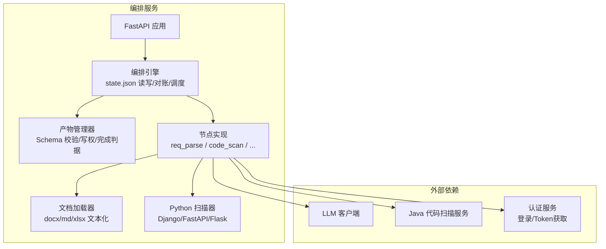

**图表来源**
- [api.py:11-27](file://services/orchestrator/src/orchestrator/api.py#L11-L27)
- [engine.py:133-302](file://services/orchestrator/src/orchestrator/engine.py#L133-L302)
- [artifacts.py:55-157](file://services/orchestrator/src/orchestrator/artifacts.py#L55-L157)
- [doc_loader.py:12-33](file://services/orchestrator/src/orchestrator/doc_loader.py#L12-L33)
- [python_scan.py:60-102](file://services/orchestrator/src/orchestrator/python_scan.py#L60-L102)

**章节来源**
- [api.py:11-27](file://services/orchestrator/src/orchestrator/api.py#L11-L27)
- [engine.py:133-302](file://services/orchestrator/src/orchestrator/engine.py#L133-L302)
- [artifacts.py:55-157](file://services/orchestrator/src/orchestrator/artifacts.py#L55-L157)

## 核心组件
- 九节点固定口径：req_parse、code_scan、interface_reconstruct、code_review、testcase_generate、auto_execute、test_report、defect_list、retest_regression。顺序冻结，分母固定为 9。
- 四态标注：completed、manual_intervention、running、pending。
- 产物即事实：state.json 仅缓存状态，实际以产物存在且通过 Schema 校验为准。
- 断点续跑：open_job 加载 state.json 并对账，自动补齐或回退状态。
- 跳序防护：请求运行某节点时，其前序节点必须全部 completed（降级节点视为已处理）。
- 降级策略：将节点置为 manual_intervention 并记录原因，流程继续推进后续节点。
- **新增**：多文档输入支持、认证配置、版本化分析、多语言扫描、变更范围分析。

**章节来源**
- [pipeline.py:11-84](file://services/orchestrator/src/orchestrator/pipeline.py#L11-L84)
- [engine.py:24-35](file://services/orchestrator/src/orchestrator/engine.py#L24-L35)
- [engine.py:153-261](file://services/orchestrator/src/orchestrator/engine.py#L153-L261)

## 架构总览
下图展示编排引擎与各组件的交互关系，以及状态流转与产物校验机制。

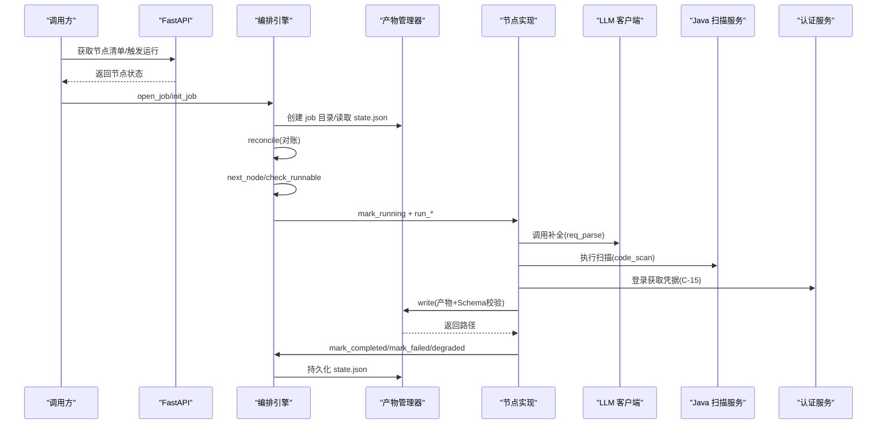

**图表来源**
- [api.py:11-27](file://services/orchestrator/src/orchestrator/api.py#L11-L27)
- [engine.py:140-261](file://services/orchestrator/src/orchestrator/engine.py#L140-L261)
- [artifacts.py:75-131](file://services/orchestrator/src/orchestrator/artifacts.py#L75-L131)
- [req_parse.py:33-78](file://services/orchestrator/src/orchestrator/nodes/req_parse.py#L33-L78)
- [code_scan.py:26-49](file://services/orchestrator/src/orchestrator/nodes/code_scan.py#L26-L49)

## 详细组件分析

### 流水线与状态管理（PipelineState 与 Engine）
- 固定九节点顺序与四态枚举，确保口径一致。
- JobState 维护节点状态、降级清单、重试次数与时间戳。
- 对账 reconcile：以产物为准修正状态；若状态为 completed 但产物失效则回退 pending 并记录错误。
- 跳序防护 check_runnable：前序未完成则拒绝运行。
- 标记方法：mark_running、mark_completed（需产物达标）、mark_failed、mark_degraded。
- **新增**：级联失效机制（C-14），重跑时目标节点及下游全部归档重置。

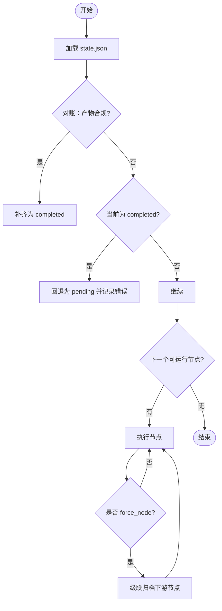

**图表来源**
- [engine.py:153-261](file://services/orchestrator/src/orchestrator/engine.py#L153-L261)
- [runner.py:106-108](file://services/orchestrator/src/orchestrator/runner.py#L106-L108)

**章节来源**
- [pipeline.py:11-84](file://services/orchestrator/src/orchestrator/pipeline.py#L11-L84)
- [engine.py:43-131](file://services/orchestrator/src/orchestrator/engine.py#L43-L131)
- [engine.py:153-261](file://services/orchestrator/src/orchestrator/engine.py#L153-L261)

### 产物管理与 Schema 校验（ArtifactStore）
- 固定产物清单与写权隔离：orchestrator 与 test-executor 各自拥有写权限，避免并发冲突。
- 写入流程：先 Schema 校验，再原子落盘（tmp + replace），失败即拒绝。
- 完成判据：JSON 产物需通过 Schema 校验；Markdown 报告仅检查非空存在。
- 归档能力：重跑前归档旧产物，禁止原地覆盖。
- **新增**：归档带时间戳防多次重跑覆盖（C-14）。

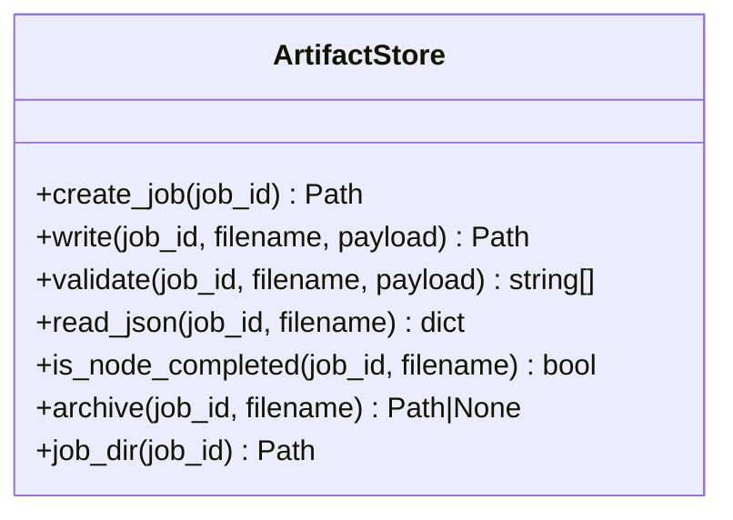

**图表来源**
- [artifacts.py:55-157](file://services/orchestrator/src/orchestrator/artifacts.py#L55-L157)

**章节来源**
- [artifacts.py:22-52](file://services/orchestrator/src/orchestrator/artifacts.py#L22-L52)
- [artifacts.py:75-131](file://services/orchestrator/src/orchestrator/artifacts.py#L75-L131)

### 节点：需求解析（req_parse）
- 输入：需求文档文本、提示词模板、可选基线文档对。
- 处理：调用 LLM 补全，提取 items 数组，进行结构校验。
- 输出：requirement_items.json（含 schema_version、job_id、source_file、items）。
- 质量保证：Prompt 缺失、LLM 网络/超时、输出不可解析或未过 Schema 均有明确错误码与处理路径；失败经 engine.mark_failed 记录后抛出。
- **新增**：多文档支持（C-10），支持 docx/md/xlsx 格式，按文档名分节拼接；版本化分析（C-22），基线/被测需求差异结构化输出。

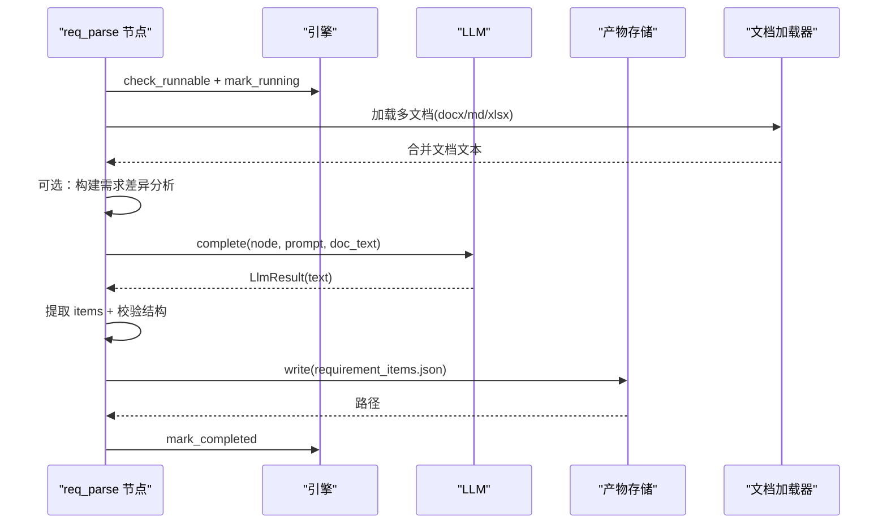

**图表来源**
- [req_parse.py:60-129](file://services/orchestrator/src/orchestrator/nodes/req_parse.py#L60-L129)
- [doc_loader.py:12-33](file://services/orchestrator/src/orchestrator/doc_loader.py#L12-L33)
- [requirement_items.json:1-44](file://schemas/requirement_items.json#L1-L44)

**章节来源**
- [req_parse.py:1-200](file://services/orchestrator/src/orchestrator/nodes/req_parse.py#L1-L200)
- [requirement_items.json:1-44](file://schemas/requirement_items.json#L1-L44)

### 节点：代码扫描（code_scan）
- 输入：仓库列表（RepositoryInput）。
- 处理：调用 java-parser 扫描，提取 code_inventory，校验 job_id 归属与仓库状态。
- 输出：code_inventory.json（含 schema_version、job_id、repositories 等）。
- 质量保证：任一仓库 status=error 即节点失败；empty/truncated 为正常态如实落盘。
- **新增**：多语言支持（C-13），Python 仓库走内置 AST 扫描器，支持 Django/FastAPI/Flask 框架；变更范围分析（C-09），支持 baseline_branch 分支 diff。

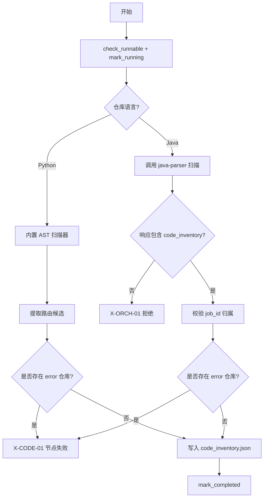

**图表来源**
- [code_scan.py:26-94](file://services/orchestrator/src/orchestrator/nodes/code_scan.py#L26-L94)
- [python_scan.py:60-102](file://services/orchestrator/src/orchestrator/python_scan.py#L60-L102)

**章节来源**
- [code_scan.py:1-94](file://services/orchestrator/src/orchestrator/nodes/code_scan.py#L1-L94)

### 智能测试生成与多协议支持
- 基于需求的用例设计：从 requirement_items.json 提取需求条目，结合接口还原结果生成用例草案。
- 基于接口的脚本生成：依据 interfaces.json 参数规范生成 pytest 脚本，并通过 py_compile 与收集校验 loadable。
- 多协议支持：REST、gRPC、GraphQL、SOAP、MQ；其中 REST 完整实现，其他协议最小可用级（脚本生成成功 + Mock 执行演示）。
- 用例元数据：testcases.json 包含 id、interface_id、requirement_id、category、expected、script_path、loadable、low_confidence 等字段。
- **新增**：认证配置（C-15），支持登录 URL、用户名密码、跳过证书校验，执行前自动登录注入凭据头。

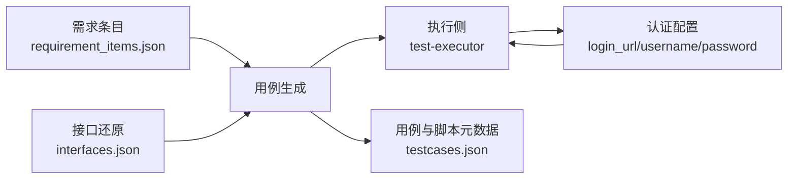

**图表来源**
- [testcases.json:1-35](file://schemas/testcases.json#L1-L35)
- [execution.json:1-59](file://schemas/execution.json#L1-L59)

**章节来源**
- [testcases.json:1-35](file://schemas/testcases.json#L1-L35)
- [execution.json:1-59](file://schemas/execution.json#L1-L59)

### 自动执行、测试报告、缺陷管理、回归测试
- 自动执行：test-executor 根据 testcases.json 执行脚本，产出 execution.json（results、summary、degraded_protocols）。
- 测试报告：test_report.md 由 orchestrator 生成，作为 Markdown 产物存在即有效。
- 缺陷管理：仅断言失败进入 defects.json，环境失败隔离待确认；支持生命周期历史审计。
- 回归测试：regression_index.json 按协议维度归档脚本，支持版本递增与漂移告警。
- **新增**：认证凭据注入（C-15），执行前自动登录被测服务，支持 Token 和 Cookie 两种模式。

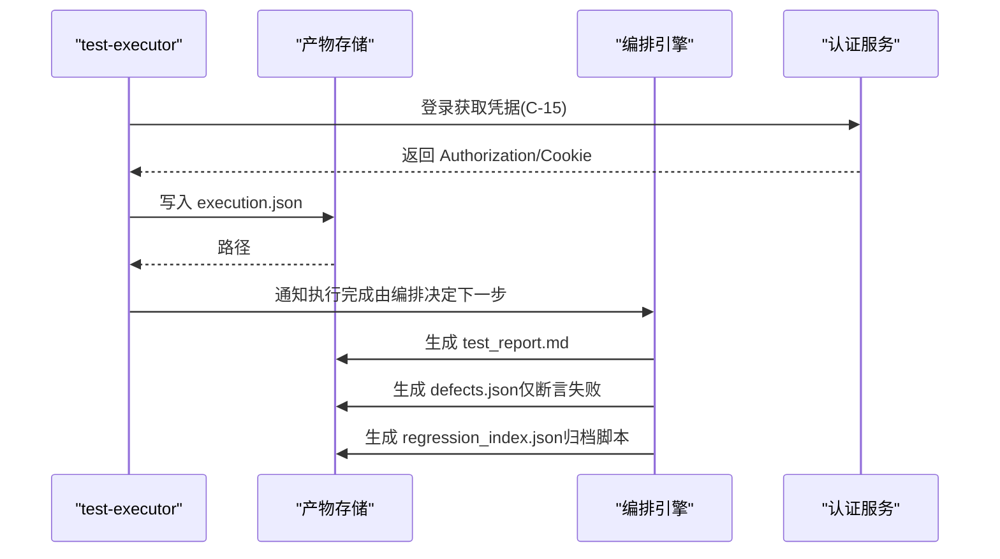

**图表来源**
- [execution.json:1-59](file://schemas/execution.json#L1-L59)
- [defects.json:1-54](file://schemas/defects.json#L1-L54)
- [regression_index.json:1-50](file://schemas/regression_index.json#L1-L50)

**章节来源**
- [execution.json:1-59](file://schemas/execution.json#L1-L59)
- [defects.json:1-54](file://schemas/defects.json#L1-L54)
- [regression_index.json:1-50](file://schemas/regression_index.json#L1-L50)

### 版本化需求分析与变更范围管理
- **需求版本差异分析**（C-22）：支持基线/被测需求文档对，LLM 结构化分析差异，输出 requirement_diff.json。
- **变更范围分析**（C-09）：仓库级别支持 baseline_branch，执行 git diff --name-status 产出 changed_files。
- **Code Review 增强**：程序化派生视图四·变更范围，changed interfaces 关联变更文件，unmatched_changed_files 单列业务逻辑变更。
- **多文档支持**（C-10）：Web 提交增 docs[] 数组，CLI --doc 可重复传入，后端兼容旧单文档字段。

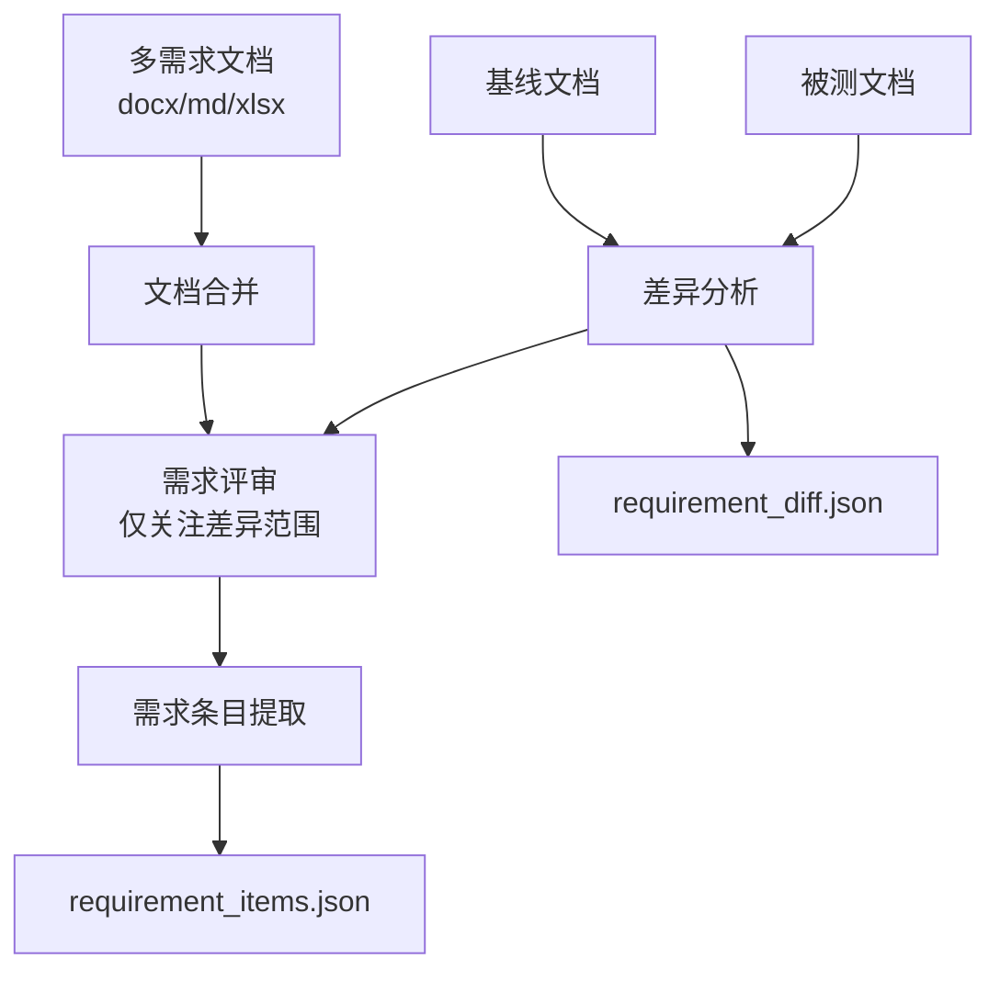

**图表来源**
- [req_parse.py:147-186](file://services/orchestrator/src/orchestrator/nodes/req_parse.py#L147-L186)
- [requirement_diff.json:1-33](file://schemas/requirement_diff.json#L1-L33)

**章节来源**
- [req_parse.py:147-186](file://services/orchestrator/src/orchestrator/nodes/req_parse.py#L147-L186)
- [requirement_diff.json:1-33](file://schemas/requirement_diff.json#L1-L33)

### 认证配置与服务集成
- **鉴权配置表单**（C-15）：任务配置页增可选「鉴权配置」区块，支持登录 URL、用户名、密码、跳过证书校验。
- **自动登录机制**：auto_execute/retest_regression 执行前自动登录被测服务，支持 Token 和 Cookie 两种响应模式。
- **凭据安全**：密码明文落盘 job_input.json（内部验收演示可接受），CLI 入口 `--auth` 避免凭据进 shell 历史。
- **301 重定向补偿**：发现 P-12 Django APPEND_SLASH 问题，RestRunner 同 method 重发一次补偿。

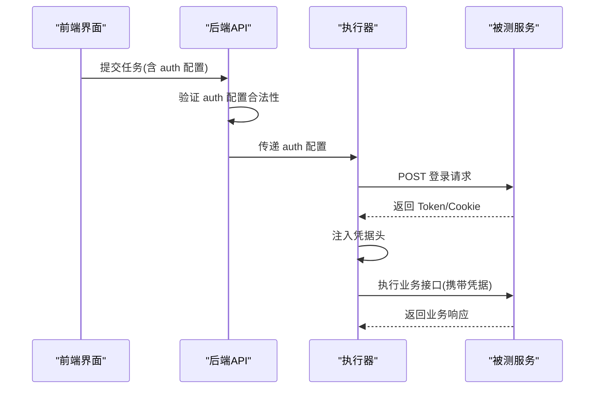

**图表来源**
- [api.py:495-514](file://services/orchestrator/src/orchestrator/api.py#L495-L514)
- [test_auto_execute.py:595-654](file://services/orchestrator/tests/test_auto_execute.py#L595-L654)

**章节来源**
- [api.py:495-514](file://services/orchestrator/src/orchestrator/api.py#L495-L514)

## 依赖关系分析
- 编排引擎依赖：PipelineState（节点顺序与状态）、ArtifactStore（产物与校验）、错误模块（统一错误码）。
- 节点依赖：req_parse 依赖 LLM 客户端与提示词加载；code_scan 依赖 java-parser 客户端。
- API 层依赖：FastAPI 应用与 PipelineState 用于暴露节点清单与健康检查。
- **新增依赖**：doc_loader 支持多文档格式，python_scan 支持 Python 框架，认证服务集成。

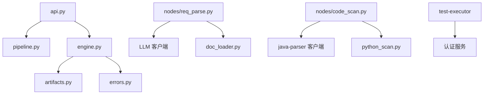

**图表来源**
- [api.py:11-27](file://services/orchestrator/src/orchestrator/api.py#L11-L27)
- [engine.py:133-302](file://services/orchestrator/src/orchestrator/engine.py#L133-L302)
- [artifacts.py:55-157](file://services/orchestrator/src/orchestrator/artifacts.py#L55-L157)
- [errors.py:1-39](file://services/orchestrator/src/orchestrator/errors.py#L1-L39)
- [req_parse.py:33-78](file://services/orchestrator/src/orchestrator/nodes/req_parse.py#L33-L78)
- [code_scan.py:26-49](file://services/orchestrator/src/orchestrator/nodes/code_scan.py#L26-L49)

**章节来源**
- [api.py:11-27](file://services/orchestrator/src/orchestrator/api.py#L11-L27)
- [engine.py:133-302](file://services/orchestrator/src/orchestrator/engine.py#L133-L302)
- [artifacts.py:55-157](file://services/orchestrator/src/orchestrator/artifacts.py#L55-L157)
- [errors.py:1-39](file://services/orchestrator/src/orchestrator/errors.py#L1-L39)

## 性能与可靠性
- 原子落盘：state.json 与产物均采用 tmp + replace 写入，避免部分写入导致的不一致。
- 对账机制：每次 open_job 都会对账，保证状态与产物一致，提升崩溃恢复能力。
- 跳序防护：防止乱序执行导致的下游数据不完整。
- Schema 强校验：所有结构化产物必须通过对应 JSON Schema，杜绝脏数据流入下游。
- 降级策略：将异常节点置为人工介入，流程继续推进，保障整体进度。
- **新增**：级联失效机制（C-14），重跑时目标节点及下游全部归档重置，防止新旧数据混用；多文档批量处理，大文档按章节拆分避免 LLM 截断。

## 故障排查指南
- 常见错误码：
  - X-LLM-01：LLM 调用超时/网络失败（可重试）。
  - X-LLM-02：LLM 输出未过 Schema 校验（不重试，人工介入）。
  - X-LLM-03：Prompt 文件缺失/元信息不合规（配置错误，人工介入）。
  - X-ORCH-01：产物校验失败（宁停不猜）。
  - X-ORCH-02：断点续跑跳序请求（前序未完成）。
  - X-ORCH-03：java-parser 服务不可达/通信失败。
  - X-EXEC-01：认证失败/凭据错误（C-15 新增）。
- 排查步骤：
  - 检查 state.json 中节点的 attempts、updated_at、error 字段定位最近失败。
  - 核对产物是否存在且通过 Schema 校验（is_node_completed）。
  - 查看降级清单 degraded 中的 node、reason、marked_at 了解降级原因。
  - 对于 LLM 相关错误，检查 Prompt 文件与 LLM 客户端连通性。
  - 对于 java-parser 相关错误，检查服务可达性与响应结构。
  - **新增**：认证相关问题检查 login_url 格式、用户名密码有效性、HTTPS 证书配置。

**章节来源**
- [errors.py:1-39](file://services/orchestrator/src/orchestrator/errors.py#L1-L39)
- [engine.py:153-261](file://services/orchestrator/src/orchestrator/engine.py#L153-L261)

## 结论
LLM-AutoTest 通过九节点固定流水线、严格 Schema 校验、断点续跑与降级策略，构建了高可靠、可观测、可扩展的智能测试生成与执行体系。以"产物即事实"为核心原则，确保状态与数据一致性；以"程序化汇总"为原则，避免 LLM 引入不确定性。该架构既满足快速迭代与演示需求，也为生产落地提供了坚实基础。

**最新增强**：系统已具备多文档需求输入、受保护服务认证、版本化需求分析、多语言仓库支持和变更范围分析等核心能力，为复杂企业级测试场景提供了完整解决方案。

## 附录：使用场景与效果展示
- 场景一：新需求接入
  - 输入：多份需求文档（docx/md/xlsx）。
  - 过程：req_parse 解析为 requirement_items.json；code_scan 扫描仓库产出 code_inventory.json；后续节点依次生成接口还原、审查、用例、执行与报告。
  - 效果：快速产出可执行的测试脚本与报告，缩短回归周期。
- 场景二：多协议接口测试
  - 输入：接口契约（REST/gRPC/GraphQL/SOAP/MQ）。
  - 过程：基于接口还原生成用例与脚本；REST 完整实现，其他协议最小可用级演示。
  - 效果：统一测试资产沉淀，便于回归与复用。
- 场景三：断点续跑与人工介入
  - 输入：已有 job_id。
  - 过程：open_job 对账并恢复；遇到降级节点转入人工介入，修复后可重新触发。
  - 效果：提高鲁棒性与可运维性，降低中断成本。
- **新增场景**：版本化需求管理
  - 输入：基线需求文档 + 被测需求文档。
  - 过程：自动生成需求差异分析，下游评审仅关注变更范围。
  - 效果：精准定位变更影响，提高评审效率。
- **新增场景**：受保护服务测试
  - 输入：服务登录地址、用户名、密码。
  - 过程：执行前自动登录，注入凭据头访问业务接口。
  - 效果：支持企业级安全架构下的自动化测试。