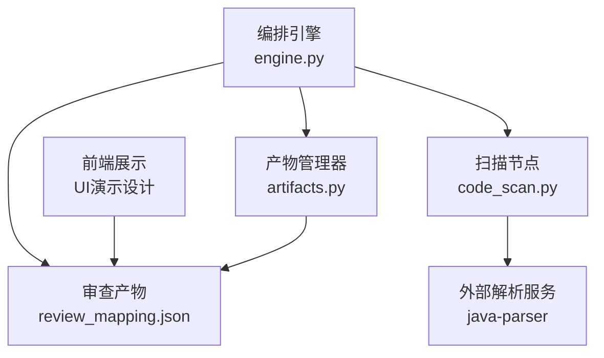
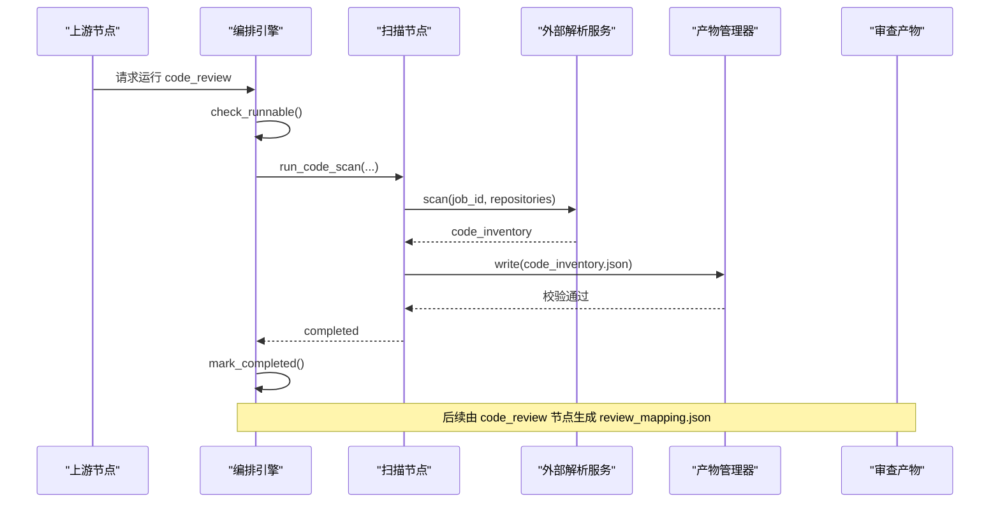
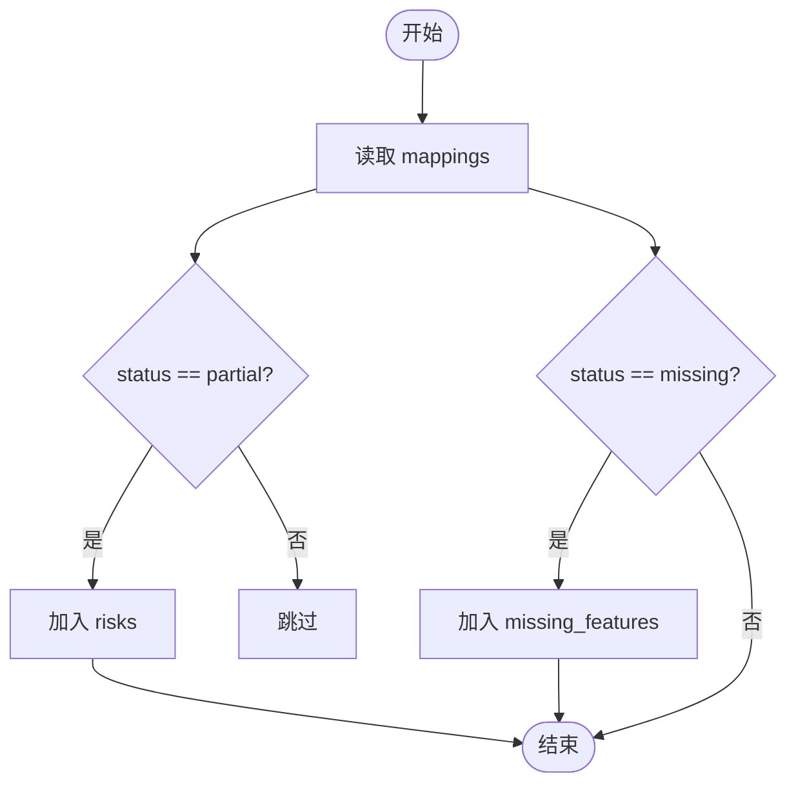
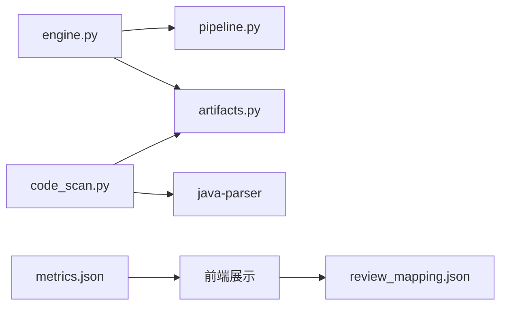

# 代码审查节点

<cite>
**本文引用的文件**
- [review_mapping.json](file://schemas/review_mapping.json)
- [code_scan.py](file://services/orchestrator/src/orchestrator/nodes/code_scan.py)
- [engine.py](file://services/orchestrator/src/orchestrator/engine.py)
- [artifacts.py](file://services/orchestrator/src/orchestrator/artifacts.py)
- [pipeline.py](file://services/orchestrator/src/orchestrator/pipeline.py)
- [frontend-code-style.md](file://rules/frontend-code-style.md)
- [python-code-style.md](file://rules/python-code-style.md)
- [defects.json](file://schemas/defects.json)
- [metrics.json](file://schemas/metrics.json)
- [04_功能规格说明.md](file://docs/04_功能规格说明.md)
- [03_用户故事卡片.md](file://docs/03_用户故事卡片.md)
- [07_UI演示设计.md](file://docs/07_UI演示设计.md)
</cite>

## 目录
1. [简介](#简介)
2. [项目结构](#项目结构)
3. [核心组件](#核心组件)
4. [架构总览](#架构总览)
5. [详细组件分析](#详细组件分析)
6. [依赖关系分析](#依赖关系分析)
7. [性能与效率优化](#性能与效率优化)
8. [故障排查指南](#故障排查指南)
9. [结论](#结论)
10. [附录](#附录)

## 简介
本文件围绕“代码审查节点”展开，系统性说明基于规则的代码质量检查机制、安全漏洞检测与性能问题识别策略；解释审查规则自定义配置与扩展方式；详述 review_mapping.json 的映射关系与数据流转；说明与静态分析工具的集成与结果整合；给出审查报告生成格式与可视化方案；并提供降低误报率与提升审查效率的方法。

## 项目结构
代码审查相关能力由编排引擎、产物管理、扫描节点与前端展示共同构成：
- 编排引擎负责流水线状态、断点续跑、跳序防护与完成判据。
- 产物管理器统一落盘、Schema 校验与写权隔离。
- code_scan 节点调用外部解析服务产出源码清单，为后续接口还原与映射提供输入。
- review_mapping.json 定义三视图（需求-代码映射、风险清单、遗漏功能清单）及人工审核记录的数据契约。
- 前端以“Code Review 三视图页”呈现映射表、派生卡片与人工审核面板。

图表来源
- [engine.py:24-35](file://services/orchestrator/src/orchestrator/engine.py#L24-L35)
- [artifacts.py:24-50](file://services/orchestrator/src/orchestrator/artifacts.py#L24-L50)
- [code_scan.py:26-49](file://services/orchestrator/src/orchestrator/nodes/code_scan.py#L26-L49)
- [07_UI演示设计.md:64-70](file://docs/07_UI演示设计.md#L64-L70)

章节来源
- [engine.py:24-35](file://services/orchestrator/src/orchestrator/engine.py#L24-L35)
- [artifacts.py:24-50](file://services/orchestrator/src/orchestrator/artifacts.py#L24-L50)
- [code_scan.py:26-49](file://services/orchestrator/src/orchestrator/nodes/code_scan.py#L26-L49)
- [07_UI演示设计.md:64-70](file://docs/07_UI演示设计.md#L64-L70)

## 核心组件
- 编排引擎：维护九节点固定顺序、状态四态、断点续跑与产物对账，确保“产物即事实”。
- 产物管理器：按 Schema 校验产物、原子落盘、写权排他，并以“存在且通过校验”作为节点完成判据。
- 扫描节点：调用 java-parser 进行多仓库扫描，产出 code_inventory.json，并处理仓库级错误、空仓与截断范围。
- 审查映射契约：review_mapping.json 定义三视图结构与人工审核日志，保证下游消费一致性。
- 前端展示：三视图页集中呈现映射表、风险与遗漏清单计数，以及人工审核面板。

章节来源
- [pipeline.py:23-34](file://services/orchestrator/src/orchestrator/pipeline.py#L23-L34)
- [engine.py:161-180](file://services/orchestrator/src/orchestrator/engine.py#L161-L180)
- [artifacts.py:75-131](file://services/orchestrator/src/orchestrator/artifacts.py#L75-L131)
- [code_scan.py:26-94](file://services/orchestrator/src/orchestrator/nodes/code_scan.py#L26-L94)
- [review_mapping.json:1-81](file://schemas/review_mapping.json#L1-L81)
- [07_UI演示设计.md:64-70](file://docs/07_UI演示设计.md#L64-L70)

## 架构总览
代码审查节点在流水线中的位置与交互如下：
- 前置：需求解析与代码扫描产出结构化输入。
- 当前：基于规则与 LLM 辅助进行需求-代码映射，程序化派生风险与遗漏清单，支持人工审核闭环。
- 后置：用例生成、执行、测试报告、缺陷清单与回归沉淀。

图表来源
- [engine.py:196-242](file://services/orchestrator/src/orchestrator/engine.py#L196-L242)
- [code_scan.py:26-49](file://services/orchestrator/src/orchestrator/nodes/code_scan.py#L26-L49)
- [artifacts.py:75-131](file://services/orchestrator/src/orchestrator/artifacts.py#L75-L131)

## 详细组件分析

### 基于规则的代码质量检查与安全/性能检测
- 编码规范验证
  - 前端规范：Vue 3 + TypeScript + pnpm，禁止引入无关框架，强调可访问性、类型对齐后端契约、避免 v-html 等安全风险。
  - Python 规范：PEP 8、ruff/mypy、异步与超时、异常与日志、测试覆盖率要求。
- 安全漏洞检测
  - 前端侧禁止直接渲染不可信内容到 v-html/innerHTML，需安全过滤；禁止提交密钥或敏感信息。
  - Python 侧禁止记录敏感字段，网络调用设置超时与重试边界，异常捕获具体化。
- 性能问题识别
  - 前端轮询需在页面离开时停止，避免资源泄漏；样式复用变量，避免重复计算。
  - Python 侧避免阻塞式 I/O 进入异步路径，限制重试次数，减少 token 消耗与上下文大小。

章节来源
- [frontend-code-style.md:12-55](file://rules/frontend-code-style.md#L12-L55)
- [python-code-style.md:11-56](file://rules/python-code-style.md#L11-L56)

### 审查规则自定义配置与扩展机制
- 规则文件组织
  - 使用 .rules 下的 Markdown 文件描述语言特定规范，并通过 trigger/glob 限定生效范围。
- 扩展方式
  - 新增语言/模块：新增规则文件并在 glob 中声明匹配路径；保持命名与结构一致。
  - 接入 CI：在构建/提交钩子中调用对应 lint/build/test 命令，将规则作为门禁。
- 与产物关联
  - 规则不直接写入产物，但通过前后端实现约束，间接影响 code_review 的映射质量与置信度。

章节来源
- [frontend-code-style.md:1-10](file://rules/frontend-code-style.md#L1-L10)
- [python-code-style.md:1-7](file://rules/python-code-style.md#L1-L7)

### review_mapping.json 映射关系与数据流转
- 三视图结构
  - 视图一：mappings 数组，每条包含 requirement_id、interface_id、status（implemented/partial/missing/undetermined）、confidence、evidence（含 code_location 与 note）。
  - 视图二：risks 数组，从 partial 条目自动派生，包含 requirement_id、interface_id、description。
  - 视图三：missing_features 数组，提取 missing 条目，包含 requirement_id、title。
  - 附加：review_log 数组，记录人工审核决策（approved/rejected）、原因、是否回流与时间戳。
- 数据流转
  - 上游 code_scan 产出 code_inventory.json，供接口还原与映射使用。
  - code_review 节点生成 review_mapping.json，经 artifacts 校验后落盘。
  - 前端读取 review_mapping.json 渲染三视图与审核面板。

图表来源
- [review_mapping.json:10-78](file://schemas/review_mapping.json#L10-L78)

章节来源
- [review_mapping.json:1-81](file://schemas/review_mapping.json#L1-L81)
- [04_功能规格说明.md:119-140](file://docs/04_功能规格说明.md#L119-L140)

### 与静态分析工具的集成与结果整合
- Java 侧集成
  - 通过 maven-checkstyle-plugin 在 verify 阶段执行 checkstyle，配置文件位于 checkstyle.xml，失败则阻断构建。
- 结果整合策略
  - 将静态检查结果纳入制品归档或日志，结合 code_inventory.json 定位问题文件与行号。
  - 在 code_review 映射证据中引用代码位置，便于人工复核与修复追踪。

章节来源
- [pom.xml:55-79](file://services/java-parser/pom.xml#L55-L79)

### 审查报告生成格式与可视化展示
- 报告格式
  - 结构化产物：review_mapping.json（三视图 + 审核日志）。
  - 文本报告：test_report.md 作为 Markdown 报告，仅以存在性与非空作为完成判据。
- 可视化展示
  - 三视图页：主区展示映射表（四态标注 + 置信度），右侧派生卡片显示风险与遗漏清单计数，底部审核面板支持通过/驳回与回流。
  - Dashboard：顶部 9 节点流水线状态，左栏接口还原清单，右栏自动化率度量，底部映射表摘要。

章节来源
- [engine.py:24-35](file://services/orchestrator/src/orchestrator/engine.py#L24-L35)
- [artifacts.py:120-131](file://services/orchestrator/src/orchestrator/artifacts.py#L120-L131)
- [07_UI演示设计.md:55-70](file://docs/07_UI演示设计.md#L55-L70)

### 误报率降低策略
- 静态特征优先
  - 先通过注解/proto/WSDL 等特征文件定位接口定义，再送入 LLM 语义解析，减少全文盲扫带来的噪声。
- 分块与去重
  - 单次调用仅送入接口定义及其直接关联文件，跨文件信息以中间产物合并去重，降低幻觉与误报。
- 置信度与证据
  - 每条映射附带 confidence 与 evidence.code_location，便于人工快速核验与剔除低置信度项。
- 兜底仓库与分列呈现
  - 兜底仓库结果单独标注、不计入达成指标，避免掩盖真实仓库解析能力结论。

章节来源
- [04_功能规格说明.md:103-116](file://docs/04_功能规格说明.md#L103-L116)
- [03_用户故事卡片.md:46-55](file://docs/03_用户故事卡片.md#L46-L55)

### 审查效率优化方法
- 断点续跑与对账
  - 以产物为准对账，崩溃或中断后可恢复；降级节点按人工介入计入，流程继续推进。
- 写权排他与原子落盘
  - 每个产物仅允许一个服务写入，tmp+replace 原子落盘，避免并发冲突与部分写入。
- 超时与重试边界
  - 外部调用设置连接与读取超时，重试有限制，避免重复副作用与资源占用。
- 度量与瓶颈分析
  - 自动化率 = completed / 9，报告注明降级节点与原因，指导针对性优化。

章节来源
- [engine.py:153-180](file://services/orchestrator/src/orchestrator/engine.py#L153-L180)
- [artifacts.py:75-96](file://services/orchestrator/src/orchestrator/artifacts.py#L75-L96)
- [python-code-style.md:38-48](file://rules/python-code-style.md#L38-L48)
- [metrics.json:28-48](file://schemas/metrics.json#L28-L48)

## 依赖关系分析
- 编排引擎依赖 pipeline 定义的节点顺序与状态枚举。
- 扫描节点依赖外部 java-parser 服务与 artifacts 落盘。
- 产物管理器依赖 schemas 下同名 JSON Schema 进行校验。
- 前端依赖 review_mapping.json 与 metrics.json 进行展示与度量。

图表来源
- [engine.py:24-35](file://services/orchestrator/src/orchestrator/engine.py#L24-L35)
- [pipeline.py:23-34](file://services/orchestrator/src/orchestrator/pipeline.py#L23-L34)
- [artifacts.py:24-50](file://services/orchestrator/src/orchestrator/artifacts.py#L24-L50)
- [code_scan.py:26-49](file://services/orchestrator/src/orchestrator/nodes/code_scan.py#L26-L49)
- [review_mapping.json:1-81](file://schemas/review_mapping.json#L1-L81)
- [metrics.json:28-48](file://schemas/metrics.json#L28-L48)

章节来源
- [engine.py:24-35](file://services/orchestrator/src/orchestrator/engine.py#L24-L35)
- [pipeline.py:23-34](file://services/orchestrator/src/orchestrator/pipeline.py#L23-L34)
- [artifacts.py:24-50](file://services/orchestrator/src/orchestrator/artifacts.py#L24-L50)
- [code_scan.py:26-49](file://services/orchestrator/src/orchestrator/nodes/code_scan.py#L26-L49)
- [review_mapping.json:1-81](file://schemas/review_mapping.json#L1-L81)
- [metrics.json:28-48](file://schemas/metrics.json#L28-L48)

## 性能与效率优化
- 控制 LLM 上下文大小：静态特征定位 + 分块调用，减少 token 消耗与解析失败概率。
- 异步与超时：所有外部调用设置超时，避免阻塞；重试有限制，防止雪崩。
- 产物校验前置：写入前即过 Schema 校验，尽早暴露问题，减少无效下游处理。
- 度量驱动优化：以自动化率为基线，识别瓶颈节点，针对性改进。

[本节为通用指导，无需具体文件引用]

## 故障排查指南
- 常见错误码
  - X-ORCH-01：产物缺失/结构不符/写权冲突，检查 schema 与写方归属。
  - X-ORCH-02：跳序请求，确认前序节点是否全部完成。
  - X-CODE-01：仓库扫描硬错误，检查仓库路径与权限。
- 排查步骤
  - 查看 state.json 中节点状态与 error 字段。
  - 核对 artifacts 目录下产物是否存在且通过校验。
  - 检查外部服务响应是否符合契约（如 code_inventory 必须存在）。
  - 前端展示异常时，确认 review_mapping.json 与 metrics.json 结构正确。

章节来源
- [engine.py:196-242](file://services/orchestrator/src/orchestrator/engine.py#L196-L242)
- [artifacts.py:75-131](file://services/orchestrator/src/orchestrator/artifacts.py#L75-L131)
- [code_scan.py:78-94](file://services/orchestrator/src/orchestrator/nodes/code_scan.py#L78-L94)

## 结论
代码审查节点以“产物即事实”为核心，结合规则化的编码规范、安全的开发实践与高效的编排机制，实现了需求-代码映射、风险与遗漏清单的程序化派生，以及人工审核闭环。通过静态特征优先、分块调用与严格校验，有效降低误报率并提升审查效率。前端三视图与 Dashboard 提供了直观的可视化展示，便于团队快速定位问题与推进改进。

[本节为总结性内容，无需具体文件引用]

## 附录
- 关键产物与职责
  - code_inventory.json：源码清单，由 code_scan 节点产出。
  - review_mapping.json：三视图与审核日志，由 code_review 节点产出。
  - test_report.md：Markdown 报告，仅存在性校验。
  - defects.json：本地缺陷记录，用于缺陷闭环。
  - metrics.json：自动化率度量，分母固定为 9。

章节来源
- [engine.py:24-35](file://services/orchestrator/src/orchestrator/engine.py#L24-L35)
- [artifacts.py:24-50](file://services/orchestrator/src/orchestrator/artifacts.py#L24-L50)
- [defects.json:1-54](file://schemas/defects.json#L1-L54)
- [metrics.json:28-48](file://schemas/metrics.json#L28-L48)