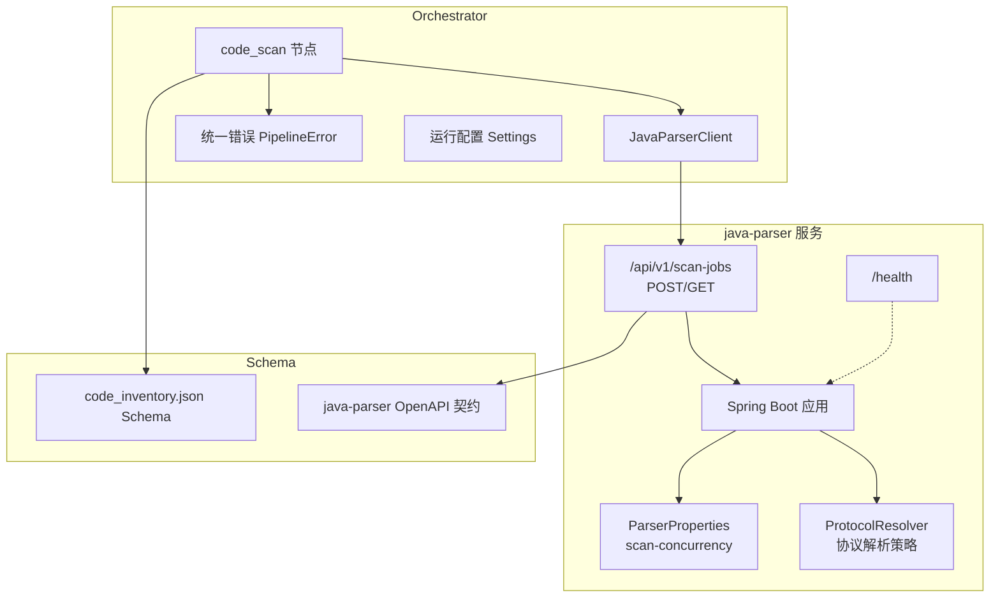
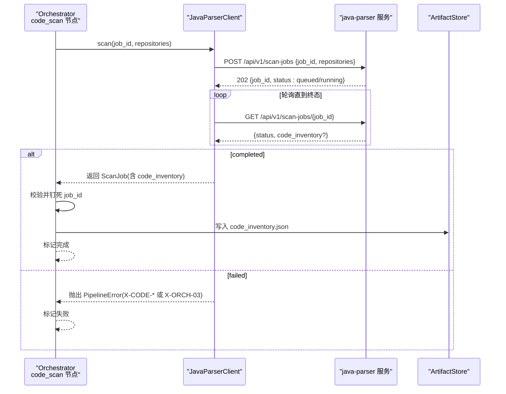
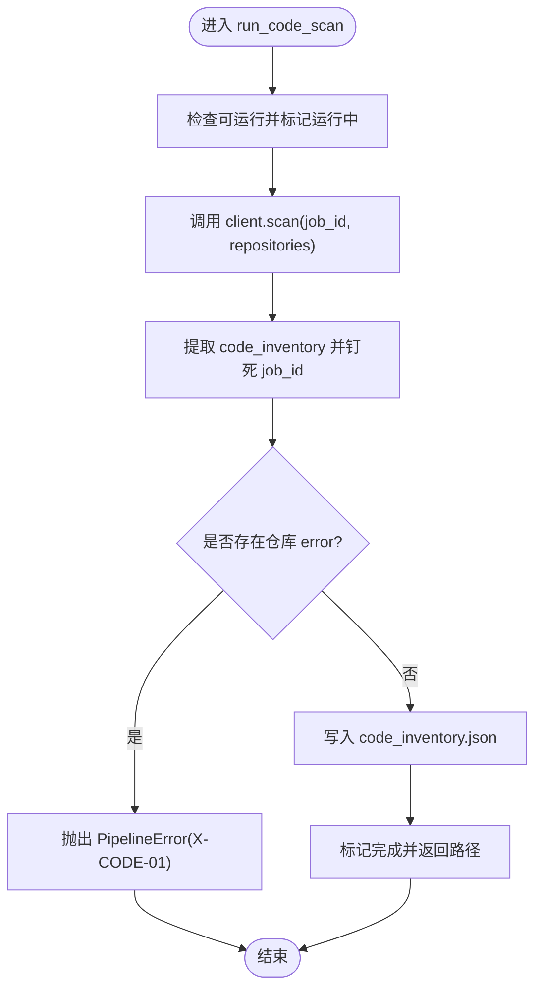
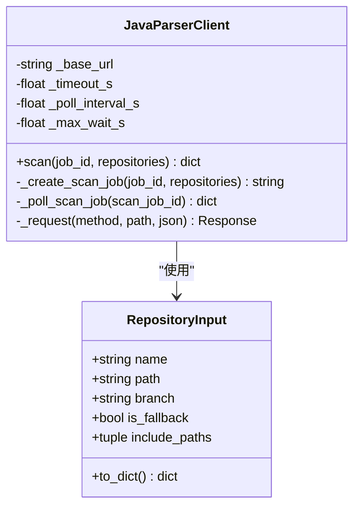
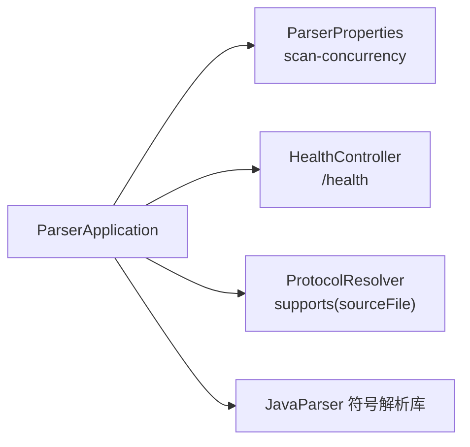
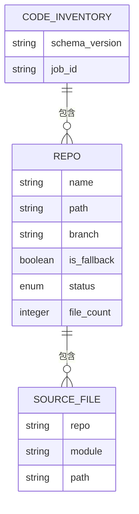
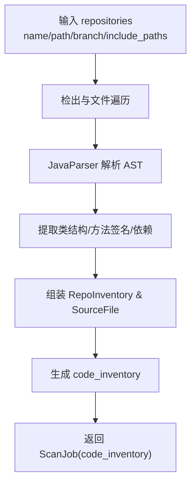
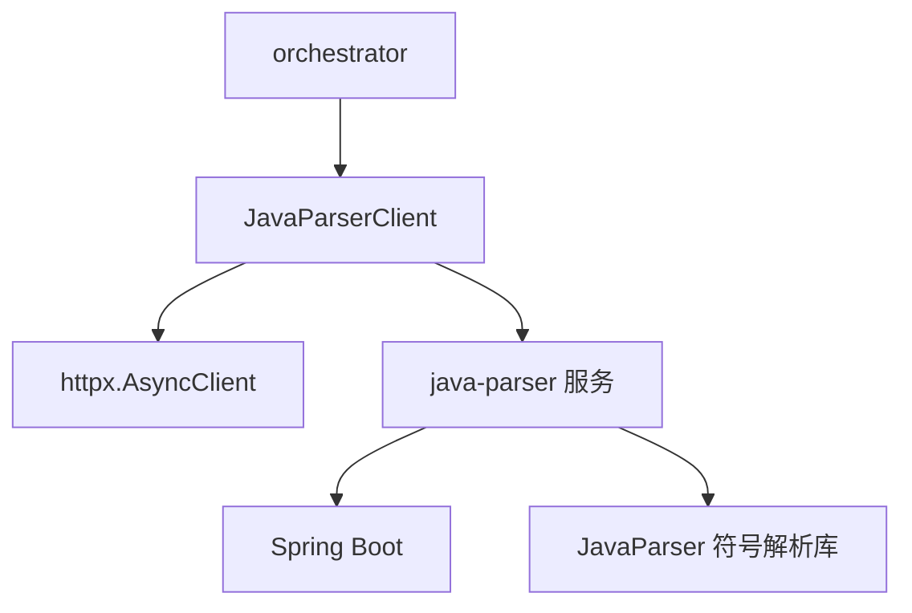

# 代码扫描节点

<cite>
**本文引用的文件**
- [services/orchestrator/src/orchestrator/nodes/code_scan.py](file://services/orchestrator/src/orchestrator/nodes/code_scan.py)
- [services/orchestrator/src/orchestrator/javaparser_client.py](file://services/orchestrator/src/orchestrator/javaparser_client.py)
- [schemas/code_inventory.json](file://schemas/code_inventory.json)
- [schemas/contracts/java-parser.openapi.yaml](file://schemas/contracts/java-parser.openapi.yaml)
- [services/java-parser/src/main/resources/application.yml](file://services/java-parser/src/main/resources/application.yml)
- [services/java-parser/src/main/java/com/llmautotest/parser/ParserProperties.java](file://services/java-parser/src/main/java/com/llmautotest/parser/ParserProperties.java)
- [services/java-parser/pom.xml](file://services/java-parser/pom.xml)
- [services/java-parser/src/main/java/com/llmautotest/parser/ProtocolResolver.java](file://services/java-parser/src/main/java/com/llmautotest/parser/ProtocolResolver.java)
- [services/java-parser/src/main/java/com/llmautotest/parser/HealthController.java](file://services/java-parser/src/main/java/com/llmautotest/parser/HealthController.java)
- [services/orchestrator/src/orchestrator/errors.py](file://services/orchestrator/src/orchestrator/errors.py)
- [services/orchestrator/src/orchestrator/config.py](file://services/orchestrator/src/orchestrator/config.py)
</cite>

## 目录
1. [简介](#简介)
2. [项目结构](#项目结构)
3. [核心组件](#核心组件)
4. [架构总览](#架构总览)
5. [详细组件分析](#详细组件分析)
6. [依赖关系分析](#依赖关系分析)
7. [性能与内存优化](#性能与内存优化)
8. [故障排查指南](#故障排查指南)
9. [结论](#结论)
10. [附录：配置项清单](#附录配置项清单)

## 简介
本章节面向“代码扫描节点”，聚焦 orchestrator 侧的 code_scan 节点如何驱动 java-parser 服务完成 Java 多仓库扫描，产出并落盘 code_inventory.json。文档覆盖：
- Git 仓库克隆、文件遍历与静态分析的调用流程（由 java-parser 实现）
- JavaParser 客户端的创建 job、轮询、错误处理机制
- code_inventory.json 的数据结构与生成过程
- 静态分析技术点：类结构提取、方法签名分析、依赖识别（通过契约与接口暴露）
- 扫描配置与性能调优参数（并发度、超时、轮询间隔等）
- 大项目扫描的性能优化策略与内存管理建议

## 项目结构
围绕代码扫描的关键路径如下：
- orchestrator 的 code_scan 节点负责编排与产物落盘
- JavaParserClient 封装 HTTP 异步调用与轮询
- java-parser 服务提供 /api/v1/scan-jobs 异步任务接口
- schemas 定义 code_inventory.json 的结构与 API 契约

图表来源
- [services/orchestrator/src/orchestrator/nodes/code_scan.py:26-49](file://services/orchestrator/src/orchestrator/nodes/code_scan.py#L26-L49)
- [services/orchestrator/src/orchestrator/javaparser_client.py:70-151](file://services/orchestrator/src/orchestrator/javaparser_client.py#L70-L151)
- [schemas/contracts/java-parser.openapi.yaml:24-115](file://schemas/contracts/java-parser.openapi.yaml#L24-L115)
- [services/java-parser/src/main/resources/application.yml:1-8](file://services/java-parser/src/main/resources/application.yml#L1-L8)
- [services/java-parser/src/main/java/com/llmautotest/parser/ParserProperties.java:1-16](file://services/java-parser/src/main/java/com/llmautotest/parser/ParserProperties.java#L1-L16)
- [services/java-parser/src/main/java/com/llmautotest/parser/ProtocolResolver.java:1-17](file://services/java-parser/src/main/java/com/llmautotest/parser/ProtocolResolver.java#L1-L17)
- [schemas/code_inventory.json:1-57](file://schemas/code_inventory.json#L1-L57)

章节来源
- [services/orchestrator/src/orchestrator/nodes/code_scan.py:1-94](file://services/orchestrator/src/orchestrator/nodes/code_scan.py#L1-L94)
- [services/orchestrator/src/orchestrator/javaparser_client.py:1-162](file://services/orchestrator/src/orchestrator/javaparser_client.py#L1-L162)
- [schemas/contracts/java-parser.openapi.yaml:1-369](file://schemas/contracts/java-parser.openapi.yaml#L1-L369)
- [services/java-parser/src/main/resources/application.yml:1-8](file://services/java-parser/src/main/resources/application.yml#L1-L8)
- [services/java-parser/src/main/java/com/llmautotest/parser/ParserProperties.java:1-16](file://services/java-parser/src/main/java/com/llmautotest/parser/ParserProperties.java#L1-L16)
- [schemas/code_inventory.json:1-57](file://schemas/code_inventory.json#L1-L57)

## 核心组件
- code_scan 节点：编排扫描流程、校验响应、落盘 code_inventory.json、状态标记
- JavaParserClient：创建 scan job、轮询至终态、统一通信错误
- java-parser 服务：接收多仓库扫描请求，执行静态分析，返回 code_inventory
- Schema：code_inventory.json 的结构约束；OpenAPI 契约定义 API 行为

章节来源
- [services/orchestrator/src/orchestrator/nodes/code_scan.py:26-94](file://services/orchestrator/src/orchestrator/nodes/code_scan.py#L26-L94)
- [services/orchestrator/src/orchestrator/javaparser_client.py:28-162](file://services/orchestrator/src/orchestrator/javaparser_client.py#L28-L162)
- [schemas/contracts/java-parser.openapi.yaml:185-273](file://schemas/contracts/java-parser.openapi.yaml#L185-L273)
- [schemas/code_inventory.json:1-57](file://schemas/code_inventory.json#L1-L57)

## 架构总览
orchestrator 通过 code_scan 节点发起多仓库扫描，java-parser 以异步 job 模式处理，完成后返回包含 code_inventory 的 ScanJob。客户端轮询直至 completed 或 failed。

图表来源
- [services/orchestrator/src/orchestrator/nodes/code_scan.py:26-49](file://services/orchestrator/src/orchestrator/nodes/code_scan.py#L26-L49)
- [services/orchestrator/src/orchestrator/javaparser_client.py:70-151](file://services/orchestrator/src/orchestrator/javaparser_client.py#L70-L151)
- [schemas/contracts/java-parser.openapi.yaml:24-115](file://schemas/contracts/java-parser.openapi.yaml#L24-L115)

## 详细组件分析

### code_scan 节点
职责与流程：
- 前置检查与状态标记
- 调用 JavaParserClient.scan 获取 ScanJob
- 从响应中提取 code_inventory，并强制绑定 job_id
- 检查仓库级硬错误（任一 error 即失败）
- 将 code_inventory 写入 artifacts，并标记节点完成

关键要点：
- 仓库四态口径：ok、empty（继续）、truncated（记录 truncated_scope）、error（失败）
- 若响应缺少 code_inventory 或 job_id 不匹配，抛出统一错误

图表来源
- [services/orchestrator/src/orchestrator/nodes/code_scan.py:26-94](file://services/orchestrator/src/orchestrator/nodes/code_scan.py#L26-L94)

章节来源
- [services/orchestrator/src/orchestrator/nodes/code_scan.py:26-94](file://services/orchestrator/src/orchestrator/nodes/code_scan.py#L26-L94)

### JavaParserClient
职责与流程：
- 构造 RepositoryInput 列表，POST 创建 scan job
- 轮询 GET 查询 job 状态，直至 completed/failed
- 统一通信异常为 X-ORCH-03；契约错误透传其 code 并归位 node_id=code_scan

关键要点：
- 默认超时、轮询间隔与最大等待时间可注入（测试用小值加速）
- 未知 job 状态视为通信错误
- HTTP 非 2xx 且无契约错误体时，归类为通信失败

图表来源
- [services/orchestrator/src/orchestrator/javaparser_client.py:28-162](file://services/orchestrator/src/orchestrator/javaparser_client.py#L28-L162)

章节来源
- [services/orchestrator/src/orchestrator/javaparser_client.py:28-162](file://services/orchestrator/src/orchestrator/javaparser_client.py#L28-L162)

### java-parser 服务与静态分析
- 服务入口与配置：Spring Boot 应用，端口与扫描并发度可配置
- 协议解析策略：ProtocolResolver 支持 rest/dubbo/grpc/graphql/soap/mq 等多协议，作为扫描阶段的过滤器
- 健康检查：/health 用于编排健康探测
- 依赖：基于 JavaParser 符号解析库进行源码解析

图表来源
- [services/java-parser/src/main/java/com/llmautotest/parser/ParserApplication.java:1-17](file://services/java-parser/src/main/java/com/llmautotest/parser/ParserApplication.java#L1-L17)
- [services/java-parser/src/main/resources/application.yml:1-8](file://services/java-parser/src/main/resources/application.yml#L1-L8)
- [services/java-parser/src/main/java/com/llmautotest/parser/ParserProperties.java:1-16](file://services/java-parser/src/main/java/com/llmautotest/parser/ParserProperties.java#L1-L16)
- [services/java-parser/src/main/java/com/llmautotest/parser/ProtocolResolver.java:1-17](file://services/java-parser/src/main/java/com/llmautotest/parser/ProtocolResolver.java#L1-L17)
- [services/java-parser/pom.xml:31-47](file://services/java-parser/pom.xml#L31-L47)

章节来源
- [services/java-parser/src/main/java/com/llmautotest/parser/ParserApplication.java:1-17](file://services/java-parser/src/main/java/com/llmautotest/parser/ParserApplication.java#L1-L17)
- [services/java-parser/src/main/resources/application.yml:1-8](file://services/java-parser/src/main/resources/application.yml#L1-L8)
- [services/java-parser/src/main/java/com/llmautotest/parser/ParserProperties.java:1-16](file://services/java-parser/src/main/java/com/llmautotest/parser/ParserProperties.java#L1-L16)
- [services/java-parser/src/main/java/com/llmautotest/parser/ProtocolResolver.java:1-17](file://services/java-parser/src/main/java/com/llmautotest/parser/ProtocolResolver.java#L1-L17)
- [services/java-parser/pom.xml:31-47](file://services/java-parser/pom.xml#L31-L47)

### code_inventory.json 数据结构
- 顶层字段：schema_version、job_id、repositories
- repositories 数组每项包含：name、path、branch、is_fallback、status、file_count、可选 truncated_scope、encoding_skipped、error、files
- files 数组每项包含：repo、module、path
- 仓库状态枚举：ok、empty、truncated、error

图表来源
- [schemas/code_inventory.json:1-57](file://schemas/code_inventory.json#L1-L57)

章节来源
- [schemas/code_inventory.json:1-57](file://schemas/code_inventory.json#L1-L57)

### 静态分析技术与数据流
- 类结构提取与方法签名分析：由 JavaParser 符号解析库在 java-parser 服务内完成，结合 ProtocolResolver 过滤协议相关源码
- 依赖关系识别：通过符号解析构建引用关系，输出到 code_inventory 的 files 清单及后续候选提取阶段（接口候选提取见 OpenAPI 契约中的 extract-jobs）
- 数据流：repositories（路径+分支）→ 检出与遍历 → 解析 AST → 提取类/方法/依赖 → 组装 code_inventory → 返回给 orchestrator

图表来源
- [schemas/contracts/java-parser.openapi.yaml:185-273](file://schemas/contracts/java-parser.openapi.yaml#L185-L273)
- [services/java-parser/pom.xml:31-47](file://services/java-parser/pom.xml#L31-L47)

## 依赖关系分析
- orchestrator 与 java-parser 通过 HTTP 契约解耦，错误码与节点归属明确
- JavaParserClient 对 httpx 的封装屏蔽底层通信细节，统一错误归口
- java-parser 依赖 Spring Boot 与 JavaParser 符号解析库，支持多协议策略扩展

图表来源
- [services/orchestrator/src/orchestrator/javaparser_client.py:123-151](file://services/orchestrator/src/orchestrator/javaparser_client.py#L123-L151)
- [services/java-parser/pom.xml:31-47](file://services/java-parser/pom.xml#L31-L47)

章节来源
- [services/orchestrator/src/orchestrator/javaparser_client.py:123-151](file://services/orchestrator/src/orchestrator/javaparser_client.py#L123-L151)
- [services/java-parser/pom.xml:31-47](file://services/java-parser/pom.xml#L31-L47)

## 性能与内存优化
- 扫描并发度：java-parser 侧 parser.scan-concurrency 控制多仓库扫描并行度，需根据资源与仓库规模调整
- 轮询参数：JavaParserClient 的 poll_interval_s 与 max_wait_s 影响响应延迟与超时容忍度，可按网络与服务端负载调优
- 单次请求超时：DEFAULT_TIMEOUT_S 控制 HTTP 请求超时，避免长尾阻塞
- 大仓库截断：通过 include_paths 指定核心模块目录，减少扫描范围，降低内存与 CPU 压力
- 编码跳过：encoding_skipped 记录无法解析的文件，避免中断整体扫描
- 内存管理建议（通用实践）：
  - 合理设置 JVM 堆大小与 GC 策略（针对 java-parser 容器）
  - 分块解析与增量扫描，避免一次性加载全部 AST
  - 限制并发解析线程数，防止 OOM
  - 对超大仓库优先启用 include_paths 截断策略

章节来源
- [services/java-parser/src/main/resources/application.yml:1-8](file://services/java-parser/src/main/resources/application.yml#L1-L8)
- [services/java-parser/src/main/java/com/llmautotest/parser/ParserProperties.java:1-16](file://services/java-parser/src/main/java/com/llmautotest/parser/ParserProperties.java#L1-L16)
- [services/orchestrator/src/orchestrator/javaparser_client.py:21-23](file://services/orchestrator/src/orchestrator/javaparser_client.py#L21-L23)
- [schemas/contracts/java-parser.openapi.yaml:179-183](file://schemas/contracts/java-parser.openapi.yaml#L179-L183)
- [schemas/code_inventory.json:28-29](file://schemas/code_inventory.json#L28-L29)

## 故障排查指南
- 通信失败：X-ORCH-03，常见于连接超时、HTTP 异常、轮询耗尽；检查 java-parser 服务可达性与网络
- 契约错误：X-CODE-*，由 java-parser 返回；查看 details 与 message，定位具体仓库问题
- 仓库硬错误：任一仓库 status=error 导致节点失败；核对仓库路径、分支与权限
- 空仓库/截断：empty/truncated 为正常态，检查 truncated_scope 与 encoding_skipped 是否满足预期
- 产物校验失败：X-ORCH-01，检查 code_inventory 是否缺失或 job_id 不匹配

章节来源
- [services/orchestrator/src/orchestrator/errors.py:1-39](file://services/orchestrator/src/orchestrator/errors.py#L1-L39)
- [services/orchestrator/src/orchestrator/nodes/code_scan.py:52-94](file://services/orchestrator/src/orchestrator/nodes/code_scan.py#L52-L94)
- [services/orchestrator/src/orchestrator/javaparser_client.py:98-162](file://services/orchestrator/src/orchestrator/javaparser_client.py#L98-L162)

## 结论
code_scan 节点通过清晰的编排与严格的契约校验，实现了 Java 多仓库扫描的稳定落地。配合 java-parser 的异步 job 模式与可配置的并发度，能够在不同规模项目中平衡性能与可靠性。通过 include_paths 截断与编码跳过机制，进一步提升了大项目的可扫描性。建议在部署时依据资源与仓库规模调优并发与超时参数，并结合监控与日志持续优化。

## 附录：配置项清单
- orchestrator 环境变量（部分）：
  - JAVA_PARSER_URL：java-parser 服务地址
  - LLM_*：LLM 调用参数（与扫描无关但属运行配置）
  - ARTIFACTS_ROOT：产物根目录
- java-parser 配置：
  - server.port：服务端口
  - parser.scan-concurrency：多仓库扫描并发度

章节来源
- [services/orchestrator/src/orchestrator/config.py:9-56](file://services/orchestrator/src/orchestrator/config.py#L9-L56)
- [services/java-parser/src/main/resources/application.yml:1-8](file://services/java-parser/src/main/resources/application.yml#L1-L8)