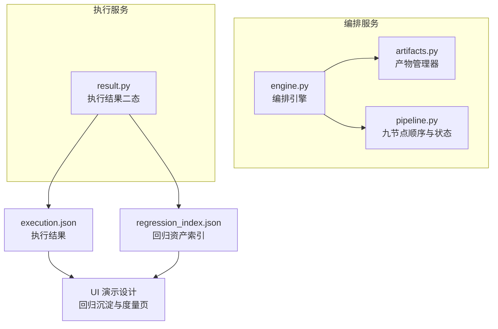
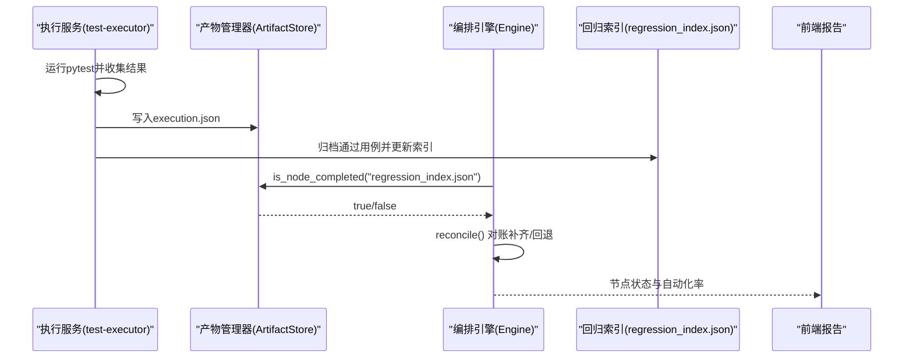
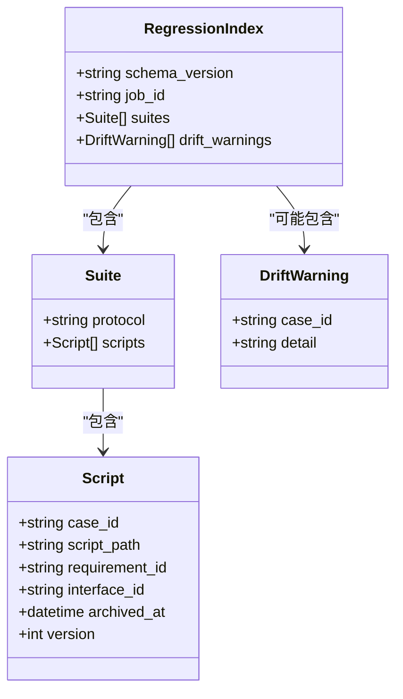
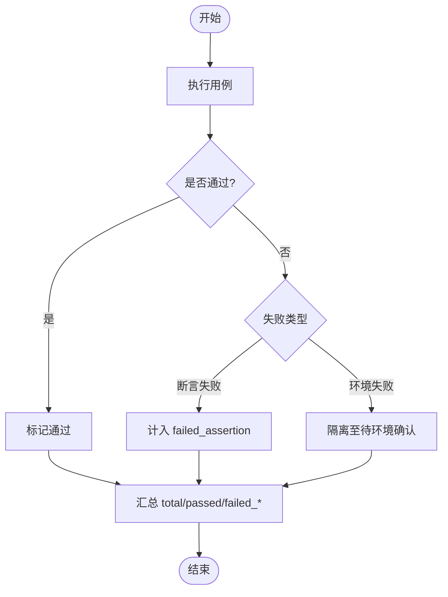
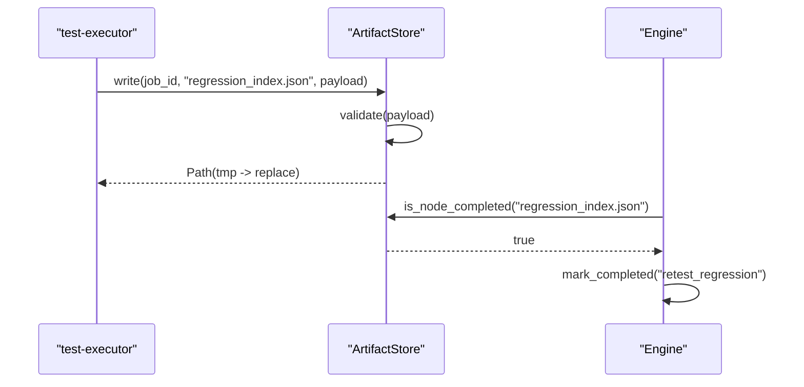
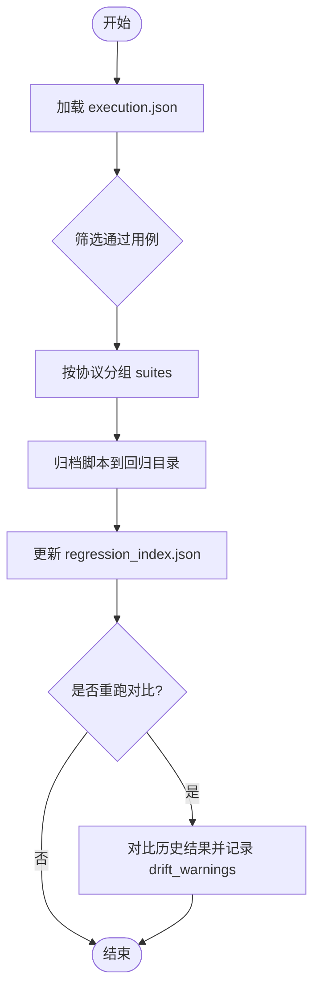
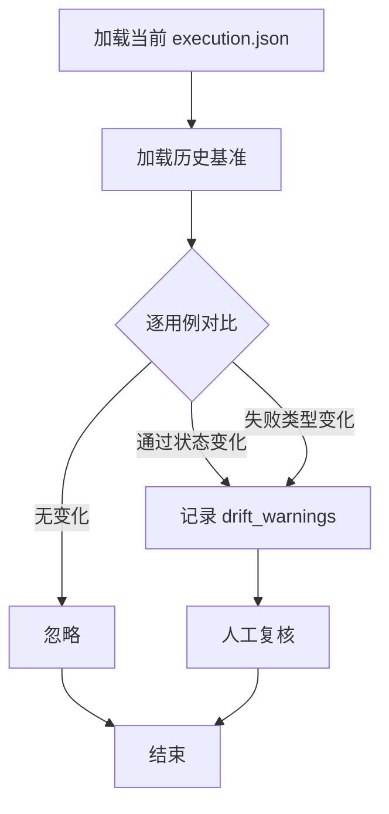
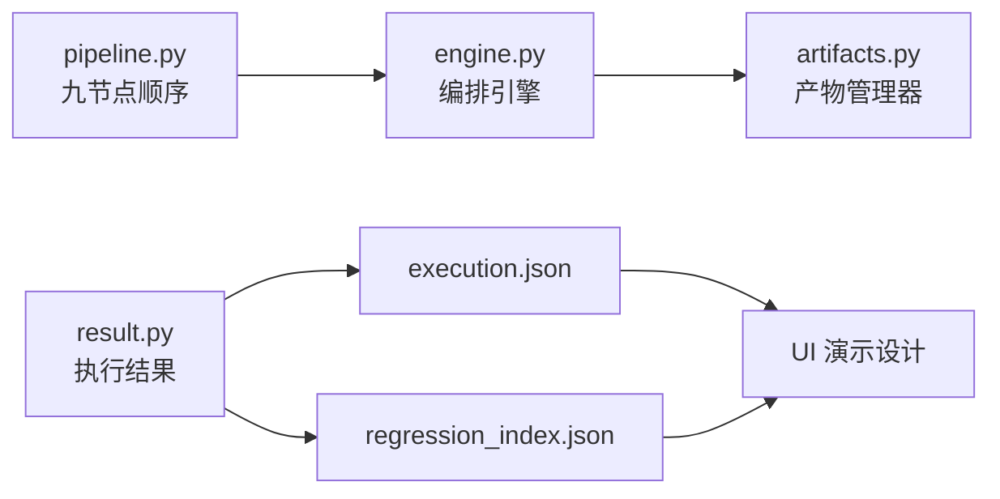

# 回归测试节点

<cite>
**本文引用的文件**
- [regression_index.json](file://schemas/regression_index.json)
- [execution.json](file://schemas/execution.json)
- [artifacts.py](file://services/orchestrator/src/orchestrator/artifacts.py)
- [engine.py](file://services/orchestrator/src/orchestrator/engine.py)
- [pipeline.py](file://services/orchestrator/src/orchestrator/pipeline.py)
- [result.py](file://services/test-executor/src/executor/result.py)
- [07_UI演示设计.md](file://docs/07_UI演示设计.md)
- [10_测试框架选型说明.md](file://docs/10_测试框架选型说明.md)
- [04_功能规格说明.md](file://docs/04_功能规格说明.md)
- [03_用户故事卡片.md](file://docs/03_用户故事卡片.md)
</cite>

## 目录
1. [简介](#简介)
2. [项目结构](#项目结构)
3. [核心组件](#核心组件)
4. [架构总览](#架构总览)
5. [详细组件分析](#详细组件分析)
6. [依赖关系分析](#依赖关系分析)
7. [性能考虑](#性能考虑)
8. [故障排查指南](#故障排查指南)
9. [结论](#结论)
10. [附录](#附录)

## 简介
本章节面向“回归测试节点（retest_regression）”，围绕回归资产的管理与版本控制、索引结构与用例组织、选择策略与执行范围、结果对比与差异分析、效果量化与质量门禁，以及性能优化与增量执行方案进行系统化说明。回归测试在本项目中作为流水线第 9 个固定节点存在，负责将复测通过的用例沉淀为可重跑的回归脚本资产，并维护一份按协议维度组织的索引，以支撑后续一键重跑与漂移告警。

## 项目结构
回归测试相关能力横跨“编排服务”和“执行服务”两个子系统：
- 编排服务（orchestrator）：负责产物卷管理、Schema 校验、节点完成判据、状态对账与降级处理；将 regression_index.json 视为 retest_regression 节点的产物之一。
- 执行服务（test-executor）：负责加载 pytest 脚本、执行用例、产出 execution.json，并将通过用例归档到回归目录，同时更新回归索引。
- 文档与规范：在 docs 中定义 UI 展示、执行策略、降级口径与度量口径等约束。

图表来源
- [artifacts.py:1-157](file://services/orchestrator/src/orchestrator/artifacts.py#L1-L157)
- [engine.py:1-302](file://services/orchestrator/src/orchestrator/engine.py#L1-L302)
- [pipeline.py:1-84](file://services/orchestrator/src/orchestrator/pipeline.py#L1-L84)
- [result.py:1-61](file://services/test-executor/src/executor/result.py#L1-L61)
- [regression_index.json:1-50](file://schemas/regression_index.json#L1-L50)
- [execution.json:1-59](file://schemas/execution.json#L1-L59)
- [07_UI演示设计.md:72-95](file://docs/07_UI演示设计.md#L72-L95)

章节来源
- [artifacts.py:1-157](file://services/orchestrator/src/orchestrator/artifacts.py#L1-L157)
- [engine.py:1-302](file://services/orchestrator/src/orchestrator/engine.py#L1-L302)
- [pipeline.py:1-84](file://services/orchestrator/src/orchestrator/pipeline.py#L1-L84)
- [07_UI演示设计.md:72-95](file://docs/07_UI演示设计.md#L72-L95)

## 核心组件
- 回归资产索引（regression_index.json）：以 schema 强约束的 JSON 文件，记录 job_id、schema_version、按协议划分的 suites 及每个用例的 case_id、script_path、requirement_id、interface_id、archived_at、version，以及 drift_warnings 漂移告警。
- 产物管理器（ArtifactStore）：统一读写产物卷，提供 Schema 校验、写权排他、归档与“节点完成”判定。
- 编排引擎（Engine）：维护 state.json，实现断点续跑、跳序防护、降级清单与自动化率汇总；将 retest_regression 节点与 regression_index.json 绑定为完成判据。
- 执行结果模型（CaseResult/ExecutionSummary）：区分断言失败与环境失败，程序化汇总 total/passed/failed_assertion/failed_environment，确保数值不经 LLM。
- 执行结果 Schema（execution.json）：规定每条用例的结果字段、summary 与 degraded_protocols 降级清单。

章节来源
- [regression_index.json:1-50](file://schemas/regression_index.json#L1-L50)
- [artifacts.py:1-157](file://services/orchestrator/src/orchestrator/artifacts.py#L1-L157)
- [engine.py:1-302](file://services/orchestrator/src/orchestrator/engine.py#L1-L302)
- [result.py:1-61](file://services/test-executor/src/executor/result.py#L1-L61)
- [execution.json:1-59](file://schemas/execution.json#L1-L59)

## 架构总览
回归测试节点位于流水线第九位，承接 auto_execute 产出的 execution.json，并在 retest_regression 阶段完成：
- 从执行结果中筛选“通过”的用例，将其脚本归档至回归目录（scripts/archive），并按协议维度组织套件。
- 生成或更新 regression_index.json，维护用例版本与归档时间戳，支持幂等重档。
- 若发现回归重跑结果与沉淀时不一致，则记录 drift_warnings，交由人工判断，不自动删除。
- 编排引擎依据 regression_index.json 的存在与合规性判定 retest_regression 节点完成。

图表来源
- [engine.py:133-265](file://services/orchestrator/src/orchestrator/engine.py#L133-L265)
- [artifacts.py:75-131](file://services/orchestrator/src/orchestrator/artifacts.py#L75-L131)
- [execution.json:1-59](file://schemas/execution.json#L1-L59)
- [regression_index.json:1-50](file://schemas/regression_index.json#L1-L50)

## 详细组件分析

### 回归资产索引（regression_index.json）
- 顶层字段
  - schema_version：固定为 "1.0"，用于向后兼容。
  - job_id：以 "job-" 开头，标识一次流水线任务。
  - suites：按协议维度组织回归套件，协议枚举包含 rest、grpc、graphql、soap、mq。
  - drift_warnings：当回归重跑结果与沉淀时不一致时记录漂移告警，需人工判断，不自动删除。
- 套件项（suite）
  - protocol：协议类型。
  - scripts：用例列表，每项包含：
    - case_id：用例编号，形如 TC-xxx。
    - script_path：归档后路径（移动非复制，禁止原地覆盖）。
    - requirement_id：需求条目 ID，形如 REQ-xxx，用于溯源。
    - interface_id：接口 ID，形如 IF-XXX-xxx，用于关联被测接口。
    - archived_at：UTC ISO-8601 时间戳，幂等重档会更新时间。
    - version：覆盖归档时递增的版本号，便于追踪变更。
- 漂移告警（drift_warnings）
  - case_id：触发漂移的用例编号。
  - detail：漂移详情描述。

图表来源
- [regression_index.json:1-50](file://schemas/regression_index.json#L1-L50)

章节来源
- [regression_index.json:1-50](file://schemas/regression_index.json#L1-L50)

### 执行结果与二态分离（execution.json 与 result.py）
- execution.json 规定每条用例的结果字段，包括 case_id、interface_id、passed、failure_kind（assertion/environment）、failure_reason、timeout、skipped_reason、duration_ms、timestamp。
- summary 字段提供程序化汇总：total、passed、failed_assertion、failed_environment、interrupted。
- result.py 中的 FailureKind 与 CaseResult/ExecutionSummary 保证断言失败与环境失败的严格区分，并通过属性计算汇总值，避免 LLM 介入数值。

图表来源
- [execution.json:1-59](file://schemas/execution.json#L1-L59)
- [result.py:10-61](file://services/test-executor/src/executor/result.py#L10-L61)

章节来源
- [execution.json:1-59](file://schemas/execution.json#L1-L59)
- [result.py:1-61](file://services/test-executor/src/executor/result.py#L1-L61)

### 产物管理与节点完成判据
- ArtifactStore 负责：
  - 写权排他：regression_index.json 由 test-executor 写入，orchestrator 仅读取与校验。
  - Schema 校验：所有 JSON 产物必须通过对应 schema 校验，否则拒绝写入。
  - 节点完成判据：is_node_completed 检查产物存在且校验通过（Markdown 仅查存在性与大小）。
  - 归档：archive 方法在重跑前将旧产物移动到 archive 目录，禁止原地覆盖。
- Engine 将 retest_regression 节点与 regression_index.json 绑定为完成判据，并在 reconcile 中对账补齐或回退状态。

图表来源
- [artifacts.py:75-131](file://services/orchestrator/src/orchestrator/artifacts.py#L75-L131)
- [engine.py:161-242](file://services/orchestrator/src/orchestrator/engine.py#L161-L242)

章节来源
- [artifacts.py:1-157](file://services/orchestrator/src/orchestrator/artifacts.py#L1-L157)
- [engine.py:1-302](file://services/orchestrator/src/orchestrator/engine.py#L1-L302)

### 选择策略与执行范围确定算法
- 选择策略
  - 基于 execution.json 的 results 数组，筛选 passed=true 的用例进入回归套件。
  - 按协议维度分组（rest/grpc/graphql/soap/mq），形成 suites。
  - 对每个用例生成 script_path（归档后的路径），并附带 requirement_id、interface_id 以便溯源。
- 执行范围确定
  - 全量重跑：对 suites 下全部脚本执行 pytest，输出新的 execution.json 并与历史对比。
  - 增量重跑：根据 drift_warnings 或变更范围（如某接口或需求条目）定位受影响用例，仅重跑相关脚本。
  - 降级协议：若某协议 Runner 不可用，按 X-EXEC-03 降级为“脚本生成成功+Mock执行演示”，并在 degraded_protocols 中记录。

图表来源
- [execution.json:1-59](file://schemas/execution.json#L1-L59)
- [regression_index.json:1-50](file://schemas/regression_index.json#L1-L50)
- [04_功能规格说明.md:194-207](file://docs/04_功能规格说明.md#L194-L207)

章节来源
- [execution.json:1-59](file://schemas/execution.json#L1-L59)
- [regression_index.json:1-50](file://schemas/regression_index.json#L1-L50)
- [04_功能规格说明.md:194-207](file://docs/04_功能规格说明.md#L194-L207)

### 测试结果对比与差异分析方法
- 对比对象
  - 当前执行结果（execution.json）与历史基准（上一次回归执行的 execution.json 或回归基线）。
- 对比维度
  - 用例级：case_id 是否一致、passed 是否变化、failure_kind 是否变化。
  - 指标级：summary.total/passed/failed_assertion/failed_environment 的变化。
  - 协议级：degraded_protocols 是否新增或变化。
- 差异处理
  - 若出现不一致，记录 drift_warnings，交由人工判断，不自动删除用例。
  - 对于环境失败（environment），隔离至待环境确认，不计入缺陷清单。

图表来源
- [execution.json:1-59](file://schemas/execution.json#L1-L59)
- [regression_index.json:1-50](file://schemas/regression_index.json#L1-L50)

章节来源
- [execution.json:1-59](file://schemas/execution.json#L1-L59)
- [regression_index.json:1-50](file://schemas/regression_index.json#L1-L50)

### 回归测试效果的量化评估与质量门禁
- 量化指标
  - 自动化率：completed / 9（固定分母为 9），由 Engine 程序化汇总，不经过 LLM。
  - 通过率：passed / total，来自 execution.json 的 summary。
  - 断言失败数与隔离的环境失败数：分别统计，环境失败不计入通过率分母。
- 质量门禁
  - 节点完成：retest_regression 节点需产出合规的 regression_index.json。
  - 漂移告警：出现 drift_warnings 时需人工复核，未解决不得关闭回归闭环。
  - 降级说明：报告中显式列出降级协议与原因，避免虚假正向结论。

章节来源
- [engine.py:126-131](file://services/orchestrator/src/orchestrator/engine.py#L126-L131)
- [execution.json:1-59](file://schemas/execution.json#L1-L59)
- [07_UI演示设计.md:72-95](file://docs/07_UI演示设计.md#L72-L95)

### 性能优化与增量执行方案
- 性能优化
  - 并行执行：按协议或用例集合并行执行 pytest，缩短整体耗时。
  - 缓存与复用：对 fixtures 与 Mock 服务结果进行缓存，减少外部依赖开销。
  - 超时控制：单用例设置超时上限，避免个别用例阻塞整体执行。
- 增量执行
  - 基于变更范围（如接口或需求条目）定位受影响用例，仅重跑相关脚本。
  - 结合 drift_warnings 精准定位不稳定用例，优先复测。
  - 对不可用协议按 X-EXEC-03 降级，保障主流程推进。

章节来源
- [04_功能规格说明.md:194-207](file://docs/04_功能规格说明.md#L194-L207)
- [10_测试框架选型说明.md:39-53](file://docs/10_测试框架选型说明.md#L39-L53)

## 依赖关系分析
- orchestrator 与 test-executor 通过产物卷解耦：
  - test-executor 写入 execution.json 与 regression_index.json。
  - orchestrator 读取并校验这些产物，驱动节点状态流转。
- pipeline.py 固定九节点顺序，retest_regression 为最后一环，依赖 auto_execute 与 test_report 等前置节点完成。
- UI 层消费 execution.json 与 regression_index.json 呈现回归沉淀与度量信息。

图表来源
- [pipeline.py:23-34](file://services/orchestrator/src/orchestrator/pipeline.py#L23-L34)
- [engine.py:133-265](file://services/orchestrator/src/orchestrator/engine.py#L133-L265)
- [artifacts.py:24-50](file://services/orchestrator/src/orchestrator/artifacts.py#L24-L50)
- [execution.json:1-59](file://schemas/execution.json#L1-L59)
- [regression_index.json:1-50](file://schemas/regression_index.json#L1-L50)
- [07_UI演示设计.md:72-95](file://docs/07_UI演示设计.md#L72-L95)

章节来源
- [pipeline.py:1-84](file://services/orchestrator/src/orchestrator/pipeline.py#L1-L84)
- [engine.py:1-302](file://services/orchestrator/src/orchestrator/engine.py#L1-L302)
- [artifacts.py:1-157](file://services/orchestrator/src/orchestrator/artifacts.py#L1-L157)
- [execution.json:1-59](file://schemas/execution.json#L1-L59)
- [regression_index.json:1-50](file://schemas/regression_index.json#L1-L50)
- [07_UI演示设计.md:72-95](file://docs/07_UI演示设计.md#L72-L95)

## 性能考虑
- 执行效率
  - 使用 pytest 的并行插件或按协议分组并行执行，提升吞吐。
  - 对网络请求与外部依赖设置合理超时与重试策略。
- 资源占用
  - 限制并发度，避免资源争用导致抖动。
  - 对大体积响应体进行采样或裁剪，降低内存压力。
- 稳定性
  - 环境失败隔离，避免污染通过率。
  - 漂移告警及时上报，防止误判。

[本节为通用指导，不直接分析具体文件]

## 故障排查指南
- 常见错误
  - 产物校验失败：检查 regression_index.json 或 execution.json 是否符合 schema。
  - 写权冲突：确认 test-executor 写入 regression_index.json，orchestrator 仅读取。
  - 节点未完成：核对前置节点是否 completed，必要时重新触发。
- 排查步骤
  - 查看 artifacts.validate 返回的错误列表，定位具体字段问题。
  - 检查 engine.reconcile 的对账日志，确认状态是否正确补齐或回退。
  - 针对 drift_warnings 进行人工复核，确认是否为真实回归问题。

章节来源
- [artifacts.py:75-112](file://services/orchestrator/src/orchestrator/artifacts.py#L75-L112)
- [engine.py:161-180](file://services/orchestrator/src/orchestrator/engine.py#L161-L180)
- [regression_index.json:36-47](file://schemas/regression_index.json#L36-L47)

## 结论
回归测试节点通过严格的 schema 与产物管理机制，实现了回归资产的有序沉淀与版本控制。借助 execution.json 的二态分离与程序化汇总，系统能够准确量化回归效果并设置质量门禁。配合漂移告警与降级策略，回归测试在保证稳定性的同时具备可扩展的增量执行能力，为持续集成提供可靠保障。

## 附录
- 关键参考
  - 九节点顺序与状态：pipeline.py
  - 产物管理与完成判据：artifacts.py
  - 编排引擎与对账：engine.py
  - 执行结果二态与汇总：result.py
  - 执行结果 schema：execution.json
  - 回归资产索引 schema：regression_index.json
  - UI 展示与度量：07_UI演示设计.md
  - 执行策略与降级：04_功能规格说明.md
  - 测试框架选型与落地：10_测试框架选型说明.md
  - 用户故事与验收标准：03_用户故事卡片.md

章节来源
- [pipeline.py:1-84](file://services/orchestrator/src/orchestrator/pipeline.py#L1-L84)
- [artifacts.py:1-157](file://services/orchestrator/src/orchestrator/artifacts.py#L1-L157)
- [engine.py:1-302](file://services/orchestrator/src/orchestrator/engine.py#L1-L302)
- [result.py:1-61](file://services/test-executor/src/executor/result.py#L1-L61)
- [execution.json:1-59](file://schemas/execution.json#L1-L59)
- [regression_index.json:1-50](file://schemas/regression_index.json#L1-L50)
- [07_UI演示设计.md:72-95](file://docs/07_UI演示设计.md#L72-L95)
- [04_功能规格说明.md:194-207](file://docs/04_功能规格说明.md#L194-L207)
- [10_测试框架选型说明.md:39-53](file://docs/10_测试框架选型说明.md#L39-L53)
- [03_用户故事卡片.md:115-175](file://docs/03_用户故事卡片.md#L115-L175)