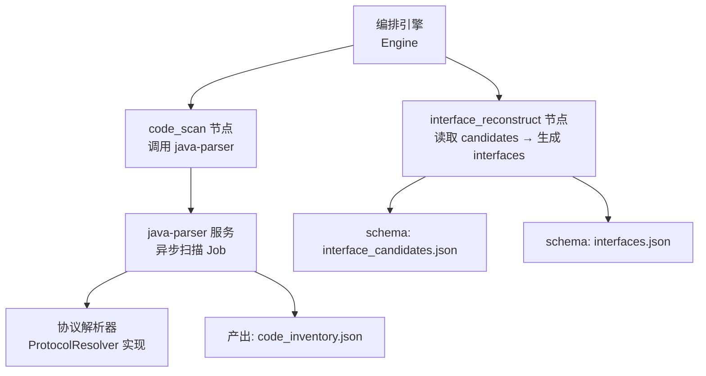
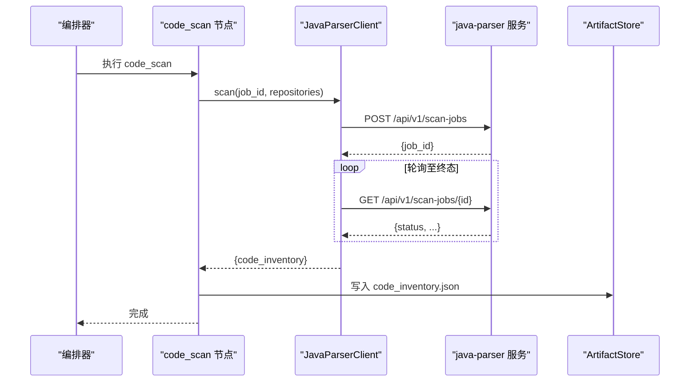
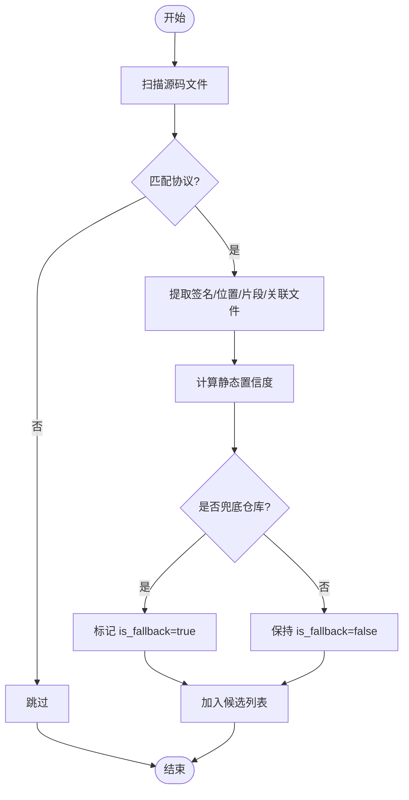
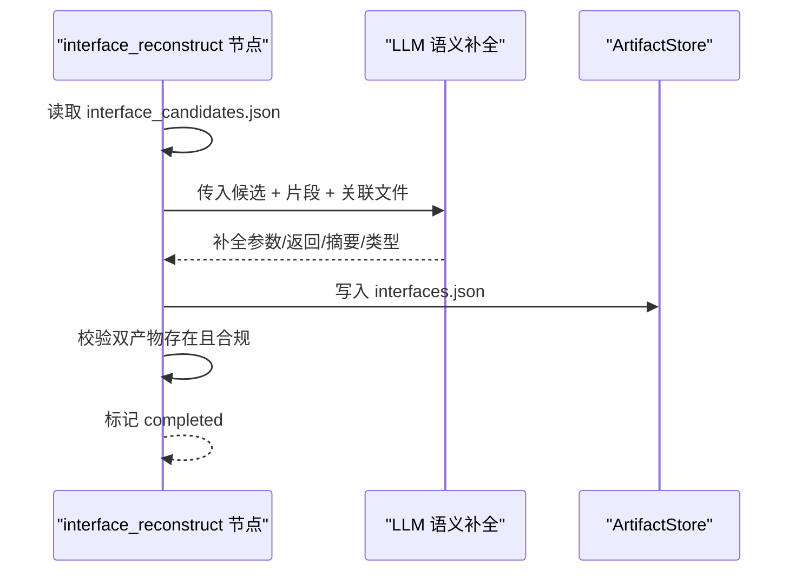
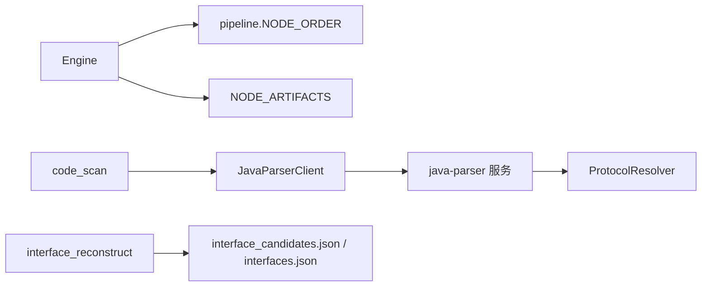
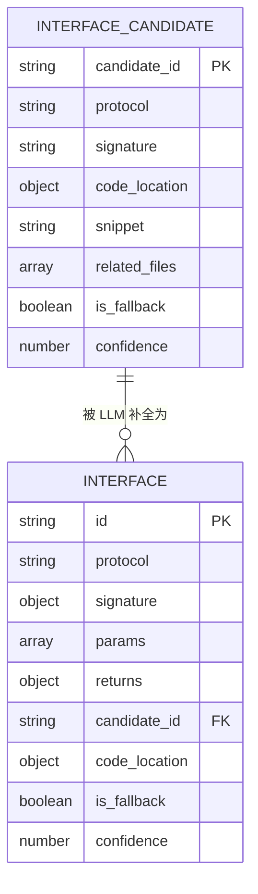

# 接口还原节点

<cite>
**本文引用的文件**
- [services/orchestrator/src/orchestrator/pipeline.py](file://services/orchestrator/src/orchestrator/pipeline.py)
- [services/orchestrator/src/orchestrator/engine.py](file://services/orchestrator/src/orchestrator/engine.py)
- [services/orchestrator/src/orchestrator/javaparser_client.py](file://services/orchestrator/src/orchestrator/javaparser_client.py)
- [services/orchestrator/src/orchestrator/nodes/code_scan.py](file://services/orchestrator/src/orchestrator/nodes/code_scan.py)
- [services/java-parser/src/main/java/com/llmautotest/parser/ProtocolResolver.java](file://services/java-parser/src/main/java/com/llmautotest/parser/ProtocolResolver.java)
- [schemas/interface_candidates.json](file://schemas/interface_candidates.json)
- [schemas/interfaces.json](file://schemas/interfaces.json)
- [schemas/samples/interface_candidates.sample.json](file://schemas/samples/interface_candidates.sample.json)
- [schemas/samples/interfaces.sample.json](file://schemas/samples/interfaces.sample.json)
- [schemas/contracts/java-parser.openapi.yaml](file://schemas/contracts/java-parser.openapi.yaml)
</cite>

## 目录
1. [简介](#简介)
2. [项目结构](#项目结构)
3. [核心组件](#核心组件)
4. [架构总览](#架构总览)
5. [详细组件分析](#详细组件分析)
6. [依赖关系分析](#依赖关系分析)
7. [性能与可扩展性](#性能与可扩展性)
8. [故障排查指南](#故障排查指南)
9. [结论](#结论)
10. [附录](#附录)

## 简介
本章节聚焦“接口还原节点”（pipeline 中的 interface_reconstruct），说明其如何基于 JavaParser 的静态分析与 LLM 语义理解，从多仓库代码中识别接口候选、生成结构化接口清单，并支持 REST、gRPC、GraphQL、SOAP、MQ 五类协议。文档同时给出接口候选与最终接口的数据规范、OpenAPI 生成与版本管理策略，以及准确性评估与改进建议。

## 项目结构
接口还原涉及编排器（Orchestrator）、Java 解析服务（java-parser）以及 JSON Schema 契约：
- 编排器负责流水线调度、状态持久化、节点产物校验与错误归位。
- Java 解析服务提供异步扫描 Job 创建与轮询，输出 code_inventory.json，并在内部通过可插拔协议解析器识别不同协议的接口定义。
- 契约层以 JSON Schema 和 OpenAPI 描述接口候选与最终接口的数据结构，保障上下游一致性与演进可控。

图示来源
- [services/orchestrator/src/orchestrator/engine.py:24-35](file://services/orchestrator/src/orchestrator/engine.py#L24-L35)
- [services/orchestrator/src/orchestrator/nodes/code_scan.py:26-49](file://services/orchestrator/src/orchestrator/nodes/code_scan.py#L26-L49)
- [services/orchestrator/src/orchestrator/javaparser_client.py:70-80](file://services/orchestrator/src/orchestrator/javaparser_client.py#L70-L80)
- [services/java-parser/src/main/java/com/llmautotest/parser/ProtocolResolver.java:7-16](file://services/java-parser/src/main/java/com/llmautotest/parser/ProtocolResolver.java#L7-L16)

章节来源
- [services/orchestrator/src/orchestrator/pipeline.py:23-34](file://services/orchestrator/src/orchestrator/pipeline.py#L23-L34)
- [services/orchestrator/src/orchestrator/engine.py:24-35](file://services/orchestrator/src/orchestrator/engine.py#L24-L35)

## 核心组件
- 编排引擎（Engine）：维护 9 节点固定顺序与状态，校验产物完整性，确保接口还原节点的前置条件满足。
- code_scan 节点：调用 java-parser 进行多仓库扫描，落盘 code_inventory.json，并对仓库级错误进行硬失败判定。
- JavaParserClient：封装与 java-parser 的异步通信（创建 Job、轮询至终态），统一通信异常为 X-ORCH-03，透传契约错误码。
- ProtocolResolver：在 java-parser 侧定义协议解析策略接口，支持按协议扩展（rest/grpc/graphql/soap/mq）。
- 契约与样本：interface_candidates.json 与 interfaces.json 分别约束候选与最终接口；samples 提供示例；OpenAPI 契约用于跨语言对齐。

章节来源
- [services/orchestrator/src/orchestrator/engine.py:133-242](file://services/orchestrator/src/orchestrator/engine.py#L133-L242)
- [services/orchestrator/src/orchestrator/nodes/code_scan.py:26-94](file://services/orchestrator/src/orchestrator/nodes/code_scan.py#L26-L94)
- [services/orchestrator/src/orchestrator/javaparser_client.py:52-161](file://services/orchestrator/src/orchestrator/javaparser_client.py#L52-L161)
- [services/java-parser/src/main/java/com/llmautotest/parser/ProtocolResolver.java:7-16](file://services/java-parser/src/main/java/com/llmautotest/parser/ProtocolResolver.java#L7-L16)
- [schemas/interface_candidates.json:1-58](file://schemas/interface_candidates.json#L1-L58)
- [schemas/interfaces.json:1-70](file://schemas/interfaces.json#L1-L70)

## 架构总览
接口还原节点位于流水线第 3 步，前置为需求解析与代码扫描。其输入来自 code_scan 产出的 code_inventory.json（由 java-parser 生成），输出包含两份关键产物：
- interface_candidates.json：静态特征定位的接口候选集合，供 LLM 语义补全使用。
- interfaces.json：经 LLM 补全后的最终接口清单，作为下游用例生成与执行的依据。

图示来源
- [services/orchestrator/src/orchestrator/nodes/code_scan.py:26-49](file://services/orchestrator/src/orchestrator/nodes/code_scan.py#L26-L49)
- [services/orchestrator/src/orchestrator/javaparser_client.py:70-121](file://services/orchestrator/src/orchestrator/javaparser_client.py#L70-L121)

章节来源
- [services/orchestrator/src/orchestrator/pipeline.py:23-34](file://services/orchestrator/src/orchestrator/pipeline.py#L23-L34)
- [services/orchestrator/src/orchestrator/engine.py:24-35](file://services/orchestrator/src/orchestrator/engine.py#L24-L35)

## 详细组件分析

### 接口候选识别过程（静态侧）
- 协议识别：java-parser 通过 ProtocolResolver 接口对源码文件进行协议过滤与解析，支持 rest、grpc、graphql、soap、mq。新增协议只需实现该接口，不改动主流程。
- 候选抽取：针对每个协议，提取可确定的签名（如 HTTP method+path 或 service/method），记录源码位置、片段与关联文件（controller/service/dto/proto/wsdl/listener）。
- 置信度与兜底：为每个候选标注 confidence（静态定位置信度）与 is_fallback（是否来自兜底仓库），便于后续 LLM 加权与报告分列。
- 产物结构：严格遵循 interface_candidates.json 的 schema，保证与 ExtractJob 契约一致。

图示来源
- [services/java-parser/src/main/java/com/llmautotest/parser/ProtocolResolver.java:7-16](file://services/java-parser/src/main/java/com/llmautotest/parser/ProtocolResolver.java#L7-L16)
- [schemas/interface_candidates.json:10-49](file://schemas/interface_candidates.json#L10-L49)

章节来源
- [services/java-parser/src/main/java/com/llmautotest/parser/ProtocolResolver.java:7-16](file://services/java-parser/src/main/java/com/llmautotest/parser/ProtocolResolver.java#L7-L16)
- [schemas/interface_candidates.json:1-58](file://schemas/interface_candidates.json#L1-L58)

### interface_candidates.json 数据结构
- 根字段：schema_version、job_id、candidates、warnings。
- candidates 数组项：candidate_id、protocol、signature、code_location、snippet、related_files、is_fallback、confidence。
- related_files 角色：controller、service、dto、proto、wsdl、listener、other，用于构建 Controller→Service→DTO 的静态调用链。
- warnings：记录单文件解析失败或候选数不足等告警，不中断整体流程。

章节来源
- [schemas/interface_candidates.json:1-58](file://schemas/interface_candidates.json#L1-L58)
- [schemas/samples/interface_candidates.sample.json:1-62](file://schemas/samples/interface_candidates.sample.json#L1-L62)

### 最终接口生成逻辑（LLM 语义补全）
- 输入：interface_candidates.json 提供的候选集与上下文片段。
- 处理：LLM 根据协议语义补全参数类型、必填性、默认值、返回类型与摘要；无法确定类型时标记 unknown 并补充边界默认值。
- 输出：interfaces.json，每条接口具备唯一 id（IF-{PROTOCOL}-{NNN}）、协议、签名、参数、返回、溯源 candidate_id、源码位置、is_fallback、confidence。
- 校验：engine 要求 interface_reconstruct 节点同时产出 interface_candidates.json 与 interfaces.json 才视为完成。

图示来源
- [schemas/interfaces.json:10-66](file://schemas/interfaces.json#L10-L66)
- [services/orchestrator/src/orchestrator/engine.py:24-35](file://services/orchestrator/src/orchestrator/engine.py#L24-L35)

章节来源
- [schemas/interfaces.json:1-70](file://schemas/interfaces.json#L1-L70)
- [schemas/samples/interfaces.sample.json:1-75](file://schemas/samples/interfaces.sample.json#L1-L75)
- [services/orchestrator/src/orchestrator/engine.py:24-35](file://services/orchestrator/src/orchestrator/engine.py#L24-L35)

### 多协议支持机制（REST、gRPC、GraphQL、SOAP、MQ）
- 协议抽象：ProtocolResolver 定义 supportedProtocol、supports、解析结果约定，新增协议无需修改主流程。
- 协议范围：枚举限定为 rest、grpc、graphql、soap、mq，与接口候选与最终接口 schema 保持一致。
- 签名表达：REST 使用 method+path；其他协议使用 service_method 表达服务方法名。
- 关联文件：proto、wsdl、listener 等角色帮助 LLM 理解消息结构与调用约定。

章节来源
- [services/java-parser/src/main/java/com/llmautotest/parser/ProtocolResolver.java:7-16](file://services/java-parser/src/main/java/com/llmautotest/parser/ProtocolResolver.java#L7-L16)
- [schemas/interface_candidates.json:17-18](file://schemas/interface_candidates.json#L17-L18)
- [schemas/interfaces.json:19-28](file://schemas/interfaces.json#L19-L28)

### OpenAPI 规范生成与版本管理
- 契约对齐：java-parser.openapi.yaml 定义了 InterfaceCandidate、ExtractJob 等结构，确保跨语言一致。
- 生成路径：从 interface_candidates.json 与 interfaces.json 映射到 OpenAPI 的 paths、components.schemas 等，保持字段命名与枚举一致。
- 版本策略：schema_version 固定为 1.0；当字段名/类型变更需升级小版本并记录 breaking/non-breaking；所有对外字段以 09 规格为准，存储以 10 规格为准。

章节来源
- [schemas/contracts/java-parser.openapi.yaml:329-368](file://schemas/contracts/java-parser.openapi.yaml#L329-L368)
- [schemas/interface_candidates.json:1-8](file://schemas/interface_candidates.json#L1-L8)
- [schemas/interfaces.json:1-8](file://schemas/interfaces.json#L1-L8)

### 准确性评估与改进策略
- 评估维度：
  - 召回率：候选覆盖真实接口的比例（基于人工抽查与回归用例）。
  - 精确率：候选与实际实现一致的比例（签名、参数、协议）。
  - 补全质量：LLM 生成的参数类型、必填性、默认值与返回类型的正确性。
  - 协议覆盖率：五种协议是否均被识别与还原。
- 数据来源：
  - 静态侧：confidence、related_files、snippet 提供线索。
  - 动态侧：用例执行结果与断言失败分类（环境失败 vs 断言失败）。
- 改进策略：
  - 提升静态识别：增强 ProtocolResolver 规则与关联文件挖掘。
  - 优化 LLM 提示：提供更丰富的上下文（DTO、proto、wsdl、监听器）。
  - 引入反馈闭环：将失败用例反哺到候选与补全阶段，持续迭代。
  - 兜底仓库分列：is_fallback 用于区分演示与真实仓库结果，避免指标污染。

[本节为通用方法论，不直接分析具体文件]

## 依赖关系分析
- 编排器依赖 pipeline 定义的节点顺序与状态机，确保接口还原节点在前序完成后运行。
- code_scan 节点依赖 JavaParserClient 与 java-parser 服务，通信异常统一为 X-ORCH-03。
- 协议解析在 java-parser 内通过 ProtocolResolver 解耦，便于扩展与维护。
- 契约层（JSON Schema 与 OpenAPI）贯穿上下游，保证数据一致性。

图示来源
- [services/orchestrator/src/orchestrator/pipeline.py:23-34](file://services/orchestrator/src/orchestrator/pipeline.py#L23-L34)
- [services/orchestrator/src/orchestrator/engine.py:24-35](file://services/orchestrator/src/orchestrator/engine.py#L24-L35)
- [services/orchestrator/src/orchestrator/javaparser_client.py:70-121](file://services/orchestrator/src/orchestrator/javaparser_client.py#L70-L121)
- [services/java-parser/src/main/java/com/llmautotest/parser/ProtocolResolver.java:7-16](file://services/java-parser/src/main/java/com/llmautotest/parser/ProtocolResolver.java#L7-L16)

章节来源
- [services/orchestrator/src/orchestrator/pipeline.py:23-34](file://services/orchestrator/src/orchestrator/pipeline.py#L23-L34)
- [services/orchestrator/src/orchestrator/engine.py:24-35](file://services/orchestrator/src/orchestrator/engine.py#L24-L35)

## 性能与可扩展性
- 异步轮询：JavaParserClient 使用 httpx 异步客户端与轮询间隔控制，避免阻塞与超时风险。
- 可扩展协议：ProtocolResolver 接口使新增协议无需改动主流程，降低耦合。
- 产物校验：engine 以产物为准进行对账，减少状态不一致导致的重试与回滚开销。
- 建议：
  - 调优轮询间隔与最大等待时间以适应不同仓库规模。
  - 对大仓库启用 include_paths 过滤，减少扫描范围。
  - 结合缓存与增量扫描，降低重复解析成本。

[本节为通用指导，不直接分析具体文件]

## 故障排查指南
- 通信失败：X-ORCH-03 表示 java-parser 通信异常（连接/超时/HTTP 异常），检查服务可达性与网络配置。
- 契约错误：java-parser 返回的契约错误体（{code, message}）会被透传并归位到 code_scan 节点，查看 details 定位问题。
- 产物缺失：若 interface_reconstruct 未同时产出 interface_candidates.json 与 interfaces.json，engine 会拒绝标记完成，检查节点实现与落盘逻辑。
- 仓库错误：任一仓库 status=error（X-CODE-01）将导致节点失败，查看 code_inventory.json 中 repositories 的状态与原因。

章节来源
- [services/orchestrator/src/orchestrator/javaparser_client.py:123-161](file://services/orchestrator/src/orchestrator/javaparser_client.py#L123-L161)
- [services/orchestrator/src/orchestrator/nodes/code_scan.py:78-94](file://services/orchestrator/src/orchestrator/nodes/code_scan.py#L78-L94)
- [services/orchestrator/src/orchestrator/engine.py:229-242](file://services/orchestrator/src/orchestrator/engine.py#L229-L242)

## 结论
接口还原节点通过“静态识别 + LLM 语义补全”的双阶段方案，在多仓库、多协议场景下稳定产出结构化接口清单。借助清晰的契约与编排引擎的强校验，系统具备良好的可维护性与可扩展性。未来可通过增强静态规则、优化 LLM 提示与引入反馈闭环持续提升还原准确率。

[本节为总结性内容，不直接分析具体文件]

## 附录
- 数据模型图（接口候选与最终接口）

图示来源
- [schemas/interface_candidates.json:10-49](file://schemas/interface_candidates.json#L10-L49)
- [schemas/interfaces.json:10-66](file://schemas/interfaces.json#L10-L66)