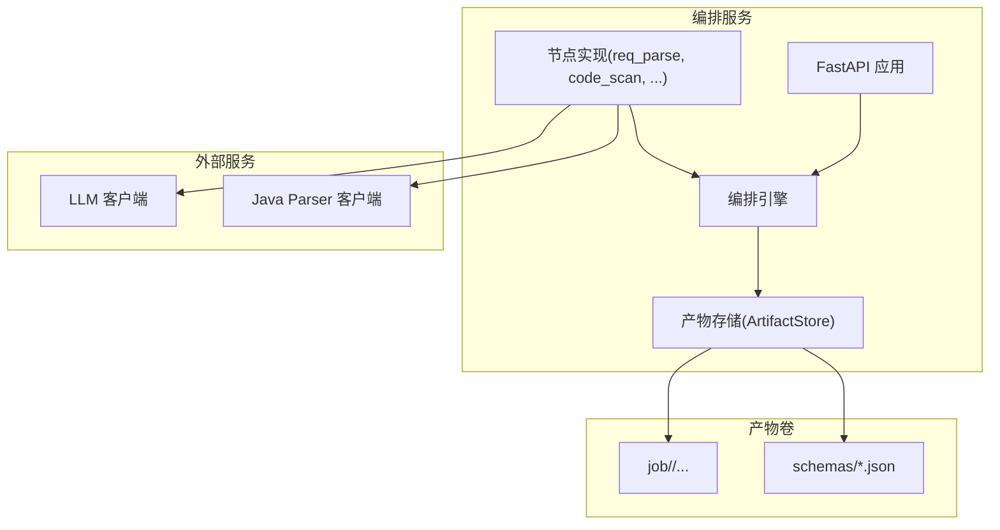
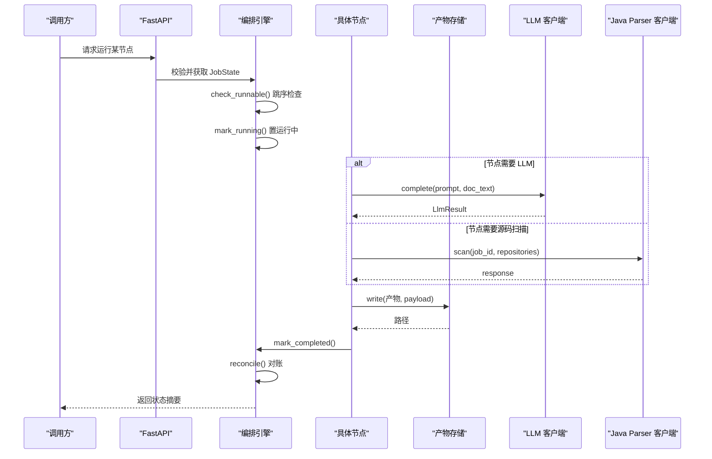
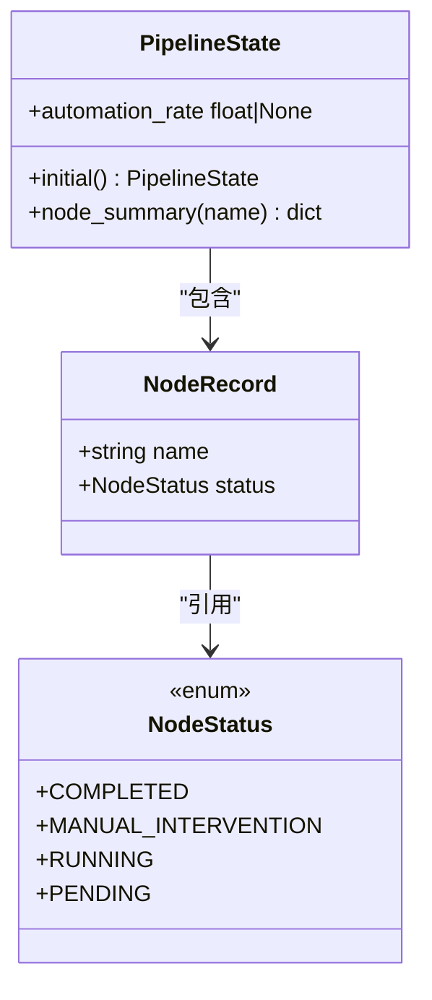
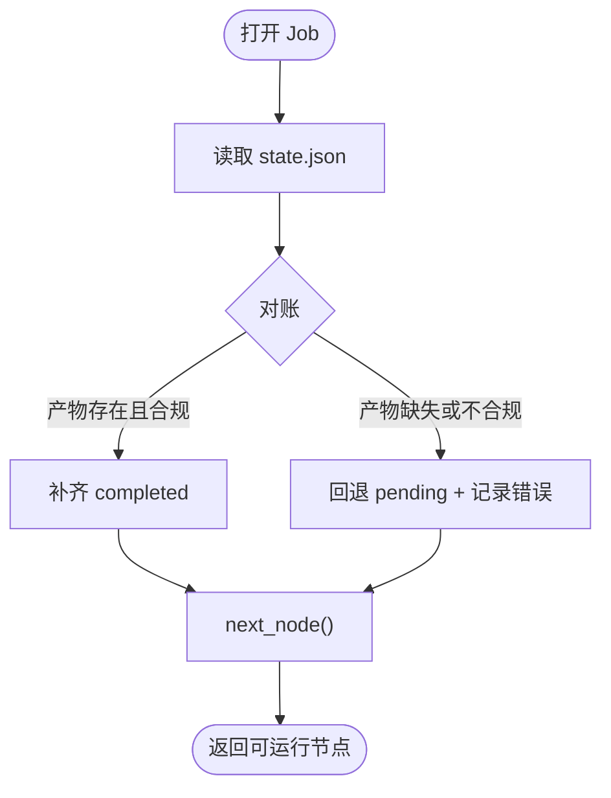
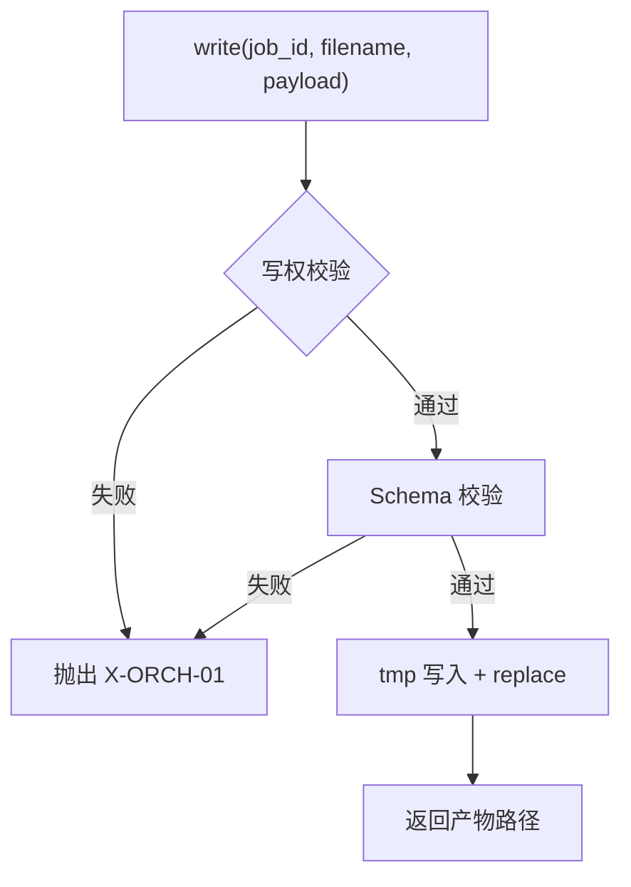
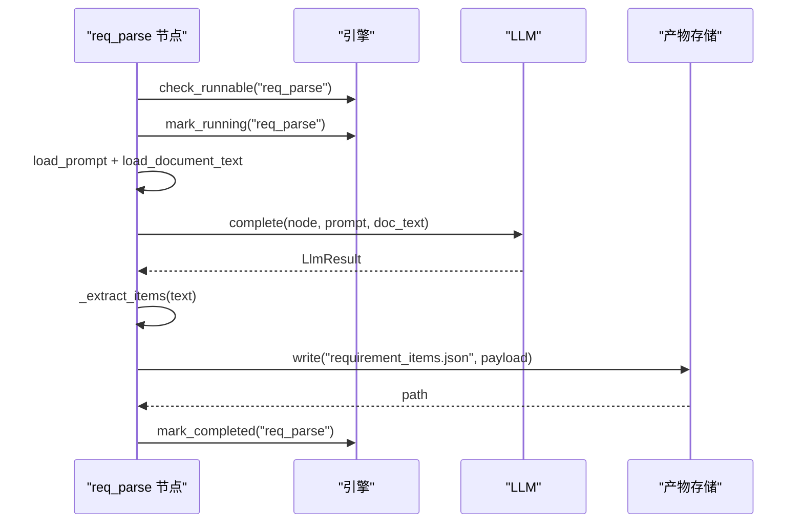
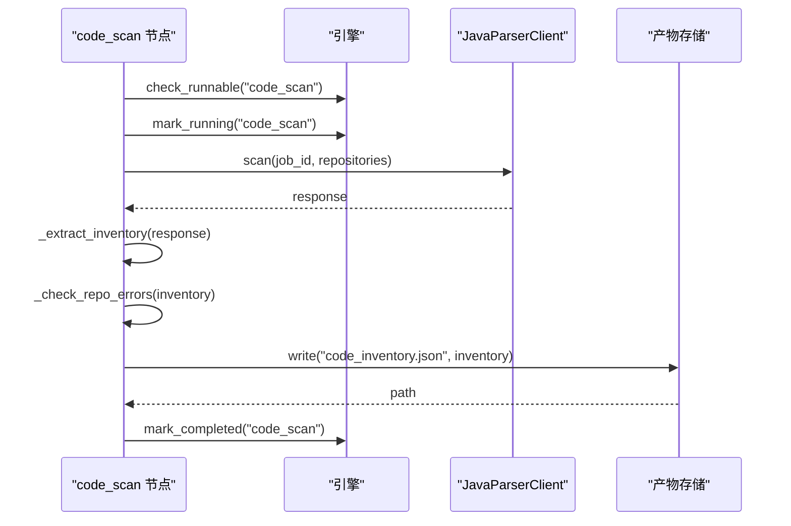
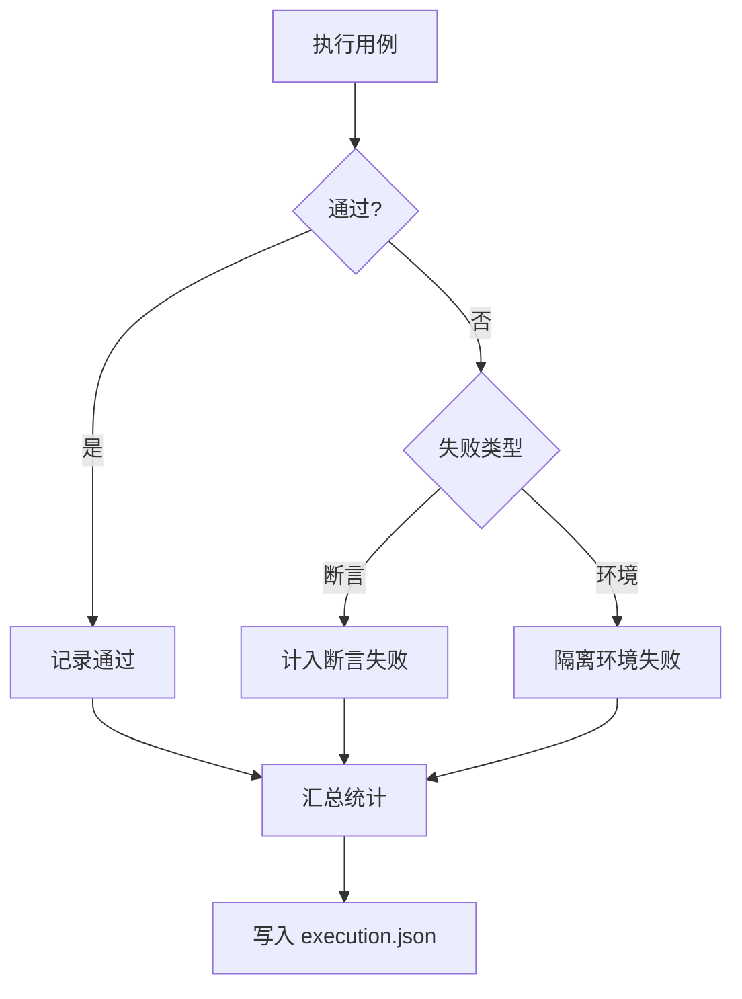
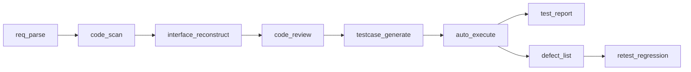

# 流水线工作流

<cite>
**本文引用的文件**
- [pipeline.py](file://services/orchestrator/src/orchestrator/pipeline.py)
- [engine.py](file://services/orchestrator/src/orchestrator/engine.py)
- [api.py](file://services/orchestrator/src/orchestrator/api.py)
- [artifacts.py](file://services/orchestrator/src/orchestrator/artifacts.py)
- [errors.py](file://services/orchestrator/src/orchestrator/errors.py)
- [config.py](file://services/orchestrator/src/orchestrator/config.py)
- [req_parse.py](file://services/orchestrator/src/orchestrator/nodes/req_parse.py)
- [code_scan.py](file://services/orchestrator/src/orchestrator/nodes/code_scan.py)
- [result.py](file://services/test-executor/src/executor/result.py)
- [execution.json](file://schemas/execution.json)
- [testcases.json](file://schemas/testcases.json)
- [defects.json](file://schemas/defects.json)
</cite>

## 目录
1. [简介](#简介)
2. [项目结构](#项目结构)
3. [核心组件](#核心组件)
4. [架构总览](#架构总览)
5. [详细组件分析](#详细组件分析)
6. [依赖关系分析](#依赖关系分析)
7. [性能考量](#性能考量)
8. [故障排查指南](#故障排查指南)
9. [结论](#结论)
10. [附录](#附录)

## 简介
本文件为 LLM-AutoTest 的流水线工作流提供系统化文档，围绕 9 个固定节点（需求解析、代码扫描、接口还原、代码审查、用例生成、自动执行、测试报告、缺陷管理、回归测试）展开，说明每个节点的输入输出、处理逻辑与错误处理机制；梳理节点间依赖与数据流转；解释断点续跑原理与使用方法；并提供流程图与时序图帮助理解完整执行过程。同时给出常见问题排查方法与性能优化建议。

## 项目结构
- 编排服务 orchestrator：负责流水线状态管理、节点调度、产物校验与持久化、对外 API。
- 测试执行器 test-executor：负责用例执行与结果落盘（执行侧产物由该服务写入）。
- Java 解析器 java-parser：提供源码扫描能力（通过客户端调用）。
- schemas：定义所有结构化产物的 JSON Schema，作为跨模块契约与校验依据。
- prompts/doc_loader：加载提示词与需求文档，供 LLM 节点使用。

图表来源
- [api.py:11-27](file://services/orchestrator/src/orchestrator/api.py#L11-L27)
- [engine.py:133-302](file://services/orchestrator/src/orchestrator/engine.py#L133-L302)
- [artifacts.py:55-157](file://services/orchestrator/src/orchestrator/artifacts.py#L55-L157)

章节来源
- [api.py:11-27](file://services/orchestrator/src/orchestrator/api.py#L11-L27)
- [engine.py:133-302](file://services/orchestrator/src/orchestrator/engine.py#L133-L302)
- [artifacts.py:55-157](file://services/orchestrator/src/orchestrator/artifacts.py#L55-L157)

## 核心组件
- 节点顺序与状态：固定 9 节点顺序与四态标注（待运行、运行中、已完成、人工介入），自动化率按“已完成/9”计算。
- 编排引擎：负责 job 生命周期、断点续跑对账、跳序防护、完成判定、降级记录等。
- 产物存储：统一读写产物，基于 Schema 校验，维护写权隔离与完成判据。
- 错误体系：统一错误码与结构，贯穿各节点与引擎。
- 配置：全部来自环境变量，避免硬编码。

章节来源
- [pipeline.py:11-84](file://services/orchestrator/src/orchestrator/pipeline.py#L11-L84)
- [engine.py:22-131](file://services/orchestrator/src/orchestrator/engine.py#L22-L131)
- [artifacts.py:22-50](file://services/orchestrator/src/orchestrator/artifacts.py#L22-L50)
- [errors.py:1-39](file://services/orchestrator/src/orchestrator/errors.py#L1-39)
- [config.py:9-56](file://services/orchestrator/src/orchestrator/config.py#L9-L56)

## 架构总览
下图展示从 API 到节点执行的端到端流程，以及产物与状态文件的交互。

图表来源
- [api.py:11-27](file://services/orchestrator/src/orchestrator/api.py#L11-L27)
- [engine.py:140-265](file://services/orchestrator/src/orchestrator/engine.py#L140-L265)
- [artifacts.py:75-131](file://services/orchestrator/src/orchestrator/artifacts.py#L75-L131)
- [req_parse.py:33-78](file://services/orchestrator/src/orchestrator/nodes/req_parse.py#L33-L78)
- [code_scan.py:26-49](file://services/orchestrator/src/orchestrator/nodes/code_scan.py#L26-L49)

## 详细组件分析

### 节点清单与状态模型
- 9 节点固定顺序：req_parse → code_scan → interface_reconstruct → code_review → testcase_generate → auto_execute → test_report → defect_list → retest_regression。
- 节点四态：PENDING、RUNNING、COMPLETED、MANUAL_INTERVENTION。
- 自动化率：completed / 9（无实测时返回 None）。

图表来源
- [pipeline.py:11-84](file://services/orchestrator/src/orchestrator/pipeline.py#L11-L84)

章节来源
- [pipeline.py:11-84](file://services/orchestrator/src/orchestrator/pipeline.py#L11-L84)

### 编排引擎与断点续跑
- 产物即事实：state.json 仅缓存状态，每次打开 job 都会以产物为准进行对账（reconcile）。
- 断点续跑：open_job 会读取 state.json，执行 reconcile，并增加 resumed 计数。
- 跳序防护：请求运行某节点前，其前序节点必须全部 completed（或 manual_intervention 视为已处理）。
- 完成判定：mark_completed 会严格校验对应产物是否满足完成条件。
- 降级：mark_degraded 将节点置为 manual_intervention 并记录原因。

图表来源
- [engine.py:153-194](file://services/orchestrator/src/orchestrator/engine.py#L153-L194)
- [engine.py:161-180](file://services/orchestrator/src/orchestrator/engine.py#L161-L180)

章节来源
- [engine.py:140-265](file://services/orchestrator/src/orchestrator/engine.py#L140-L265)

### 产物存储与 Schema 校验
- 产物目录布局：job/<job_id>/ 下存放 9 个产物、state.json 及 scripts/fixtures/logs/archive 等子目录。
- 写权隔离：orchestrator 与 test-executor 各自拥有指定产物的写权，防止并发冲突。
- 完成判据：JSON 产物需通过对应 Schema 校验；Markdown 产物仅需非空存在。
- 归档：重跑前可将旧产物归档至 archive，禁止原地覆盖。

图表来源
- [artifacts.py:75-96](file://services/orchestrator/src/orchestrator/artifacts.py#L75-L96)
- [artifacts.py:120-131](file://services/orchestrator/src/orchestrator/artifacts.py#L120-L131)
- [artifacts.py:133-142](file://services/orchestrator/src/orchestrator/artifacts.py#L133-L142)

章节来源
- [artifacts.py:22-50](file://services/orchestrator/src/orchestrator/artifacts.py#L22-L50)
- [artifacts.py:75-157](file://services/orchestrator/src/orchestrator/artifacts.py#L75-L157)

### 节点一：需求解析（req_parse）
- 输入：需求文档文本（通过 doc_loader 加载）、提示词（prompts 目录）。
- 处理：调用 LLM 完成，提取 items 数组，构造 payload 并通过 Schema 校验后落盘 requirement_items.json。
- 输出：requirement_items.json。
- 错误处理：
  - Prompt 缺失/元信息不合规：X-LLM-03（人工介入）。
  - LLM 网络/超时：X-LLM-01（客户端重试）。
  - LLM 输出不可解析或未过 Schema：X-LLM-02（不重试，人工介入）。
  - 其他异常经 engine.mark_failed 记录后抛出。

图表来源
- [req_parse.py:33-78](file://services/orchestrator/src/orchestrator/nodes/req_parse.py#L33-L78)
- [req_parse.py:81-125](file://services/orchestrator/src/orchestrator/nodes/req_parse.py#L81-L125)

章节来源
- [req_parse.py:1-125](file://services/orchestrator/src/orchestrator/nodes/req_parse.py#L1-L125)
- [errors.py:1-39](file://services/orchestrator/src/orchestrator/errors.py#L1-L39)

### 节点二：代码扫描（code_scan）
- 输入：仓库列表（RepositoryInput）。
- 处理：调用 Java Parser 客户端扫描，提取 code_inventory，校验仓库级错误，落盘 code_inventory.json。
- 输出：code_inventory.json。
- 错误处理：
  - 仓库 error：X-CODE-01（节点失败）。
  - empty/truncated：正常态，如实落盘。
  - 通信失败：X-ORCH-03。

图表来源
- [code_scan.py:26-49](file://services/orchestrator/src/orchestrator/nodes/code_scan.py#L26-L49)
- [code_scan.py:52-94](file://services/orchestrator/src/orchestrator/nodes/code_scan.py#L52-L94)

章节来源
- [code_scan.py:1-94](file://services/orchestrator/src/orchestrator/nodes/code_scan.py#L1-L94)

### 节点三：接口还原（interface_reconstruct）
- 输入：接口候选与契约信息（上游产出）。
- 处理：结合静态分析与 LLM 补全，生成 interfaces.json 与 interface_candidates.json。
- 输出：interfaces.json、interface_candidates.json（两者均需合规）。
- 完成判据：两份产物均存在且通过 Schema 校验。

章节来源
- [engine.py:24-35](file://services/orchestrator/src/orchestrator/engine.py#L24-L35)
- [artifacts.py:22-50](file://services/orchestrator/src/orchestrator/artifacts.py#L22-L50)

### 节点四：代码审查（code_review）
- 输入：代码与接口映射上下文。
- 处理：生成 review_mapping.json（含映射、风险、遗漏视图）。
- 输出：review_mapping.json。
- 完成判据：产物存在且通过 Schema 校验。

章节来源
- [engine.py:24-35](file://services/orchestrator/src/orchestrator/engine.py#L24-L35)
- [artifacts.py:22-50](file://services/orchestrator/src/orchestrator/artifacts.py#L22-L50)

### 节点五：用例生成（testcase_generate）
- 输入：接口规范与需求条目。
- 处理：生成用例与脚本元数据，确保每接口三类用例（normal/boundary/exception）至少各一条。
- 输出：testcases.json。
- 完成判据：产物存在且通过 Schema 校验。

章节来源
- [engine.py:24-35](file://services/orchestrator/src/orchestrator/engine.py#L24-L35)
- [testcases.json:1-35](file://schemas/testcases.json#L1-L35)

### 节点六：自动执行（auto_execute）
- 输入：testcases.json 与执行环境。
- 处理：执行用例，区分断言失败与环境失败，汇总统计。
- 输出：execution.json（包含 results 与 summary）。
- 完成判据：产物存在且通过 Schema 校验。

图表来源
- [result.py:10-61](file://services/test-executor/src/executor/result.py#L10-L61)
- [execution.json:1-59](file://schemas/execution.json#L1-L59)

章节来源
- [result.py:1-61](file://services/test-executor/src/executor/result.py#L1-L61)
- [execution.json:1-59](file://schemas/execution.json#L1-L59)

### 节点七：测试报告（test_report）
- 输入：execution.json 与相关产物。
- 处理：生成 Markdown 测试报告。
- 输出：test_report.md（仅存在性判据）。
- 完成判据：文件存在且非空。

章节来源
- [engine.py:24-35](file://services/orchestrator/src/orchestrator/engine.py#L24-L35)
- [artifacts.py:120-131](file://services/orchestrator/src/orchestrator/artifacts.py#L120-L131)

### 节点八：缺陷管理（defect_list）
- 输入：execution.json 中的断言失败项。
- 处理：生成 defects.json，仅断言失败进入缺陷清单；环境失败隔离待确认。
- 输出：defects.json。
- 完成判据：产物存在且通过 Schema 校验。

章节来源
- [defects.json:1-54](file://schemas/defects.json#L1-L54)
- [engine.py:24-35](file://services/orchestrator/src/orchestrator/engine.py#L24-L35)

### 节点九：回归测试（retest_regression）
- 输入：缺陷历史与回归资产索引。
- 处理：生成 regression_index.json，用于后续回归范围选择与复测跟踪。
- 输出：regression_index.json。
- 完成判据：产物存在且通过 Schema 校验。

章节来源
- [engine.py:24-35](file://services/orchestrator/src/orchestrator/engine.py#L24-L35)

## 依赖关系分析
- 节点顺序依赖：严格按 NODE_ORDER 顺序推进，前序未完成则阻塞后续（跳序防护）。
- 产物依赖：每个节点依赖上游产物，完成判据由 Engine 根据 NODE_ARTIFACTS 校验。
- 写权依赖：orchestrator 与 test-executor 分别负责不同产物的写入，避免冲突。
- 外部依赖：LLM 与 Java Parser 通过客户端调用，失败按约定错误码上报。

图表来源
- [pipeline.py:23-34](file://services/orchestrator/src/orchestrator/pipeline.py#L23-L34)
- [engine.py:24-35](file://services/orchestrator/src/orchestrator/engine.py#L24-L35)

章节来源
- [pipeline.py:23-34](file://services/orchestrator/src/orchestrator/pipeline.py#L23-L34)
- [engine.py:24-35](file://services/orchestrator/src/orchestrator/engine.py#L24-L35)

## 性能考量
- 并行与批处理：在安全边界内，可对多仓库扫描或多接口用例生成进行批处理，减少 I/O 次数。
- 产物校验成本：Schema 校验在写入时触发，建议批量构建 payload 后再单次写入，降低重复校验开销。
- LLM 调用优化：合理设置温度、top_p、seed 与超时，避免过长响应导致超时；必要时启用客户端重试。
- 存储 I/O：使用原子写入（tmp+replace）避免部分写入导致的读不一致；归档旧产物减少磁盘碎片。
- 监控与度量：通过 metrics.json 与自动化率指标持续观察瓶颈节点。

[本节为通用指导，不直接分析具体文件]

## 故障排查指南
- 常见错误码与含义：
  - X-LLM-01：LLM 调用超时/网络失败（可重试）。
  - X-LLM-02：LLM 输出未过 Schema 校验（不重试，人工介入）。
  - X-LLM-03：Prompt 缺失/元信息不合规（配置错误，人工介入）。
  - X-ORCH-01：产物校验失败（结构不符或写权冲突）。
  - X-ORCH-02：断点续跑跳序请求（前序未完成）。
  - X-ORCH-03：java-parser 服务不可达/通信失败。
- 排查步骤：
  - 查看 state.json 中对应节点的 error 字段，定位最近一次失败详情。
  - 检查 artifacts/job/<job_id>/ 下产物是否存在且通过 Schema 校验。
  - 核对环境变量配置（端口、LLM 参数、java_parser_url、artifacts_root、schemas_dir）。
  - 若为 LLM 问题，检查网络连通性与超时配置；若为 Schema 问题，调整输出结构。
  - 若为跳序错误，先完成前序节点再重试。

章节来源
- [errors.py:1-39](file://services/orchestrator/src/orchestrator/errors.py#L1-L39)
- [engine.py:196-220](file://services/orchestrator/src/orchestrator/engine.py#L196-L220)
- [config.py:35-56](file://services/orchestrator/src/orchestrator/config.py#L35-L56)

## 结论
本流水线以“产物即事实”为核心原则，通过严格的 Schema 校验与状态对账，确保 9 个节点的可观测、可恢复与可审计。编排引擎提供断点续跑与跳序防护，错误体系统一归口，便于快速定位与修复。配合清晰的产物契约与写权隔离，系统具备良好的扩展性与稳定性。

## 附录

### 断点续跑：原理与使用方法
- 原理：
  - open_job 读取 state.json 并对账，以产物为准修正状态（补齐 completed 或回退 pending）。
  - 对账过程中记录 resumed 计数，便于追踪续跑次数。
  - next_node 跳过已完成与人工介入节点，继续推进后续节点。
- 使用方法：
  - 首次运行：init_job 创建 job 并写入初始 state.json。
  - 中断后恢复：open_job 打开已有 job，执行 reconcile，然后继续运行 next_node。
  - 强制重跑：可先归档旧产物（archive），再重新触发目标节点（遵循写权与 Schema 约束）。

章节来源
- [engine.py:140-194](file://services/orchestrator/src/orchestrator/engine.py#L140-L194)
- [artifacts.py:133-142](file://services/orchestrator/src/orchestrator/artifacts.py#L133-L142)

### 关键数据模型与接口规范（节选）
- 执行结果（execution.json）：
  - 必需字段：schema_version、job_id、results、summary。
  - results 每项包含 case_id、interface_id、passed、timestamp 等；failure_kind 支持 assertion/environment/null。
  - summary 程序化汇总 total、passed、failed_assertion、failed_environment。
- 用例与脚本元数据（testcases.json）：
  - 必需字段：schema_version、job_id、cases。
  - cases 每项包含 id、interface_id、category、title、expected、script_path、loadable 等。
- 缺陷记录（defects.json）：
  - 必需字段：schema_version、job_id、defects。
  - defects 每项包含 id、case_id、interface_id、failure_reason、reproduce、status、history、is_fallback 等。

章节来源
- [execution.json:1-59](file://schemas/execution.json#L1-L59)
- [testcases.json:1-35](file://schemas/testcases.json#L1-L35)
- [defects.json:1-54](file://schemas/defects.json#L1-L54)