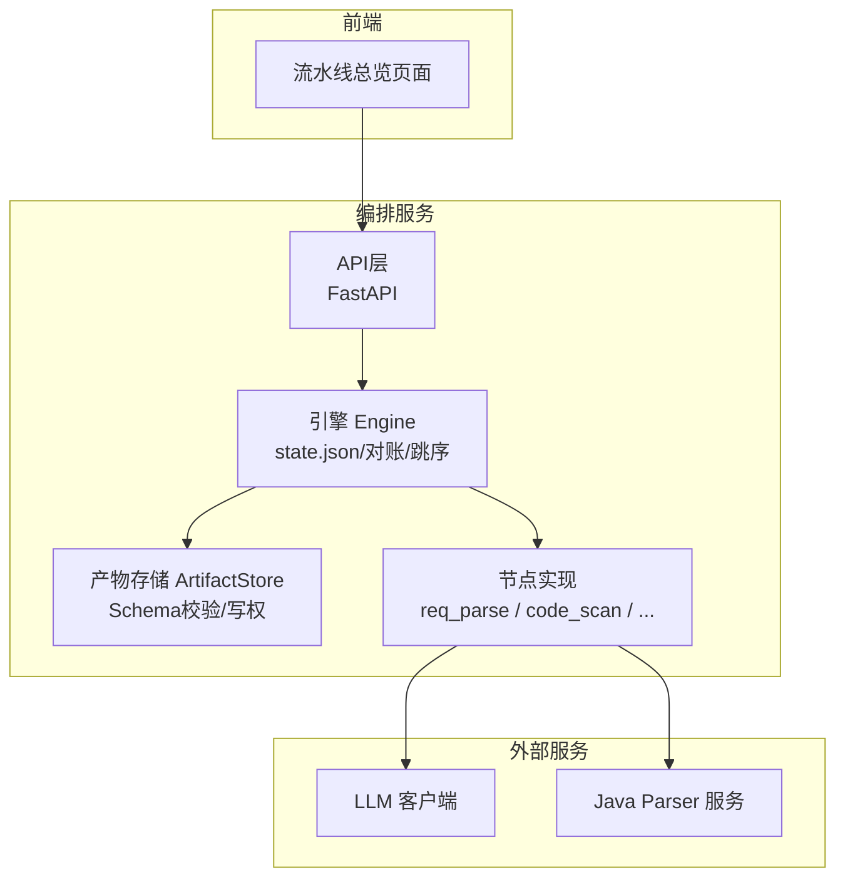
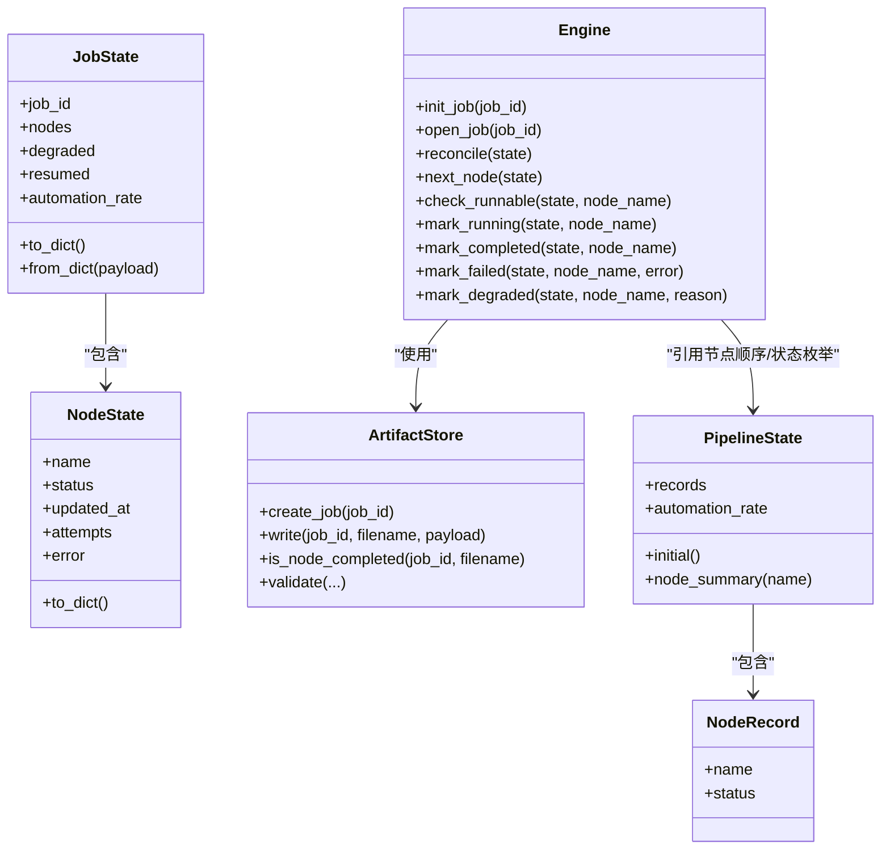
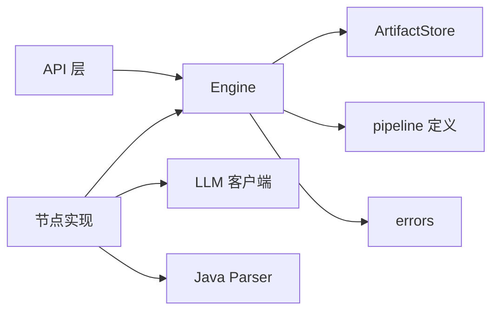
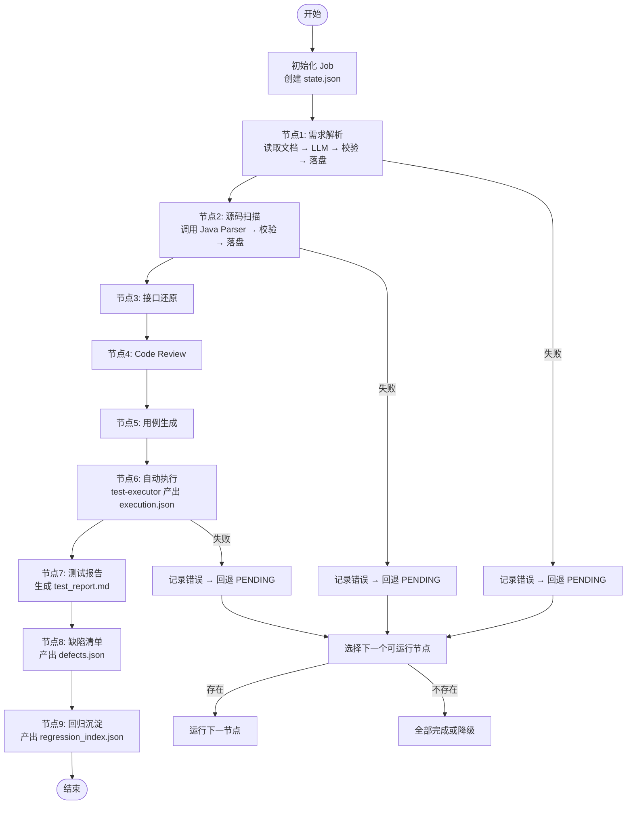

# 流水线概览

<cite>
**本文引用的文件**
- [pipeline.py](file://services/orchestrator/src/orchestrator/pipeline.py)
- [engine.py](file://services/orchestrator/src/orchestrator/engine.py)
- [artifacts.py](file://services/orchestrator/src/orchestrator/artifacts.py)
- [errors.py](file://services/orchestrator/src/orchestrator/errors.py)
- [api.py](file://services/orchestrator/src/orchestrator/api.py)
- [__main__.py](file://services/orchestrator/src/orchestrator/__main__.py)
- [config.py](file://services/orchestrator/src/orchestrator/config.py)
- [req_parse.py](file://services/orchestrator/src/orchestrator/nodes/req_parse.py)
- [code_scan.py](file://services/orchestrator/src/orchestrator/nodes/code_scan.py)
- [result.py](file://services/test-executor/src/executor/result.py)
- [PipelineOverviewView.vue](file://services/frontend/src/views/PipelineOverviewView.vue)
</cite>

## 目录
1. [引言](#引言)
2. [项目结构](#项目结构)
3. [核心组件](#核心组件)
4. [架构总览](#架构总览)
5. [详细组件分析](#详细组件分析)
6. [依赖关系分析](#依赖关系分析)
7. [性能与可靠性](#性能与可靠性)
8. [故障排查指南](#故障排查指南)
9. [结论](#结论)
10. [附录：完整处理链路流程图](#附录完整处理链路流程图)

## 引言
本文件面向 LLM-AutoTest 的“流水线概览”，聚焦 orchestrator（编排服务）如何以固定 9 节点顺序驱动从需求解析到回归沉淀的全流程，并解释四态标注、状态持久化、断点续跑、自动化率计算与监控展示。读者可据此理解流水线启动、执行、监控与异常恢复的整体机制。

## 项目结构
- 编排服务 orchestrator：定义 9 节点顺序、状态模型、产物校验、state.json 持久化、断点续跑与跳序防护，并提供 REST API。
- 测试执行器 test-executor：产出执行侧产物（如 execution.json），并区分“断言失败”和“环境失败”。
- 前端 frontend：可视化 job 列表、9 节点状态与自动化率，数值由后端提供。
- 配置 config：通过环境变量注入运行参数，避免硬编码。

图表来源
- [api.py:11-27](file://services/orchestrator/src/orchestrator/api.py#L11-L27)
- [engine.py:133-302](file://services/orchestrator/src/orchestrator/engine.py#L133-L302)
- [artifacts.py:55-157](file://services/orchestrator/src/orchestrator/artifacts.py#L55-L157)
- [req_parse.py:33-79](file://services/orchestrator/src/orchestrator/nodes/req_parse.py#L33-L79)
- [code_scan.py:26-49](file://services/orchestrator/src/orchestrator/nodes/code_scan.py#L26-L49)

章节来源
- [api.py:11-27](file://services/orchestrator/src/orchestrator/api.py#L11-L27)
- [__main__.py:15-25](file://services/orchestrator/src/orchestrator/__main__.py#L15-L25)
- [config.py:9-56](file://services/orchestrator/src/orchestrator/config.py#L9-L56)

## 核心组件
- 9 节点固定口径与四态标注：
  - 节点顺序固定为 9 个：需求解析、源码扫描、接口还原、Code Review、用例生成、自动执行、测试报告、缺陷清单、回归沉淀。
  - 四态：completed、manual_intervention、running、pending。降级节点按 manual_intervention 计入，分母固定为 9。
- PipelineState 与 NodeRecord：
  - PipelineState 维护 9 个 NodeRecord 的集合；NodeRecord 包含 name 与 status。
  - 自动化率 = completed 节点数 / 9；无实测时返回 None。
- JobState 与 NodeState（state.json 持久化）：
  - JobState 描述一次流水线的完整状态，包含 nodes、degraded、resumed 等字段。
  - NodeState 记录单节点的 status、updated_at、attempts、error。
- 产物存储 ArtifactStore：
  - 统一产物目录布局、写权排他、Schema 校验、完成判据（JSON 需过校验，Markdown 仅存在且非空）。
- 引擎 Engine：
  - 负责 state.json 的创建、加载、对账（reconcile）、next_node、check_runnable、mark_running/completed/failed/degraded、以及原子落盘。
- 节点实现：
  - req_parse：读取需求文档，调用 LLM，解析输出并写入 requirement_items.json。
  - code_scan：调用 java-parser 扫描仓库，校验响应并写入 code_inventory.json。
- 错误体系：
  - 统一 PipelineError 结构，含 code/message/node_id/details；禁止表外错误码。
- 前端展示：
  - 流水线总览页显示 job 列表、9 节点状态、自动化率与降级提示，数值来自后端。

章节来源
- [pipeline.py:11-83](file://services/orchestrator/src/orchestrator/pipeline.py#L11-L83)
- [engine.py:43-131](file://services/orchestrator/src/orchestrator/engine.py#L43-L131)
- [artifacts.py:22-50](file://services/orchestrator/src/orchestrator/artifacts.py#L22-L50)
- [artifacts.py:75-131](file://services/orchestrator/src/orchestrator/artifacts.py#L75-L131)
- [errors.py:1-39](file://services/orchestrator/src/orchestrator/errors.py#L1-39)
- [PipelineOverviewView.vue:1-88](file://services/frontend/src/views/PipelineOverviewView.vue#L1-L88)

## 架构总览
下图展示了 orchestrator 内部各模块与外部服务的交互关系，以及 state.json 作为“唯一事实”的核心地位。

图表来源
- [pipeline.py:37-83](file://services/orchestrator/src/orchestrator/pipeline.py#L37-L83)
- [engine.py:43-131](file://services/orchestrator/src/orchestrator/engine.py#L43-L131)
- [artifacts.py:55-157](file://services/orchestrator/src/orchestrator/artifacts.py#L55-L157)

## 详细组件分析

### 9 节点顺序与四态标注
- 固定顺序：req_parse → code_scan → interface_reconstruct → code_review → testcase_generate → auto_execute → test_report → defect_list → retest_regression。
- 四态：completed、manual_intervention、running、pending。
- 降级节点按 manual_intervention 计入，分母固定为 9，不缩减。

章节来源
- [pipeline.py:23-34](file://services/orchestrator/src/orchestrator/pipeline.py#L23-L34)
- [pipeline.py:11-21](file://services/orchestrator/src/orchestrator/pipeline.py#L11-L21)

### PipelineState 与 NodeRecord 数据结构
- NodeRecord：name 与 status 的不可变记录。
- PipelineState：维护 records 元组，提供 initial、node_summary、automation_rate。
- automation_rate：当有 completed 节点时返回 completed/9，否则返回 None。

章节来源
- [pipeline.py:37-70](file://services/orchestrator/src/orchestrator/pipeline.py#L37-L70)

### JobState、NodeState 与 state.json 持久化
- JobState：包含 job_id、created_at、updated_at、nodes、degraded、resumed；序列化/反序列化严格校验。
- NodeState：name、status、updated_at、attempts、error；用于 state.json 的 nodes 数组元素。
- 持久化路径：每个 job 目录下 state.json；Engine 负责原子写入（tmp+replace）。

章节来源
- [engine.py:43-96](file://services/orchestrator/src/orchestrator/engine.py#L43-L96)
- [engine.py:98-131](file://services/orchestrator/src/orchestrator/engine.py#L98-L131)
- [engine.py:267-302](file://services/orchestrator/src/orchestrator/engine.py#L267-L302)

### 自动化率计算逻辑
- 计算口径：completed 节点数 / 9。
- 数据来源：JobState.nodes 或 PipelineState.records。
- 无实测时返回 None，前端以“—”展示，避免误导。

章节来源
- [pipeline.py:61-70](file://services/orchestrator/src/orchestrator/pipeline.py#L61-L70)
- [engine.py:126-131](file://services/orchestrator/src/orchestrator/engine.py#L126-L131)
- [PipelineOverviewView.vue:19-22](file://services/frontend/src/views/PipelineOverviewView.vue#L19-L22)

### 产物校验与完成判据
- 产物清单与写权：orchestrator 与 test-executor 分工明确，防止并发写冲突。
- 完成判据：JSON 产物必须存在且通过 Schema 校验；Markdown 产物仅需存在且非空。
- is_node_completed：统一判定入口，供 reconcile 与 mark_completed 使用。

章节来源
- [artifacts.py:22-50](file://services/orchestrator/src/orchestrator/artifacts.py#L22-L50)
- [artifacts.py:75-131](file://services/orchestrator/src/orchestrator/artifacts.py#L75-L131)

### 断点续跑与对账（reconcile）
- open_job：加载 state.json 后执行 reconcile，修正状态与产物不一致的情况，并增加 resumed 计数。
- reconcile：若产物合规则标记 completed；若状态为 completed 但产物失效则回退 pending 并记录错误。
- next_node：跳过 completed 与 manual_intervention，继续推进后续节点。

章节来源
- [engine.py:153-194](file://services/orchestrator/src/orchestrator/engine.py#L153-L194)

### 跳序防护
- check_runnable：请求运行某节点前，检查其所有前序节点是否已完成或已降级；否则抛出 X-ORCH-02。
- 目的：保证流水线顺序正确性，防止乱序执行导致产物不完整。

章节来源
- [engine.py:196-219](file://services/orchestrator/src/orchestrator/engine.py#L196-L219)

### 节点执行示例：req_parse
- 流程：check_runnable → mark_running → 加载 prompt → 读取需求文档 → 调用 LLM → 提取 items → 写入 requirement_items.json → mark_completed。
- 失败处理：捕获 PipelineError 并调用 mark_failed 记录错误，再向上抛出。

章节来源
- [req_parse.py:33-79](file://services/orchestrator/src/orchestrator/nodes/req_parse.py#L33-L79)

### 节点执行示例：code_scan
- 流程：check_runnable → mark_running → 调用 Java Parser 扫描 → 提取 inventory → 检查仓库错误 → 写入 code_inventory.json → mark_completed。
- 仓库四态：error（节点失败）、empty/truncated（正常态如实落盘）、ok。

章节来源
- [code_scan.py:26-49](file://services/orchestrator/src/orchestrator/nodes/code_scan.py#L26-L49)
- [code_scan.py:78-94](file://services/orchestrator/src/orchestrator/nodes/code_scan.py#L78-L94)

### 执行结果二态（测试执行器）
- CaseResult：case_id、passed、failure_kind（assertion/environment）。
- ExecutionSummary：汇总 total、passed、failed_assertion、failed_environment，用于度量与报告。

章节来源
- [result.py:10-61](file://services/test-executor/src/executor/result.py#L10-L61)

### 服务启动与监控
- 启动：__main__.py 读取配置并启动 FastAPI 应用。
- 健康检查：/health 返回 ok。
- 节点清单：/api/v1/pipeline/nodes 返回 9 节点及当前状态（骨架阶段全部 pending）。

章节来源
- [__main__.py:15-25](file://services/orchestrator/src/orchestrator/__main__.py#L15-L25)
- [api.py:11-27](file://services/orchestrator/src/orchestrator/api.py#L11-L27)
- [config.py:9-56](file://services/orchestrator/src/orchestrator/config.py#L9-L56)

## 依赖关系分析
- orchestrator 依赖：
  - artifacts：产物卷访问、Schema 校验、完成判据。
  - errors：统一错误结构与错误码。
  - pipeline：节点顺序与状态枚举。
  - nodes：具体节点实现（req_parse、code_scan 等）。
  - api：REST 接口暴露。
- 外部依赖：
  - LLM 客户端：用于需求解析等节点。
  - Java Parser：用于代码扫描与接口还原。

图表来源
- [api.py:11-27](file://services/orchestrator/src/orchestrator/api.py#L11-L27)
- [engine.py:133-302](file://services/orchestrator/src/orchestrator/engine.py#L133-L302)
- [artifacts.py:55-157](file://services/orchestrator/src/orchestrator/artifacts.py#L55-L157)
- [errors.py:1-39](file://services/orchestrator/src/orchestrator/errors.py#L1-39)
- [req_parse.py:33-79](file://services/orchestrator/src/orchestrator/nodes/req_parse.py#L33-L79)
- [code_scan.py:26-49](file://services/orchestrator/src/orchestrator/nodes/code_scan.py#L26-L49)

章节来源
- [engine.py:133-302](file://services/orchestrator/src/orchestrator/engine.py#L133-L302)
- [artifacts.py:55-157](file://services/orchestrator/src/orchestrator/artifacts.py#L55-L157)
- [errors.py:1-39](file://services/orchestrator/src/orchestrator/errors.py#L1-L39)

## 性能与可靠性
- 原子落盘：state.json 与产物写入均采用 tmp+replace，避免部分写入导致的损坏。
- 对账机制：每次 open_job 都会以产物为准校正状态，确保“产物是唯一事实”。
- 写权排他：不同服务对产物的写权限隔离，避免并发写冲突。
- 超时与重试：LLM 调用支持超时配置；网络/超时错误归类为可重试错误码。
- 降级策略：节点失败可降级为 manual_intervention，流程继续推进，并在 degraded 清单中记录原因。

[本节为通用指导，不直接分析具体文件]

## 故障排查指南
- 常见错误码：
  - X-LLM-01：LLM 调用超时/网络失败（可重试）。
  - X-LLM-02：LLM 输出未过 Schema 校验（不重试，人工介入）。
  - X-LLM-03：Prompt 缺失/元信息不合规（配置错误，人工介入）。
  - X-ORCH-01：产物校验失败或 state.json 结构不合规。
  - X-ORCH-02：断点续跑跳序请求（前序未完成）。
  - X-ORCH-03：java-parser 服务不可达/通信失败。
- 排查步骤：
  - 查看 state.json 中对应节点的 error 字段，定位最近一次失败详情。
  - 检查产物是否存在并通过 Schema 校验（is_node_completed）。
  - 确认前序节点是否已完成或已降级（check_runnable）。
  - 核对环境变量配置（端口、LLM 参数、java_parser_url、schemas_dir 等）。

章节来源
- [errors.py:8-39](file://services/orchestrator/src/orchestrator/errors.py#L8-L39)
- [engine.py:196-219](file://services/orchestrator/src/orchestrator/engine.py#L196-L219)
- [artifacts.py:75-131](file://services/orchestrator/src/orchestrator/artifacts.py#L75-L131)
- [config.py:35-56](file://services/orchestrator/src/orchestrator/config.py#L35-L56)

## 结论
LLM-AutoTest 的流水线以固定 9 节点顺序与四态标注为核心，结合 state.json 持久化与产物校验，实现了可靠的编排与断点续跑能力。自动化率以程序化方式汇总，前端直观展示。通过写权排他与对账机制，系统在高并发与异常场景下仍保持数据一致性与可观测性。

[本节为总结性内容，不直接分析具体文件]

## 附录：完整处理链路流程图
以下流程图展示从需求解析到回归沉淀的端到端链路，包括关键分支与异常处理。

图表来源
- [engine.py:153-194](file://services/orchestrator/src/orchestrator/engine.py#L153-L194)
- [engine.py:221-261](file://services/orchestrator/src/orchestrator/engine.py#L221-L261)
- [req_parse.py:33-79](file://services/orchestrator/src/orchestrator/nodes/req_parse.py#L33-L79)
- [code_scan.py:26-49](file://services/orchestrator/src/orchestrator/nodes/code_scan.py#L26-L49)
- [artifacts.py:120-131](file://services/orchestrator/src/orchestrator/artifacts.py#L120-L131)