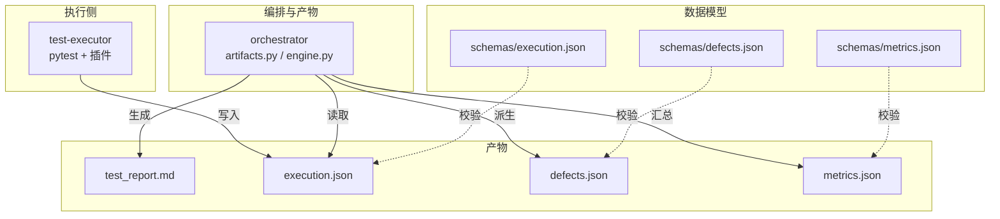
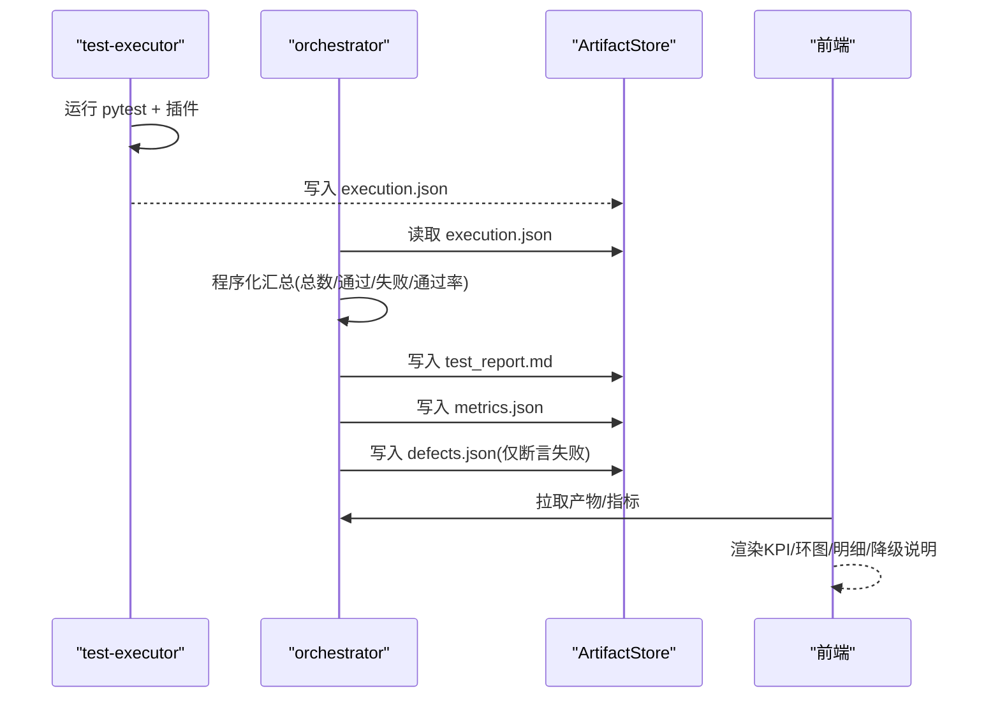
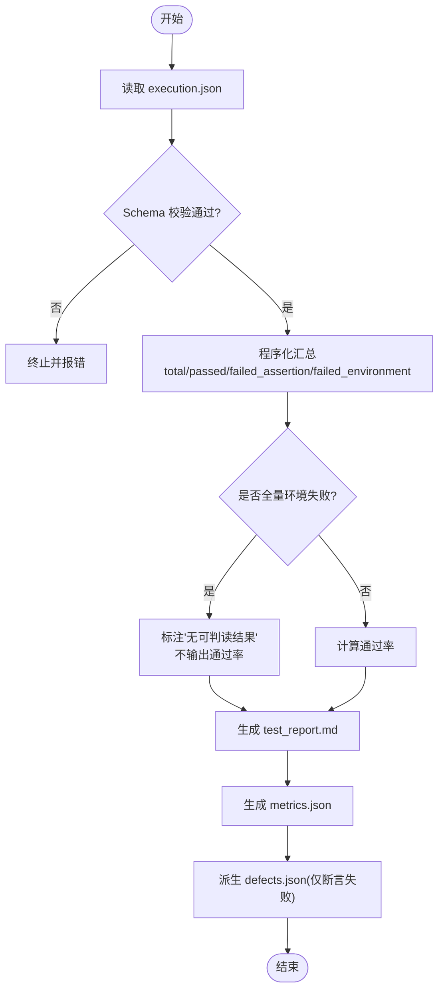
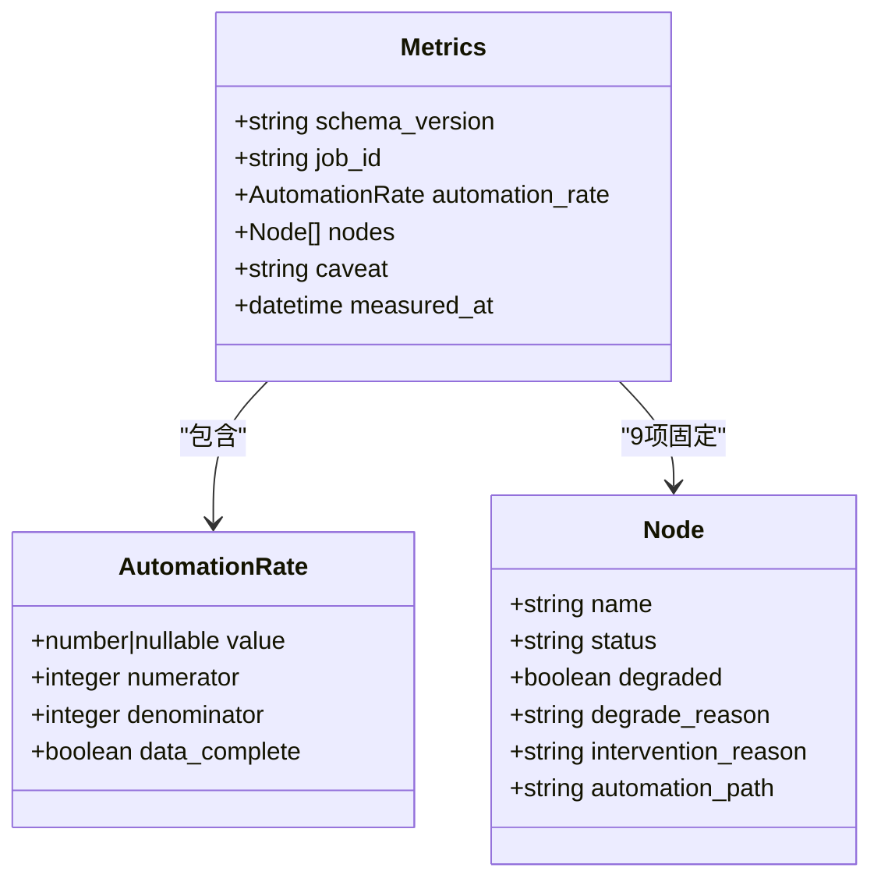
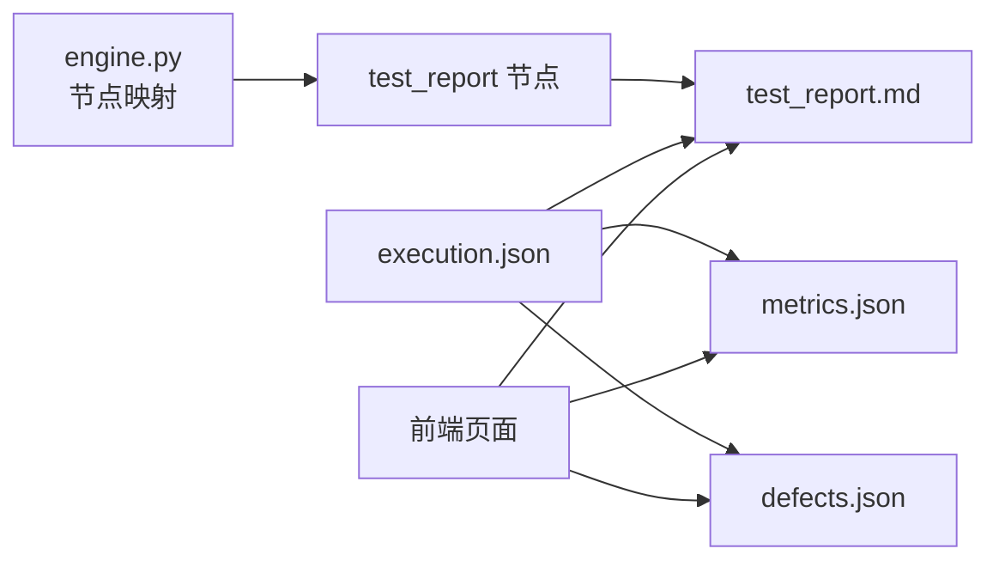

# 测试报告节点

<cite>
**本文引用的文件**
- [artifacts.py](file://services/orchestrator/src/orchestrator/artifacts.py)
- [engine.py](file://services/orchestrator/src/orchestrator/engine.py)
- [metrics.json](file://schemas/metrics.json)
- [execution.json](file://schemas/execution.json)
- [defects.json](file://schemas/defects.json)
- [execution.sample.json](file://schemas/samples/execution.sample.json)
- [07_UI演示设计.md](file://docs/07_UI演示设计.md)
- [04_功能规格说明.md](file://docs/04_功能规格说明.md)
- [10_测试框架选型说明.md](file://docs/10_测试框架选型说明.md)
- [jobs.ts](file://services/frontend/src/mock/jobs.ts)
</cite>

## 目录
1. [简介](#简介)
2. [项目结构](#项目结构)
3. [核心组件](#核心组件)
4. [架构总览](#架构总览)
5. [详细组件分析](#详细组件分析)
6. [依赖关系分析](#依赖关系分析)
7. [性能考虑](#性能考虑)
8. [故障排查指南](#故障排查指南)
9. [结论](#结论)
10. [附录](#附录)

## 简介
本章节面向“测试报告节点”，聚焦以下目标：
- 解释测试数据的汇总分析与报告生成算法，明确数据来源与计算口径。
- 详细说明 metrics.json 的指标定义与统计方法。
- 介绍报告模板的定制化和多格式输出支持（Markdown + JSON）。
- 解释可视化图表的生成与交互式报告展示的前后端约定。
- 提供报告数据的导出与集成接口建议。
- 给出报告性能优化与大文件处理策略。

该节点位于流水线第 7 个节点，承接自动执行结果，产出测试报告与度量数据，并驱动后续缺陷闭环与回归沉淀。

**章节来源**
- [07_UI演示设计.md:72-79](file://docs/07_UI演示设计.md#L72-L79)
- [04_功能规格说明.md:215-232](file://docs/04_功能规格说明.md#L215-L232)

## 项目结构
围绕测试报告节点的关键文件与职责如下：
- 产物管理与节点完成判定：orchestrator 的 artifacts.py 负责产物落盘、Schema 校验、写权排他与归档；test_report.md 作为 Markdown 报告产物由 orchestrator 写入。
- 节点映射与状态：engine.py 将“test_report”节点绑定到 test_report.md 产物，用于编排推进。
- 数据模型与约束：
  - execution.json：用例执行结果的统一 Schema，包含 results、summary、degraded_protocols。
  - defects.json：仅断言失败进入缺陷清单，环境失败隔离。
  - metrics.json：自动化率度量，固定分母为 9，数值程序化汇总。
- 前端展示约定：UI 文档定义了测试报告页的 KPI、协议分布环图、失败明细表、降级说明章节与双产物徽标。
- 执行侧实现要点：pytest 原始结果经 test-executor 服务程序化汇总为 execution.json，不经 LLM。

**图表来源**
- [artifacts.py:24-50](file://services/orchestrator/src/orchestrator/artifacts.py#L24-L50)
- [engine.py:29-35](file://services/orchestrator/src/orchestrator/engine.py#L29-L35)
- [execution.json:1-59](file://schemas/execution.json#L1-L59)
- [defects.json:1-54](file://schemas/defects.json#L1-L54)
- [metrics.json:1-49](file://schemas/metrics.json#L1-L49)

**章节来源**
- [artifacts.py:1-157](file://services/orchestrator/src/orchestrator/artifacts.py#L1-L157)
- [engine.py:29-72](file://services/orchestrator/src/orchestrator/engine.py#L29-L72)
- [execution.json:1-59](file://schemas/execution.json#L1-L59)
- [defects.json:1-54](file://schemas/defects.json#L1-L54)
- [metrics.json:1-49](file://schemas/metrics.json#L1-L49)

## 核心组件
- 产物管理器 ArtifactStore
  - 负责 job 目录创建、产物写入（带 Schema 校验）、只读读取、节点完成判定、旧产物归档。
  - 对 test_report.md 仅做存在性与非空判定；JSON 产物需通过对应 Schema 校验。
- 节点映射与状态
  - 将“test_report”节点映射到 test_report.md 产物，作为编排推进条件。
- 数据模型
  - execution.json：用例级结果与摘要，二态失败分类（断言失败/环境失败），降级协议记录。
  - defects.json：缺陷清单，仅断言失败入单，可审计生命周期。
  - metrics.json：自动化率度量，固定分母 9，数据不完整时 value 可为 null。
- 前端展示约定
  - 报告页 KPI、协议分布环图、失败明细表、降级说明章节、双产物徽标等。

**章节来源**
- [artifacts.py:55-157](file://services/orchestrator/src/orchestrator/artifacts.py#L55-L157)
- [engine.py:29-72](file://services/orchestrator/src/orchestrator/engine.py#L29-L72)
- [execution.json:1-59](file://schemas/execution.json#L1-L59)
- [defects.json:1-54](file://schemas/defects.json#L1-L54)
- [metrics.json:1-49](file://schemas/metrics.json#L1-L49)
- [07_UI演示设计.md:72-79](file://docs/07_UI演示设计.md#L72-L79)

## 架构总览
测试报告节点的端到端流程：
- 执行侧（test-executor）运行 pytest，收集原始结果并通过自定义插件标注失败类型，最终程序化汇总为 execution.json。
- 编排侧（orchestrator）读取 execution.json，依据 Schema 校验后生成 test_report.md 与 metrics.json，同时派生 defects.json。
- 前端按 UI 规范渲染报告页，展示 KPI、协议分布、失败明细与降级说明。

**图表来源**
- [10_测试框架选型说明.md:45-53](file://docs/10_测试框架选型说明.md#L45-L53)
- [artifacts.py:75-131](file://services/orchestrator/src/orchestrator/artifacts.py#L75-L131)
- [execution.json:1-59](file://schemas/execution.json#L1-L59)
- [metrics.json:1-49](file://schemas/metrics.json#L1-L49)
- [defects.json:1-54](file://schemas/defects.json#L1-L54)

## 详细组件分析

### 测试数据汇总与报告生成算法
- 数据来源与口径
  - 用例级结果来自 execution.json 的 results 数组，每条记录包含 case_id、interface_id、passed、failure_kind、duration_ms、timestamp 等。
  - 摘要 summary 包含 total、passed、failed_assertion、failed_environment，必要时含 interrupted。
  - 降级协议 degraded_protocols 显式记录 MQ 等协议的降级模式与原因。
- 汇总规则
  - 总数=results 长度；通过数=passed=true 的数量；断言失败数=failure_kind="assertion" 的数量；环境失败数=failure_kind="environment" 的数量。
  - 全量环境失败时，报告应标注“无可判读结果”，不输出通过率。
- 报告产物
  - Markdown 报告：面向人工阅读，包含 KPI、协议分布、失败明细、降级说明章节。
  - JSON 产物：供下游模块消费（如缺陷模块）。
- 节点完成判定
  - test_report.md 存在且非空即视为节点完成。

**图表来源**
- [execution.json:1-59](file://schemas/execution.json#L1-L59)
- [defects.json:1-54](file://schemas/defects.json#L1-L54)
- [artifacts.py:120-131](file://services/orchestrator/src/orchestrator/artifacts.py#L120-L131)
- [04_功能规格说明.md:215-232](file://docs/04_功能规格说明.md#L215-L232)

**章节来源**
- [execution.json:1-59](file://schemas/execution.json#L1-L59)
- [execution.sample.json:1-63](file://schemas/samples/execution.sample.json#L1-L63)
- [04_功能规格说明.md:215-232](file://docs/04_功能规格说明.md#L215-L232)
- [artifacts.py:120-131](file://services/orchestrator/src/orchestrator/artifacts.py#L120-L131)

### metrics.json 指标定义与统计方法
- 字段含义
  - schema_version：版本标识。
  - job_id：任务 ID。
  - automation_rate：自动化率对象，包含 value、numerator、denominator、data_complete。
    - denominator 固定为 9（九节点固定口径）。
    - value 可为 null（数据不完整时不输出误导数值）。
    - data_complete 表示数据完整性。
  - nodes：9 个节点的状态数组，每个节点包含 name、status、degraded、degrade_reason、intervention_reason、automation_path。
  - caveat：项目口径≠生产口径的声明。
  - measured_at：测量时间戳。
- 统计方法
  - 自动化率 = 无人工节点数 / 9。
  - 降级节点按“人工介入”计入分母，并在 degrade_reason 中注明原因。
  - 瓶颈分析通过 automation_path 字段提供可自动化路径建议。

**图表来源**
- [metrics.json:1-49](file://schemas/metrics.json#L1-L49)

**章节来源**
- [metrics.json:1-49](file://schemas/metrics.json#L1-L49)

### 报告模板定制与多格式输出
- 多格式输出
  - Markdown：面向人工阅读，包含 KPI、协议分布、失败明细、降级说明章节。
  - JSON：面向下游系统消费（如缺陷模块）。
- 模板定制点
  - KPI 文案与单位。
  - 协议分布维度（REST/gRPC/GraphQL/SOAP/MQ）。
  - 失败明细列（case_id、interface_id、failure_kind、failure_reason、duration_ms、timestamp）。
  - 降级说明章节（protocol、mode、reason）。
- 前端展示约定
  - 顶部 KPI、中区协议环图、底部降级说明章节、双产物徽标。

**章节来源**
- [07_UI演示设计.md:72-79](file://docs/07_UI演示设计.md#L72-L79)
- [04_功能规格说明.md:215-232](file://docs/04_功能规格说明.md#L215-L232)

### 可视化图表与交互式报告展示
- 图表类型
  - 协议分布环图：按 REST/gRPC/GraphQL/SOAP/MQ 统计用例数量或通过率。
  - 失败明细表：区分“断言失败”和“环境失败”。
- 交互约定
  - 点击失败条目可定位到用例脚本路径（reproduce.script_path）。
  - 支持按协议筛选、按失败类型筛选。
  - 前端不自行计算指标，数值来自后端汇总（避免前后端不一致）。

**章节来源**
- [07_UI演示设计.md:72-79](file://docs/07_UI演示设计.md#L72-L79)
- [defects.json:1-54](file://schemas/defects.json#L1-L54)
- [jobs.ts:1-46](file://services/frontend/src/mock/jobs.ts#L1-L46)

### 报告数据导出与集成接口
- 导出方式
  - 直接下载 test_report.md 与 execution.json、defects.json、metrics.json。
  - 通过 orchestrator API 获取产物内容（基于 artifacts.py 的读取能力）。
- 集成建议
  - CI/CD 阶段拉取产物并归档。
  - 质量门禁：当自动化率低于阈值或存在未关闭缺陷时阻断合并。
  - 与缺陷管理系统对接：当前为本地文件（D3 口径），可按需扩展。

**章节来源**
- [artifacts.py:114-131](file://services/orchestrator/src/orchestrator/artifacts.py#L114-L131)
- [04_功能规格说明.md:215-232](file://docs/04_功能规格说明.md#L215-L232)

## 依赖关系分析
- 编排依赖
  - engine.py 将“test_report”节点绑定到 test_report.md 产物，作为推进条件。
- 产物依赖
  - test_report.md 依赖 execution.json 的存在与正确性。
  - metrics.json 依赖 execution.json 与节点状态。
  - defects.json 依赖 execution.json 的断言失败结果。
- 前端依赖
  - 前端页面依赖 orchestrator 提供的产物与指标（mock 阶段使用 jobs.ts）。

**图表来源**
- [engine.py:29-35](file://services/orchestrator/src/orchestrator/engine.py#L29-L35)
- [execution.json:1-59](file://schemas/execution.json#L1-L59)
- [metrics.json:1-49](file://schemas/metrics.json#L1-L49)
- [defects.json:1-54](file://schemas/defects.json#L1-L54)
- [jobs.ts:1-46](file://services/frontend/src/mock/jobs.ts#L1-L46)

**章节来源**
- [engine.py:29-72](file://services/orchestrator/src/orchestrator/engine.py#L29-L72)
- [execution.json:1-59](file://schemas/execution.json#L1-L59)
- [metrics.json:1-49](file://schemas/metrics.json#L1-L49)
- [defects.json:1-54](file://schemas/defects.json#L1-L54)
- [jobs.ts:1-46](file://services/frontend/src/mock/jobs.ts#L1-L46)

## 性能考虑
- 大文件处理
  - 对 execution.json 采用流式读取与增量汇总，避免一次性加载全部结果导致内存峰值。
  - 对 test_report.md 生成采用分块写入，减少 I/O 抖动。
- 并行与缓存
  - 协议维度的统计可并行计算，结果缓存至中间变量。
  - 对重复查询的 summary 进行内存缓存，避免重复遍历 results。
- 资源限制
  - 设置超时与重试机制，防止长时间阻塞。
  - 对异常分支（如全量环境失败）快速短路，减少无效计算。

[本节为通用指导，不直接分析具体文件]

## 故障排查指南
- 常见错误
  - execution.json 缺失或损坏：报告生成失败，禁止产出空报告。
  - Schema 校验失败：写入被拒绝，检查字段是否符合 schemas 定义。
  - 全量环境失败：报告标注“无可判读结果”，不输出通过率。
- 排查步骤
  - 确认 execution.json 是否存在且通过 Schema 校验。
  - 检查 summary 字段是否完整（total、passed、failed_assertion、failed_environment）。
  - 查看 degraded_protocols 是否记录了降级协议与原因。
  - 核对 metrics.json 的 data_complete 与 value 是否为 null（数据不完整时）。

**章节来源**
- [04_功能规格说明.md:215-232](file://docs/04_功能规格说明.md#L215-L232)
- [execution.json:1-59](file://schemas/execution.json#L1-L59)
- [metrics.json:1-49](file://schemas/metrics.json#L1-L49)

## 结论
测试报告节点以 execution.json 为唯一数据源，通过程序化汇总生成 Markdown 与 JSON 双产物，确保数值一致性与可追溯性。metrics.json 提供固定口径的自动化率度量，结合节点状态与降级说明，形成完整的度量闭环。前端按 UI 规范展示关键指标与图表，便于快速定位问题。通过合理的性能优化与故障排查策略，保障在大规模用例场景下的稳定与高效。

[本节为总结，不直接分析具体文件]

## 附录
- 关键参考
  - 功能规格：F-RPT-01~03、R-RPT-02、X-RPT-01~02。
  - 执行侧：pytest 原始结果经 test-executor 程序化汇总为 execution.json。
  - 前端：测试报告页的 KPI、环图、明细、降级说明与双产物徽标。

**章节来源**
- [04_功能规格说明.md:215-232](file://docs/04_功能规格说明.md#L215-L232)
- [10_测试框架选型说明.md:45-53](file://docs/10_测试框架选型说明.md#L45-L53)
- [07_UI演示设计.md:72-79](file://docs/07_UI演示设计.md#L72-L79)