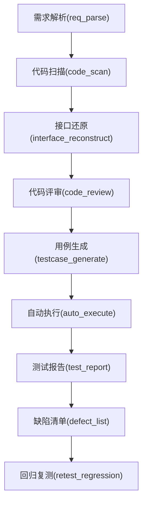
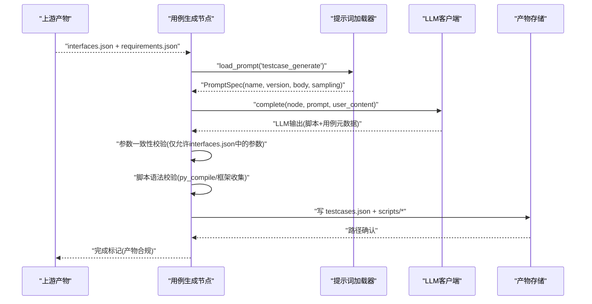
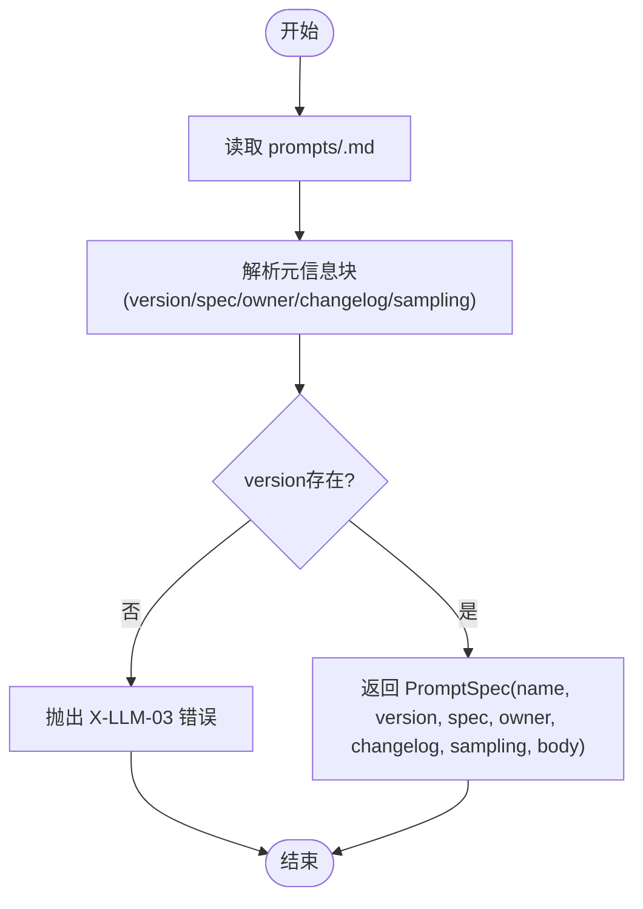
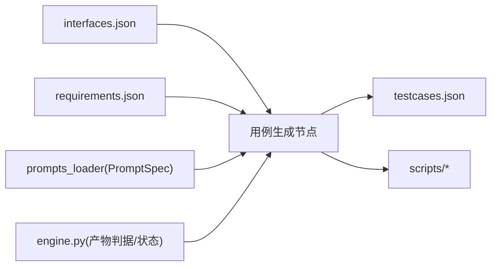

# 用例生成节点

<cite>
**本文引用的文件**
- [testcases.json](file://schemas/testcases.json)
- [interfaces.json](file://schemas/interfaces.json)
- [execution.json](file://schemas/execution.json)
- [defects.json](file://schemas/defects.json)
- [prompts_loader.py](file://services/orchestrator/src/orchestrator/prompts_loader.py)
- [_template.md](file://prompts/_template.md)
- [README.md（prompts）](file://prompts/README.md)
- [engine.py](file://services/orchestrator/src/orchestrator/engine.py)
- [pipeline.py](file://services/orchestrator/src/orchestrator/pipeline.py)
- [req_parse.py](file://services/orchestrator/src/orchestrator/nodes/req_parse.py)
- [code_scan.py](file://services/orchestrator/src/orchestrator/nodes/code_scan.py)
- [04_功能规格说明.md](file://docs/04_功能规格说明.md)
- [12_开发设计说明.md](file://docs/12_开发设计说明.md)
</cite>

## 目录
1. [简介](#简介)
2. [项目结构](#项目结构)
3. [核心组件](#核心组件)
4. [架构总览](#架构总览)
5. [详细组件分析](#详细组件分析)
6. [依赖关系分析](#依赖关系分析)
7. [性能与可扩展性](#性能与可扩展性)
8. [故障排查指南](#故障排查指南)
9. [结论](#结论)
10. [附录](#附录)

## 简介
本章节聚焦“用例生成节点”（testcase_generate），围绕基于需求与接口的智能测试用例生成，系统性地说明：
- 输入与输出契约：以 interfaces.json、requirements.json 为输入，产出 testcases.json 与可执行脚本。
- 数据模型与模板：testcases.json 的结构约束与 prompts/_template.md 的元信息约定。
- 提示词管理：prompts_loader 的动态加载与版本化机制。
- 脚本自动生成与语言适配：从接口签名到 pytest 脚本的生成策略与校验。
- 质量评估与人工审核：loadable、low_confidence 等指标及回退流程。
- 覆盖率与重复检测：用例覆盖维度与去重策略建议。

## 项目结构
用例生成节点位于编排流水线的第 5 个固定节点，前后衔接代码扫描、接口还原与自动执行等阶段。产物布局遵循 docs/12 的规范，testcases.json 与 scripts/ 下的脚本由该节点写入。

图表来源
- [pipeline.py:23-34](file://services/orchestrator/src/orchestrator/pipeline.py#L23-L34)
- [engine.py:25-35](file://services/orchestrator/src/orchestrator/engine.py#L25-L35)

章节来源
- [pipeline.py:23-34](file://services/orchestrator/src/orchestrator/pipeline.py#L23-L34)
- [engine.py:25-35](file://services/orchestrator/src/orchestrator/engine.py#L25-L35)
- [12_开发设计说明.md:51-72](file://docs/12_开发设计说明.md#L51-L72)

## 核心组件
- 编排引擎（Engine）：负责状态持久化、断点续跑、跳序防护、降级处理；定义各节点的产物判据，其中 testcase_generate 的产物为 testcases.json。
- 提示词加载器（prompts_loader）：从 prompts/ 下按名称加载 Markdown Prompt，解析头部元信息（version/spec/owner/changelog/sampling/body），供 LLM 调用使用。
- 用例数据模型（schemas/testcases.json）：定义用例元数据结构，包括 id、interface_id、category、params、expected、script_path、loadable、low_confidence 等字段与约束。
- 接口数据模型（schemas/interfaces.json）：定义接口签名、参数、返回类型、协议、定位信息等，作为用例生成的权威来源。
- 执行结果模型（schemas/execution.json）：记录用例执行结果与汇总，用于后续报告与缺陷闭环。
- 缺陷模型（schemas/defects.json）：将断言失败用例转化为缺陷条目，支持生命周期追踪。

章节来源
- [engine.py:25-35](file://services/orchestrator/src/orchestrator/engine.py#L25-L35)
- [prompts_loader.py:13-63](file://services/orchestrator/src/orchestrator/prompts_loader.py#L13-L63)
- [testcases.json:1-35](file://schemas/testcases.json#L1-L35)
- [interfaces.json:1-70](file://schemas/interfaces.json#L1-L70)
- [execution.json:1-59](file://schemas/execution.json#L1-L59)
- [defects.json:1-54](file://schemas/defects.json#L1-L54)

## 架构总览
用例生成节点的整体交互如下：上游提供 interfaces.json 与 requirements.json；节点内部通过 prompts_loader 动态加载 Prompt，驱动 LLM 生成测试脚本与用例元数据；随后进行参数一致性校验与脚本语法校验；最终落盘 testcases.json 与脚本文件。

图表来源
- [engine.py:25-35](file://services/orchestrator/src/orchestrator/engine.py#L25-L35)
- [prompts_loader.py:31-63](file://services/orchestrator/src/orchestrator/prompts_loader.py#L31-L63)
- [testcases.json:10-31](file://schemas/testcases.json#L10-L31)
- [interfaces.json:10-66](file://schemas/interfaces.json#L10-L66)

## 详细组件分析

### 用例数据模型（schemas/testcases.json）
- 顶层字段：schema_version、job_id、cases。
- 用例项字段：
  - id：用例编号，格式 TC-xxx。
  - interface_id：关联接口 ID，格式 IF-XXX-xxx，用于溯源。
  - requirement_id：可选的需求条目 ID，格式 REQ-xxx，用于需求追溯。
  - category：用例类别 normal/boundary/exception，要求每接口三类各至少一条。
  - title：用例标题。
  - params：参数对象，参数名与结构必须来自 interfaces.json，出现清单外参数即打回。
  - expected：预期结果描述，作为断言依据。
  - script_path：生成的 pytest 脚本相对路径。
  - loadable：脚本可被框架加载且零错误的校验结果。
  - low_confidence：当接口参数类型为 unknown 时标记低置信度。

章节来源
- [testcases.json:1-35](file://schemas/testcases.json#L1-L35)

### 接口数据模型（schemas/interfaces.json）
- 接口项包含 id、protocol、signature（method/path 或 service/method）、params（name/type/required/in/default）、returns、candidate_id、code_location、is_fallback、confidence。
- 用例生成需严格遵循接口签名与参数集合，禁止引入未声明参数。

章节来源
- [interfaces.json:1-70](file://schemas/interfaces.json#L1-L70)

### 提示词管理与动态加载（prompts_loader）
- PromptSpec：封装 name/version/spec/owner/changelog/sampling/body，并提供 ref 留痕。
- load_prompt：按名称加载 prompts/<name>.md，解析元信息块，缺失或不合规抛出 PipelineError（X-LLM-03）。
- _parse_meta：解析 --- 包裹的元信息块，支持前导注释与空行，提取 version/spec/owner/changelog/sampling 与正文。
- 模板约定：prompts/_template.md 规定元信息字段与采样参数建议；prompts/README.md 强调禁止内联 Prompt、命名约定与变更升版规则。

图表来源
- [prompts_loader.py:31-63](file://services/orchestrator/src/orchestrator/prompts_loader.py#L31-L63)
- [prompts_loader.py:66-122](file://services/orchestrator/src/orchestrator/prompts_loader.py#L66-L122)
- [_template.md:1-22](file://prompts/_template.md#L1-L22)
- [README.md（prompts）:1-15](file://prompts/README.md#L1-L15)

章节来源
- [prompts_loader.py:13-63](file://services/orchestrator/src/orchestrator/prompts_loader.py#L13-L63)
- [prompts_loader.py:66-122](file://services/orchestrator/src/orchestrator/prompts_loader.py#L66-L122)
- [_template.md:1-22](file://prompts/_template.md#L1-L22)
- [README.md（prompts）:1-15](file://prompts/README.md#L1-L15)

### 测试脚本自动生成与语言适配策略
- 输入：interfaces.json（接口签名与参数）、requirements.json（需求语义用于断言语义）。
- 生成目标：pytest 脚本与用例元数据（testcases.json）。
- 语言适配：
  - REST：method/path 映射为 HTTP 请求构造。
  - gRPC/SOAP/MQ：service_method 映射为对应协议调用。
  - GraphQL：根据 schema 生成查询/变更语句。
- 校验：
  - 参数一致性：params 中出现的参数名必须属于 interfaces.json 的参数集合，否则丢弃并重生成。
  - 脚本可加载：py_compile 或框架收集零 error，loadable 置真。
  - 边界值：数值 0/负数/极值，字符串空/超长，unknown 类型按 null 处理。
- 产出：scripts/ 下脚本文件 + testcases.json 中 script_path 指向。

章节来源
- [04_功能规格说明.md:151-176](file://docs/04_功能规格说明.md#L151-L176)
- [interfaces.json:10-66](file://schemas/interfaces.json#L10-L66)
- [testcases.json:10-31](file://schemas/testcases.json#L10-L31)

### 用例质量评估标准与人工审核流程
- 质量指标：
  - loadable：脚本可被框架加载且无语法错误。
  - low_confidence：当接口参数类型为 unknown 时标记，报告中注明。
  - category 覆盖：每接口正常/边界/异常各至少一条。
- 人工审核：
  - 若 LLM 输出未过 Schema 校验，按节点失败处理，禁止截取可用部分。
  - 参数一致性连续两次不通过，放弃该接口用例并记录“生成质量告警”。
  - 对 low_confidence 用例需人工复核断言语义与边界值合理性。

章节来源
- [testcases.json:10-31](file://schemas/testcases.json#L10-L31)
- [04_功能规格说明.md:151-176](file://docs/04_功能规格说明.md#L151-L176)

### 用例覆盖率分析与重复用例检测机制
- 覆盖率维度：
  - 接口覆盖：每个已还原接口是否生成了用例。
  - 类别覆盖：normal/boundary/exception 三类是否齐全。
  - 参数覆盖：关键参数（必填、边界、异常）是否覆盖。
  - 协议覆盖：REST/gRPC/GraphQL/SOAP/MQ 是否均有用例。
- 重复检测：
  - 基于 interface_id + params 指纹去重，避免等价用例重复生成。
  - 基于 expected 文本相似度合并近似用例，保留最具代表性的一条。
  - 结合 requirement_id 与 category 组合键，确保需求-用例双向可追溯且不重复。

[本节为概念性说明，不直接分析具体文件]

### 执行结果与缺陷闭环（与用例生成联动）
- execution.json：记录每条用例的 case_id、interface_id、passed、failure_kind、failure_reason、timeout、skipped_reason、duration_ms、timestamp，以及程序化汇总 summary。
- defects.json：将断言失败用例转为缺陷条目，包含 reproduce（script_path + params）、status 生命周期、history 审计轨迹。
- 与用例生成的联动：用例脚本路径与参数在缺陷中可复现，便于回归与修复验证。

章节来源
- [execution.json:1-59](file://schemas/execution.json#L1-L59)
- [defects.json:1-54](file://schemas/defects.json#L1-L54)

## 依赖关系分析
用例生成节点依赖上游产物与提示词资源，并通过编排引擎进行状态与产物校验。

图表来源
- [engine.py:25-35](file://services/orchestrator/src/orchestrator/engine.py#L25-L35)
- [prompts_loader.py:31-63](file://services/orchestrator/src/orchestrator/prompts_loader.py#L31-L63)
- [testcases.json:10-31](file://schemas/testcases.json#L10-L31)

章节来源
- [engine.py:25-35](file://services/orchestrator/src/orchestrator/engine.py#L25-L35)
- [prompts_loader.py:31-63](file://services/orchestrator/src/orchestrator/prompts_loader.py#L31-L63)

## 性能与可扩展性
- 并行生成：按接口并行生成用例与脚本，提升吞吐。
- 增量校验：对新增接口仅重新生成相关用例，减少无效计算。
- 缓存策略：对相同接口签名与需求的 Prompt 输出进行缓存，避免重复 LLM 调用。
- 资源隔离：不同协议的生成任务隔离执行，避免相互干扰。
- 扩展点：新增协议只需扩展 signature 解析与脚本模板，无需改动核心流程。

[本节提供通用指导，不直接分析具体文件]

## 故障排查指南
- 提示词缺失或元信息不合规：
  - 现象：加载 Prompt 时报错（X-LLM-03）。
  - 处理：检查 prompts/<name>.md 是否存在，元信息块是否包含 version 等必需字段。
- LLM 输出不可解析或未过 Schema：
  - 现象：用例生成节点失败，state.json 记录错误。
  - 处理：查看 llm_calls.jsonl 留痕，修正 Prompt 或调整采样参数。
- 参数一致性校验失败：
  - 现象：用例被丢弃并重生成。
  - 处理：核对 interfaces.json 参数集合，确保 Prompt 引导 LLM 仅使用合法参数。
- 脚本不可加载：
  - 现象：loadable 为假。
  - 处理：检查脚本语法与依赖，必要时调整模板或环境。
- 低置信度用例：
  - 现象：low_confidence 为真。
  - 处理：人工复核断言语义与边界值，补充 known 类型或 Mock。

章节来源
- [prompts_loader.py:31-63](file://services/orchestrator/src/orchestrator/prompts_loader.py#L31-L63)
- [req_parse.py:33-78](file://services/orchestrator/src/orchestrator/nodes/req_parse.py#L33-L78)
- [code_scan.py:26-49](file://services/orchestrator/src/orchestrator/nodes/code_scan.py#L26-L49)
- [engine.py:161-180](file://services/orchestrator/src/orchestrator/engine.py#L161-L180)

## 结论
用例生成节点通过严格的契约（interfaces.json、testcases.json）与提示词版本化管理（prompts_loader），实现了从需求与接口到可执行脚本与用例元数据的自动化生成。配合编排引擎的状态与产物校验，确保了流程的可控性与可追溯性。质量评估与人工审核机制保障了生成用例的可靠性与可维护性。未来可通过并行化、缓存与增量策略进一步提升效率与可扩展性。

[本节为总结性内容，不直接分析具体文件]

## 附录
- 产物目录布局：参考 docs/12 的规范，testcases.json 与 scripts/ 位于 job 根目录下。
- 节点顺序与状态：NODE_ORDER 固定为 9 个节点，testcase_generate 为第 5 个。
- 执行与缺陷：execution.json 与 defects.json 为后续报告与回归的基础。

章节来源
- [12_开发设计说明.md:51-72](file://docs/12_开发设计说明.md#L51-L72)
- [pipeline.py:23-34](file://services/orchestrator/src/orchestrator/pipeline.py#L23-L34)
- [execution.json:1-59](file://schemas/execution.json#L1-L59)
- [defects.json:1-54](file://schemas/defects.json#L1-L54)