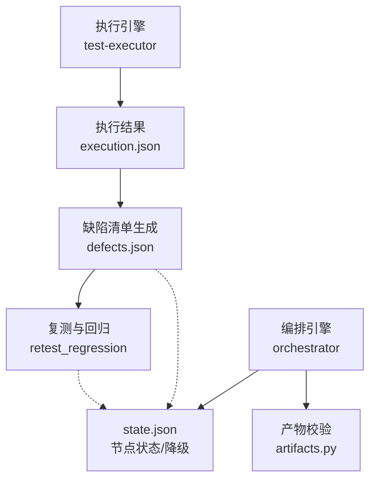
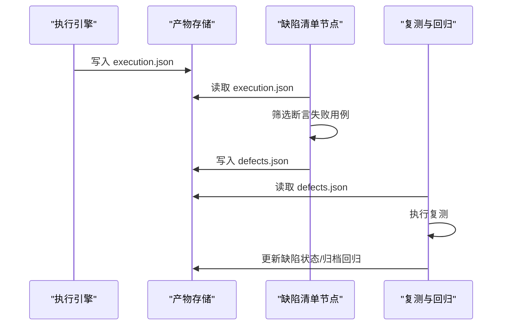
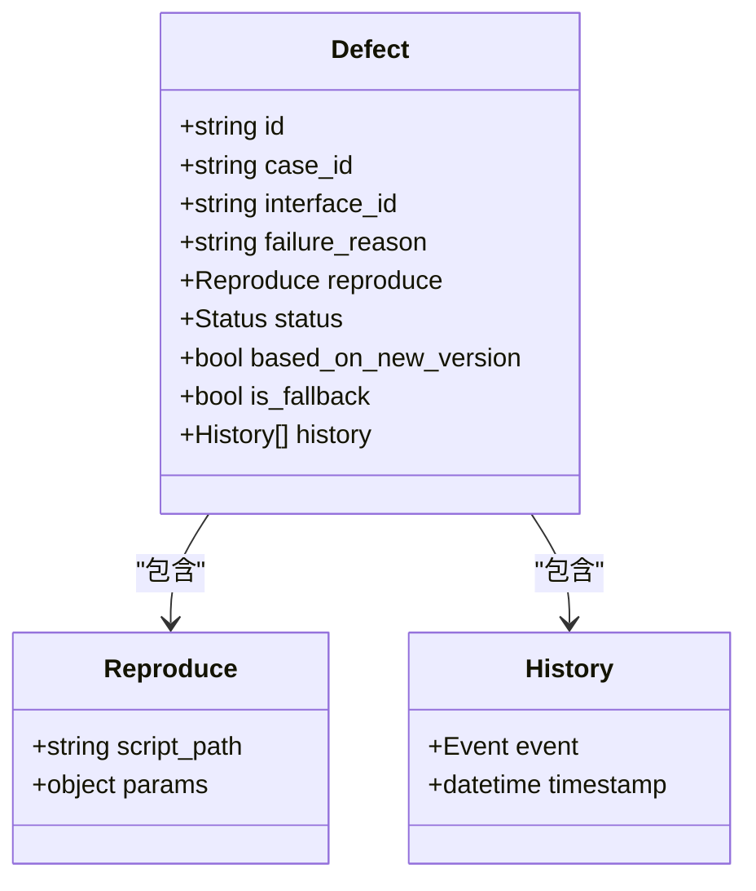
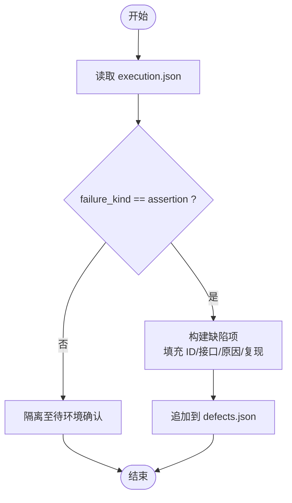
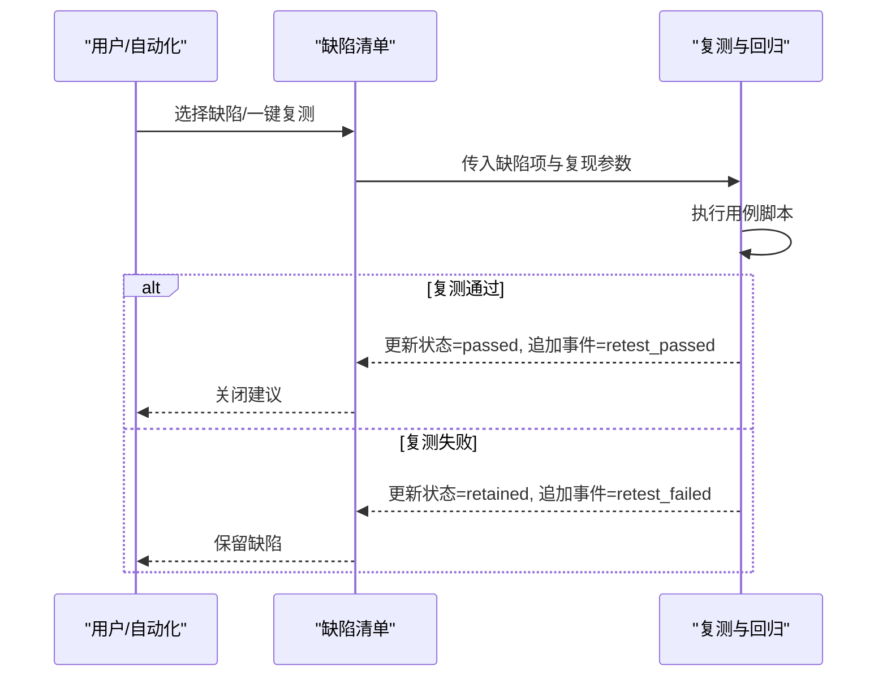
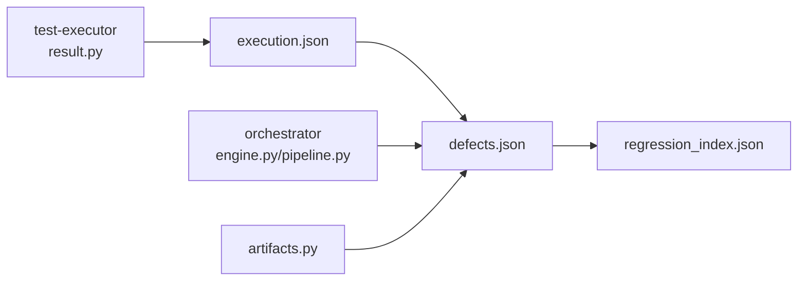

# 缺陷管理节点

<cite>
**本文引用的文件**
- [defects.json](file://schemas/defects.json)
- [execution.sample.json](file://schemas/samples/execution.sample.json)
- [result.py](file://services/test-executor/src/executor/result.py)
- [engine.py](file://services/orchestrator/src/orchestrator/engine.py)
- [pipeline.py](file://services/orchestrator/src/orchestrator/pipeline.py)
- [artifacts.py](file://services/orchestrator/src/orchestrator/artifacts.py)
- [02_立项提案.md](file://docs/02_立项提案.md)
- [03_用户故事卡片.md](file://docs/03_用户故事卡片.md)
- [04_功能规格说明.md](file://docs/04_功能规格说明.md)
- [06_需求定稿冻结.md](file://docs/06_需求定稿冻结.md)
- [12_开发设计说明.md](file://docs/12_开发设计说明.md)
</cite>

## 目录
1. [简介](#简介)
2. [项目结构](#项目结构)
3. [核心组件](#核心组件)
4. [架构总览](#架构总览)
5. [详细组件分析](#详细组件分析)
6. [依赖关系分析](#依赖关系分析)
7. [性能考虑](#性能考虑)
8. [故障排查指南](#故障排查指南)
9. [结论](#结论)
10. [附录](#附录)

## 简介
本章节面向“缺陷管理节点”，围绕缺陷的自动识别、分类与记录，以及缺陷生命周期管理进行系统化说明。本项目采用“本地缺陷记录”口径（非 Jira），通过执行结果中的断言失败自动产出缺陷清单，支持复测与回归沉淀，形成闭环。同时明确：环境失败不进入缺陷清单，隔离至待环境确认；项目口径与生产口径不同，不得直接外推。

**章节来源**
- [02_立项提案.md:31-54](file://docs/02_立项提案.md#L31-L54)
- [06_需求定稿冻结.md:37-50](file://docs/06_需求定稿冻结.md#L37-L50)

## 项目结构
缺陷管理相关的关键位置如下：
- 数据模型：schemas/defects.json 定义缺陷清单 Schema，约束字段、状态与历史事件。
- 执行产物：schemas/samples/execution.sample.json 展示执行结果样例，包含断言失败与环境失败的区分。
- 执行侧逻辑：services/test-executor/src/executor/result.py 实现失败二态判定与汇总。
- 编排与产物治理：services/orchestrator/src/orchestrator/engine.py、pipeline.py、artifacts.py 负责节点顺序、完成判据、降级策略与产物读写权限。
- 规范与验收：docs 下多份文档定义了缺陷生成、复测、回归沉淀及度量口径。

**图表来源**
- [engine.py:24-35](file://services/orchestrator/src/orchestrator/engine.py#L24-L35)
- [pipeline.py:23-34](file://services/orchestrator/src/orchestrator/pipeline.py#L23-L34)
- [artifacts.py:32-49](file://services/orchestrator/src/orchestrator/artifacts.py#L32-L49)

**章节来源**
- [engine.py:24-35](file://services/orchestrator/src/orchestrator/engine.py#L24-L35)
- [pipeline.py:23-34](file://services/orchestrator/src/orchestrator/pipeline.py#L23-L34)
- [artifacts.py:32-49](file://services/orchestrator/src/orchestrator/artifacts.py#L32-L49)

## 核心组件
- 缺陷清单 Schema（defects.json）：规定缺陷项必填字段、ID 规则、关联用例与接口、复现步骤、状态枚举、历史事件与兜底标记等。
- 执行结果二态（result.py）：将失败区分为“断言失败”和“环境失败”，仅断言失败进入缺陷清单。
- 编排引擎（engine.py/pipeline.py）：维护 9 节点顺序、完成判据、降级处理与自动化率计算；缺陷清单为第 8 节点。
- 产物治理（artifacts.py）：定义各节点产物文件名与写权归属，确保 orchestrator 与 test-executor 职责清晰。

**章节来源**
- [defects.json:1-54](file://schemas/defects.json#L1-L54)
- [result.py:1-61](file://services/test-executor/src/executor/result.py#L1-L61)
- [engine.py:133-265](file://services/orchestrator/src/orchestrator/engine.py#L133-L265)
- [pipeline.py:11-34](file://services/orchestrator/src/orchestrator/pipeline.py#L11-L34)
- [artifacts.py:32-49](file://services/orchestrator/src/orchestrator/artifacts.py#L32-L49)

## 架构总览
缺陷管理节点在流水线中的位置与交互如下：
- 上游：auto_execute 产出 execution.json，其中包含每条用例的执行结果与失败类型。
- 本节点：基于 execution.json 筛选断言失败用例，按 defects.json 生成缺陷清单。
- 下游：retest_regression 对缺陷发起复测，根据结果更新缺陷状态并归档回归脚本。

**图表来源**
- [engine.py:24-35](file://services/orchestrator/src/orchestrator/engine.py#L24-L35)
- [pipeline.py:23-34](file://services/orchestrator/src/orchestrator/pipeline.py#L23-L34)
- [artifacts.py:32-49](file://services/orchestrator/src/orchestrator/artifacts.py#L32-L49)

## 详细组件分析

### 缺陷清单数据结构（defects.json）
- 根对象：schema_version、job_id、defects 数组。
- 缺陷项必填：id、case_id、interface_id、failure_reason、reproduce、status、history、is_fallback。
- 关键字段含义：
  - id/case_id/interface_id：遵循固定格式，便于双向关联与检索。
  - reproduce：引用用例脚本路径与参数，支撑一键复现。
  - status：discovered → retesting → passed → closed_suggested/retained。
  - history：可审计的时间戳事件流，覆盖发现、复测开始/通过/失败、关闭建议/保留。
  - based_on_new_version：复测时代码变更标注，提示可能非同一缺陷。
  - is_fallback：演示埋入缺陷透传标记，避免混入真实质量统计。

**图表来源**
- [defects.json:1-54](file://schemas/defects.json#L1-L54)

**章节来源**
- [defects.json:1-54](file://schemas/defects.json#L1-L54)

### 缺陷自动识别与分类机制
- 输入：execution.json 中每条用例的 passed/failure_kind/failure_reason。
- 识别规则：仅 failure_kind 为 assertion 的用例进入缺陷清单；environment 失败隔离至待环境确认，不入缺陷清单。
- 分类依据：按 interface_id 归类，便于后续按接口维度统计与回归。
- 复现信息：从用例脚本提取 script_path 与必要参数，保证可重复执行。

**图表来源**
- [execution.sample.json:1-63](file://schemas/samples/execution.sample.json#L1-L63)
- [result.py:10-61](file://services/test-executor/src/executor/result.py#L10-L61)
- [defects.json:10-36](file://schemas/defects.json#L10-L36)

**章节来源**
- [execution.sample.json:1-63](file://schemas/samples/execution.sample.json#L1-L63)
- [result.py:10-61](file://services/test-executor/src/executor/result.py#L10-L61)
- [defects.json:10-36](file://schemas/defects.json#L10-L36)

### 缺陷生命周期管理与复测流程
- 生命周期状态：discovered → retesting → passed → closed_suggested/retained。
- 事件追踪：每次状态变化写入 history 事件与时间戳，确保可审计。
- 复测触发：对已修复缺陷或全量缺陷发起复测，更新状态与历史记录。
- 代码变更标注：若复测时发现被测代码已变更，设置 based_on_new_version，提示可能非同一缺陷。
- 脚本缺失处理：若复测用例脚本被删除/修改，跳过该项并报错指明缺失用例。

**图表来源**
- [defects.json:30-48](file://schemas/defects.json#L30-L48)
- [04_功能规格说明.md:253-257](file://docs/04_功能规格说明.md#L253-L257)

**章节来源**
- [defects.json:30-48](file://schemas/defects.json#L30-L48)
- [04_功能规格说明.md:253-257](file://docs/04_功能规格说明.md#L253-L257)

### 严重性评估与优先级排序
- 当前仓库未提供显式的严重性与优先级算法实现；可按以下实践落地：
  - 严重性：结合 failure_reason 关键词、影响范围（接口级别）、是否阻塞主流程等维度打分。
  - 优先级：综合严重性、修复成本、回归风险与业务影响确定 P0/P1/P2。
  - 建议：在缺陷项扩展 severity/priority 字段，并在复测与报告环节统一使用。
- 注意：本项目当前缺陷清单 Schema 未强制该字段，属于可选增强。

[本节为通用实践建议，不直接分析具体文件]

### 与外部缺陷管理系统的集成方案
- 项目口径：本地缺陷记录文件（非 Jira），用于 MVP 与验收演示。
- 生产口径：人工提交缺陷系统；需显式声明“项目口径 ≠ 生产口径”。
- 集成建议：
  - 导出转换：将 defects.json 映射为外部系统所需字段（标题、描述、复现步骤、关联用例/接口）。
  - 同步策略：定时或事件驱动同步，支持增量更新与去重。
  - 回写机制：外部系统状态变更回写至本地，保持双端一致。
- 限制：MVP 阶段不实现对接，优先跑通本地闭环。

**章节来源**
- [06_需求定稿冻结.md:37-50](file://docs/06_需求定稿冻结.md#L37-L50)
- [02_立项提案.md:31-54](file://docs/02_立项提案.md#L31-L54)

### 缺陷趋势分析与质量度量指标
- 趋势分析：基于 defects.json 的 history 事件与时间戳，统计缺陷发现速率、复测通过率、关闭建议率等。
- 质量指标：
  - 断言失败占比 vs 环境失败占比（来自 execution.json）。
  - 缺陷复测通过率、保留率、关闭建议率。
  - 回归脚本沉淀数量与稳定性。
- 数据来源：execution.json、defects.json、regression_index.json（回归资产索引）。

**章节来源**
- [execution.sample.json:1-63](file://schemas/samples/execution.sample.json#L1-L63)
- [defects.json:1-54](file://schemas/defects.json#L1-L54)

## 依赖关系分析
- 上游依赖：
  - execution.json：由 test-executor 产出，包含用例执行结果与失败类型。
  - artifacts.py：定义缺陷清单文件的写权归属（test-executor）。
- 内部依赖：
  - engine.py/pipeline.py：保障缺陷清单节点在 9 节点顺序中的位置与完成判据。
- 下游依赖：
  - regression_index.json：复测通过后归档回归脚本，形成回归套件。

**图表来源**
- [result.py:10-61](file://services/test-executor/src/executor/result.py#L10-L61)
- [engine.py:24-35](file://services/orchestrator/src/orchestrator/engine.py#L24-L35)
- [pipeline.py:23-34](file://services/orchestrator/src/orchestrator/pipeline.py#L23-L34)
- [artifacts.py:32-49](file://services/orchestrator/src/orchestrator/artifacts.py#L32-L49)

**章节来源**
- [result.py:10-61](file://services/test-executor/src/executor/result.py#L10-L61)
- [engine.py:24-35](file://services/orchestrator/src/orchestrator/engine.py#L24-L35)
- [pipeline.py:23-34](file://services/orchestrator/src/orchestrator/pipeline.py#L23-L34)
- [artifacts.py:32-49](file://services/orchestrator/src/orchestrator/artifacts.py#L32-L49)

## 性能考虑
- 批量处理：缺陷清单生成应批量读取 execution.json，避免逐条 I/O。
- 幂等性：缺陷 ID 生成与写入需幂等，防止重复创建。
- 历史事件追加：history 追加操作应原子化，避免并发写入冲突。
- 大文件优化：当用例规模较大时，建议分片处理与异步落盘。

[本节提供一般性指导，不直接分析具体文件]

## 故障排查指南
- 产物校验失败：若 defects.json 不符合 Schema，编排层会拒绝完成；检查字段格式与必填项。
- 状态不一致：打开 job 时会以产物为准对账，若 state.json 与产物不一致会自动修正。
- 降级处理：节点失败后重试耗尽可降级为 manual_intervention，不影响后续节点推进。
- 错误码参考：X-ORCH-01/X-ORCH-02 等用于定位编排问题；X-EXEC-01/X-EXEC-02 用于执行侧问题。

**章节来源**
- [engine.py:153-265](file://services/orchestrator/src/orchestrator/engine.py#L153-L265)
- [12_开发设计说明.md:29-50](file://docs/12_开发设计说明.md#L29-L50)
- [12_开发设计说明.md:88-112](file://docs/12_开发设计说明.md#L88-L112)

## 结论
缺陷管理节点在本项目中以“本地缺陷记录”为核心，实现了从执行失败到缺陷清单、复测与回归沉淀的闭环。通过严格的 Schema 约束与编排引擎的状态机，保障了缺陷数据的规范性与可审计性。未来可在严重性与优先级评估、外部系统集成方面逐步增强，以满足生产级质量管理的需要。

[本节为总结性内容，不直接分析具体文件]

## 附录
- 关键验收标准：
  - 每个失败用例转化为缺陷记录，含接口、失败原因、复现步骤。
  - 一条命令发起复测，更新缺陷状态。
  - 至少完成一次“缺陷产生 → 复测通过 → 关闭”闭环。
- 边界与异常：
  - 复测时代码变更标注“基于新版本”。
  - 复测用例脚本缺失则跳过并报错。
  - 演示缺陷由独立分支埋入，不进主干。

**章节来源**
- [03_用户故事卡片.md:155-164](file://docs/03_用户故事卡片.md#L155-L164)
- [04_功能规格说明.md:253-257](file://docs/04_功能规格说明.md#L253-L257)