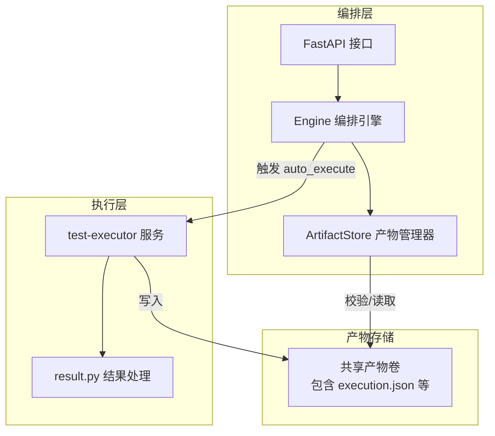
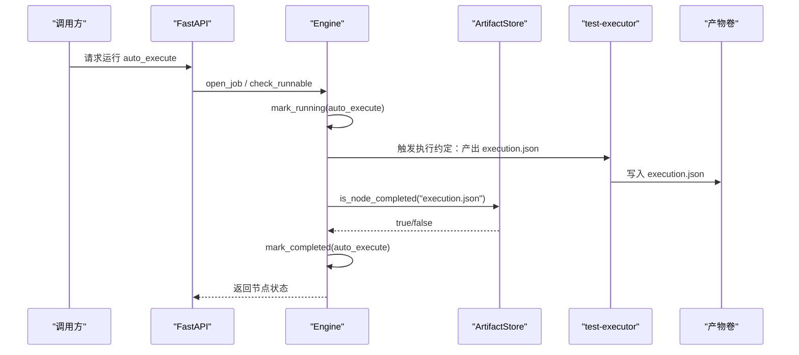
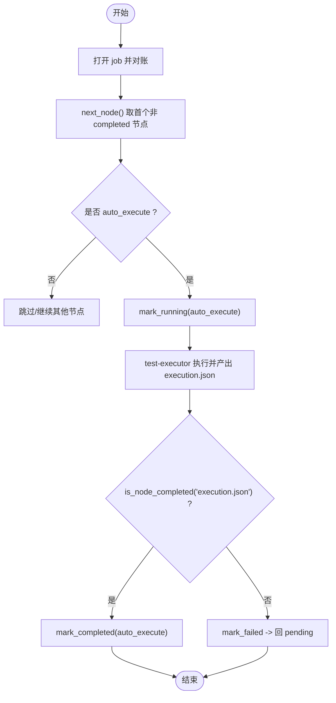
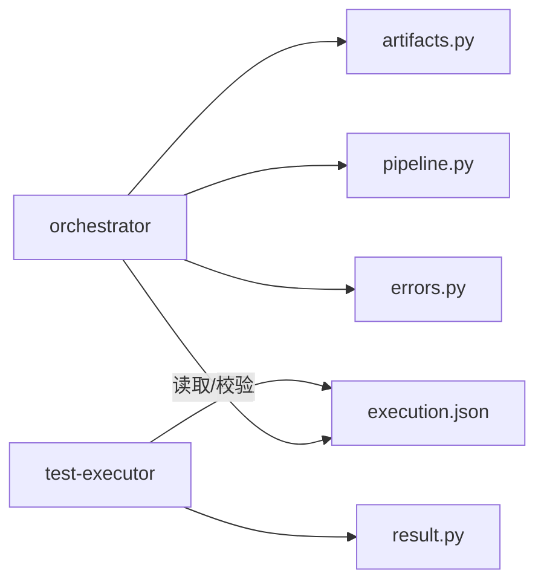

# 自动执行节点

<cite>
**本文引用的文件**
- [execution.json](file://schemas/execution.json)
- [execution.sample.json](file://schemas/samples/execution.sample.json)
- [result.py](file://services/test-executor/src/executor/result.py)
- [test_result.py](file://services/test-executor/tests/test_result.py)
- [engine.py](file://services/orchestrator/src/orchestrator/engine.py)
- [pipeline.py](file://services/orchestrator/src/orchestrator/pipeline.py)
- [artifacts.py](file://services/orchestrator/src/orchestrator/artifacts.py)
- [api.py](file://services/orchestrator/src/orchestrator/api.py)
- [errors.py](file://services/orchestrator/src/orchestrator/errors.py)
- [config.py](file://services/orchestrator/src/orchestrator/config.py)
- [10_测试框架选型说明.md](file://docs/10_测试框架选型说明.md)
- [04_功能规格说明.md](file://docs/04_功能规格说明.md)
</cite>

## 目录
1. [简介](#简介)
2. [项目结构](#项目结构)
3. [核心组件](#核心组件)
4. [架构总览](#架构总览)
5. [详细组件分析](#详细组件分析)
6. [依赖关系分析](#依赖关系分析)
7. [性能与并行策略](#性能与并行策略)
8. [故障恢复与重试](#故障恢复与重试)
9. [环境隔离与安全](#环境隔离与安全)
10. [排障指南](#排障指南)
11. [结论](#结论)

## 简介
本文件围绕“自动执行节点”（auto_execute）展开，聚焦测试脚本的执行引擎与调度机制、execution.json 的执行配置与任务管理、test-executor 服务架构与 result.py 的结果处理逻辑，并解释并行执行策略、资源管理、执行环境隔离与安全性、失败重试与故障恢复等关键主题。

## 项目结构
- orchestrator：流水线编排服务，负责 9 个节点的顺序编排、断点续跑、产物校验与状态持久化；其中 auto_execute 节点以 execution.json 作为完成判据之一。
- test-executor：测试执行服务，负责加载与执行 pytest 用例，产出 execution.json，并对失败进行二态判定（断言失败 vs 环境失败）。
- schemas：定义产物 Schema，execution.json 是 auto_execute 产物的唯一契约。

**图表来源**
- [api.py:11-27](file://services/orchestrator/src/orchestrator/api.py#L11-L27)
- [engine.py:133-265](file://services/orchestrator/src/orchestrator/engine.py#L133-L265)
- [artifacts.py:55-131](file://services/orchestrator/src/orchestrator/artifacts.py#L55-L131)
- [result.py:10-61](file://services/test-executor/src/executor/result.py#L10-L61)

**章节来源**
- [api.py:11-27](file://services/orchestrator/src/orchestrator/api.py#L11-L27)
- [engine.py:133-265](file://services/orchestrator/src/orchestrator/engine.py#L133-L265)
- [artifacts.py:55-131](file://services/orchestrator/src/orchestrator/artifacts.py#L55-L131)

## 核心组件
- 执行配置与产物契约：execution.json 定义了用例级结果、汇总统计、降级协议清单等字段，是 auto_execute 节点完成的硬性约束。
- 结果处理：result.py 提供 FailureKind、CaseResult、ExecutionSummary，实现“断言失败”和“环境失败”的二态分离与程序化汇总。
- 编排与调度：engine.py 维护 JobState/NodeState，负责 next_node、check_runnable、mark_running/completed/failed/degraded，以及基于产物存在的 reconcile。
- 产物管理：artifacts.py 统一读写产物，按 Schema 校验，并以“存在且通过校验”作为节点完成判据。
- 配置与环境：config.py 从环境变量注入运行参数，避免硬编码。

**章节来源**
- [execution.json:1-59](file://schemas/execution.json#L1-L59)
- [result.py:10-61](file://services/test-executor/src/executor/result.py#L10-L61)
- [engine.py:43-131](file://services/orchestrator/src/orchestrator/engine.py#L43-L131)
- [artifacts.py:22-50](file://services/orchestrator/src/orchestrator/artifacts.py#L22-L50)
- [config.py:9-56](file://services/orchestrator/src/orchestrator/config.py#L9-L56)

## 架构总览
auto_execute 节点在 orchestrator 的 9 节点流水线中处于“用例生成之后、报告之前”。其执行入口由编排引擎驱动，实际执行由 test-executor 完成，最终产物为 execution.json。orchestrator 通过 ArtifactStore 对 execution.json 进行存在性与 Schema 校验，从而判定节点完成。

**图表来源**
- [engine.py:153-242](file://services/orchestrator/src/orchestrator/engine.py#L153-L242)
- [artifacts.py:120-131](file://services/orchestrator/src/orchestrator/artifacts.py#L120-L131)

## 详细组件分析

### execution.json 执行配置与任务管理
- 顶层字段：schema_version、job_id、results、summary、degraded_protocols。
- results：每条用例需包含 case_id、interface_id、passed、timestamp；可选 failure_kind（assertion/environment）、failure_reason、timeout、skipped_reason、duration_ms。
- summary：total、passed、failed_assertion、failed_environment、interrupted（服务崩溃剩余用例标记中断）。
- degraded_protocols：记录降级的协议及原因，用于报告分列。

该文件由 test-executor 在服务侧直接写入，作为 auto_execute 节点完成的唯一依据之一。

**章节来源**
- [execution.json:1-59](file://schemas/execution.json#L1-L59)
- [execution.sample.json:1-63](file://schemas/samples/execution.sample.json#L1-L63)

### result.py 结果处理逻辑
- FailureKind：枚举“断言失败”和“环境失败”，用于区分缺陷归因与通过率口径。
- CaseResult：单条用例结果，构造时校验“通过用例不得携带失败类型”，保证结果自洽。
- ExecutionSummary：基于用例结果元组计算 total、passed、failed_assertion、failed_environment，确保数值仅经此处汇总，不经 LLM。

测试覆盖了对 CaseResult 自洽性校验与 Summary 二态计数。

**章节来源**
- [result.py:10-61](file://services/test-executor/src/executor/result.py#L10-L61)
- [test_result.py:10-30](file://services/test-executor/tests/test_result.py#L10-L30)

### 编排引擎与调度机制（engine.py）
- 节点顺序与状态：NODE_ORDER 固定 9 节点；NodeStatus 四态（completed/manual_intervention/running/pending）。
- 断点续跑与对账：open_job 会 reconcile，以产物为准修正状态；若产物缺失或损坏，回退为 pending。
- 跳序防护：check_runnable 要求前序节点全部 completed（含 manual_intervention 视为已处理），否则抛出 X-ORCH-02。
- 生命周期：mark_running → 业务执行 → mark_completed（先验产物判据）/ mark_failed（回 pending 并记录错误）/ mark_degraded（计入人工介入与降级清单）。
- 自动化率：completed/9，不缩减分母。

**图表来源**
- [engine.py:153-242](file://services/orchestrator/src/orchestrator/engine.py#L153-L242)
- [artifacts.py:120-131](file://services/orchestrator/src/orchestrator/artifacts.py#L120-L131)

**章节来源**
- [engine.py:23-35](file://services/orchestrator/src/orchestrator/engine.py#L23-L35)
- [engine.py:133-265](file://services/orchestrator/src/orchestrator/engine.py#L133-L265)
- [pipeline.py:11-34](file://services/orchestrator/src/orchestrator/pipeline.py#L11-L34)

### test-executor 服务架构与执行流程
- 执行命令：使用 pytest 以无人值守模式执行，输出结构化 JSON 报告，再由 test-executor 汇总为 execution.json。
- 可加载性校验：生成完成后进行 py_compile 与 pytest 收集阶段零 error 校验。
- 二态标注：自定义插件将断言失败标记为 assertion，网络/连接异常映射为 environment。
- 汇总与归档：按协议维度组织脚本目录，执行结束后程序化汇总为 execution.json 并落盘。

**章节来源**
- [10_测试框架选型说明.md:45-53](file://docs/10_测试框架选型说明.md#L45-L53)
- [04_功能规格说明.md:194-207](file://docs/04_功能规格说明.md#L194-L207)

## 依赖关系分析
- orchestrator 依赖 artifacts.py 进行产物读写与校验，依赖 pipeline.py 的节点顺序与状态枚举，依赖 errors.py 的统一错误码。
- test-executor 依赖 result.py 进行结果建模与汇总，最终产出 execution.json，被 orchestrator 消费。
- 产物写权：execution.json 的写方为 test-executor，orchestrator 只读校验，避免并发写冲突。

**图表来源**
- [artifacts.py:22-50](file://services/orchestrator/src/orchestrator/artifacts.py#L22-L50)
- [engine.py:18-21](file://services/orchestrator/src/orchestrator/engine.py#L18-L21)
- [result.py:10-61](file://services/test-executor/src/executor/result.py#L10-L61)

**章节来源**
- [artifacts.py:22-50](file://services/orchestrator/src/orchestrator/artifacts.py#L22-L50)
- [engine.py:18-21](file://services/orchestrator/src/orchestrator/engine.py#L18-L21)

## 性能与并行策略
- 当前代码库未内置进程/线程池级别的并行执行器；pytest 自身支持并行插件，但仓库内未见显式启用。因此默认执行模型为串行。
- 若需并行，建议在 test-executor 侧引入 pytest-xdist 或类似机制，并结合资源配额（如并发度、超时、隔离目录）控制资源占用。
- 对于多协议 Runner，可按协议维度拆分脚本目录，结合外部调度器（如队列）实现跨协议并行，但需保证 execution.json 的原子写入与幂等合并。

[本节为通用建议，不直接分析具体文件]

## 故障恢复与重试
- 节点级重试：engine.py 通过 attempts 计数与 mark_failed 回 pending，配合外部调度可实现重试；当重试耗尽后，可由编排决定降级（manual_intervention + degraded 清单）。
- 产物对账：reconcile 以产物为准，若产物失效则回退为 pending，避免“假完成”。
- 超时与中断：X-EXEC-02 用例超时记失败；X-EXEC-04 服务崩溃剩余用例标 interrupted；X-EXEC-05 前置数据不可用跳过并记录。
- LLM 调用重试：LLM 客户端具备网络/超时类失败的重试与退避策略，但不适用于执行节点本身。

**章节来源**
- [engine.py:161-261](file://services/orchestrator/src/orchestrator/engine.py#L161-L261)
- [04_功能规格说明.md:201-207](file://docs/04_功能规格说明.md#L201-L207)
- [llm/client.py:108-121](file://services/orchestrator/src/orchestrator/llm/client.py#L108-L121)

## 环境隔离与安全
- 产物卷隔离：每个 job 独立目录，子目录 scripts/fixtures/logs/archive 便于隔离日志、夹具与归档。
- 写权排他：artifacts.py 强制按服务名限制写权限，避免 orchestrator 与 test-executor 互相覆盖产物。
- 安全配置：config.py 从环境变量注入敏感信息（如 LLM_API_KEY），并提供不含密钥的配置摘要用于日志。
- 最小权限：test-executor 仅能写入约定的产物文件，不能越权修改 orchestrator 产物。

**章节来源**
- [artifacts.py:55-157](file://services/orchestrator/src/orchestrator/artifacts.py#L55-L157)
- [config.py:9-56](file://services/orchestrator/src/orchestrator/config.py#L9-L56)

## 排障指南
- 常见错误码：
  - X-ORCH-01：产物校验失败或 state.json 损坏/不匹配。
  - X-ORCH-02：跳序请求（前序未完成）。
  - X-ORCH-03：java-parser 通信失败。
  - X-LLM-*：LLM 调用相关错误（超时/网络/Schema 不合规）。
- 排查步骤：
  - 检查 state.json 是否存在且可读，job_id 是否匹配。
  - 确认 execution.json 是否存在且通过 Schema 校验。
  - 查看节点错误详情（error.message/details）定位根因。
  - 若为环境问题（environment），优先修复被测服务或网络连通性。
  - 若为断言失败（assertion），回归用例与预期。

**章节来源**
- [errors.py:8-39](file://services/orchestrator/src/orchestrator/errors.py#L8-L39)
- [engine.py:271-302](file://services/orchestrator/src/orchestrator/engine.py#L271-L302)
- [artifacts.py:98-131](file://services/orchestrator/src/orchestrator/artifacts.py#L98-L131)

## 结论
自动执行节点以 execution.json 为核心契约，由 orchestrator 编排调度、test-executor 执行并产出结果。result.py 实现了严格的二态失败分类与程序化汇总，保障报告数值可信。通过产物对账、跳序防护与降级机制，系统在稳定性与可观测性上具备良好基础。未来可在 test-executor 侧按需引入并行执行与更细粒度的资源管控，进一步提升吞吐与弹性。