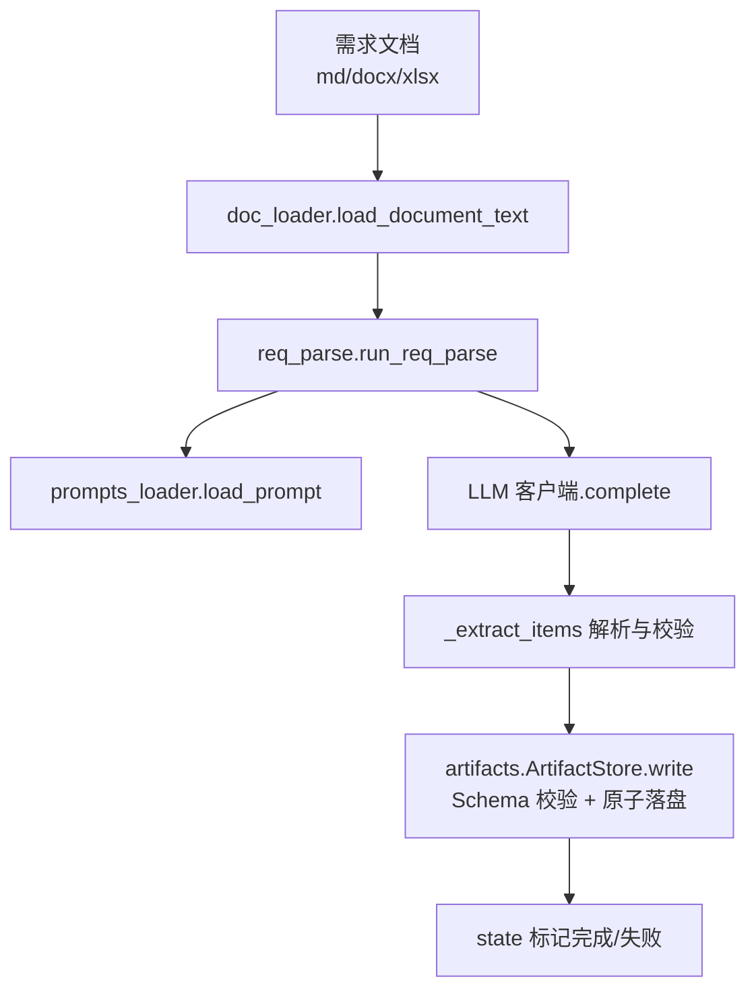
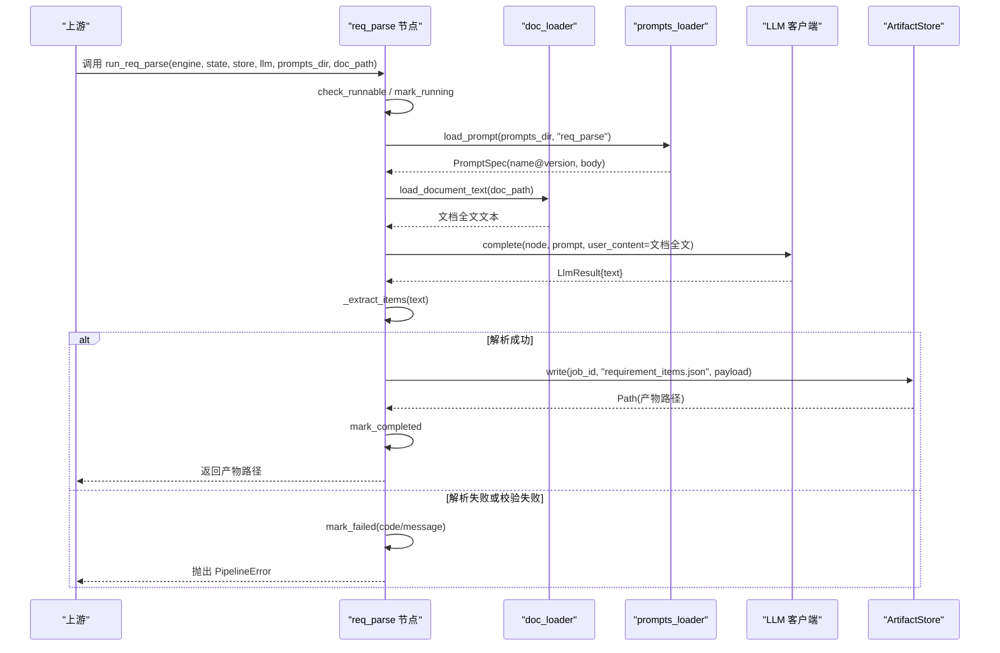
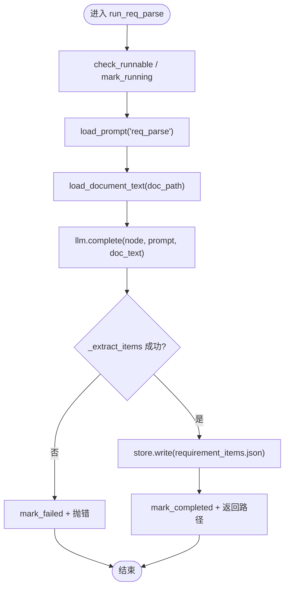
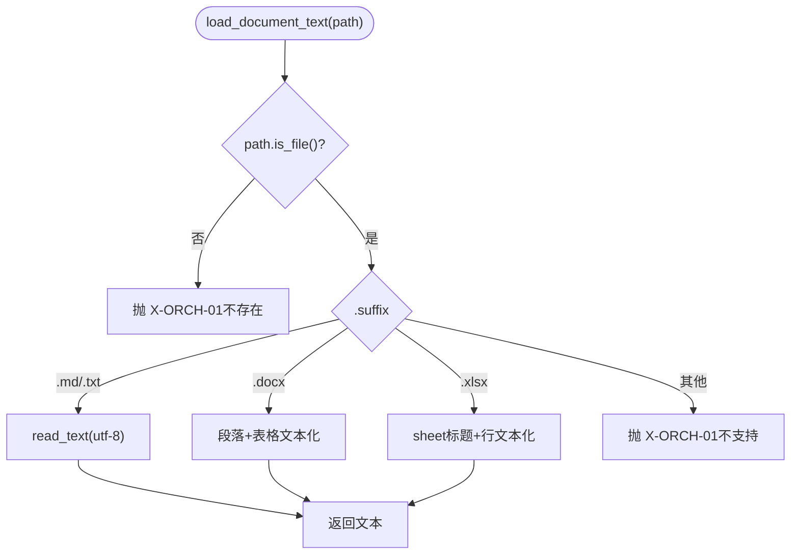
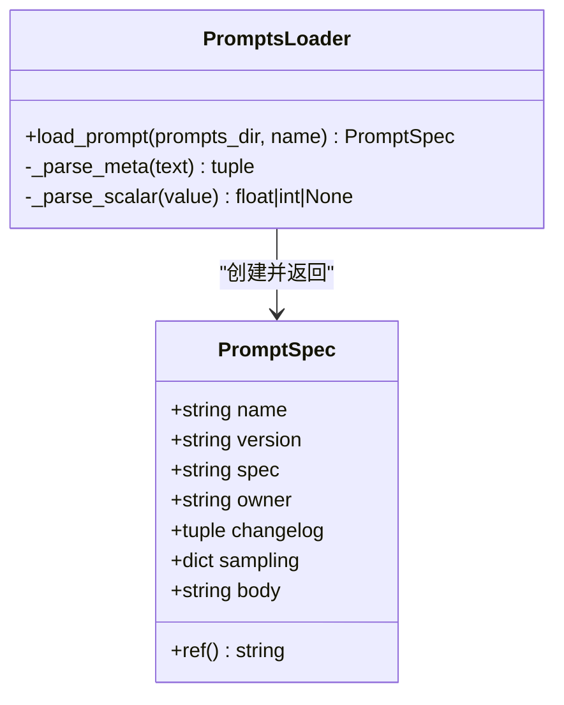
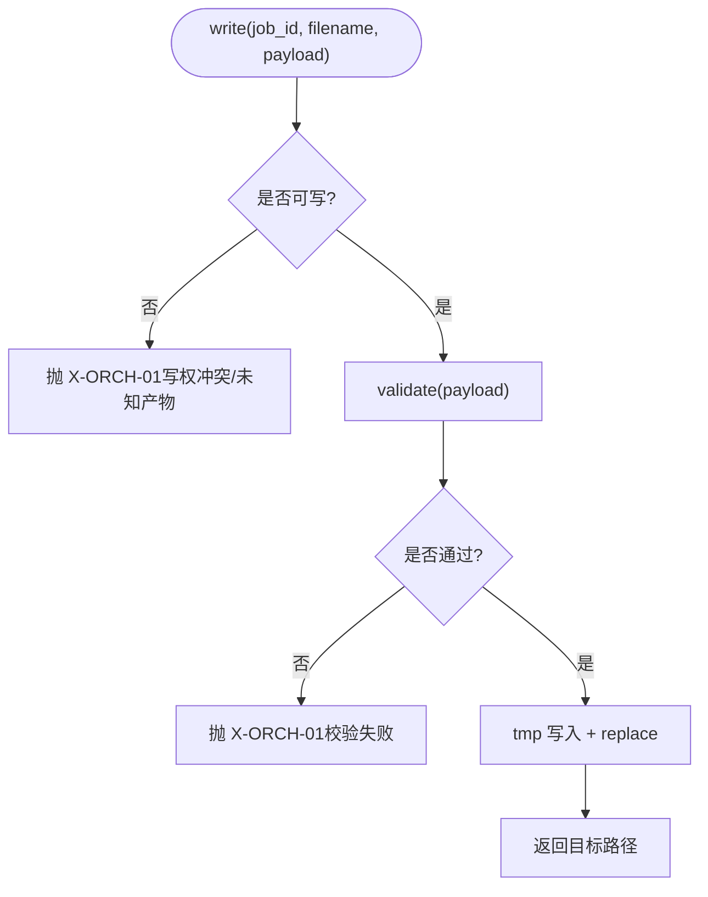
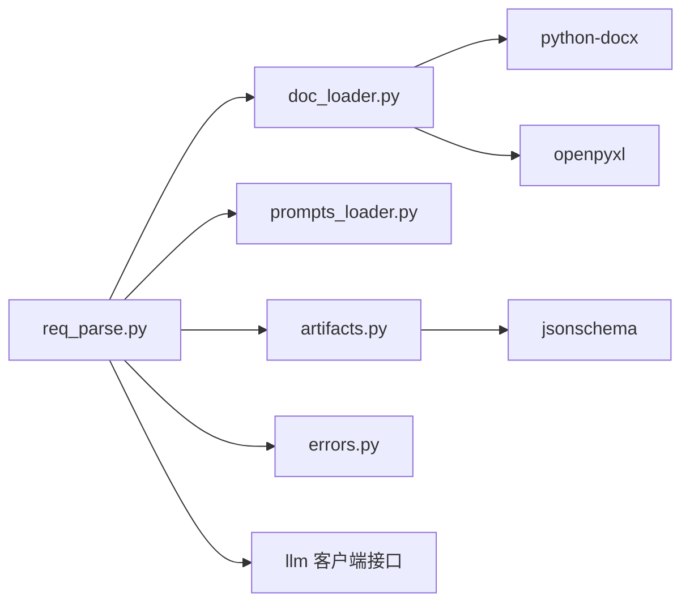

# 需求解析节点

<cite>
**本文引用的文件**
- [services/orchestrator/src/orchestrator/nodes/req_parse.py](file://services/orchestrator/src/orchestrator/nodes/req_parse.py)
- [services/orchestrator/src/orchestrator/doc_loader.py](file://services/orchestrator/src/orchestrator/doc_loader.py)
- [schemas/requirement_items.json](file://schemas/requirement_items.json)
- [services/orchestrator/src/orchestrator/prompts_loader.py](file://services/orchestrator/src/orchestrator/prompts_loader.py)
- [prompts/_template.md](file://prompts/_template.md)
- [services/orchestrator/src/orchestrator/errors.py](file://services/orchestrator/src/orchestrator/errors.py)
- [services/orchestrator/src/orchestrator/artifacts.py](file://services/orchestrator/src/orchestrator/artifacts.py)
- [services/orchestrator/tests/test_req_parse.py](file://services/orchestrator/tests/test_req_parse.py)
- [services/orchestrator/tests/test_doc_loader.py](file://services/orchestrator/tests/test_doc_loader.py)
</cite>

## 目录
1. [简介](#简介)
2. [项目结构](#项目结构)
3. [核心组件](#核心组件)
4. [架构总览](#架构总览)
5. [详细组件分析](#详细组件分析)
6. [依赖关系分析](#依赖关系分析)
7. [性能考虑](#性能考虑)
8. [故障排查指南](#故障排查指南)
9. [结论](#结论)
10. [附录](#附录)

## 简介
本节点负责将多格式需求文档（Markdown、Word、Excel等）统一文本化，调用大模型进行结构化解析，产出符合 Schema 的 requirement_items.json。该过程涵盖：
- 多格式文档加载与文本化
- Prompt 版本化管理与加载
- LLM 调用与输出容错处理
- JSON Schema 校验与产物落盘
- 错误码归一与状态管理

## 项目结构
围绕“需求解析”的关键文件与职责如下：
- req_parse.py：节点编排入口，串联 doc_loader、LLM、Schema 校验与产物落盘
- doc_loader.py：多格式文档到纯文本的统一加载器
- prompts_loader.py：Prompt 文件加载与元信息解析
- artifacts.py：产物卷访问、Schema 校验、原子写入与完成判据
- errors.py：统一错误码与异常结构
- schemas/requirement_items.json：产物 Schema 定义
- tests/*：覆盖关键路径与边界条件

图表来源
- [services/orchestrator/src/orchestrator/nodes/req_parse.py:33-78](file://services/orchestrator/src/orchestrator/nodes/req_parse.py#L33-L78)
- [services/orchestrator/src/orchestrator/doc_loader.py:12-33](file://services/orchestrator/src/orchestrator/doc_loader.py#L12-L33)
- [services/orchestrator/src/orchestrator/prompts_loader.py:31-63](file://services/orchestrator/src/orchestrator/prompts_loader.py#L31-L63)
- [services/orchestrator/src/orchestrator/artifacts.py:75-96](file://services/orchestrator/src/orchestrator/artifacts.py#L75-L96)

章节来源
- [services/orchestrator/src/orchestrator/nodes/req_parse.py:1-125](file://services/orchestrator/src/orchestrator/nodes/req_parse.py#L1-L125)
- [services/orchestrator/src/orchestrator/doc_loader.py:1-65](file://services/orchestrator/src/orchestrator/doc_loader.py#L1-L65)
- [services/orchestrator/src/orchestrator/prompts_loader.py:1-135](file://services/orchestrator/src/orchestrator/prompts_loader.py#L1-L135)
- [services/orchestrator/src/orchestrator/artifacts.py:1-157](file://services/orchestrator/src/orchestrator/artifacts.py#L1-L157)
- [schemas/requirement_items.json:1-44](file://schemas/requirement_items.json#L1-L44)

## 核心组件
- 需求解析节点（req_parse）
  - 负责跳序检查、运行态标记、Prompt 加载、文档文本化、LLM 调用、结果提取与校验、产物落盘、完成/失败状态更新
- 文档加载器（doc_loader）
  - 支持 md/txt/docx/xlsx；表格按行拼接为制表符分隔文本；xlsx 以 sheet 名作为节标题
- Prompt 加载器（prompts_loader）
  - 从 prompts/<name>.md 读取并解析头部元信息块（version/spec/owner/changelog/sampling），返回 PromptSpec
- 产物存储（artifacts）
  - 基于 JSON Schema 校验产物；原子写入（tmp+replace）；提供完成判据与归档能力
- 错误体系（errors）
  - 统一 PipelineError 与错误码（X-LLM-01/02/03、X-ORCH-01/02/03）

章节来源
- [services/orchestrator/src/orchestrator/nodes/req_parse.py:25-78](file://services/orchestrator/src/orchestrator/nodes/req_parse.py#L25-L78)
- [services/orchestrator/src/orchestrator/doc_loader.py:12-33](file://services/orchestrator/src/orchestrator/doc_loader.py#L12-L33)
- [services/orchestrator/src/orchestrator/prompts_loader.py:13-63](file://services/orchestrator/src/orchestrator/prompts_loader.py#L13-L63)
- [services/orchestrator/src/orchestrator/artifacts.py:55-96](file://services/orchestrator/src/orchestrator/artifacts.py#L55-L96)
- [services/orchestrator/src/orchestrator/errors.py:1-39](file://services/orchestrator/src/orchestrator/errors.py#L1-L39)

## 架构总览
下图展示了从输入文档到最终产物的完整流程，包括错误分支与状态流转。

图表来源
- [services/orchestrator/src/orchestrator/nodes/req_parse.py:33-78](file://services/orchestrator/src/orchestrator/nodes/req_parse.py#L33-L78)
- [services/orchestrator/src/orchestrator/doc_loader.py:12-33](file://services/orchestrator/src/orchestrator/doc_loader.py#L12-L33)
- [services/orchestrator/src/orchestrator/prompts_loader.py:31-63](file://services/orchestrator/src/orchestrator/prompts_loader.py#L31-L63)
- [services/orchestrator/src/orchestrator/artifacts.py:75-96](file://services/orchestrator/src/orchestrator/artifacts.py#L75-L96)

## 详细组件分析

### 需求解析节点（req_parse）
- 功能要点
  - 执行前检查与运行态标记
  - 加载 Prompt 与文档文本
  - 调用 LLM 获取结构化输出
  - 剥离代码围栏后解析 JSON，校验 items 数组与元素类型
  - 组装 payload（schema_version、job_id、source_file、items）
  - 通过 ArtifactStore 写入 requirement_items.json，失败时映射为 X-LLM-02
  - 成功则标记完成，失败则记录错误并抛出
- 关键实现位置
  - 主流程：[run_req_parse:33-78](file://services/orchestrator/src/orchestrator/nodes/req_parse.py#L33-L78)
  - 结果提取与校验：[_extract_items:81-109](file://services/orchestrator/src/orchestrator/nodes/req_parse.py#L81-L109)
  - 代码围栏剥离：[_strip_code_fence:112-124](file://services/orchestrator/src/orchestrator/nodes/req_parse.py#L112-L124)

图表来源
- [services/orchestrator/src/orchestrator/nodes/req_parse.py:33-78](file://services/orchestrator/src/orchestrator/nodes/req_parse.py#L33-L78)
- [services/orchestrator/src/orchestrator/nodes/req_parse.py:81-124](file://services/orchestrator/src/orchestrator/nodes/req_parse.py#L81-L124)

章节来源
- [services/orchestrator/src/orchestrator/nodes/req_parse.py:1-125](file://services/orchestrator/src/orchestrator/nodes/req_parse.py#L1-L125)

### 文档加载器（doc_loader）
- 支持格式
  - .md/.txt：直接读取 UTF-8 文本
  - .docx：段落文本 + 表格行（单元格用制表符拼接）
  - .xlsx：每个 sheet 以“## 标题”开头，行内单元格用制表符拼接
- 错误处理
  - 文件不存在或不支持的扩展名 → X-ORCH-01
- 扩展机制
  - 在 load_document_text 中按后缀分发；新增格式只需添加分支与对应解析函数

图表来源
- [services/orchestrator/src/orchestrator/doc_loader.py:12-33](file://services/orchestrator/src/orchestrator/doc_loader.py#L12-L33)
- [services/orchestrator/src/orchestrator/doc_loader.py:36-64](file://services/orchestrator/src/orchestrator/doc_loader.py#L36-L64)

章节来源
- [services/orchestrator/src/orchestrator/doc_loader.py:1-65](file://services/orchestrator/src/orchestrator/doc_loader.py#L1-L65)

### Prompt 加载器（prompts_loader）
- 约定
  - 所有 Prompt 存放于 prompts/ 目录，禁止代码内联字符串
  - 文件头使用 YAML-like 元信息块（--- ... ---），包含 version/spec/owner/changelog/sampling
- 行为
  - 按 name 查找 <name>.md，解析元信息块，返回 PromptSpec
  - 缺失文件或元信息不合规 → X-LLM-03
- 模板
  - 参考 _template.md 的头部结构与正文约定

图表来源
- [services/orchestrator/src/orchestrator/prompts_loader.py:13-63](file://services/orchestrator/src/orchestrator/prompts_loader.py#L13-L63)
- [services/orchestrator/src/orchestrator/prompts_loader.py:66-135](file://services/orchestrator/src/orchestrator/prompts_loader.py#L66-L135)
- [prompts/_template.md:1-22](file://prompts/_template.md#L1-L22)

章节来源
- [services/orchestrator/src/orchestrator/prompts_loader.py:1-135](file://services/orchestrator/src/orchestrator/prompts_loader.py#L1-L135)
- [prompts/_template.md:1-22](file://prompts/_template.md#L1-L22)
- [prompts/README.md:1-15](file://prompts/README.md#L1-L15)

### 产物存储与 Schema 校验（artifacts）
- 写权与清单
  - 产物文件名与 schemas/ 下同名 Schema 一一对应；仅允许指定服务写入
- 写入流程
  - 先校验 payload 是否符合 Schema；通过后临时文件写入再原子替换
- 完成判据
  - 产物存在且通过 Schema 校验即为完成（Markdown 报告仅检查非空）

图表来源
- [services/orchestrator/src/orchestrator/artifacts.py:75-96](file://services/orchestrator/src/orchestrator/artifacts.py#L75-L96)
- [services/orchestrator/src/orchestrator/artifacts.py:98-112](file://services/orchestrator/src/orchestrator/artifacts.py#L98-L112)
- [services/orchestrator/src/orchestrator/artifacts.py:144-157](file://services/orchestrator/src/orchestrator/artifacts.py#L144-L157)

章节来源
- [services/orchestrator/src/orchestrator/artifacts.py:1-157](file://services/orchestrator/src/orchestrator/artifacts.py#L1-L157)

### 错误体系（errors）
- 错误码
  - X-LLM-01：LLM 调用超时/网络失败（可重试）
  - X-LLM-02：LLM 输出未过 Schema 校验（不重试，人工介入）
  - X-LLM-03：Prompt 文件缺失/元信息不合规（配置错误，人工介入）
  - X-ORCH-01：产物校验失败/写权冲突
  - X-ORCH-02：断点续跑跳序请求
  - X-ORCH-03：java-parser 服务不可达/通信失败
- 异常结构
  - PipelineError 包含 code、message、node_id、details，并提供 to_dict 序列化

章节来源
- [services/orchestrator/src/orchestrator/errors.py:1-39](file://services/orchestrator/src/orchestrator/errors.py#L1-L39)

## 依赖关系分析
- 模块耦合
  - req_parse 依赖 doc_loader、prompts_loader、artifacts、errors、llm 客户端协议
  - doc_loader 依赖外部库（python-docx、openpyxl）
  - artifacts 依赖 jsonschema 进行 Schema 校验
- 外部集成点
  - LLM 客户端：通过 SupportsComplete 协议注入，便于测试桩替换
  - 文件系统：产物卷根目录与 schemas 目录

图表来源
- [services/orchestrator/src/orchestrator/nodes/req_parse.py:15-20](file://services/orchestrator/src/orchestrator/nodes/req_parse.py#L15-L20)
- [services/orchestrator/src/orchestrator/doc_loader.py:36-55](file://services/orchestrator/src/orchestrator/doc_loader.py#L36-L55)
- [services/orchestrator/src/orchestrator/artifacts.py:18-19](file://services/orchestrator/src/orchestrator/artifacts.py#L18-L19)

章节来源
- [services/orchestrator/src/orchestrator/nodes/req_parse.py:1-125](file://services/orchestrator/src/orchestrator/nodes/req_parse.py#L1-L125)
- [services/orchestrator/src/orchestrator/doc_loader.py:1-65](file://services/orchestrator/src/orchestrator/doc_loader.py#L1-L65)
- [services/orchestrator/src/orchestrator/artifacts.py:1-157](file://services/orchestrator/src/orchestrator/artifacts.py#L1-L157)

## 性能考虑
- 文档加载
  - xlsx 使用只读模式与 data_only 提升读取效率；避免不必要对象构建
  - docx 表格行拼接为单行文本，减少后续处理开销
- LLM 调用
  - 建议结合 Prompt 的 sampling 参数（temperature/top_p/seed）控制稳定性与成本
  - 对网络/超时错误（X-LLM-01）可在上层实现重试策略
- 产物写入
  - 原子写入（tmp+replace）避免部分写入导致的下游读取不一致
  - 先 Schema 校验再落盘，减少无效 I/O

[本节为通用优化建议，不直接分析具体文件]

## 故障排查指南
- 常见错误与定位
  - X-ORCH-01：需求文档不存在或不支持格式；检查 doc_path 与扩展名
  - X-LLM-02：LLM 输出不是合法 JSON、缺少 items、或 items 不符合 Schema；查看 LLM 原始输出与 schema 约束
  - X-LLM-03：Prompt 文件缺失或元信息不合规；确认 prompts/<name>.md 是否存在且包含必要字段
  - X-ORCH-02：跳序请求被拒绝；确保前置节点已完成
- 验证步骤
  - 使用测试用例复现：test_req_parse_* 与 test_doc_loader_*
  - 检查 state.json 中节点的 error 字段，定位错误码与消息
  - 核对 requirement_items.json 的 schema_version、job_id、source_file、items 结构

章节来源
- [services/orchestrator/tests/test_req_parse.py:63-156](file://services/orchestrator/tests/test_req_parse.py#L63-L156)
- [services/orchestrator/tests/test_doc_loader.py:15-71](file://services/orchestrator/tests/test_doc_loader.py#L15-L71)
- [services/orchestrator/src/orchestrator/errors.py:8-14](file://services/orchestrator/src/orchestrator/errors.py#L8-L14)

## 结论
需求解析节点通过统一的文档加载、Prompt 版本化管理、LLM 结构化输出与严格的 Schema 校验，实现了从多格式需求文档到标准化需求条目的可靠转换。其模块化设计与明确的错误码体系便于扩展与维护，同时为后续自动化测试与追踪提供了高质量的结构化输入。

[本节为总结性内容，不直接分析具体文件]

## 附录

### 输入数据格式
- 需求文档
  - 支持 .md/.txt/.docx/.xlsx；docx 表格行以制表符拼接，xlsx 以 sheet 名为节标题
- Prompt
  - 位于 prompts/<name>.md，包含元信息块与正文；加载器解析后传入 LLM

章节来源
- [services/orchestrator/src/orchestrator/doc_loader.py:12-33](file://services/orchestrator/src/orchestrator/doc_loader.py#L12-L33)
- [services/orchestrator/src/orchestrator/prompts_loader.py:31-63](file://services/orchestrator/src/orchestrator/prompts_loader.py#L31-L63)
- [prompts/_template.md:1-22](file://prompts/_template.md#L1-L22)

### 输出数据格式（requirement_items.json）
- 顶层字段
  - schema_version：固定为 "1.0"
  - job_id：以 "job-" 开头的字符串
  - source_file：来源文档路径与格式（docx/md/xlsx）
  - items：需求条目数组，至少一项
- 条目字段
  - id：匹配正则 REQ-三位数字
  - title：非空字符串
  - description：功能点结构化描述
  - priority：枚举 P0/P1/P2
  - source_location：可选，包含 section 与 line
  - golden_match：可选，包含 matched 与 golden_id（REQ-三位数字）

章节来源
- [schemas/requirement_items.json:1-44](file://schemas/requirement_items.json#L1-L44)

### 与 LLM 集成的提示词设计与结果验证
- 提示词设计
  - 通过 prompts_loader 加载 PromptSpec，要求 LLM 输出严格符合 schemas/ 下的 JSON Schema
  - 元信息块中的 sampling 参数用于控制采样策略（temperature/top_p/seed）
- 结果验证
  - 先剥离代码围栏，再解析 JSON；校验 items 数组与元素类型
  - 通过 ArtifactStore.validate 进行 Schema 校验，失败即视为 X-LLM-02

章节来源
- [services/orchestrator/src/orchestrator/prompts_loader.py:31-63](file://services/orchestrator/src/orchestrator/prompts_loader.py#L31-L63)
- [services/orchestrator/src/orchestrator/nodes/req_parse.py:81-109](file://services/orchestrator/src/orchestrator/nodes/req_parse.py#L81-L109)
- [services/orchestrator/src/orchestrator/artifacts.py:98-112](file://services/orchestrator/src/orchestrator/artifacts.py#L98-L112)