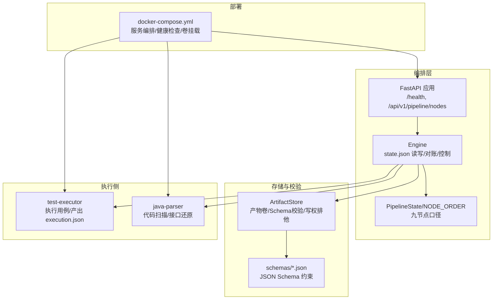
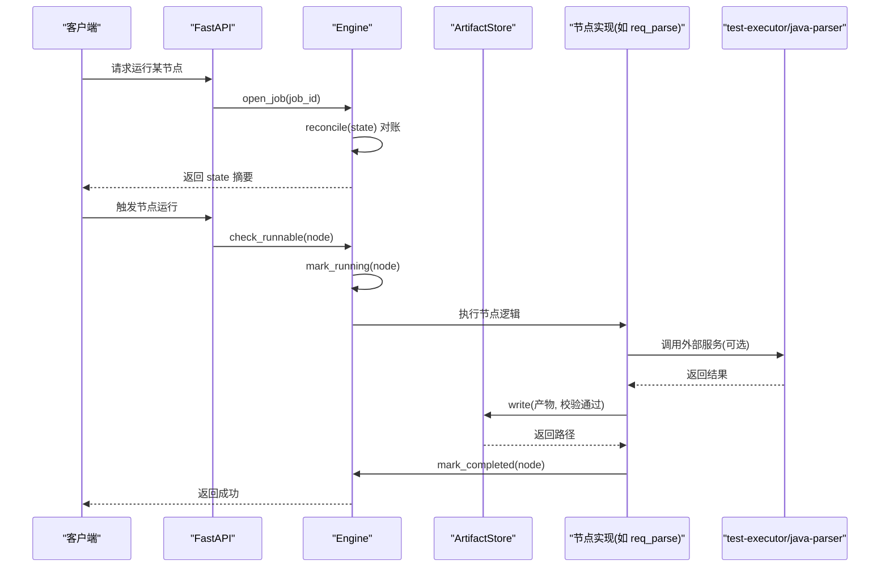
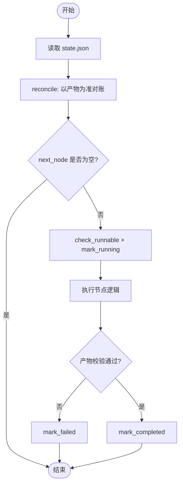
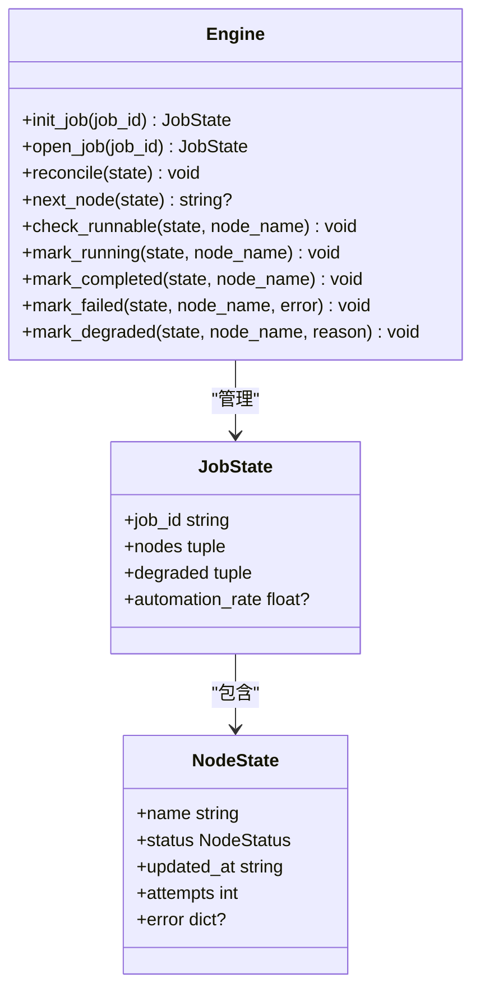
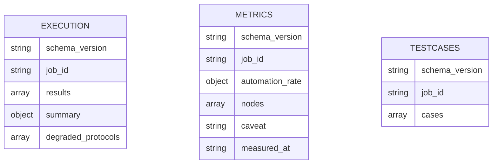
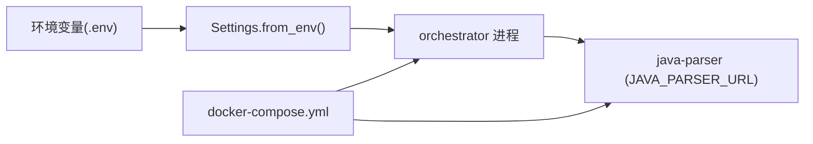
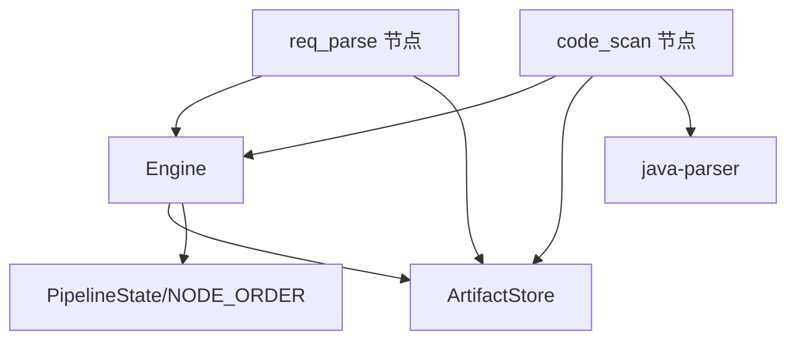

# 高级特性

<cite>
**本文引用的文件**
- [engine.py](file://services/orchestrator/src/orchestrator/engine.py)
- [pipeline.py](file://services/orchestrator/src/orchestrator/pipeline.py)
- [api.py](file://services/orchestrator/src/orchestrator/api.py)
- [artifacts.py](file://services/orchestrator/src/orchestrator/artifacts.py)
- [config.py](file://services/orchestrator/src/orchestrator/config.py)
- [errors.py](file://services/orchestrator/src/orchestrator/errors.py)
- [req_parse.py](file://services/orchestrator/src/orchestrator/nodes/req_parse.py)
- [code_scan.py](file://services/orchestrator/src/orchestrator/nodes/code_scan.py)
- [result.py](file://services/test-executor/src/executor/result.py)
- [docker-compose.yml](file://deploy/docker-compose.yml)
- [execution.json](file://schemas/execution.json)
- [metrics.json](file://schemas/metrics.json)
- [testcases.json](file://schemas/testcases.json)
</cite>

## 目录
1. [简介](#简介)
2. [项目结构](#项目结构)
3. [核心组件](#核心组件)
4. [架构总览](#架构总览)
5. [详细组件分析](#详细组件分析)
6. [依赖关系分析](#依赖关系分析)
7. [性能考量](#性能考量)
8. [故障排查指南](#故障排查指南)
9. [结论](#结论)
10. [附录](#附录)

## 简介
本章节聚焦 LLM-AutoTest 的高级特性，围绕以下目标展开：断点续跑（状态持久化、进度恢复与执行控制）、人工介入机制（节点暂停、参数调整与结果确认）、结果分析（覆盖率统计、性能指标与质量评估）、多环境支持配置（环境变量管理与服务发现）、监控告警集成方式，以及故障排查与性能调优建议。文档以代码级事实为依据，结合数据流与控制流图示，帮助读者快速理解并落地使用。

## 项目结构
LLM-AutoTest 采用微服务编排模式：
- orchestrator：流水线编排引擎，负责状态持久化、断点续跑、跳序防护、降级与人工介入标记。
- test-executor：测试执行侧，产出执行结果与度量汇总。
- java-parser：代码扫描与接口逆向解析服务。
- frontend：前端展示与交互。
- deploy：容器编排与依赖声明。
- schemas：产物 Schema 定义，用于强校验与一致性保障。

图表来源
- [api.py:11-27](file://services/orchestrator/src/orchestrator/api.py#L11-L27)
- [engine.py:133-302](file://services/orchestrator/src/orchestrator/engine.py#L133-L302)
- [artifacts.py:55-157](file://services/orchestrator/src/orchestrator/artifacts.py#L55-L157)
- [pipeline.py:23-84](file://services/orchestrator/src/orchestrator/pipeline.py#L23-L84)
- [docker-compose.yml:1-62](file://deploy/docker-compose.yml#L1-L62)

章节来源
- [api.py:11-27](file://services/orchestrator/src/orchestrator/api.py#L11-L27)
- [engine.py:133-302](file://services/orchestrator/src/orchestrator/engine.py#L133-L302)
- [artifacts.py:55-157](file://services/orchestrator/src/orchestrator/artifacts.py#L55-L157)
- [pipeline.py:23-84](file://services/orchestrator/src/orchestrator/pipeline.py#L23-L84)
- [docker-compose.yml:1-62](file://deploy/docker-compose.yml#L1-L62)

## 核心组件
- 编排引擎（Engine）：实现 state.json 的创建、打开、对账、运行态标记、完成判定、失败回退、降级与人工介入标记；提供 next_node 与 check_runnable 控制流程推进。
- 产物管理器（ArtifactStore）：统一产物卷访问、Schema 校验、写权排他、归档与“节点已完成”判据。
- 流水线定义（Pipeline）：固定九节点顺序与四态标注（completed、manual_intervention、running、pending）。
- 配置（Settings）：从环境变量加载运行时配置，包含 LLM 调用参数、超时、Schema 目录等。
- 错误模型（PipelineError）：统一错误码与结构化错误信息，便于追踪与上报。

章节来源
- [engine.py:43-131](file://services/orchestrator/src/orchestrator/engine.py#L43-L131)
- [artifacts.py:55-157](file://services/orchestrator/src/orchestrator/artifacts.py#L55-L157)
- [pipeline.py:11-84](file://services/orchestrator/src/orchestrator/pipeline.py#L11-L84)
- [config.py:9-56](file://services/orchestrator/src/orchestrator/config.py#L9-L56)
- [errors.py:1-39](file://services/orchestrator/src/orchestrator/errors.py#L1-L39)

## 架构总览
下图展示了断点续跑与人工介入在编排层的控制流，以及与产物卷和外部服务的交互。

图表来源
- [engine.py:153-242](file://services/orchestrator/src/orchestrator/engine.py#L153-L242)
- [artifacts.py:75-131](file://services/orchestrator/src/orchestrator/artifacts.py#L75-L131)
- [req_parse.py:33-78](file://services/orchestrator/src/orchestrator/nodes/req_parse.py#L33-L78)
- [code_scan.py:26-49](file://services/orchestrator/src/orchestrator/nodes/code_scan.py#L26-L49)

## 详细组件分析

### 断点续跑：状态持久化、进度恢复与执行控制
- 状态持久化
  - state.json 由 Engine 原子写入（tmp + replace），包含 job_id、created_at、updated_at、nodes、degraded、resumed。
  - 每个 NodeState 记录 name、status、updated_at、attempts、error。
- 进度恢复
  - open_job 读取 state.json 后调用 reconcile：以产物为准修正状态（产物存在且合规 → completed；状态为 completed 但产物失效 → 回 pending 并记录错误）。
  - resumed 计数每次对账次数，便于审计。
- 执行控制
  - next_node：跳过 completed 与 manual_intervention，返回下一个待运行节点。
  - check_runnable：跳序防护，前序节点必须全部 completed 或 manual_intervention（降级节点视同已处理）。
  - mark_running/mark_completed/mark_failed/mark_degraded：细粒度控制节点生命周期。

图表来源
- [engine.py:153-261](file://services/orchestrator/src/orchestrator/engine.py#L153-L261)
- [engine.py:267-302](file://services/orchestrator/src/orchestrator/engine.py#L267-L302)

章节来源
- [engine.py:43-131](file://services/orchestrator/src/orchestrator/engine.py#L43-L131)
- [engine.py:153-261](file://services/orchestrator/src/orchestrator/engine.py#L153-L261)
- [engine.py:267-302](file://services/orchestrator/src/orchestrator/engine.py#L267-L302)

### 人工介入机制：节点暂停、参数调整与结果确认
- 节点暂停
  - 当节点被降级时，Engine.mark_degraded 将节点状态置为 manual_intervention，并在 degraded 清单中记录原因与时间戳。
  - next_node 会跳过 manual_intervention 节点，流程继续推进后续节点。
- 参数调整
  - 可通过环境变量（Settings）调整 LLM 调用参数（温度、top_p、seed、超时等），影响上游节点生成质量与稳定性。
- 结果确认
  - 人工可修复问题后显式重新触发该节点；Engine.check_runnable 保证前序节点满足条件，确保执行顺序正确。
  - 产物校验失败会拒绝落盘，避免污染产物卷。

图表来源
- [engine.py:43-131](file://services/orchestrator/src/orchestrator/engine.py#L43-L131)
- [engine.py:133-261](file://services/orchestrator/src/orchestrator/engine.py#L133-L261)

章节来源
- [engine.py:153-261](file://services/orchestrator/src/orchestrator/engine.py#L153-L261)
- [config.py:9-56](file://services/orchestrator/src/orchestrator/config.py#L9-L56)

### 结果分析：覆盖率统计、性能指标与质量评估
- 覆盖率统计
  - 当前仓库未直接实现覆盖率采集；可在 test-executor 扩展收集覆盖率数据并写入 metrics.json（需遵循 Schema 约定）。
- 性能指标
  - execution.json 包含每条用例的 duration_ms、timeout、timestamp 等字段，可用于计算平均耗时、超时率、P95/P99 等指标。
  - ExecutionSummary 提供 total、passed、failed_assertion、failed_environment 的程序化汇总，不经过 LLM。
- 质量评估
  - metrics.json 定义自动化率度量：分母固定为 9，value 可为 null 表示数据不完整；nodes 数组逐项记录状态与降级原因。
  - 报告解读需遵循“项目口径 ≠ 生产口径”的声明，避免误用。

图表来源
- [execution.json:1-59](file://schemas/execution.json#L1-L59)
- [metrics.json:1-49](file://schemas/metrics.json#L1-L49)
- [testcases.json:1-35](file://schemas/testcases.json#L1-L35)

章节来源
- [result.py:17-61](file://services/test-executor/src/executor/result.py#L17-L61)
- [execution.json:1-59](file://schemas/execution.json#L1-L59)
- [metrics.json:1-49](file://schemas/metrics.json#L1-L49)

### 多环境支持配置：环境变量管理与服务发现
- 环境变量管理
  - Settings.from_env 从环境变量加载端口、Java Parser URL、产物根目录、LLM 基线参数（模型名、温度、top_p、seed、超时）、Schema 目录等。
  - public_summary 输出不含密钥的配置摘要，便于日志安全。
- 服务发现
  - docker-compose.yml 声明服务间依赖与健康检查；orchestrator 依赖 java-parser 健康后再启动。
  - JAVA_PARSER_URL 通过环境变量注入，实现服务地址解耦。

图表来源
- [config.py:35-56](file://services/orchestrator/src/orchestrator/config.py#L35-L56)
- [docker-compose.yml:18-32](file://deploy/docker-compose.yml#L18-L32)

章节来源
- [config.py:9-56](file://services/orchestrator/src/orchestrator/config.py#L9-L56)
- [docker-compose.yml:1-62](file://deploy/docker-compose.yml#L1-L62)

### 监控告警系统集成方式
- 健康检查
  - FastAPI 暴露 /health 端点，供编排系统探测服务可用性。
  - docker-compose 为 java-parser 配置 healthcheck，确保依赖就绪。
- 指标与日志
  - 建议在 orchestrator 与 test-executor 中接入 Prometheus 指标导出（如请求数、错误率、耗时分布），并结合集中式日志系统进行聚合与告警。
  - 利用 artifacts.py 的归档能力，将异常产物与日志归档至 archive 目录，便于回溯。

章节来源
- [api.py:16-25](file://services/orchestrator/src/orchestrator/api.py#L16-L25)
- [docker-compose.yml:11-16](file://deploy/docker-compose.yml#L11-L16)
- [artifacts.py:133-142](file://services/orchestrator/src/orchestrator/artifacts.py#L133-L142)

## 依赖关系分析
- 组件耦合
  - Engine 依赖 ArtifactStore 进行产物读写与校验，依赖 Pipeline 获取节点顺序与状态枚举。
  - 节点实现（如 req_parse、code_scan）依赖 Engine 与 ArtifactStore，并通过外部服务（LLM、java-parser）获取输入。
- 外部依赖
  - java-parser：代码扫描与接口还原，通信失败以 X-ORCH-03 表达。
  - LLM 客户端：网络/超时以 X-LLM-01 表达；输出不合规以 X-LLM-02 表达。
- 循环依赖
  - 当前模块划分清晰，未发现循环依赖。

图表来源
- [engine.py:133-261](file://services/orchestrator/src/orchestrator/engine.py#L133-L261)
- [artifacts.py:55-157](file://services/orchestrator/src/orchestrator/artifacts.py#L55-L157)
- [req_parse.py:33-78](file://services/orchestrator/src/orchestrator/nodes/req_parse.py#L33-L78)
- [code_scan.py:26-49](file://services/orchestrator/src/orchestrator/nodes/code_scan.py#L26-L49)

章节来源
- [engine.py:133-261](file://services/orchestrator/src/orchestrator/engine.py#L133-L261)
- [artifacts.py:55-157](file://services/orchestrator/src/orchestrator/artifacts.py#L55-L157)
- [req_parse.py:33-78](file://services/orchestrator/src/orchestrator/nodes/req_parse.py#L33-L78)
- [code_scan.py:26-49](file://services/orchestrator/src/orchestrator/nodes/code_scan.py#L26-L49)

## 性能考量
- 产物校验开销
  - ArtifactStore.validate 对每个 JSON 产物执行 Schema 校验，建议在高频写入场景下缓存 Schema 对象以减少重复解析。
- 并发与锁
  - 当前写操作为单进程原子替换，若引入多实例并行写同一 job 目录，需增加分布式锁或文件锁以避免竞态。
- LLM 调用优化
  - 合理设置 temperature/top_p/seed 与超时，降低不稳定输出导致的重试成本。
  - 对大输入（多仓库源码）采用分块策略，减少单次 token 消耗与超时风险。
- 执行侧性能
  - 基于 execution.json 的 duration_ms 统计 P95/P99 耗时，识别慢用例并优化。
  - 区分断言失败与环境失败，优先解决环境问题以提升整体通过率。

[本节为通用性能建议，无需特定文件引用]

## 故障排查指南
- 常见错误码
  - X-LLM-01：LLM 调用超时/网络失败（可重试）。
  - X-LLM-02：LLM 输出未过 Schema 校验（不重试，人工介入）。
  - X-LLM-03：Prompt 缺失/元信息不合规（配置错误，人工介入）。
  - X-ORCH-01：产物校验失败（拒绝落盘）。
  - X-ORCH-02：断点续跑跳序请求（前序未完成）。
  - X-ORCH-03：java-parser 服务不可达/通信失败。
- 排查步骤
  - 检查 state.json 的 nodes 与 degraded 清单，定位卡住节点与降级原因。
  - 核对产物是否存在且通过 Schema 校验（is_node_completed）。
  - 查看 logs 与 archive 目录中的历史产物与错误详情。
  - 验证环境变量与服务发现（JAVA_PARSER_URL、LLM_* 参数）。
  - 使用 /health 检查服务健康状态。

章节来源
- [errors.py:1-39](file://services/orchestrator/src/orchestrator/errors.py#L1-L39)
- [engine.py:153-261](file://services/orchestrator/src/orchestrator/engine.py#L153-L261)
- [artifacts.py:75-131](file://services/orchestrator/src/orchestrator/artifacts.py#L75-L131)
- [api.py:16-25](file://services/orchestrator/src/orchestrator/api.py#L16-L25)

## 结论
LLM-AutoTest 通过 Engine 与 ArtifactStore 实现了可靠的断点续跑与人工介入机制，配合严格的 Schema 校验与固定九节点口径，确保了流水线的一致性与可追溯性。结果分析基于程序化汇总与标准化 Schema，避免了 LLM 主观偏差。多环境配置通过环境变量与服务发现解耦，便于部署与运维。建议在生产环境中补充监控告警与性能观测，持续优化 LLM 调用与执行侧效率。

[本节为总结性内容，无需特定文件引用]

## 附录
- 最佳实践
  - 始终通过 open_job + reconcile 恢复状态，避免手动修改 state.json。
  - 对降级节点记录明确原因，并在报告中分列说明。
  - 使用环境变量管理敏感信息与运行参数，避免硬编码。
  - 在 test-executor 中严格区分断言失败与环境失败，提升问题定位效率。
- 常见问题
  - 跳序请求：确保前序节点 completed 或 manual_intervention。
  - 产物校验失败：检查 Schema 与 payload 结构，必要时归档旧产物并重试。
  - LLM 输出不合规：调整 Prompt 与参数，必要时人工介入修正。

[本节为通用指导，无需特定文件引用]