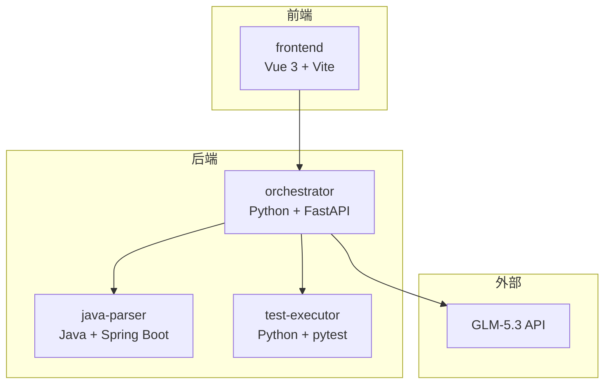
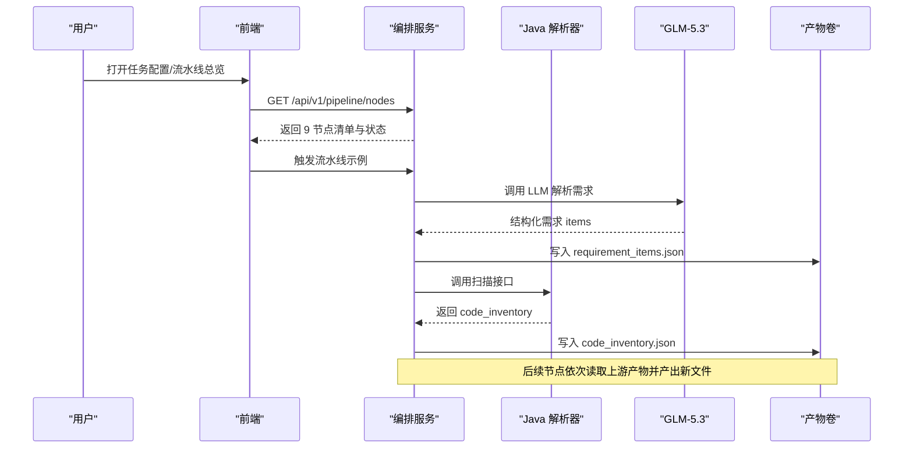
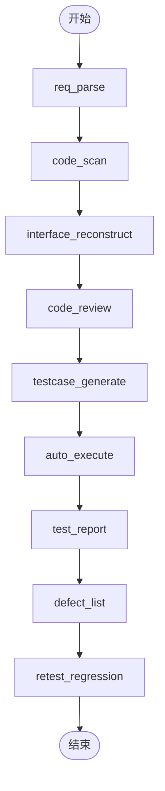
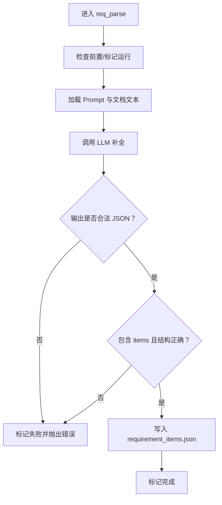
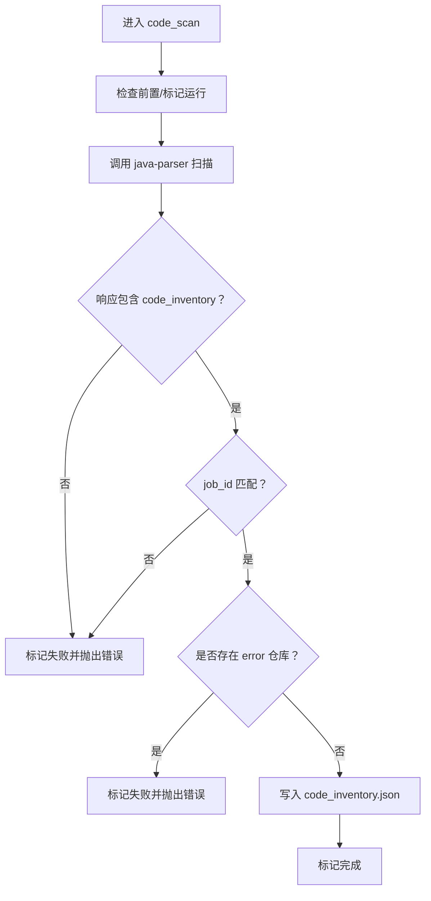
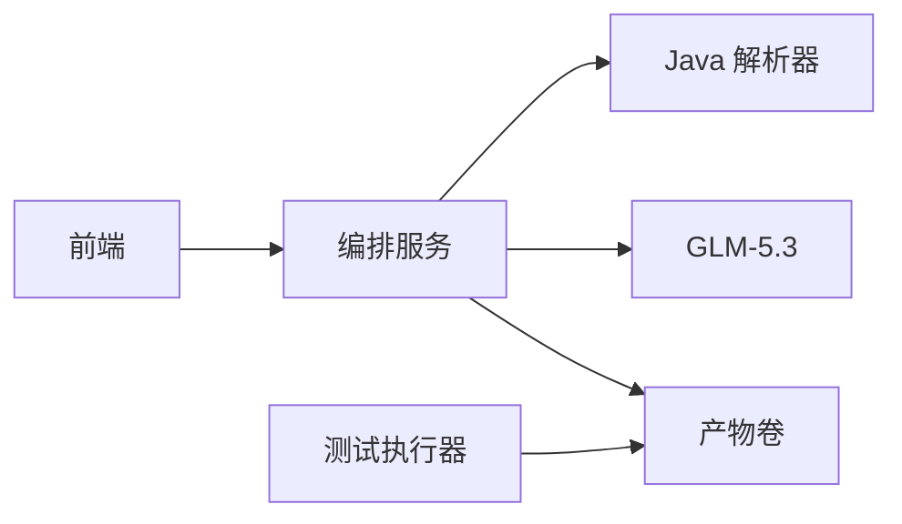

# 项目概述

<cite>
**本文引用的文件**
- [pipeline.py](file://services/orchestrator/src/orchestrator/pipeline.py)
- [api.py](file://services/orchestrator/src/orchestrator/api.py)
- [config.py](file://services/orchestrator/src/orchestrator/config.py)
- [ParserApplication.java](file://services/java-parser/src/main/java/com/llmautotest/parser/ParserApplication.java)
- [HealthController.java](file://services/java-parser/src/main/java/com/llmautotest/parser/HealthController.java)
- [package.json](file://services/frontend/package.json)
- [App.vue](file://services/frontend/src/App.vue)
- [docker-compose.yml](file://deploy/docker-compose.yml)
- [08-系统架构与技术选型.md](file://MumuSpec/08-系统架构与技术选型.md)
- [06-功能规格说明.md](file://MumuSpec/06-功能规格说明.md)
- [04-产品需求说明.md](file://MumuSpec/04-产品需求说明.md)
- [execution.json](file://schemas/execution.json)
- [req_parse.py](file://services/orchestrator/src/orchestrator/nodes/req_parse.py)
- [code_scan.py](file://services/orchestrator/src/orchestrator/nodes/code_scan.py)
</cite>

## 目录
1. [简介](#简介)
2. [项目结构](#项目结构)
3. [核心组件](#核心组件)
4. [架构总览](#架构总览)
5. [详细组件分析](#详细组件分析)
6. [依赖关系分析](#依赖关系分析)
7. [性能与可扩展性](#性能与可扩展性)
8. [故障排查指南](#故障排查指南)
9. [结论](#结论)
10. [附录：快速开始](#附录快速开始)

## 简介
LLM-AutoTest 是一个 AI 驱动的自动化测试流水线平台，目标是将“需求文档 → 代码扫描 → 接口逆向还原 → Code Review → 用例生成 → 执行 → 报告 → 缺陷闭环 → 回归沉淀”的全流程自动化。系统通过固定 9 节点口径（分母为 9）度量自动化率，并以结构化产物在节点间传递数据，确保可追溯、可复现、可度量。

业务价值：
- 降低手工编写用例与回归成本，提升覆盖率与一致性
- 以 LLM 辅助解析需求与逆向接口，缩短从需求到可执行脚本的周期
- 提供统一的前端界面与 REST API，便于团队协同与集成
- 通过容器化部署与共享产物卷，实现多服务解耦与独立升级

## 项目结构
仓库采用多服务微服务架构，按职责拆分为前端、编排服务、Java 解析器、测试执行器等容器，并通过 docker-compose 编排。关键目录：
- services/orchestrator：Python FastAPI 编排服务，定义 9 节点流水线与状态管理
- services/java-parser：Java Spring Boot 服务，负责 Java 多仓库扫描与接口逆向
- services/frontend：Vue 3 + Vite 前端，提供任务配置、流水线监控、报告与度量等页面
- services/test-executor：测试执行器（可选启用），负责加载并执行生成的测试脚本
- deploy/docker-compose.yml：唯一事实来源的容器编排配置
- schemas：各阶段产物 JSON Schema，用于校验与度量汇总
- MumuSpec/docs：需求、架构、规格等设计文档

图表来源
- [docker-compose.yml:3-41](file://deploy/docker-compose.yml#L3-L41)
- [08-系统架构与技术选型.md:29-65](file://MumuSpec/08-系统架构与技术选型.md#L29-L65)

章节来源
- [docker-compose.yml:3-41](file://deploy/docker-compose.yml#L3-L41)
- [08-系统架构与技术选型.md:29-65](file://MumuSpec/08-系统架构与技术选型.md#L29-L65)

## 核心组件
- 编排服务（orchestrator）
  - 暴露 REST API，维护 9 节点固定顺序与四态标注（待运行/运行中/已完成/人工介入）
  - 通过 ArtifactStore 将结构化产物落盘，供下游节点消费
  - 调用 LLM 客户端完成需求解析等节点任务
- Java 解析器（java-parser）
  - 提供健康检查与扫描接口，支持多仓库源码扫描与接口逆向
  - 输出 code_inventory.json，供后续接口还原与映射使用
- 前端（frontend）
  - 六页导航：任务配置、流水线总览、Code Review 三视图、测试报告、缺陷闭环、回归沉淀与度量
  - 通过 Mock 数据占位，逐步对接真实 API
- 测试执行器（test-executor）
  - 加载生成的测试脚本，执行并产出 execution.json，供报告与度量汇总

章节来源
- [pipeline.py:11-84](file://services/orchestrator/src/orchestrator/pipeline.py#L11-L84)
- [api.py:11-27](file://services/orchestrator/src/orchestrator/api.py#L11-L27)
- [ParserApplication.java:8-16](file://services/java-parser/src/main/java/com/llmautotest/parser/ParserApplication.java#L8-L16)
- [HealthController.java:8-17](file://services/java-parser/src/main/java/com/llmautotest/parser/HealthController.java#L8-L17)
- [package.json:1-29](file://services/frontend/package.json#L1-L29)
- [App.vue:15-42](file://services/frontend/src/App.vue#L15-L42)

## 架构总览
系统采用混合架构：Python 作为流水线主体，Java 解析器以独立服务形式嵌入，前后端通过 REST 交互；所有节点间以文件为接口，结构化 JSON 落盘到共享卷 /data/llm-autotest。

图表来源
- [api.py:21-25](file://services/orchestrator/src/orchestrator/api.py#L21-L25)
- [req_parse.py:33-78](file://services/orchestrator/src/orchestrator/nodes/req_parse.py#L33-L78)
- [code_scan.py:26-49](file://services/orchestrator/src/orchestrator/nodes/code_scan.py#L26-L49)
- [docker-compose.yml:57-62](file://deploy/docker-compose.yml#L57-L62)

## 详细组件分析

### 9 节点固定流水线与状态
- 固定顺序：req_parse → code_scan → interface_reconstruct → code_review → testcase_generate → auto_execute → test_report → defect_list → retest_regression
- 四态标注：completed / manual_intervention / running / pending
- 自动化率 = completed 节点数 / 9（程序化计算，不经 LLM）

图表来源
- [pipeline.py:23-34](file://services/orchestrator/src/orchestrator/pipeline.py#L23-L34)
- [pipeline.py:11-21](file://services/orchestrator/src/orchestrator/pipeline.py#L11-L21)

章节来源
- [pipeline.py:11-84](file://services/orchestrator/src/orchestrator/pipeline.py#L11-L84)

### 需求解析节点（req_parse）
- 输入：需求文档（Word/Markdown/Excel）
- 处理：加载 Prompt → 调用 LLM 解析 → 提取 items 数组 → 校验 Schema → 落盘 requirement_items.json
- 失败口径：Prompt 缺失、网络/超时、输出不可解析或未过 Schema，均记录失败并抛错

图表来源
- [req_parse.py:33-78](file://services/orchestrator/src/orchestrator/nodes/req_parse.py#L33-L78)
- [req_parse.py:81-124](file://services/orchestrator/src/orchestrator/nodes/req_parse.py#L81-L124)

章节来源
- [req_parse.py:1-125](file://services/orchestrator/src/orchestrator/nodes/req_parse.py#L1-L125)

### 代码扫描节点（code_scan）
- 输入：Java 多仓库路径列表
- 处理：调用 java-parser 扫描 → 提取 code_inventory → 校验 job_id 归属 → 落盘 code_inventory.json
- 仓库四态：error（硬错误）、empty（正常继续）、truncated（截断范围记录）、ok

图表来源
- [code_scan.py:26-49](file://services/orchestrator/src/orchestrator/nodes/code_scan.py#L26-L49)
- [code_scan.py:52-94](file://services/orchestrator/src/orchestrator/nodes/code_scan.py#L52-L94)

章节来源
- [code_scan.py:1-94](file://services/orchestrator/src/orchestrator/nodes/code_scan.py#L1-L94)

### Java 解析器服务
- 入口：Spring Boot 应用启动
- 健康检查：/health 返回服务名与状态，供编排依赖检测
- 职责：多仓库扫描、接口逆向还原，输出结构化 inventory

章节来源
- [ParserApplication.java:8-16](file://services/java-parser/src/main/java/com/llmautotest/parser/ParserApplication.java#L8-L16)
- [HealthController.java:8-17](file://services/java-parser/src/main/java/com/llmautotest/parser/HealthController.java#L8-L17)

### 前端应用
- 技术栈：Vue 3 + Vite + TypeScript
- 页面：任务配置、流水线总览、Code Review 三视图、测试报告、缺陷闭环、回归沉淀与度量
- 当前状态：部分页面使用占位组件与 mock 数据，后续对接 orchestrator API

章节来源
- [package.json:1-29](file://services/frontend/package.json#L1-L29)
- [App.vue:15-42](file://services/frontend/src/App.vue#L15-L42)

### 执行结果与度量
- execution.json：定义测试结果与摘要字段，仅程序化汇总数值，不经 LLM
- 自动化率：基于 9 节点状态计算，分母固定为 9

章节来源
- [execution.json:1-59](file://schemas/execution.json#L1-L59)
- [pipeline.py:61-70](file://services/orchestrator/src/orchestrator/pipeline.py#L61-L70)

## 依赖关系分析
- 编排服务依赖：
  - LLM 客户端（GLM-5.3）
  - Java 解析器（REST）
  - 产物存储（共享卷）
- 前端依赖：
  - 编排服务 API
- 测试执行器依赖：
  - 产物卷中的测试脚本与执行上下文

图表来源
- [docker-compose.yml:3-41](file://deploy/docker-compose.yml#L3-L41)
- [config.py:9-24](file://services/orchestrator/src/orchestrator/config.py#L9-L24)

章节来源
- [docker-compose.yml:3-41](file://deploy/docker-compose.yml#L3-L41)
- [config.py:9-56](file://services/orchestrator/src/orchestrator/config.py#L9-L56)

## 性能与可扩展性
- 容器化隔离：每个服务独立进程，便于水平扩展与故障隔离
- 产物卷共享：避免跨服务数据拷贝，减少 I/O 开销
- 异步编排：编排服务使用异步模型，提高并发处理能力
- 降级策略：对非 REST 协议或环境不可达场景，记录降级与原因，保证流程不中断

[本节为通用指导，无需特定文件引用]

## 故障排查指南
- 健康检查
  - orchestrator：GET /health
  - java-parser：GET /health
- 常见错误
  - 缺少必填环境变量：检查 PORT、JAVA_PARSER_URL、LLM_BASE_URL、LLM_SEED 等
  - LLM 输出未过 Schema：查看 req_parse 节点日志，确认 Prompt 与输出格式
  - 仓库扫描错误：检查 java-parser 返回的 repositories 状态，定位 error 仓库
  - 执行环境不可达：标记“环境失败”，隔离待环境确认

章节来源
- [api.py:16-19](file://services/orchestrator/src/orchestrator/api.py#L16-L19)
- [HealthController.java:12-16](file://services/java-parser/src/main/java/com/llmautotest/parser/HealthController.java#L12-L16)
- [config.py:35-56](file://services/orchestrator/src/orchestrator/config.py#L35-L56)
- [code_scan.py:78-94](file://services/orchestrator/src/orchestrator/nodes/code_scan.py#L78-L94)
- [execution.json:19-28](file://schemas/execution.json#L19-L28)

## 结论
LLM-AutoTest 通过固定 9 节点流水线与结构化产物，实现了从需求到回归沉淀的端到端自动化。Python 编排服务与 Java 解析器解耦协作，前端提供可视化操作入口，配合容器化部署与共享产物卷，满足团队协作与持续交付的需求。未来可在执行器与 Mock 服务方面进一步完善，覆盖更多协议与复杂场景。

[本节为总结，无需特定文件引用]

## 附录：快速开始
- 前置条件
  - 已安装 Docker 与 docker-compose
  - 准备 .env 文件，至少包含 JAVA_PARSER_URL、LLM_BASE_URL、LLM_SEED 等必要变量
- 启动服务
  - 命令：docker compose -f deploy/docker-compose.yml --env-file deploy/.env up -d
  - 端口：
    - 前端：8080
    - 编排服务：8000
    - Java 解析器：8081
- 验证健康
  - 访问 http://localhost:8000/health
  - 访问 http://localhost:8081/health
- 使用前端
  - 打开浏览器访问 http://localhost:8080
  - 在“任务配置”中上传需求文档与指定仓库路径
  - 在“流水线总览”中查看 9 节点状态与自动化率

章节来源
- [docker-compose.yml:1-62](file://deploy/docker-compose.yml#L1-L62)
- [api.py:16-25](file://services/orchestrator/src/orchestrator/api.py#L16-L25)
- [HealthController.java:12-16](file://services/java-parser/src/main/java/com/llmautotest/parser/HealthController.java#L12-L16)
- [04-产品需求说明.md:29-90](file://MumuSpec/04-产品需求说明.md#L29-L90)