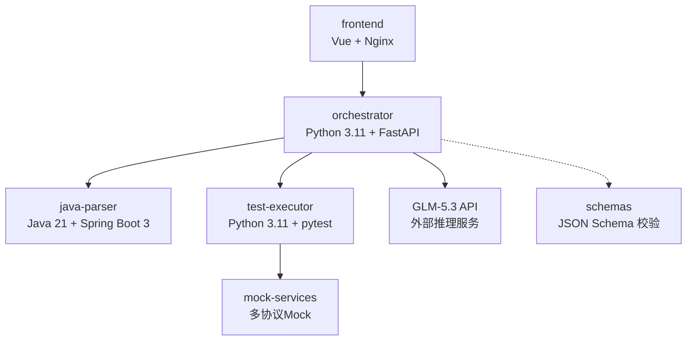
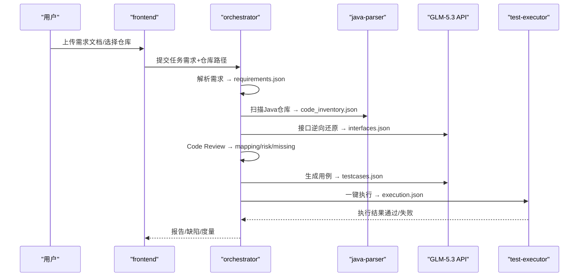
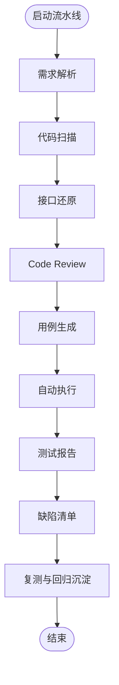
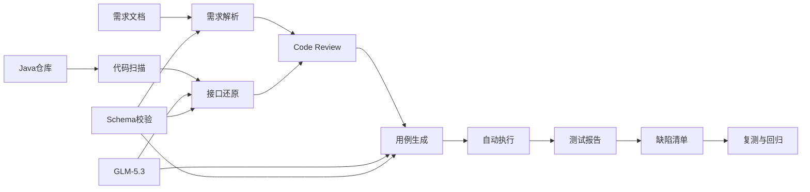

# 项目背景与目标

<cite>
**本文引用的文件**
- [MumuSpec/04-产品需求说明.md](file://MumuSpec/04-产品需求说明.md)
- [MumuSpec/05-用户故事与验收标准.md](file://MumuSpec/05-用户故事与验收标准.md)
- [MumuSpec/08-系统架构与技术选型.md](file://MumuSpec/08-系统架构与技术选型.md)
- [MumuSpec/12-实施计划与里程碑.md](file://MumuSpec/12-实施计划与里程碑.md)
- [MumuSpec/13-测试策略与质量门禁.md](file://MumuSpec/13-测试策略与质量门禁.md)
- [docs/02_立项提案.md](file://docs/02_立项提案.md)
- [services/orchestrator/src/orchestrator/config.py](file://services/orchestrator/src/orchestrator/config.py)
- [services/orchestrator/src/orchestrator/pipeline.py](file://services/orchestrator/src/orchestrator/pipeline.py)
- [schemas/README.md](file://schemas/README.md)
</cite>

## 目录
1. [引言](#引言)
2. [项目结构](#项目结构)
3. [核心组件](#核心组件)
4. [架构总览](#架构总览)
5. [详细组件分析](#详细组件分析)
6. [依赖关系分析](#依赖关系分析)
7. [性能与可维护性考量](#性能与可维护性考量)
8. [故障排查指南](#故障排查指南)
9. [结论](#结论)
10. [附录](#附录)

## 引言
传统接口测试在团队多仓库、无统一接口文档的背景下，普遍面临以下挑战：
- 用例编写耗时：测试人员需逐模块阅读源码以理解接口，重复劳动多、效率低。
- 维护成本高：代码演进频繁，手工用例难以及时同步，回归成本持续攀升。
- 覆盖率不足：受限于人力与时间，关键路径与异常分支覆盖不充分，质量风险外溢。
- 资产沉淀弱：缺乏历史用例与缺陷数据复用，每次回归“从零开始”。

本项目以AI技术赋能自动化测试，目标是构建基于大语言模型的智能测试平台，打通“从需求文档到测试用例”的端到端自动化链路，实现：
- 用LLM进行需求解析、接口逆向还原、Code Review三视图生成、用例生成与执行编排；
- 通过容器化服务与标准化产物Schema，形成可度量、可复用的测试流水线；
- 以“跑通即交付”的方式验证可行性，为后续规模化投入提供决策依据。

业务价值体现在：
- 降低测试成本：减少人工编写与维护用例的工作量；
- 提高测试质量：系统化覆盖正常/边界/异常场景，提升断言明确性与结果可追溯性；
- 加速交付周期：一键触发全量执行，缩短反馈闭环；
- 建立可度量的自动化基线：以9节点口径量化自动化率，指导后续优化方向。

愿景与长期规划：
- 短期（首版）：在限定范围内完成“需求输入→接口还原→用例生成→执行→报告→缺陷闭环→回归沉淀”的最小可用闭环，并产出首个自动化率数值；
- 中期：扩展协议覆盖、增强LLM稳定性与提示工程、完善前端可视化与度量看板；
- 长期：沉淀企业级智能测试中台，支持多项目接入、增量更新、跨团队协作与治理。

**章节来源**
- [docs/02_立项提案.md:10-18](file://docs/02_立项提案.md#L10-L18)
- [MumuSpec/04-产品需求说明.md:29-90](file://MumuSpec/04-产品需求说明.md#L29-L90)
- [MumuSpec/08-系统架构与技术选型.md:29-65](file://MumuSpec/08-系统架构与技术选型.md#L29-L65)

## 项目结构
项目采用多容器化微服务架构，职责清晰、边界明确：
- frontend：Vue 3 + Nginx，提供任务配置、流水线监控、三视图展示、报告/缺陷/度量查看等Web能力；
- orchestrator：Python 3.11 + FastAPI，负责9节点编排、断点续跑、产物管理与REST API；
- java-parser：Java 21 + Spring Boot 3 + JavaParser，负责Java多仓库扫描与接口逆向还原；
- test-executor：Python 3.11 + pytest，负责测试脚本加载与无人值守执行、断言二态判定；
- mock-services：按协议提供gRPC/GraphQL/SOAP/MQ的Mock执行环境；
- schemas：集中管理所有结构化产物的JSON Schema，作为单一事实来源；
- MumuSpec/docs：需求规格、架构设计、实施计划、测试策略等规范文档。

**图表来源**
- [MumuSpec/08-系统架构与技术选型.md:29-65](file://MumuSpec/08-系统架构与技术选型.md#L29-L65)
- [schemas/README.md:1-29](file://schemas/README.md#L1-L29)

**章节来源**
- [MumuSpec/08-系统架构与技术选型.md:29-79](file://MumuSpec/08-系统架构与技术选型.md#L29-L79)
- [schemas/README.md:1-29](file://schemas/README.md#L1-L29)

## 核心组件
- 需求解析与输入通道：支持Word/Markdown/Excel三格式需求文档解析，输出结构化需求条目JSON，供下游消费。
- 代码扫描与接口还原：对指定Java多仓库进行源码扫描，结合LLM从源码逆向还原接口定义（路径、方法、入参、出参、协议类型），输出结构化接口清单。
- Code Review三视图：基于需求与接口/代码映射，一次生成三种视图——需求-代码映射表、风险清单、遗漏功能清单。
- 用例生成与执行：LLM基于接口与需求自动生成可执行测试脚本，每接口至少3条用例（正常/边界/异常各≥1），由执行引擎一键触发全量执行，输出结构化执行结果。
- 测试报告与缺陷闭环：自动产出测试报告（Markdown+JSON），失败用例转化为缺陷记录，支持复测与回归脚本沉淀。
- 度量与验收：定义9节点口径，计算自动化率=已完成节点数/9，并在验收演示中实测首个数值。

这些能力共同构成“从需求到回归”的端到端自动化闭环，显著降低人工介入比例，提升测试效率与准确性。

**章节来源**
- [MumuSpec/04-产品需求说明.md:29-90](file://MumuSpec/04-产品需求说明.md#L29-L90)
- [MumuSpec/05-用户故事与验收标准.md:29-216](file://MumuSpec/05-用户故事与验收标准.md#L29-L216)
- [MumuSpec/13-测试策略与质量门禁.md:29-89](file://MumuSpec/13-测试策略与质量门禁.md#L29-L89)

## 架构总览
系统整体容器化部署，前后端分离、服务解耦，通过REST交互与共享产物卷持久化状态。关键设计原则包括：
- Python为主流水线主体，Java解析以独立服务嵌入，边界清晰；
- 冻结LLM基线为GLM-5.3，禁止引入其他模型；
- 产物Schema作为单一事实来源，所有LLM输出必须通过Schema校验后方可进入下游；
- 前端提供Web操作入口，后端保留统一命令入口兼容基线口径。

**图表来源**
- [MumuSpec/08-系统架构与技术选型.md:29-65](file://MumuSpec/08-系统架构与技术选型.md#L29-L65)
- [MumuSpec/04-产品需求说明.md:29-90](file://MumuSpec/04-产品需求说明.md#L29-L90)

**章节来源**
- [MumuSpec/08-系统架构与技术选型.md:29-97](file://MumuSpec/08-系统架构与技术选型.md#L29-L97)

## 详细组件分析

### 流水线与节点状态（orchestrator）
- 固定9节点口径：需求解析、代码扫描、接口还原、Code Review、用例生成、自动执行、测试报告、缺陷清单、复测与回归沉淀；
- 节点四态：completed/manual_intervention/running/pending；
- 自动化率计算：已完成节点数/9，骨架阶段返回None表示尚未实测，正式实现从产物卷读取。

**图表来源**
- [services/orchestrator/src/orchestrator/pipeline.py:11-34](file://services/orchestrator/src/orchestrator/pipeline.py#L11-L34)
- [services/orchestrator/src/orchestrator/pipeline.py:45-70](file://services/orchestrator/src/orchestrator/pipeline.py#L45-L70)

**章节来源**
- [services/orchestrator/src/orchestrator/pipeline.py:1-84](file://services/orchestrator/src/orchestrator/pipeline.py#L1-L84)

### 配置与环境变量（orchestrator）
- 全部配置来自环境变量，避免硬编码；
- 包含端口、Java解析服务地址、产物根目录、GLM-5.3调用参数（base_url、model_name、api_key、temperature、top_p、seed、timeout）、Schema目录等；
- 提供公开摘要方法用于日志安全输出，不包含密钥。

**章节来源**
- [services/orchestrator/src/orchestrator/config.py:1-56](file://services/orchestrator/src/orchestrator/config.py#L1-L56)

### 产物Schema与契约
- schemas目录集中存放所有结构化产物的JSON Schema，作为单一事实来源；
- 每个Schema含schema_version字段，结构变更必须升版本；
- orchestrator/test-executor中的pydantic模型与Schema一一对应；
- LLM输出必须通过对应Schema校验后才可进入下游产物；
- 横切约定包括ID命名、时间戳格式、协议枚举、错误结构等。

**章节来源**
- [schemas/README.md:1-29](file://schemas/README.md#L1-L29)

### 用户故事与验收标准
- 覆盖需求输入、代码输入、Code Review、用例生成与执行、报告与缺陷闭环、度量与验收六大Epic；
- 每个用户故事有明确的验收标准（AC），确保“跑通”的可验证性；
- P0/P1优先级划分，保障首版聚焦核心价值。

**章节来源**
- [MumuSpec/05-用户故事与验收标准.md:29-231](file://MumuSpec/05-用户故事与验收标准.md#L29-L231)

## 依赖关系分析
- 上游依赖：
  - 需求文档（Word/Markdown/Excel）→ 需求解析；
  - Java多仓库 → 代码扫描与接口还原；
  - GLM-5.3 API → LLM推理调用；
- 内部依赖：
  - orchestrator编排各节点，依赖java-parser与test-executor；
  - 产物Schema贯穿全链，作为数据契约；
- 外部依赖：
  - Mock服务（gRPC/GraphQL/SOAP/MQ）用于多协议执行覆盖；
  - 文件系统挂载用于产物持久化。

**图表来源**
- [MumuSpec/04-产品需求说明.md:29-90](file://MumuSpec/04-产品需求说明.md#L29-L90)
- [schemas/README.md:1-29](file://schemas/README.md#L1-L29)

**章节来源**
- [MumuSpec/04-产品需求说明.md:29-90](file://MumuSpec/04-产品需求说明.md#L29-L90)
- [schemas/README.md:1-29](file://schemas/README.md#L1-L29)

## 性能与可维护性考量
- 容器化部署：服务隔离、独立升级、故障隔离，便于扩缩容；
- 产物Schema驱动：统一数据结构，降低耦合，提升可维护性；
- 配置外置：环境变量管理敏感信息与运行参数，避免硬编码；
- 分层测试与质量门禁：Lint/Unit/Integration/E2E四层门禁，保障代码质量；
- 覆盖率要求：核心逻辑覆盖率≥70%，LLM客户端一律Mock，不依赖真实调用；
- 降级策略：非REST协议在环境不可用时降级为“脚本生成+Mock演示”，保证流程可推进。

**章节来源**
- [MumuSpec/08-系统架构与技术选型.md:67-97](file://MumuSpec/08-系统架构与技术选型.md#L67-L97)
- [MumuSpec/13-测试策略与质量门禁.md:29-89](file://MumuSpec/13-测试策略与质量门禁.md#L29-L89)

## 故障排查指南
- 配置缺失：orchestrator启动时若缺少必填环境变量将显式报错，检查PORT/JAVA_PARSER_URL/LLM_BASE_URL/LLM_SEED等；
- LLM调用超时：可通过LLM_TIMEOUT_S调整单次调用超时，结合限流策略与token用量估算规避阻塞；
- 接口还原失败：对无法解析的文件输出“跳过+原因”记录，不中断整体流程，建议准备兜底仓库；
- 执行环境不可用：非REST协议降级为“脚本生成+Mock演示”，优先保障REST最小闭环；
- 产物校验失败：确认LLM输出已通过对应Schema校验，必要时回退至上一节点重跑；
- 自动化率偏低：识别人工介入节点瓶颈，针对性优化或降级处理。

**章节来源**
- [services/orchestrator/src/orchestrator/config.py:35-56](file://services/orchestrator/src/orchestrator/config.py#L35-L56)
- [MumuSpec/05-用户故事与验收标准.md:60-69](file://MumuSpec/05-用户故事与验收标准.md#L60-L69)
- [MumuSpec/13-测试策略与质量门禁.md:29-89](file://MumuSpec/13-测试策略与质量门禁.md#L29-L89)

## 结论
LLM-AutoTest以AI技术重构接口测试流程，通过“需求输入→接口还原→用例生成→执行→报告→缺陷闭环→回归沉淀”的端到端自动化，显著降低测试成本、提升测试质量、加速交付周期。首版聚焦“跑通即交付”，以9节点口径量化自动化率，为后续规模化投入提供决策依据。长期愿景是打造企业级智能测试中台，支撑多项目接入与跨团队协作。

[本节为总结性内容，不直接分析具体文件]

## 附录
- 实施计划与里程碑：明确人力配置、里程碑交付物、WBS分解与关键路径；
- 测试策略与质量门禁：定义分层测试、门禁触发时机与通过条件；
- 系统架构与技术选型：容器清单、技术栈选型理由、部署方案与外部系统边界。

**章节来源**
- [MumuSpec/12-实施计划与里程碑.md:29-98](file://MumuSpec/12-实施计划与里程碑.md#L29-L98)
- [MumuSpec/13-测试策略与质量门禁.md:29-89](file://MumuSpec/13-测试策略与质量门禁.md#L29-L89)
- [MumuSpec/08-系统架构与技术选型.md:29-97](file://MumuSpec/08-系统架构与技术选型.md#L29-L97)