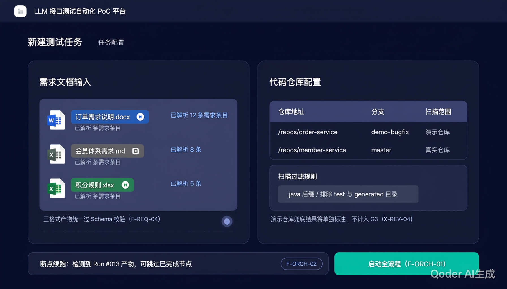
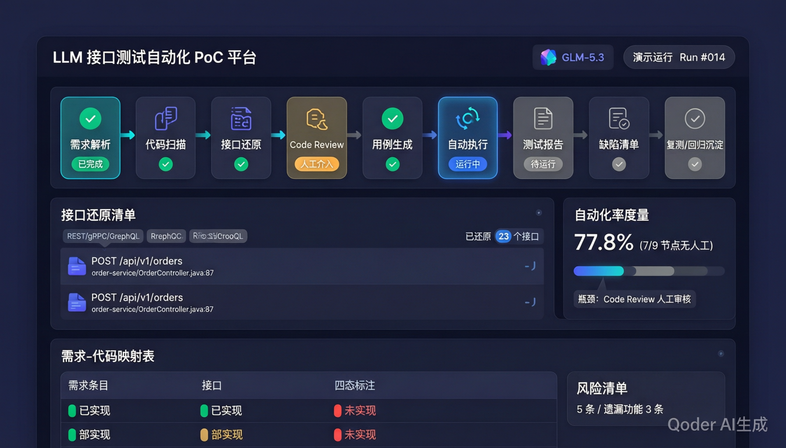
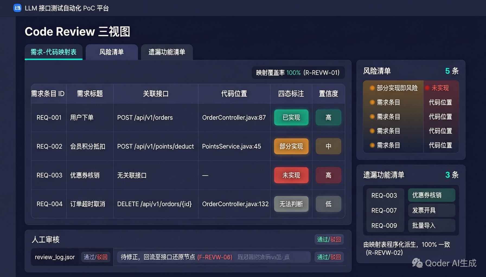
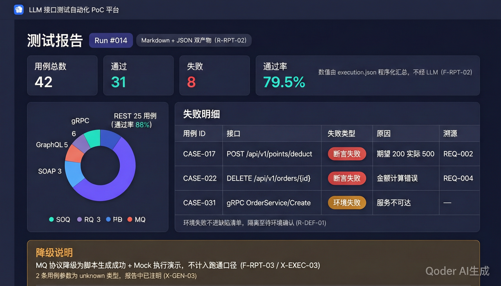
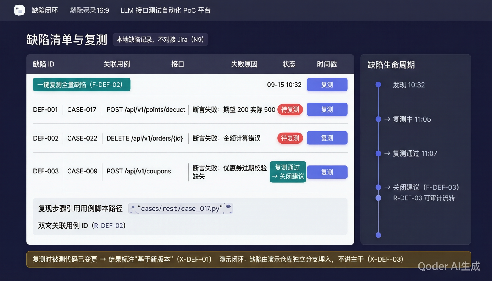
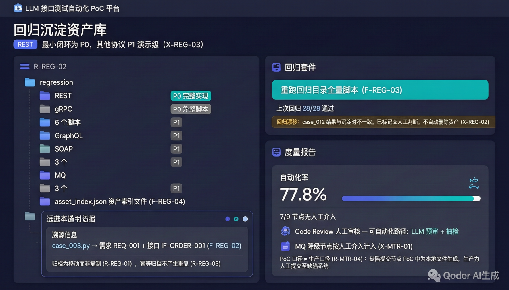

# UI 设计：LLM-AutoTest

- **文档日期**：2026-09-15
- **文档性质**：产品设计辅助资料（非冻结基线，不修改 01–04 任何口径，依据 [06_需求定稿冻结.md](06_需求定稿冻结.md) 变更控制规则第 1 条）
- **资产位置**：[assets/](assets/) 目录，6 张 UI Demo 概念图（AI 生成示意图，非可运行界面）；集中展示页：[assets/UI概念图合集.md](assets/UI概念图合集.md)
- **用途**：项目验收（M5）的可视化素材与演示脚本编排参考，兼作后续 UI 实现的方向参考；责任人为 D（测试工程师，演示编排与彩排，对应排期 M4/M5）

---

## 一、定位声明

本设计的 UI 为**演示可视化概念**，不构成对规格的实现承诺：

1. 规格现状为命令行驱动的流水线（F-ORCH-01 统一入口命令），输入通过启动参数与配置文件传入（R-REQ-01、R-CODE-01），无 UI 输入界面；Demo 图中的「任务配置页」为演示叙事的示意呈现。
2. 规格中真实存在 UI 需求的仅限 R1 风险应对策略提到的降级预案「路径演示 + 界面演示」；6 张图均可直接充当该预案中的「界面演示」素材。
3. 图中界面数据（接口数、自动化率 77.8%、缺陷条目等）均为**虚构示意数值**，演示时须替换为实测值，不得直接引用（避免与 D5「避免虚假正向结论」口径冲突）。
4. 界面上保留的规格编号标注（如 X-REV-04、R-MTR-04）为演示讲解锚点，用于现场说明兜底标注、口径分离等关键裁决。

## 二、页面清单与流程顺序

演示叙事按「配置 → 监控 → Review → 报告 → 复测 → 沉淀 + 度量」推进，对应 G1 的 6 环节闭环：

| 序号 | 页面 | 资产文件 | 演示环节 | 覆盖规格模块 |
|------|------|----------|----------|--------------|
| 1 | 任务配置 | [02_任务配置.png](assets/02_任务配置.png) | 输入通道 | 模块 1（REQ）+ 模块 2（CODE）+ 模块 0（ORCH 输入口径） |
| 2 | 流水线总览 | [01_流水线总览.png](assets/01_流水线总览.png) | 全流程运行监控 | 模块 0（ORCH）+ 模块 3（REV）+ 模块 10（MTR） |
| 3 | Code Review 四视图 | [03_CodeReview三视图.png](assets/03_CodeReview三视图.png) | Code Review | 模块 4（REVIEW）全部 6 项功能 |
| 4 | 测试报告 | [04_测试报告.png](assets/04_测试报告.png) | 自动执行 + 报告 | 模块 7（RPT）+ 模块 6（EXEC）结果呈现 |
| 5 | 缺陷闭环 | [05_缺陷闭环.png](assets/05_缺陷闭环.png) | 缺陷清单 + 复测 | 模块 8（DEF）全部 3 项功能 |
| 6 | 回归沉淀与度量 | [06_回归沉淀与度量.png](assets/06_回归沉淀与度量.png) | 回归沉淀 + 度量收口 | 模块 9（REG）+ 模块 10（MTR） |

## 二之乙、视觉基线（V2.1 实施期，2026-09-15 定稿；同日改浅色）

**实施期真实前端的视觉风格以 [services/frontend/src/styles/tokens.css](../services/frontend/src/styles/tokens.css) 为唯一事实源（简约科技风·白底浅色），本节上方 6 张概念图仅作叙事参考，不再约束配色。**已实现页面：任务配置（含 Git 仓库拉取 + 被测/基线双分支选择，mock）、流水线总览（mock 数据，对接 D3 API 后启用）；其余四页按 M1–M5 排期。要点：

- 白底低噪声背景（页面底 `#f5f7fa` + 白面板，轻投影替代暗色辉光）+ 单一强调色（科技蓝 `#2f7ff5`）；
- 仓库配置口径：从 Git 服务拉取仓库列表，每仓指定**被测分支 + 基线分支**（code_review 按两分支差异定位变更范围），与 java-parser RepositoryInput 对齐；
- 节点四态映射：已完成=蓝实底、运行中=呼吸辉光、人工介入=琥珀、待运行=灰；
- 数字与 ID 一律等宽字体（`.mono`）；自动化率等数值来自后端汇总（前端不计算）；
- 降级/兜底/数据不完整一律如实分列提示条（D1/D5/X-MTR-02 口径内置在页面结构里）；
- 变更纪律：只许新增令牌；改值须同步本节。

## 三、逐页设计说明与规格锚点

### 3.1 任务配置页

- **左栏·需求文档输入**：三格式文件（.docx / .md / .xlsx）上传区，各文件显示解析条目数 —— 对应 F-REQ-01~03；Schema 校验统一标注 —— F-REQ-04。
- **右栏·代码仓库配置**：仓库路径 + 分支 + 扫描范围表格；演示仓库（demo-bugfix 分支）与真实仓库分列标注 —— 对应 D5 / X-REV-04「兜底结果单独标注，不计入 G3」；过滤规则预览 —— R-CODE-02。
- **底部**：断点续跑开关（检测到历史产物可跳过节点）—— F-ORCH-02 / X-ORCH-02；「启动全流程」主按钮 —— F-ORCH-01。

> 注意：规格输入口径为命令行参数（R-REQ-01 文件路径列表、R-CODE-01 本地路径列表）。本页为演示示意；若实际实现无此界面，演示时以「一条命令 + 配置文件」口径讲解，界面图仅作流程示意。分支维度当前不在 R-CODE-01 输入结构中（规格空白点，见「五、遗留事项」）。

### 3.2 流水线总览 Dashboard

- **顶部 9 节点流水线**：需求解析 → 代码扫描 → 接口还原 → Code Review → 用例生成 → 自动执行 → 测试报告 → 缺陷清单 → 复测/回归沉淀，节点状态四态（已完成 / 人工介入 / 运行中 / 待运行）—— 对应 F-ORCH-01、R-MTR-01 九节点固定口径。
- **左栏·接口还原清单**：协议标签 + 代码位置（仓库+文件+行号）—— F-REV-04、R-REV-03。
- **右栏·自动化率度量卡片**：7/9 = 77.8% 示意值 + 瓶颈标注 —— F-MTR-03（分母固定 9）、F-MTR-04。
- **底部·映射表摘要**：四态标注 chip + 变更范围计数 —— F-REVW-01/02/05（C-108 两视图口径）。

### 3.3 Code Review 两视图页（C-108）

- **主区·映射表**：需求条目 × 原子 Claim × 接口 × 代码位置 × 状态（已实现/部分实现/缺失/待核查）+ 证据等级 + 置信度三档徽章；需求映射是汇总层，Claim 是可审计事实层。原风险/遗漏清单卡片已停产（C-108）：信息由 Claim 级状态与变更范围 risk_level 取代。
- **底部·视图二·变更范围与存量回归影响**：变更总评横幅（LLM 生成，标注需人工复核）+ 变更接口 × 需求/Claim 覆盖 × 风险等级，展示定义文件或关联业务文件命中方式、接口级回归影响分析（可展开，存量接口从严、纯新增从简）和未匹配变更文件的盲区归因（优先指向可能受影响的存量接口）；事实字段由双分支 diff 程序化派生，影响分析由一次受控 LLM 调用生成（编号经程序校验，失败回退纯程序视图）—— F-REVW-05（C-108）。
- **底部·人工审核面板**：review_log 结构（通过/驳回 + 回流至生成节点）—— F-REVW-06、R-REVW-05；人工审核不在 9 节点口径内 —— D6/D7。

### 3.4 测试报告页

- **顶部 KPI**：总数/通过/失败/通过率；「数值由 execution.json 程序化汇总，不经 LLM」标注 —— F-RPT-02。
- **中区**：按协议分布（REST/gRPC/GraphQL/SOAP/MQ）环图；失败明细表区分「断言失败」与「环境失败」两种类型 —— R-EXEC-03；环境失败隔离至待环境确认 —— R-DEF-01 / X-EXEC-01。
- **底部·降级说明章节**：MQ 降级为「脚本生成成功 + Mock 执行演示」，不计入跑通口径 —— F-RPT-03 / X-EXEC-03 / D4；unknown 参数用例低置信度注明 —— X-GEN-03。
- **双产物徽标**：Markdown + JSON —— R-RPT-02。

### 3.5 缺陷闭环页

- **主区·缺陷清单**：缺陷 ↔ 用例 ID 双向关联、复现步骤引用用例脚本路径、时间戳 —— F-DEF-01、R-DEF-01/02/03；单条复测按钮 + 一键复测全量 —— F-DEF-02。
- **右侧·生命周期时间线**：发现 → 复测中 → 复测通过 → 关闭建议 —— F-DEF-03，可审计流转（R-DEF-03）。
- **底部边界提示**：复测时代码已变更标注「基于新版本」—— X-DEF-01；演示缺陷由独立分支埋入、不进主干 —— X-DEF-03；本地缺陷记录不对接 Jira —— N9 / D8（D3 口径）。

### 3.6 回归沉淀与度量页

- **左栏·资产树**：按协议维度组织子目录 —— R-REG-02；REST 完整实现 / 其他协议 P1 最小可用级标注 —— X-REG-03；脚本溯源（需求条目 ID + 接口 ID）—— F-REG-02；归档为移动非复制、幂等归档 —— R-REG-01/R-REG-03；资产索引文件 —— F-REG-04。
- **右上·回归套件**：一键重跑全量 —— F-REG-03；「回归漂移」告警交人工判断、不自动删除 —— X-REG-02。
- **右下·度量报告**：自动化率大数 + 分节点分解 + 瓶颈分析（介入原因 + 可自动化路径建议）—— F-MTR-03/F-MTR-04；降级节点按人工介入计入 —— X-MTR-01 / D1；「项目口径 ≠ 生产口径」脚注 —— R-MTR-04 / D3。

## 四、验收演示叙事脚本（供 D 参考编排）

| 步骤 | 展示页 | 讲解要点 | 对应目标 |
|------|--------|----------|----------|
| 1 | 任务配置 | 三格式输入 + 双仓库（真实/兜底分列）+ 一条命令启动 | G2、G3、F-ORCH-01 |
| 2 | 流水线总览 | 9 节点串联、断点续跑、接口还原结果带代码溯源 | G1、G3 |
| 3 | Code Review 四视图 | 一次生成四视图、需求/Claim 覆盖率 100%、人工审核驳回回流 | G4、E-REVIEW-03 |
| 4 | 测试报告 | 通过率 + 失败二态分类 + 降级说明章节（诚实呈现） | G1、D4 |
| 5 | 缺陷闭环 | 复测流转 + 演示埋入缺陷闭环 | G1（复测环节） |
| 6 | 回归沉淀与度量 | 资产沉淀 + 自动化率首次实测 + 口径声明 | G5、D1/D3 |

演示要点提醒：

1. 自动化率数值以正式演示实测为准（X-MTR-03：彩排数值不作基线）；
2. 兜底仓库结果分列呈现，不与真实仓库混算（D5）；
3. 降级环节主动说明，对应「路径演示」与「跑通」的区分（D4）。

## 五、遗留事项（不影响冻结基线）

| # | 事项 | 说明 |
|---|------|------|
| 1 | 分支维度输入空白 | R-CODE-01 仅定义本地路径列表，未含分支字段；X-DEF-03 隐含演示仓库独立分支需求。实施中以「检出正确分支的本地路径」方式消化；若规模化阶段做界面化输入，应补「路径 + 分支」结构 |
| 2 | UI 实现义务 | 本文档全部页面为概念图；原基线无 UI 实现义务（N1：首版不做生产级成熟度打磨）。**2026-09-15 裁决（06 升版 V2.1）：已批准「团队可用完整 Web 界面」进入项目范围**，六页方向成为 frontend（Vue 3）的实现方向，排期由 A 评估纳入 M1–M5 |
| 3 | 示意数据替换 | 图中数值均为虚构，演示物料制作时须替换为实测产物截图或真实数据 |

---

**附**：本文档与冻结基线的关系——01–04 为唯一实施基线，05 为过程归档，06 为变更控制依据（V2.0），07（本文档）为产品设计辅助资料，不参与基线变更控制流程。
