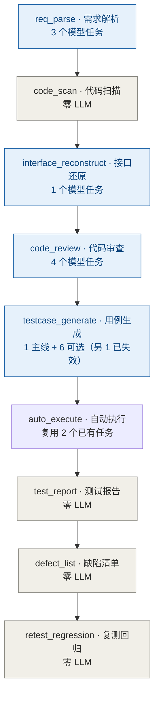
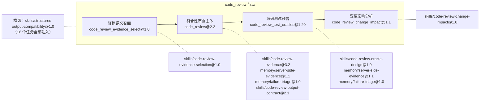

# 20 节点 · 模型任务 · Skill 映射

> 口径：**以代码为准**。映射来源是 `services/common/src/common/prompts_loader.py` 的
> `_NODE_KNOWLEDGE`（唯一决定「哪个任务注入哪些 skill」的地方）+ 各节点的 `load_prompt()`
> 调用点。表中版本号由 `load_prompt()` 实际返回的 `version` / `knowledge_refs` 打印得出，
> 非人工抄写。核对时间：2026-10-23。

一个关键概念先说清：**节点（node）≠ 模型任务（prompt）**。

- 9 个编排节点里，只有 **5 个**直接调 LLM；`code_scan` / `test_report` / `defect_list` /
  `retest_regression` 是**零 LLM 节点**。
- 反过来，一个节点可以包含**多个模型任务**：`req_parse` 3 个、`code_review` **4 个**、
  `testcase_generate` 2 个（+ 3 个可选子流程）。
- 每个模型任务 = 1 个 prompt 文件 + 一组**专属** skill/memory 注入。禁止把全部历史经验
  拼进每次调用（Token 膨胀 + 稀释当前任务约束）。

---

## 0 一页速查

| # | 节点 | 服务 | 模型任务数 | 产物 | LLM |
|---|---|---|---|---|---|
| 1 | `req_parse` | orchestrator | 3 | `requirement_review.json` + `requirement_items.json`（+ `requirement_diff.json`） | 是 |
| 2 | `code_scan` | orchestrator → java-parser | 0 | `code_inventory.json` | **零** |
| 3 | `interface_reconstruct` | orchestrator → java-parser | 1 | `interface_candidates.json` + `interfaces.json` + `change_set.json` | 是（其余程序化） |
| 4 | `code_review` | orchestrator | 4 | `review_mapping.json` | 是 |
| 5 | `testcase_generate` | test-executor | 2（+3 可选子流程） | `testcases.json` | 是 |
| 6 | `auto_execute` | test-executor | 0（复用单测/E2E 任务） | `execution.json` | 主要程序 |
| 7 | `test_report` | orchestrator | 0 | `test_report.md` + `metrics.json` | **零** |
| 8 | `defect_list` | test-executor | 0 | `defects.json` | **零** |
| 9 | `retest_regression` | test-executor | 0 | `regression_index.json` | **零** |

---

## 1 逐节点明细

### 1.1 `req_parse`（3 个模型任务）

调用顺序（同一节点内串行）：

| 顺序 | 模型任务 | prompt@版本 | 何时执行 | 失败口径 |
|---|---|---|---|---|
| ① | 双版本需求差异 | `requirement_diff@2.0` | **仅当**配置了基线需求（双版本比对） | 失败 → 节点失败（差异是后续追溯的前提） |
| ② | 需求条目提取 | `req_parse@2.1` | 总是 | 严格校验，缺 REQ/CLM 编号即失败 |
| ③ | 需求质量评审 | `requirement_review@2.0` | 总是（分批并发） | 只返回 findings；分数由程序派生 |

注入 skill/memory：

| 任务 | 注入（按顺序） |
|---|---|
| ① `requirement_diff` | `skills/requirement-diff-analysis@2.0` → `skills/structured-output-compatibility@1.0` → `skills/requirement-diff-output-contract@1.0` |
| ② `req_parse` | `skills/requirement-item-extraction@2.1` → `skills/structured-output-compatibility@1.0` → `memory/model-output-drift@2.2` → `skills/requirement-items-output-contract@1.0` |
| ③ `requirement_review` | `skills/requirement-output-stability@2.0` → `skills/structured-output-compatibility@1.0` → `memory/model-output-drift@2.2` → `skills/requirement-review-output-contract@2.0` |

> 输出契约类 skill 一律**最后注入**——把唯一允许的顶层 JSON 结构放在模型上下文末尾。

### 1.2 `code_scan`（零 LLM）

Java 仓库走 java-parser `/scan`（git diff → 文件清单 → `target_sha` / `changed_lines`）；
Python 仓库走内置 AST 扫描器（`python_scan`），同口径产出。四态：`ok` / `empty` /
`truncated` / `error`。**没有任何 prompt 参与**——这节点的结论完全由程序决定。

### 1.3 `interface_reconstruct`（1 个模型任务）

| 模型任务 | prompt@版本 | 说明 |
|---|---|---|
| 接口语义补全 | `interface_reconstruct@1.6` | 输入 java-parser 静态候选（含 `method_body` / `parameter_evidence` / `code_spans` / `change_evidence`），分批送入 |

注入：`skills/interface-reconstruction@1.0` → `skills/structured-output-compatibility@1.0` → `skills/interface-output-contract@1.0`

**本节点的模型任务只负责「语义补全」**，以下全部是程序化（不烧 LLM）：

- 候选定位与 `related_files` / `code_spans` / `change_evidence`（java-parser AST）
- 按变更证据过滤（`level ∈ body|callee|file|related_file`，解析不完整时保守纳入并打标）
- 扫描完整性门禁（`stats` 与 `code_inventory.file_count` 对账，不守恒 → 硬拦/告警）
- 落 `change_set.json`；`interfaces.json` 的溯源字段由代码回填，不经模型

### 1.4 `code_review`（4 个模型任务，同一节点内按序）

| 顺序 | 模型任务 | prompt@版本 | 作用 | 退化口径 |
|---|---|---|---|---|
| ① | 证据语义召回 | `code_review_evidence_select@1.0` | 每个 claim 批次从证据目录挑 EVD（中转站无 embedding，只能靠模型语义判断） | 返回空/失败 → 退回词面重合召回（`_select_evidence_for_claims`） |
| ② | 符合性审查主体 | `code_review@2.2` | 逐 claim 判定 satisfied / not_satisfied / undetermined，结论必须引用 EVD | 校验失败重试；不足即「无法判断」，禁止猜 |
| ③ | 源码测试预言 | `code_review_test_oracles@1.20` | 从实现证据抽可执行 oracle（请求条件 + 响应断言 + 分支） | 无 oracle 的接口 → 留缺口并告警，不编造 |
| ④ | 变更影响分析 | `code_review_change_impact@1.1` | 变更总评 + 接口级回归影响 + 盲区归因 | **失败回退纯程序视图**（`change_scope` 本身是程序派生的） |

④ 的触发条件：`_change_scope_available(inventory)` 且 `change_scope / unmatched / removed_files` 非空。

| 任务 | 注入（按顺序） |
|---|---|
| ① 证据召回 | `skills/code-review-evidence-selection@1.0` → `skills/structured-output-compatibility@1.0` |
| ② 主体 | `skills/code-review-evidence@3.2` → `skills/structured-output-compatibility@1.0` → `memory/server-side-evidence@1.1` → `memory/failure-triage@1.0` → `skills/code-review-output-contract@2.1` |
| ③ 测试预言 | `skills/code-review-oracle-design@1.0` → `skills/structured-output-compatibility@1.0` → `memory/server-side-evidence@1.1` → `memory/failure-triage@1.0` |
| ④ 影响分析 | `skills/code-review-change-impact@1.0` → `skills/structured-output-compatibility@1.0` |

> 一个节点 4 次调用，靠 `llm_calls.jsonl` 的 `prompt_file`（`name@version`）区分——
> 排查时必须看这一列，否则「这是哪次调用的锅」说不清。

### 1.5 `testcase_generate`（2 个主线任务 + 3 个可选子流程）

主线：

| 顺序 | 模型任务 | prompt@版本 | 说明 |
|---|---|---|---|
| ① | 用例生成 | `testcase_generate@1.23` | 以**接口为分批边界**，每批只带相关需求/映射/oracle；程序校验参数结构与 oracle 绑定，违规重试 |
| ② | 测试点拆分维度补全 | `testpoint_derive@1.1` | ⚠️ **当前无生产调用点**（见 §4） |

注入（①）：`skills/functional-test-design@2.3` → `skills/structured-output-compatibility@1.0` → `memory/test-design-lessons@1.0` → `memory/failure-triage@1.0` → `skills/testcase-output-contract@1.8`
注入（②）：`skills/functional-test-design@2.3` → `skills/structured-output-compatibility@1.0` → `memory/test-design-lessons@1.0` → `skills/testpoint-output-contract@1.0`

可选的 E2E 子流程（`e2e.generate_cases`，**失败只降级不拖垮节点**）：

| 顺序 | 模型任务 | prompt@版本 | 注入 |
|---|---|---|---|
| E1 | 场景规划 | `e2e_scenario_plan@2.0` | `skills/e2e-scenario-planning@1.0` + `structured-output-compatibility@1.0` |
| E2 | 页面定位 | `e2e_grounding@2.0` | `skills/e2e-page-grounding@1.0` + `structured-output-compatibility@1.0` |
| E3 | 用例生成 | `e2e_testcase_generate@2.0` | `skills/e2e-automation@3.0` → `skills/e2e-case-design@1.0` → `structured-output-compatibility@1.0` → `memory/e2e-environment@1.0` → `memory/failure-triage@1.0` → `skills/e2e-output-contract@2.0` |
| E4 | 用例复核 | `e2e_case_review@1.0` | `skills/e2e-automation@3.0` → `skills/e2e-case-review@1.0` → `structured-output-compatibility@1.0` → `skills/e2e-output-contract@2.0` |

可选单测子流程（`job_input.generate_unit_tests`）：

| 顺序 | 模型任务 | prompt@版本 | 注入 |
|---|---|---|---|
| U1 | 单测场景规划 | `unit_test_plan@1.0` | `skills/unit-test-scenario-planning@1.0` + `structured-output-compatibility@1.0` |
| U2 | 单测源码生成 | `unit_test_generate@1.6` | `skills/unit-test-source-generation@1.0` → `structured-output-compatibility@1.0` → `memory/failure-triage@1.0` |

### 1.6 `auto_execute`（节点本身不新增 prompt）

执行是程序化的（HTTP / Playwright），但会**复用两个已注册的模型任务**：

- `unit_test_generate@1.6`：`run_controlled_unit_coverage` —— 单测覆盖补生成含编译错误修复（`llm_repair`）
- `e2e_relocate@2.0`：E2E 用例执行中**定位漂移**时重定位（注入 `skills/e2e-control-relocation@1.0` + `structured-output-compatibility@1.0`）；`llm is None` 时直接放弃重定位

### 1.7 `test_report` / `defect_list` / `retest_regression`（零 LLM）

- `test_report`：全部数值由 `execution.json` 程序化汇总。**流水线第一个零 LLM 节点**（无 prompt），报告里的数字不可被模型改写。
- `defect_list`：DEF 编号程序分配，仅 `failure_kind=assertion` 进清单，环境失败隔离。模块注释明写「全程序化节点（无 Prompt，数值/溯源不经 LLM）」。
- `retest_regression`：复测 = 重跑关联用例；归档 = 移动 + 版本递增。无 `llm` 参数。

---

## 2 Skill 清单（27 个文件）→ 消费方

| Skill 文件 | 版本 | 被哪个模型任务消费 |
|---|---|---|
| `structured-output-compatibility` | 1.0 | **全部 16 个任务**（横切：结构化输出兼容治理） |
| `requirement-item-extraction` | 2.1 | `req_parse` |
| `requirement-items-output-contract` | 1.0 | `req_parse` |
| `requirement-output-stability` | 2.0 | `requirement_review` |
| `requirement-review-output-contract` | 2.0 | `requirement_review` |
| `requirement-diff-analysis` | 2.0 | `requirement_diff` |
| `requirement-diff-output-contract` | 1.0 | `requirement_diff` |
| `interface-reconstruction` | 1.0 | `interface_reconstruct` |
| `interface-output-contract` | 1.0 | `interface_reconstruct` |
| `code-review-evidence-selection` | 1.0 | `code_review_evidence_select` |
| `code-review-evidence` | 3.2 | `code_review` |
| `code-review-output-contract` | 2.1 | `code_review` |
| `code-review-oracle-design` | 1.0 | `code_review_test_oracles` |
| `code-review-change-impact` | 1.0 | `code_review_change_impact` |
| `functional-test-design` | 2.3 | `testcase_generate`、`testpoint_derive` |
| `testcase-output-contract` | 1.8 | `testcase_generate` |
| `testpoint-output-contract` | 1.0 | `testpoint_derive` |
| `e2e-scenario-planning` | 1.0 | `e2e_scenario_plan` |
| `e2e-page-grounding` | 1.0 | `e2e_grounding` |
| `e2e-automation` | 3.0 | `e2e_testcase_generate`、`e2e_case_review` |
| `e2e-case-design` | 1.0 | `e2e_testcase_generate` |
| `e2e-case-review` | 1.0 | `e2e_case_review` |
| `e2e-output-contract` | 2.0 | `e2e_testcase_generate`、`e2e_case_review` |
| `e2e-control-relocation` | 1.0 | `e2e_relocate` |
| `unit-test-scenario-planning` | 1.0 | `unit_test_plan` |
| `unit-test-source-generation` | 1.0 | `unit_test_generate` |
| `regression-candidate-policy` | — | **未注入（格式不合规 + 逻辑已程序化）**，见 §4 ② |

## 3 记忆文件（`prompts/memory/`）→ 消费方

| 记忆文件 | 版本 | 消费任务 |
|---|---|---|
| `model-output-drift` | 2.2 | `req_parse`、`requirement_review` |
| `server-side-evidence` | 1.1 | `code_review`、`code_review_test_oracles` |
| `failure-triage` | 1.0 | `code_review`、`code_review_test_oracles`、`testcase_generate`、`e2e_testcase_generate`、`unit_test_generate` |
| `test-design-lessons` | 1.0 | `testcase_generate`、`testpoint_derive` |
| `e2e-environment` | 1.0 | `e2e_testcase_generate` |
| `deployment-reliability` | 1.2 | **按设计不注入**（P2-04：运维规则不进业务生成 Prompt），人工阅读存档 |

---

## 4 核对出来的问题（已登记为 `docs/14` 的 OPT-KNW-01~07）

> 跟踪与验收口径见 `docs/14_系统优化任务清单.md` 的「节点 · 模型任务 · Skill 映射治理」专项。
> 下面三条是**问题**，另外四条（映射表手工维护、失败归因粒度、候选体量、`call_graph_incomplete`
> 判据失效）是**优化点**，一并登记在 14 清单里。

### ① `testpoint_derive` 已是死代码（prompt + 2 个 skill 白挂）→ OPT-KNW-01

`testcase_generate.py:2515` 定义了 `_enrich_testpoint_hints()`，但**生产路径无任何调用点**
（只有 `tests/` 在测它）。run 流程里测试点由 `_derive_testpoints()` 纯程序派生
（`testcase_generate.py:223`，注释明确「不再按提示维度条数补产用例」）。

影响：`prompts/testpoint_derive.md@1.1`、`skills/testpoint-output-contract@1.0`
在真实任务中从不加载，`llm_calls.jsonl` 也不会有该子阶段。要么接回调用点，要么连同
prompt/skill/测试一起删——现状是「看起来有、实际没跑」。

### ② 两个未被注入的知识文件：一个是有意，一个是放错了位置 → OPT-KNW-03

先纠正一处：**`memory/deployment-reliability.md` 不是孤儿**。P2-04 明确写了「该类运维规则
不注入业务生成 Prompt」，它是有意的运维存档（人工阅读用），加载器不引用是正确的。

真正的错位是 **`skills/regression-candidate-policy.md`**：

- 它放在 `prompts/skills/`（受控知识的目录），但**没有 `---` 元信息块**，只有正文里一句
  「版本：2.0」——而加载器要求 `version` + body，格式上就进不了注入通道。
- 内容（回归准入 / 排除 / 维护）在 `retest_regression.py` 里是**程序化实现**的
  （F-REG-01~04），本来也不该交给模型判断。
- 结果：它既不会被注入，也不被代码读取，只是躺在受控知识目录里，容易被误读成
  「回归策略已由模型把关」。

处置建议：挪到 `docs/`（当规则说明书），或在 `prompts/skills/` 保留但在文件头标注
「归档，不注入」。不宜补 frontmatter 后注册给某任务——回归准入是确定性判定，
交给模型反而引入不确定性。

### ③ `code_review` 一节点 4 任务，排障必须看 `prompt_file` → OPT-KNW-05

4 次调用共用同一节点的失败上报通道。定位问题时先看 `llm_calls.jsonl` 的
`prompt_file`（形如 `code_review_test_oracles@1.20`），否则会把「oracle 抽取失败」
误读成「审查主体失败」。

### ④ 根因：映射表本身没有一致性校验 → OPT-KNW-02

①② 能被发现，靠的是这次逐行核对；`_NODE_KNOWLEDGE` 没有测试守着，「映射键缺文件」
「skill 文件没人引用」「prompt 没注册」三类问题都不会报错。这是最该先做的一条——
做完后 ①② 会被自动拦下，④ 也就不必再靠人工过一遍。

---

## 5 新增 skill / prompt 的落点（照此办理）

1. 任务 prompt 放 `prompts/<name>.md`，头部元信息块必须有 `version` / `spec` / `owner` / `changelog`
2. 在 `_NODE_KNOWLEDGE` 里给 `<name>` 注册 skill 列表，**输出契约放最后一项**
3. skill 放 `prompts/skills/`，必须有 `version` 与正文（否则 `X-LLM-03` 直接失败，不静默退化）
4. 节点里用 `load_prompt(prompts_dir, "<name>")`，禁止代码内联 prompt 文本
5. 若同一节点新增子任务，`llm.complete()` 的第一个参数用**子阶段名**（如
   `"requirement_review"` 之于 `req_parse`），以便 `llm_calls.jsonl` 区分

---

## 附录 A 主链路示意（mermaid，GitLab / IDE 可直接渲染）

## 附录 B 单节点内多任务与注入（以 code_review 为例）

## 附录 C skill 复用度（改动影响面排序）

| skill | 被注入任务数 | 使用方 |
|---|---|---|
| `structured-output-compatibility@1.0` | **16 / 16** | 全部任务（横切，勿裁剪） |
| `failure-triage@1.0` | 5 | 审查 · 预言 · 用例 · E2E · 单测 |
| `functional-test-design@2.3` | 2 | 用例生成 · 拆分维度（后者已失效） |
| `test-design-lessons@1.0` | 2 | 用例生成 · 拆分维度（后者已失效） |
| `e2e-automation@3.0` | 2 | E2E 生成 · E2E 复核 |
| `e2e-output-contract@2.0` | 2 | E2E 生成 · E2E 复核 |
| `model-output-drift@2.2` | 2 | 需求差异 · 需求评审 |
| `server-side-evidence@1.1` | 2 | 审查 · 预言 |
| 其余 18 个 | 1 | 单任务专属 |

> 改 `structured-output-compatibility` 等于改全部 16 个任务的输出纪律 —— 必须全量回归。
> 改 `failure-triage` 影响 5 个任务，且这 5 个都是「判断失败归因」的任务，回归重点在
> 环境失败与断言失败的分界。
