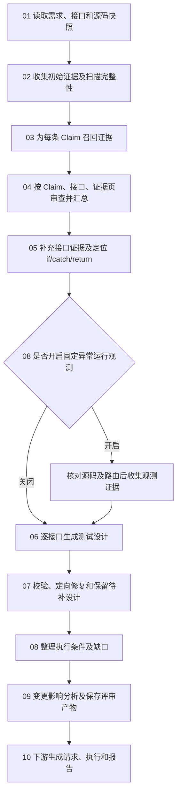

# Code Review 逻辑说明目录

更新日期：2026-10-20。本文档组描述当前工作区实现，入口为 `run_code_review`，不是未来重构方案或全量验收报告。

## 阅读顺序

| 顺序 | 文档 | 回答的问题 | 是否调用 LLM |
| --- | --- | --- | --- |
| 01 | [输入读取与源码快照](01-input-and-source-snapshot.md) | 审查什么需求、什么接口、哪个版本的代码？ | 否 |
| 02 | [初始证据与扫描完整性](02-evidence-and-scan-coverage.md) | 读到哪些代码，哪些范围缺失？ | 否 |
| 03 | [需求证据召回](03-claim-evidence-selection.md) | 哪些源码与一条需求有关？ | 是 |
| 04 | [需求符合性审查与汇总](04-claim-assessment.md) | 需求实现了多少，依据是什么？ | 是，汇总由程序完成 |
| 05 | [接口证据补齐与分支定位](05-interface-evidence-and-branches.md) | 接口有哪些处理路径，条件来自哪里？ | 否 |
| 06 | [接口测试设计生成](06-test-design-generation.md) | 每个接口应该设计哪些测试场景？ | 是 |
| 07 | [设计归一、校验与修复](07-validation-and-repair.md) | 模型设计能否被源码支持？错误如何处理？ | 校验由程序完成，修复调用 LLM |
| 08 | [执行条件与可选运行观测](08-execution-readiness.md) | 设计目前能不能执行，缺什么？ | 否 |
| 09 | [变更影响与评审产物](09-change-impact-and-artifacts.md) | 改动影响什么，最终保存什么？ | 影响说明可调用 LLM |
| 10 | [交接用例生成、执行与报告](10-generation-execution-and-report.md) | 为什么设计保留了，却没有发出请求？ | 后续用例生成调用 LLM |
| 11 | [模型传输、续接与留痕](11-model-transport-and-audit.md) | 如何分批、避免截掉内容并追溯原始回答？ | 全流程公共机制 |

每份步骤文档分别记录目的、输入输出、处理过程、失败处理、示例、当前限制和代码入口。步骤 07 是步骤 06 内部反复使用的机制；步骤 08 的运行观测实际在步骤 06 前按配置执行。编号用于阅读，不表示每一步都只运行一次。

## 主流程

步骤 11 的传输与审计机制适用于图中所有模型调用。

## 核心概念

| 名称 | 含义 |
| --- | --- |
| Requirement | 一项需求，可以包含多条独立声明 |
| Claim | 可单独判断是否实现的需求声明 |
| Evidence / EVD | 带编号、接口归属、文件位置和源码原文的证据 |
| Branch | 当前提取出的 `if` 条件、控制器 `catch` 或最终 `return` 出口，以 `branch_id` 定位；if 区分条件成立/不成立 |
| Oracle | 一份源码支持的测试设计，包含输入前提、状态条件、响应预期和证据 |
| Integration entry | 普通有效请求的 HTTP/结构检查，不声明某个内部业务分支已覆盖 |
| Preconditions | HTTP 请求可以设置的条件 |
| State conditions | 下游返回、应用配置、服务注册状态或测试数据等条件 |
| Execution readiness | 设计是否具备执行条件，和设计有没有源码依据分别判断 |

## 需要始终区分的结果

1. 需求在源码中已实现，不代表其每条测试都已经执行。
2. 测试设计有依据，不代表当前环境能制造所需状态。
3. 请求已经发出，不代表响应契约已确认或目标业务分支已触达。
4. HTTP/结构检查通过，不自动算作业务需求覆盖。
5. 源码内容被完整分页发送，不保证模型已理解跨页逻辑。

## 当前限制

- 调用方法补充有范围限制，跨方法参数绑定、动态分派不完整。
- 分支目录覆盖 if 条件和控制器 catch/最终 return，尚非完整控制流图。
- 需求审查先进行，随后才补充测试设计专用证据；两轮最终看到的证据不完全一致。
- 尚无完整的分支逐项对账与补产机制，模型仍可能遗漏设计。
- 执行准备和部分逻辑判断仍使用启发式规则及提示文本；不是完整的 Java 语义证明。
- 每轮验收结果需单独记录。2026-10-20 09:04 的任务已完成公司模型全流程；随后报告/告警统计的改动另行核对，不能据历史请求数量宣称新的业务分支已经通过。

## 实现与历史记录

- [Code Review 主实现](../../services/orchestrator/src/orchestrator/nodes/code_review.py)
- [模型审查提示词](../../prompts/code_review.md)
- [接口测试设计提示词](../../prompts/code_review_test_oracles.md)
- [逐条跳过原因排查](../testcases/execution-skips-2026-10-19.md)
- [修复与验证历史](../testcases/code-review-validation.md)
- [外部参考：codebase-graph-prd-rules 适用性评估](external-codebase-graph-prd-rules-assessment.md)（候选方案评估，尚未接入）
- [2026-10-20 最新任务耗时分析、并行调度与报告分组](../testcases/code-review-parallel-report-2026-10-20.md)（有界并行已实现，提速幅度尚未实测）
- [2026-10-20 候选自动处理与公司模型复核](../testcases/oracle-auto-resolution-2026-10-20.md)（12 接口预期与请求生成核对；不代表重跑 Claim 审查或业务执行）

后续代码逻辑变更必须在同次改动中同步更新受影响的步骤文档，尤其是输入输出、准入规则、统计口径和失败处理。历史验证记录继续放在 `docs/testcases/`，不要把某次运行数量写成恒定逻辑。
