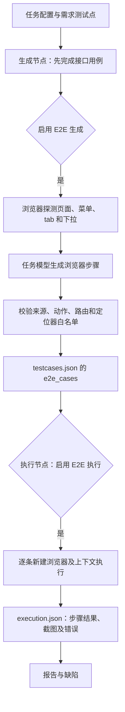

# E2E 用例生成与执行：重构前实现记录

记录日期：2026-10-20。本文保留重构前问题分析，已不是当前实现说明。新版流程、协议与限制见 [实现说明](implementation.md)，总体方案见 [重构方案](redesign.md)。

## 总体位置

E2E 挂在 testcase_generate 和 auto_execute 节点内，使用任务配置的 LLM 和鉴权配置；不是独立流水线。生成支线位于接口用例定稿之后，执行支线位于接口用例执行之后。当前接口生成路径若提前失败，不能单独走到 E2E 生成。

## 1. 配置

- base_url：被测前端地址。
- generate_cases / execute_cases：默认都关闭，可分别控制。
- auth_mode：browser 或 reuse；默认 browser。
- insecure_tls：默认 true。
- 探测默认最多 25 个路由、菜单 4 层、每 frame 收集前 400 个候选元素、每页最多保留 12 次交互；max_elements=0 可不限制元素数。
- 页面导航超时默认 15 秒，稳定等待默认 300 毫秒。
- browser_channel 能传给探测浏览器；当前执行浏览器没有对应参数。

入口：[api.py](../../services/orchestrator/src/orchestrator/api.py) 的 E2eConfig；[runner.py](../../services/orchestrator/src/orchestrator/runner.py) 向生成和执行节点传入配置。

## 2. 页面探测

1. 启动 Chromium，访问 `/`、`/login`。
2. 有鉴权且 explore_menu 开启时，通过页面输入账号、密码并登录。
3. 展开菜单，点击导航，收集落地路径；补充 a 标签 href。
4. 逐页收集主 frame 及子 frame 中的元素，转换成语义定位器；读取页面文本。
5. 点击 tab、展开下拉，收集真实选项。探测代码不提交业务表单。
6. 输出 surface：base_url、路径拼接说明、routes、selectors、visible_text、interactions、option_values 及告警。

当前有实际内容截取：每 frame 文本前 800 字符、下拉摘要前 1200 字符、单个下拉最多 60 项、菜单候选前 200 项等。路由按 path 去重保留第一份，因此匿名首页可能覆盖同路径的登录后状态。路由识别主要使用 URL pathname，未完整区分 hash、query 和页面状态。

入口：[e2e_surface.py](../../services/test-executor/src/executor/nodes/e2e_surface.py) 的 inspect_e2e_surface、_probe_authenticated、_probe_page。

## 3. 模型生成

模型输入为完整 surface 对象、需求条目、程序派生的测试点、auth_mode。主提示词要求关联有效 requirement_id/testpoint_id，程序从测试点回填 claim_id。

当前一次整体生成，代码固定 max_cases=12。没有按需求/页面分批补齐、逐分支覆盖对账或针对遗漏场景的补产机制。允许少产或空数组。

模型只生成用例描述与受限步骤，不生成任意可执行脚本。登录凭据使用 AUTH 占位符，运行时替换。

主提示词与附加输出契约存在冲突：主提示词要求 testpoint_id，附加 e2e-output-contract 的允许字段没有它；主提示词示例 expect_url 的 selector 为空字符串，附加契约要求不带 selector。解析器兼容后者差异，但要求有效测试点来源。这是当前弱模型输入中的真实不一致。

入口：[testcase_generate.py](../../services/test-executor/src/executor/nodes/testcase_generate.py) 的 _generate_e2e_cases；[主提示词](../../prompts/e2e_testcase_generate.md)；[附加契约](../../prompts/skills/e2e-output-contract.md)；[加载规则](../../services/common/src/common/prompts_loader.py)。

## 4. 校验与保存

允许动作：goto、click、fill、check、select、expect_text、expect_url。

- goto 必须来自已探测路径。
- 控件定位器必须逐字存在于已探测集合。
- 测试点必须存在，且属于对应需求。
- 整体 JSON 错误交给公共模型修复机制；单条用例非法时直接丢弃该条，汇总告警，不自动逐条修复或补产。
- 有效用例编号 E2E-001 等，保存到 testcases.json.e2e_cases；没有独立脚本文件。

当前定位器白名单合并了所有页面及所有 frame，未绑定具体页面、frame、tab 或弹窗状态。校验只证明某处探测过此定位器，不能证明当前步骤能够定位。

当前不强制必须有 expect 步骤；preconditions 与 expected 主要是文字，未自动转成准备动作和断言。

入口：_parse_e2e_cases。

## 5. 执行

开启 execute_cases 后，接口执行结束，再串行执行 e2e_cases。每条新建浏览器、上下文、页面，用例之间不共享浏览器会话；单步骤默认超时 10 秒。

browser 模式：执行模型生成的登录步骤，运行时替换用户名/密码占位符。reuse 模式：向页面同源请求注入已有鉴权头；没有自动把 API 会话变为浏览器 localStorage 状态。

动作直接调用 Playwright 语义定位器，goto 将 base_url 与 value 拼接。expect_text 检查元素文本包含 value；expect_url 仅检查 page.url 包含 value。expect_text 没有独立的“等待文本变为目标值”的重试断言。

所有步骤无异常即 passed=true。expected 的自然语言不会另行执行，所以只有点击、填写、跳转而没有 expect 的用例也可能通过。

当前执行只在顶层 page 上定位，没有 frame_locator；探测到 iframe 内控件不等于执行端能使用它。

入口：[auto_execute.py](../../services/test-executor/src/executor/nodes/auto_execute.py) 的 _execute_e2e_case、_run_e2e_step、_e2e_locator。

## 6. 判定、留痕与下游

- AssertionError 记断言失败。
- PlaywrightTimeoutError 和其它 PlaywrightError 记环境失败。因此控件消失、定位器失效导致的超时也可能被归到环境问题。
- 成功或失败均尝试保存最终页面截图、URL、标题、console/pageerror、请求失败记录。当前日志数量与文本有截取；未保存完整逐步骤结果、trace/video 或业务接口响应。
- console 错误与请求失败作为证据保存，不自动让用例失败。
- execution.json 与接口结果合并，并按 api/e2e 分解汇总；前端可单独查看 E2E 报告和截图。
- 缺陷节点识别 E2E 来源；当前自动回归归档代码明确跳过 E2E，与提示词中“两次通过后沉淀回归”的描述尚不一致。
- E2E 生成/探测失败通常记告警，不连带使已生成的接口用例失败；这也意味着主节点 completed 不能证明 E2E 已完整生成。

## 当前梳理结论

链路具备真实页面探测、需求关联、受限步骤、浏览器执行和截图留痕。但以下环节还没有形成闭环：

1. 需求到页面/状态的完整覆盖与分批生成。
2. 页面、frame、控件状态到执行定位器的对应。
3. 文字预期到可执行断言、前置数据到可执行准备动作。
4. 用例生成失败后的逐项修复及补产。
5. 完整页面内容、逐步骤执行证据与正确失败归因。
6. E2E 回归资产的实际归档机制。

本文描述现状；这些缺口未因写入文档而修复。后续修改代码时应同步更新相关步骤及本节结论。
