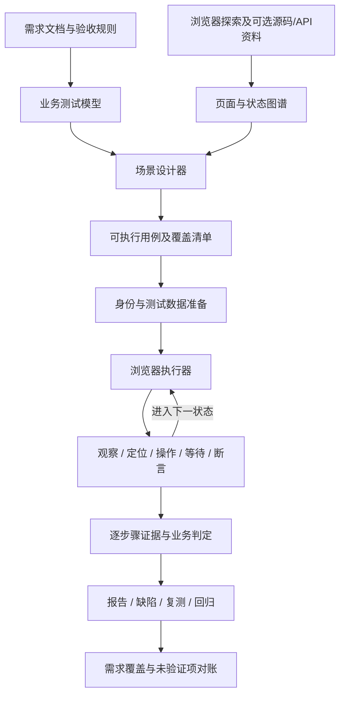

# E2E 重构方案：从需求到执行、证据与缺陷的完整流程

日期：2026-10-20。状态：业务用例协议、独立生成/执行、证据报告、缺陷复测及回归快照已实现；实际实现边界与验证记录见 [实现说明](implementation.md)。本文保留整体目标，未在实现说明确认的能力不能视为已验收。重构前记录见 [历史说明](generation-and-execution.md)。

## 一、产品目标与交付边界

以功能测试人员的一次完整测试工作为任务单元：理解需求，识别业务页面，设计场景，准备数据和身份，操作系统，核对业务结果，保留截图和过程证据，生成报告及缺陷，关联复测与回归。

每个需求点应能回答：设计了什么场景、执行到哪一步、检查了什么、结果是什么、证据在哪里、存在什么缺陷、哪些内容尚未验证以及原因。一个按钮能点击、全部动作未报错或页面可打开，不足以判定业务验证通过。

被测前端地址、测试账号及环境控制方式属于执行配置，不是整体架构设计的前置条件。

## 二、总体架构

E2E 建立独立的需求模型、任务状态及产物，不以接口用例生成成功、API oracle 完整或后端源码可得作为启动条件。它可复用公共需求解析、模型客户端、任务编排和产物存储。

源码和接口资料用于辅助识别控件、准备数据、解释失败，不能成为所有页面场景的必选门槛。接口测试设计与 E2E 测试设计分别统计。

## 三、需求理解：建立业务测试模型

### 输入

需求说明、验收标准、角色权限、流程规则、字段约束、业务字典及可选历史缺陷。每条规则保留原始来源及版本。

### 输出

- 功能与业务对象，例如审批设置、规则、申请记录。
- 角色及可执行动作。
- 流程状态与迁移条件。
- 字段、枚举、跨字段规则。
- 可检验的业务结果。
- 场景类型：正常、边界、异常、权限、状态流转、数据一致性。

规则缺失或冲突时自动回查资料。仍无法确认的预期保留为待判定，不从系统当前显示的结果倒推“正确答案”。

测试点以业务能力和需求声明为基础，不依照“需求 × 接口”机械展开。用具体约束选择边界及组合，不靠维度数量、固定条数或大量重复输入填覆盖。

## 四、系统探索：建立页面与状态图谱

### 页面不能只由 URL 标识

页面状态至少由路由、窗口、frame、角色、当前 tab、弹窗、业务对象状态及关键筛选条件共同标识。同路径的未登录、已登录、空列表、编辑弹窗分别保存。

### 探索内容

菜单与导航、iframe 与微前端、tab、弹窗、表单、表格及分页、动态和虚拟列表、下拉字典、禁用状态、校验提示、上传下载入口及多窗口。

### 输出

稳定页面/状态编号、frame 与窗口归属、控件语义、标签与可访问属性、定位候选、可到达动作、状态转移、页面截图及探测证据。每个控件必须保留其所在状态，不能汇成跨页面通用定位器集合。

探索支持按需求定向深入和执行过程中补充，不要求在设计前把所有业务状态制造完。探索本身以导航、展开及读取为主；会改变业务数据的动作进入有数据准备及清理计划的执行阶段。

### 完整内容与模型容量

取消前 800 字符、前 1200 字符及前 N 控件等静默截取。完整观察原文、截图、网络与 DOM 资料保存在证据存储中。

调用前将内容按业务组件、页面状态和规则分页；每页保留上下文、来源编号与页清单。模型需要跨页内容时按引用补读。所有页的处理状态必须对账，失败页不能作为“无相关内容”忽略。探索预算用尽时显式保留未探索节点，任务可以续跑。

模型输出按单个场景、单个步骤决策等有界单元生成；使用任务现有完整传输与续接机制。输入、返回与续接完整留痕，不用减少需求或裁掉内容满足长度限制。

## 五、场景设计：生成业务用例

### 每条用例的必要内容

| 内容 | 作用 |
| --- | --- |
| 需求/规则来源 | 说明为什么需要这条用例 |
| 业务目标与场景类型 | 区分正常、边界、异常、权限与状态流转 |
| 角色与初始状态 | 明确用谁的身份、在什么数据状态开始 |
| 数据准备与清理计划 | 明确如何构造输入及清理本次数据 |
| 操作步骤 | 业务意图、目标状态、控件定位、输入与变量 |
| 可执行断言 | 明确检查对象、操作符、预期值或关系、依据及检查时机 |
| 最终业务后置条件 | 例如保存后重新查询仍存在，禁止只验证瞬时提示 |
| 证据要求 | 每一步、关键状态及失败时应保存什么 |
| 执行条件 | 当前是否有数据、角色和控制能力 |

至少包含与该业务目标关联的可执行断言；不接受只有文字 expected 或只打开首页的“业务通过”。没有完整依据时仍保留设计及缺口，不强造预期。

### 分批方式

先按业务规则规划场景清单，再按场景与页面状态生成操作和断言；各场景可有界并行。同一业务流程内存在依赖的步骤保持顺序。没有固定全局 12 条上限。

### 两种正确性来源

1. 预期来自需求、业务验收规则及经确认的通用交互规则。
2. 定位及操作可达性来自真实系统观察。

真实页面上存在某选项只证明实际情况；需求要求另一选项时应形成差异检查，而不是把实际值当预期。

### 不完整候选的系统处理

自动补查页面状态、修正定位登记、拆开合并场景，并向同一公司模型做定向修复。逐条保存错误与修复关系，最终按需求点、计划场景和有效用例对账。不会仅丢掉候选而把节点标为完整成功。

## 六、身份、数据与外部条件

每次运行建立唯一 run_id、数据标记和数据台账。数据准备可以使用受控 API、浏览器业务流程及已有环境能力，保存生成的业务 ID 和变量。用例复用这些真实 ID，不猜历史记录。

身份支持浏览器登录、Cookie/storage 会话恢复、多角色隔离及多窗口业务协作；探测与执行使用同一身份策略和浏览器配置。令牌、密码只在运行时使用，证据按统一规则脱敏。

前置条件必须由准备动作或实际观测核验。仅有“存在待审批记录”等文字，不能默认条件已满足。清理在 finally 阶段执行，失败时保存未清理对象，不能悄悄污染下一条用例。

正常联调使用实际环境。指定下游异常、缺失注册项或特殊状态只阻断相应场景，保留条件化设计。Mock 为可选控制能力，本方案不把接线 mock 作为普通 E2E 的门槛。

## 七、自适应浏览器执行

### 每一步的执行循环

1. 读取当前窗口、frame、DOM、截图及相关网络状态。
2. 核对前置页面状态与准备条件。
3. 把业务意图绑定到当前真实控件和准确 frame。
4. 保存操作前证据。
5. 执行浏览器动作。
6. 按加载、元素、响应或业务状态等待，不用固定休眠推测完成。
7. 执行该步断言，记录实际值。
8. 保存操作后与断言证据，进入下一步。

模型负责业务理解、候选定位和复杂状态判断；程序负责动作执行、边界、断言计算、重试次数、计时和统计。业务推理、补查和修复均调用任务配置的公司模型。

### 能力范围

导航、多窗口、iframe、弹窗、输入、键盘、勾选、原生与组件下拉、分页、滚动、拖拽、上传下载、数据提取、变量传递、可见/隐藏/禁用/选中状态、文本/值/数量、列表数据、业务响应及状态流转断言。

### 自动恢复规则

页面尚在加载时继续等待；控件位置变化时重新观察，按同一语义重新定位；窗口或 frame 改变时更新上下文。只修复执行路径与定位，不改需求预期、测试输入含义或断言强度。

提交、删除、审批等动作结果不明时先查询操作结果或幂等标记，禁止盲目重点击。不能确认是否执行过时保留不确定结果。

## 八、业务判定与失败分类

优先使用可计算断言：精确文本、值、集合、数量、可见性、持久化查询、接口响应关系、跨步骤不变量。需要语义判断时提供需求原文和实际证据，要求结构化结论、引用与不确定性；仍有歧义则待判定。

截图用于每条用例的可视证据。自动视觉语义比较依赖公司模型确实具备图像能力或专用比较器；不能假设纯文本模型能够看图，也不切换为本助手模型。布局可用可计算的元素位置与样式检查；没有能力的视觉项单独显示待判定。

结果分为：通过、业务断言失败、环境失败、自动化执行问题、前置条件阻断、已执行待判定、未执行。用定位器失败直接认定产品缺陷，或将所有控件超时都记作环境故障，都会造成错误归因。

断言失败结合准备结果、执行状态和证据形成缺陷；自动化问题保留独立待处理记录。少执行、无断言、证据缺失不能隐藏在通过数中。

## 九、证据系统

以 run_id/case_id/step_id 为目录保存：

- 操作前、操作后、断言及失败截图。
- 步骤意图、实际操作、窗口/frame、定位器、时间和耗时。
- 每条断言的依据、预期、实际及结果。
- 浏览器 console、页面异常、网络请求与响应、下载文件及必要的数据校验。
- 页面状态/DOM 资料、浏览器 trace 和复现所需环境版本。
- 数据准备、身份准备和清理记录。

完整文件进入证据存储，页面按需加载；界面摘要不能替代原文。截图中的密码和敏感输入遮罩，认证头、令牌等脱敏；脱敏规则与处理记录独立于内容截取。证据保存失败应明确标识证据不完整，不静默消失。

## 十、报告、Bug 与回归

### 报告

顶部分别显示计划场景、有效用例、已执行、通过、业务失败、环境/自动化问题、阻断、待判定及未执行。总数可对账；浏览器业务用例数、操作步数和网络请求数分别统计。

按功能、需求、角色、页面、场景类型、优先级和结果筛选。正常/边界/异常使用不同类型标记，通过/失败保留独立结果标记。

每条用例均能展开时间线，直接查看每步截图、输入、实际结果和断言；失败步骤自动展开。通过用例也展示完整证据。支持导出包含报告、用例、缺陷和证据索引的结果包。

### Bug 记录

自动保存标题、功能、需求、角色、环境、前置数据、精确复现步骤、失败步骤、预期、实际、截图及网络证据、关联用例与运行、严重程度及判断依据。相同证据指纹进行归并，保留不同运行的出现记录，不覆盖历史。

默认记录在本工具内。连接外部缺陷平台属于另行配置的集成能力。

### 复测和回归

缺陷直接关联原用例及修复前证据，复测重新准备数据执行同一业务目标，保存结果历史。回归资产保存需求版本、用例版本、定位依据、数据策略和稳定性记录，具备失效与重新探索机制；不能只有提示词中的文字承诺。

## 十一、弱模型与程序的职责

| 公司模型 | 程序 |
| --- | --- |
| 理解业务规则、规划场景 | 保存来源、编号及版本 |
| 需求与页面能力关联 | 完整观察、分页与处理清单 |
| 单场景设计、当前步骤决策 | 执行浏览器工具和等待 |
| 重新定位、失败解释 | 断言计算与不可变预期 |
| 复杂语义结论与来源引用 | 状态、重试、证据、统计和对账 |

采用多个小而完整的任务、明确输出协议、真实工具反馈及定向修复，避免要求弱模型一次理解全部系统并输出长步骤清单。数据与动作结果保存在系统中，模型不用靠聊天历史记忆整个任务。

## 十二、工程拆分与交付

建议的模块边界是后续代码工作的实施方案：

| 模块 | 责任 |
| --- | --- |
| e2e/domain | 需求规则、场景、用例、状态及断言协议 |
| e2e/explorer | 页面/状态图谱、frame、控件与完整观察 |
| e2e/planner | 需求场景规划、逐场景生成、修复与覆盖对账 |
| e2e/fixtures | 身份、数据准备、变量与清理 |
| e2e/runtime | 动作、等待、断言、自适应定位与分类 |
| e2e/evidence | 每步截图、日志、trace、网络与文件索引 |
| e2e/reporting | 可视报告、Bug、复测与回归 |

现有大节点保留编排入口，具体职责迁入独立模块。共享模型传输、任务授权、存储和前端基础组件继续复用。

交付包含上述全部流程。开发可以按协议、探索设计、执行证据、报告缺陷、公司模型实测的依赖顺序推进，但最终验收必须贯通业务闭环，不能用其中一个模块完成代替整体完成。

## 十三、贯通验收场景示例

以“新增审批设置并能重新查询到”为示例，具体业务规则在实测时来自真实需求：

1. 从需求提取字段约束、重复规则及可见结果。
2. 探索列表、入口、表单、下拉和弹窗所在 frame。
3. 设计正常新增、必填缺失、边界、重复和权限等适用场景。
4. 准备唯一业务数据、指定角色及必要前置记录。
5. 填写和提交，核对提示、保存响应、重新查询后的持久化结果。
6. 每一步保留截图，业务断言保留实际值与来源。
7. 发生失败时自动保存完整 Bug；成功和未执行场景均进入报告。
8. 清理本轮数据；复测可再次运行并关联历史。

验收还必须包含：iframe 控件、多窗口、动态弹窗、故意制造的已知业务失败、定位器变化恢复、前置不满足、公司纯文本模型的视觉能力边界、完整内容分页及大规模需求续跑。结果与同一需求包的手工测试清单逐项对照，分别衡量设计覆盖、执行覆盖、断言有效性、缺陷发现及证据完整性。
